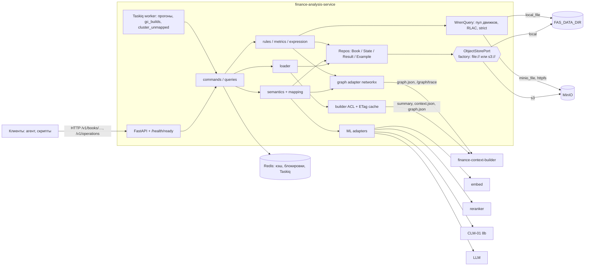
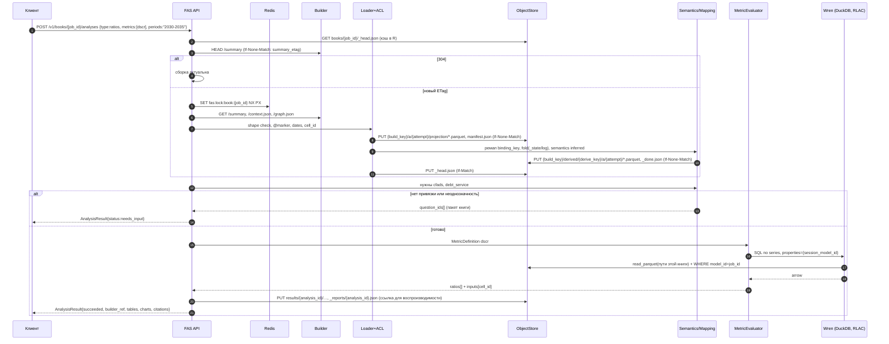

# finance-analysis-service (FAS): дизайн сервиса

> Версия 0.23 · 2026-10-23 · единственный основной документ по FAS.
> Заменяет `finance-analysis-service-architecture.md` (v0.1) и прежние редакции этого файла (`.v1.md`–`.v21.md`, `design-v0.22.md`; вариант на Postgres — `.v4-pg.md`).
> Входной контракт сверен с кодом `x0r1x/finance-context-builder` @ `8f0b1b9` (2026-10-23 08:55 MSK); форма `context 1.14.0`, `graph 1.7.0` и `summary-2` не менялась с `8a1f16b`. Wren — `Canner/WrenAI` `core/wren` 0.16.0 (PyPI `wrenai`).
> Пометки: **[код]** — проверено в коде или локальным запуском; **[допущение]** — проектное решение или непроверенная гипотеза.
>
> **Что изменилось в 0.4:** Postgres, SQLAlchemy, Alembic и UoW убраны. Всё хранение идёт через один `ObjectStorePort` с двумя адаптерами: `local` (по умолчанию `FAS_DATA_DIR`) и `s3` (AWS S3 или S3-совместимое: MinIO, Ceph). Раскладка ключей на обоих одинаковая. Данные хранятся в Parquet, изменяемое состояние — в журнале событий. Wren читает Parquet через `local_file` или `s3_file`/`minio_file`. См. §4, §7, §10.
>
> **Что изменилось в 0.5 (решения пользователя):** прод-S3 = MinIO → Wren `minio_file`. Redis обязателен во всех развёртываниях: без `FAS_REDIS_URL` сервис не стартует, фолбэки без Redis удалены. Хранение: последние 3 сборки на книгу + сборки, на которые ссылаются выданные отчёты; GC — фоновая задача (§4.10).
>
> **Что изменилось в 0.6 (решения пользователя + проход по источникам, ссылки — в «Источники»):**
> - §14: все 12 вопросов закрыты решениями пользователя;
> - §6.1: реестр правил сверен с FAST и ICAEW Code; добавлено 10 правил, поле `error_class` по таксономии Panko, пересмотрены severity;
> - §5.7/§6.2: DSCR/ADSCR/min/avg, LLCR/PLCR приведены к отраслевым определениям (Forvis Mazars): окно и кэп CFADS, DSRA, период расчёта, крайние случаи;
> - §5.6: калибровка — старт без калибратора, затем Platt → isotonic по объёму данных, temperature scaling для CLM, пороги по risk–coverage;
> - §4.6: Redis-блокировка признана «блокировкой эффективности», корректность — fencing-токен в `_head.json` (Kleppmann);
> - §4.11: обосновано, почему не Delta/Iceberg;
> - §7.1/§7.3: офлайн-установка httpfs по документации DuckDB, кэши метаданных;
> - очередь: **arq → Taskiq** (arq в режиме maintenance-only);
> - §10.3: адаптер rerank под форматы Cohere/Jina/vLLM и TEI;
> - §13: риск «MinIO community в режиме maintenance, репозиторий архивирован»;
> - §5.1: OSI-экспорт и xref на IFRS Taxonomy.
>
> **Что изменилось в 0.7 (запрос пользователя: глоссарий в S3, доступ из Spark/Trino/Impala/Airflow, строки вне глоссария; ссылки — в «Источники»):**
> - §5.9 **(новое)**: глоссарий и таксономия хранятся в том же object store, что и остальные данные FAS (S3/MinIO или локальный диск). Базовый пакет живёт в git (YAML), рабочие правки — журнал событий в `glossary/`, публикация — неизменяемый релиз + `glossary/_head.json` через CAS. Модель меток — по SKOS (`prefLabel`/`altLabel`/`hiddenLabel` с языком). Распространение изменений: Redis pub/sub + версия в ключах кэша, точечный ремап только `inferred`/`unknown`-строк;
> - §5.10 **(новое)**: строки вне глоссария. У каждой fact-строки ровно один статус, в том числе явный `unknown` (NIL). Отчёт покрытия на книгу, критический путь по графу, кластеризация неизвестных меток между книгами, предложения LLM/CLM, ревью, рост глоссария, метрики NIL precision/recall. Методы — по литературе об out-of-KB entity linking, open-set recognition, LLM schema matching и XBRL-тегировании;
> - §5.5: стадия 7b `NilDecision` и итоговые статусы строк; §6.1: правило `unmapped_in_metric_chain`; §6.2: причина `concept_unknown` у `missing_input`;
> - ~~§4.11–4.12: порт `LakePublisherPort`, Iceberg/Hive-таблицы~~ — **отменено в 0.8**. Было: внутреннее хранение остаётся на manifest + `_head.json`, для внешних движков — опциональный порт `LakePublisherPort`. Рекомендованный адаптер — Iceberg v2 в Hive Metastore (HiveCatalog) через PyIceberg: это общий знаменатель Spark, Trino и Impala. Запасной адаптер — внешние Hive-таблицы на Parquet. По умолчанию публикация выключена; включается только на S3-бэкенде;
> - §4.13: Airflow вызывает FAS по HTTP (`HttpOperator`/`HttpSensor`); ~~чтение опубликованных таблиц и OpenLineage~~ — отменено в 0.8;
> - §3.2, §9, §10, §11, §12, §13, §14, Приложение A (B10) — по итогам этих решений.
>
> **Что изменилось в 0.8 (решение пользователя 21.10: FAS не создаёт таблиц и ничего не публикует в Iceberg/Hive):**
> - FAS пишет только Parquet и JSON в своей раскладке, как раньше. Отдельный Spark-процесс, независимый от FAS и не принадлежащий ему, читает эти файлы и сам строит нужные структуры (Iceberg/Hive-таблицы и т. п.);
> - удалены `LakePublisherPort`, адаптеры `iceberg_hive`/`hive_parquet`, зависимость PyIceberg, префикс `lake/`, настройки `FAS_LAKE_*`, `LineagePort`/OpenLineage, связанные фазы, риски и открытые вопросы;
> - §4.11–4.13 заменены разделом **«Контракт чтения для внешних потребителей»** (§4.11): стабильные версионируемые схемы Parquet только из простых типов, время — `TIMESTAMP(MICROS)` в UTC без зоны, аддитивная эволюция схем, `manifest.json` как маркер фиксации (по аналогии с `_SUCCESS`), неизменяемые файлы, лента изменений `_changes/{ulid}.json` для инкрементального чтения без листинга всего бакета, окно хранения и опциональная отметка потребителя `_consumers/{name}.json`, каталог наборов с ключами соединения. Основания — документация Spark, Hadoop S3A, Impala, Parquet и AWS S3 (ссылки в «Источники»);
> - §4.2/§4.4: `_changes/`, `_consumers/`, `coverage.parquet`, `run.parquet`; `label_path` хранится JSON-строкой; в `bindings` — `status`, `build_key`, `glossary_version`; §4.10: GC учитывает отметки потребителей;
> - §4.12: Airflow вызывает FAS по HTTP и/или запускает внешний Spark-job; FAS в Airflow ничего не отправляет;
> - §9, §10, §11, §12, §13, §14 (решение записано, открытые вопросы перенумерованы), Приложение A (B10 переформулирован), **Приложение B (новое)**: ожидания к внешнему Spark-процессу.
>
> **Что изменилось в 0.9 (решение пользователя 21.10 + вопрос «как глоссарий учится на потоке книг»):**
> - §14: **решено** — глоссарий редактируется через git (база) + API с ревью (overlay, §5.9); открытые вопросы перенумерованы, добавлены вопросы про авто-продвижение, метки клиентов и дообучение;
> - §5.11 **(новое)**: обучение глоссария на потоке книг. Журнал сигналов с уровнями доверия (подтверждения людей → labeling functions по графу и тождествам → согласие книг → модели). Авто-продвижение только для `hiddenLabel`/`altLabel` при строгих порогах, новые понятия и иерархия — только ревью. Цикл релиза кандидат → shadow → canary → active с откатом, провенанс каждой метки, метки клиента отдельно от глобальных. Защита от петли обратной связи; kNN/few-shot, перекалибровка и опциональное офлайн-дообучение embed/reranker; метрики. Основания: Snorkel/data programming, TaxoExpan, TEMP, SynSetMine, Arazo et al., Sculley et al., Google SRE (ссылки в «Источники»);
> - §3.2 (эндпоинты), §5.9/§5.10.4 (связки), §9, §10.1, §12 (фазы 2b/3/5), §13 (риски 23–25).
>
> **Что изменилось в 0.10 (решения пользователя 22.10):**
> - §14: решены роли, авто-продвижение, метки клиента, дообучение, `PROPOSE_MIN_BOOKS=3`, удержание для Spark. Открытыми остались только вопросы 1–3;
> - роли: одна роль `glossary_admin` загружает и меняет глоссарий через API и может публиковать сразу; ревью необязательно (опциональная роль `glossary_reviewer`); git-база остаётся;
> - §5.9.1 **(новое)**: API глоссария. Полная загрузка YAML/JSON и точечные правки с `dry_run` (валидация + diff + влияние на книги и строки), `If-Match` по версии (428/412), каждый ответ возвращает `GlossaryState`, история релизов со статусами `draft → validating → shadow → canary → released / rolled_back`, `diff`, журнал событий, откат, экспорт YAML для git. Эскизы Pydantic-моделей и привязка к `glossary/releases|events|_head.json`;
> - §5.11.5: дообучение embed/reranker — **строго вне периметра FAS**. FAS только экспортирует датасет (эндпоинт и CLI), переключает id модели в конфиге и переэмбеддит `examples/{embed_model}/` задачей Taskiq;
> - §4.10/§4.11.5: отметка потребителя `_consumers/{name}.json` больше не опция, GC её соблюдает с потолком 14 дней;
> - §3.2, §9, §10.1, §12, §13 (риск 26), «Источники» (RFC 9110, 6585, 7396, 8288, 9457).
>
> **Что изменилось в 0.11 (решение пользователя 22.10: сборки хранятся вечно):**
> - §4.10: убраны `BUILDS_KEEP=3`, keep-set и пины для защиты от удаления. Каждая сборка книги хранится как история. GC удаляет только недописанное (папки сборок без `manifest.json` и `derived/` без `_done.json` старше 1 ч). Сборки, `derived/`, результаты, `_state/events`, `_reports`, релизы глоссария не удаляются никогда;
> - `_reports/` остаются как ссылки для воспроизводимости, для защиты от удаления они больше не нужны;
> - §4.2: индекс сборок `books/{job_id}/_builds/{ulid}.json` — история без листинга префиксов;
> - §3.2: `GET /v1/books/{job_id}/builds`, `…/builds/{build_key}`, `POST …/builds/compare`; параметр `build_key` (по умолчанию текущая) у чтений, `/ratios`, `/audit` и `/analysis-jobs`;
> - §4.11: убраны отметка потребителя `_consumers/{name}.json`, потолок 14 дней и событие `build.deleted`. Потребитель читает историю в любой момент, лента `_changes/` остаётся для инкрементального чтения;
> - §9, §10.1, §11, §12, §13 (риск 11 переписан: рост объёма, листинг, холодный tier MinIO ILM без удаления), §14 (решение 18 заменено), Приложение B.
>
> **Что изменилось в 0.12 (решение пользователя 22.10: внешнее потребление — не задача сервиса):**
> - убраны из плана Spark, Impala, Trino/Hive и Airflow: прежние §4.11 «Контракт чтения для внешних потребителей» и §4.12 «Airflow», Приложение B, лента `_changes/` и `changes_reconcile` (внутри FAS лента нигде не использовалась), настройки `CHANGES_*`, связанные фазы, риск 20, must-verify (s3a, совместимость времени) и источники;
> - новый короткий §4.11: почему свой manifest + `_head.json`; внутренние инварианты записи (неизменяемые файлы, маркер фиксации последним, `fas_schema_version`, правила схем как внутренняя практика). Одна фраза: внешнее потребление вне рамок, файлы — обычный Parquet, его можно добавить позже без изменений FAS;
> - Приложение A: B9 оставлен как пожелание к builder, B10 удалён;
> - TL;DR, §4.2, §4.4, §4.10, §5.9.1, §9, §10, §11, §12, §13, §14 (решение 19, решения 9 и 18 помечены заменёнными).
>
> **Что изменилось в 0.13 (пользователь 22.10: «правильно сохранять данные в паркет так, чтобы было удобно читать и далее трансформировать»):**
> - удаление 0.12 перепроверено: упоминаний внешних движков и оркестраторов вне changelog и §14 нет;
> - §4.12 **(новое)** «Правила записи Parquet», нейтральные к движкам: плоские простые типы и JSON-строки для сложных полей; `snake_case` ASCII-имена колонок; время `timestamp(us)` UTC без зоны; деньги `DECIMAL` с фиксированными precision/scale + `float64`-копия; ключевые колонки в каждом файле; только аддитивная эволюция; неизменяемые файлы и маркер последним; zstd, один row group на файл, сортировка по ключам; метаданные файла; `schemas/*.json` рядом с кодом и контрактный тест. Пути `key=value` не вводятся (обоснование там же);
> - §4.4: `build_key` во всех файлах книги, `flags`/`evidence` → `*_json`; §4.11: исправлена ссылка про размер row group; §14 — решение 20.
>
> **Что изменилось в 0.14 (ревизия API глоссария: необходимость и достаточность):**
> - §5.9.1 переписан от сценариев: таблица «сценарий → эндпоинт», итоговый список с моделями, ошибками, `If-Match`, `Idempotency-Key`, пагинацией `page_size/page_token`, асинхронными операциями `202 + Operation-Location` → `GET /v1/operations/{id}`. Основания: RFC 9110/6585/6902/9457, Google AIP-136/151/155/158/160, Microsoft Azure REST API Guidelines;
> - **объединено:** полная загрузка, `PATCH /v1/glossary` и `PATCH /v1/glossary/concepts/{id}` → один `POST /v1/glossary/releases` (`mode=replace|ops`, `dry_run`); `…/publish|canary|promote` и `…/rollback` → один `POST …/releases/{version}:transition`; `/export` → `…/releases/{version}/content?layout=git`; `/shadow` → `checks` в релизе и `…/impact`; `/candidates` → `/proposals?origin=mine`; `/labels/{id}/provenance` → провенанс внутри `concepts/{id}` и `labels`; `…/proposals/{id}/approve|reject` → пакетный `POST /v1/glossary/proposals:decide` (с правкой перед приёмом);
> - **удалено:** JSON Merge Patch по понятию (доменные операции вместо путей в документе), статусы `draft`, `shadow`, `released`, `superseded`, `rolled_back` (сведены к `validating`, `ready`, `canary`, `active`, `retired`, `rejected`); `GET /v1/learn/dataset` заменён асинхронным `POST /v1/learn/exports`;
> - **добавлено:** `GET /v1/glossary/concepts`, `…/concepts/{id}`, `GET /v1/glossary/labels` (поиск ru/en, метки профиля), `GET …/releases/{version}/impact`, `POST /v1/glossary:resolve` (отладка «метка → понятие» со скорами), `GET /v1/operations…` и `:cancel`; стабильные `concept_id`, deprecate вместо удаления, `merge_concepts` с перенаправлением, `split_concept`, `promote_label`; метки клиента хранятся в релизе глоссария со `scope=profile:{id}`.
>
> **Что изменилось в 0.15 (много пользователей и параллельных запросов):**
> - новый §4.13 «Конкурентность и нагрузка»: аудит мест, где документ предполагал одного пользователя или один процесс (12 пунктов); stateless-реплики API, CPU-работа вне event loop, таблица «синхронно / `202`»; single-flight и кэш результатов по детерминированному ключу; пул движков Wren с бюджетом памяти DuckDB, очередью на движок и вторым движком для «горячей» книги; GCRA rate limit, лимиты одновременности, `429/503 + Retry-After`, дедлайны, bulkheads, circuit breaker, бюджет повторов; очереди Taskiq `interactive/glossary/batch/maintenance`; параллельные подтверждения — проверка по ключу привязки (`409 binding_conflict`) и групповая свёртка; снимок версий на время запроса; идентичность из JWT (`act` для агента); поведение при отказе Redis; метрики, SLO, формула мощности, нагрузочный тест k6;
> - §3.1, §3.2 (`PUT /mapping` с `expected_event`), §4.5, §4.6, §6.6 (`Idempotency-Key` в пределах пользователя), §7.3 (пул движков; исправлен `await` в эскизе), §10.1 (настройки), §10.2 (worker-ы по очередям), §12, §13 (риски 27–30), §14 (решение 22, вопросы 4–6).
>
> **Что изменилось в 0.16 (async-first):**
> - новый §4.14: асинхронность по всей цепочке — FastAPI `async def`, `httpx.AsyncClient`, `redis.asyncio`, `opendal.AsyncOperator`, async-задачи Taskiq; все порты `async def` (§4.1 и §4.14.2); блокирующее (SDK Wren синхронный, DuckDB, pyarrow, `Decimal`, свёртка) — в два ограниченных пула потоков, долгое — в worker-ы; `202` + операция для всего долгого; уведомления: опрос с long-poll `wait_ms` (по умолчанию), SSE `GET /v1/operations/{id}/events` (опция), webhook — не сейчас; `TaskGroup`, `fail_after`, отмена при разрыве соединения; тесты «цикл не блокируется» (asyncio debug, 100 мс);
> - §14: нагрузка, права на книги и JWT стали решениями по умолчанию (решение 23); из инфраструктурных вопросов открыты только лимиты серверов моделей (с умолчаниями);
> - §3.2, §4.1, §4.13.2, §4.13.7, §7.5, §8, §10.1, §12, §13 (риски 31–32).
>
> **Что изменилось в 0.17 (аутентификация вне рамок, решение 22.10):** убраны проверка JWT/JWKS, claims `sub`/`client_id`/`act` и RFC 8693, порт прав на книги, принудительные роли `glossary_admin`/`glossary_reviewer`, настройки `AUTH_*`, `GLOSSARY_REVIEWER_ROLE`. Вместо этого — недоверенные заголовки `X-User-Id`/`X-Client-Id` (только `actor` в аудите, ключ квот и идемпотентности; без них — `anonymous`), опциональный `FAS_ADMIN_TOKEN` для записи в глоссарий (выключен), доступ ограничивает развёртывание во внутренней сети (§4.13.7, §5.9.1, §13 риск 33, §14 решение 24).
>
> **Что изменилось в 0.18 (ревизия всех маршрутов):** §3.2 — единственный каталог маршрутов (по ресурсам, с режимом «синхронно / 202», моделью ответа) и таблица «сценарий → маршрут»; остальные разделы ссылаются на него.
> - **объединено:** `POST …/ratios`, `…/audit`, `…/impact` и `POST /v1/analysis-jobs` → один `POST /v1/books/{job_id}/analyses` (`type`; узкое — синхронно, иначе `202`); `GET /v1/analysis-jobs/{id}`, `…/report`, `DELETE` → `…/books/{job_id}/analyses/{analysis_id}` (+`/report`), отмена — только `POST /v1/operations/{id}:cancel`, `DELETE` = отзыв отчёта; `…/scenarios/compare` и `…/builds/compare` → один `POST /v1/books/{job_id}:compare` (кейсы, сборки, вторая книга); `PUT …/mapping` (концепт, фаза, знак, единица) → `POST …/decisions` (+ `profile.set` — выбор профиля книги);
> - **переименовано по AIP-136:** `…/load` → `…:load`, `…/mapping/infer` → `…/mapping:infer`, `…/periods/resolve` → `…/periods:resolve`; пагинация `builds` — `page_size/page_token`; `/health` → `/health/live` + `/health/ready`;
> - **добавлено:** `GET …/decisions` (журнал решений по книге), `GET …/analyses` (история), `GET …/findings` (список находок), `GET /v1/profiles` (список), `GET /metrics` (уже требовался §4.13.9);
> - **удалено:** `GET /v1/semantic-model?format=osi` (внешнее потребление вне рамок, решение 19); `/v1/analysis-jobs` верхнего уровня (нарушал правило «книга в пути»).
>
> **Что изменилось в 0.19 (решение 22.10: OSI-экспорт возвращён):** в каталог §3.2 добавлен `GET /v1/semantic-model?format=osi&glossary_version=&profile_id=` — глобальный (не по книге), синхронный, с `ETag` по версиям; только определения (понятия, метрики, измерения периодов), без данных. §5.1 описывает отображение FAS → Apache Ossie `0.2.0.dev0` (черновик спецификации); решение 26 заменяет снятие OSI в решении 25.
>
> **Что изменилось в 0.20 (решение 22.10: форматы ответов):** JSON — формат по умолчанию везде; единое правило «форматы ответов» в §3.2: query `format=json|yaml|md` (приоритет над `Accept`), `406` для неподдерживаемого. `GET /v1/semantic-model?format=json|yaml|md` (JSON/YAML — OSI-документ, md — описание для людей; прежний `format=osi` убран: OSI — это сам маршрут); `…/releases/{version}/content?format=json|yaml|md`; отчёты — `md|json`; `GET /v1/glossary` — только JSON (§3.2, §5.1, §5.9.1, §14 решение 27).
>
> **Что изменилось в 0.21 (по итогам ревью `fas-review-v0.20.md`, принято 22.10; применены Critical C1–C11 и Important I1–I17, зафиксированные решения не тронуты):**
> - **Журнал с номерами вместо порядка по ULID (C1):** события книги — `_state/log/{seq:020d}.json` через `put_if_absent`, `state_seq` = номер последнего применённого события, `expected_event` → `expected_seq`; конфликт ловит хранилище, а не блокировка и кэш (§4.5, §4.13.6). То же для журнала глоссария и профилей.
> - **Попытки записи и маркеры (C2):** данные каждой попытки — в `…/a/{attempt_ulid}/`, маркер `put_if_absent` перечисляет файлы; файлы никогда не перезаписываются; GC удаляет только не упомянутые маркером попытки; индекс сборок — `_builds/{build_key}.json` (§4.2, §4.3, §4.10).
> - **`derive_key` (C3):** `derived/{derive_key}/` — хеш всех входов (state_seq, версии глоссария, таксономии, калибратора, моделей, профиля, кода); `_head.json` книги хранит его и версии; снимок запроса берёт версии из `_head` книги (§4.2, §4.13.6, §7.3).
> - **Профиль в ключах и CAS профилей (C4):** ключ расчёта, снимок и `versions` включают `profile_version`, `rules_version`, `metrics_version`, `fas_version`, `derive_key`; профили — `v/{seq}.yaml` + `_head.json` (§3.2, §4.13.2.1).
> - **Модель `series` видит все привязки (C5)**, политика статусов — в `MetricEvaluator` (§7.2).
> - **Арифметика (C6):** SQL отдаёт только DECIMAL-суммы по `(axis_id, period_id, concept)` по основной строке понятия; деление и всё прочее — Python `Decimal` (DuckDB делит DECIMAL в DOUBLE [код]); инвариант «одна основная строка» (§5.7, §6.2, §7.5).
> - **Глоссарий (C7, C8):** содержимое релиза = `parent ⊕ ops`, события — аудит; `to=canary|active` только при `parent_version == active` (`409 stale_parent`); единая схема `glossary/_head.json`; ремап по diff релиза, включая `inferred`-`bound` строки, `effective_concept` через `merged_into` (§5.9, §5.9.1, §5.11.3).
> - **Дедлайн и `Prefer` (C9):** «200/202» по дедлайну продолжает работу операцией (`202`), синхронные маршруты — `504 deadline_exceeded`, `503` — только перегрузка; `Prefer: respond-async, wait=N` (RFC 7240) (§3.2, §4.13.2).
> - **Хранилище (C10):** самотест условных записей обязателен при старте, на S3 провал = отказ старта; local CAS под `fcntl.flock`, без Redis (§4.1, §4.6, риск 8).
> - **Согласованное чтение builder (C11):** повторный `HEAD /summary` после загрузки, при смене ETag — повтор (§4.3).
> - **Important:** Taskiq — `idle_timeout` по очередям, heartbeat, `maxlen`, DLQ, AOF (I1); операции пишутся при создании, reconciler, единая модель `Operation` (I2); журнал как outbox (I3); `min_state_seq` вместо наложения из Redis (I4); GET без побочных эффектов, ремап в фоне (I5); ETag глоссария `"h-{seq}"` (I6); белые списки всех идентификаторов в ключах (I7); OpenTelemetry (I8); плавное завершение (I9); работа при недоступном builder (I10); каталог ошибок (I11); единые перечисления (I12); пробелы раскладки и `GET /v1/learn/exports/{id}` (I13); вероятностное сопоставление `binding_key` (I14); `timestamp(us, tz=UTC)` (I15); область идемпотентности (I16); canary с минимальным объёмом и CI-гейт, риск общего `job_id` (I17).
>
> **Что изменилось в 0.22 (решение пользователя 22.10: «Taskiq остаётся», вариант C из `fas-rq-vs-taskiq-v2.md`; прочие зафиксированные решения не тронуты):**
> - **Свой брокер `FasStreamBroker`** (подкласс `taskiq-redis` `RedisStreamBroker` за `JobQueuePort`): аренда неподтверждённых сообщений с продлением через `XCLAIM … JUSTID`, перехват по таймеру независимо от нового трафика, явный таймаут лока перехвата, счётчик попыток операции `run_attempt` → после `TASK_RETRY_MAX` повторов `failed` + `fas:dlq` + ack без выполнения; версии закреплены (§4.13.5). Убраны опоры v0.21 на несуществующее поведение: «`idle_timeout` больше p99 задачи» вместо аренды, перехват только при новом трафике, задержка повтора меткой `delay` без scheduler.
> - **Повторы задач** — `FasRetryMiddleware` (подкласс `SmartRetryMiddleware`) со своей экспоненциальной задержкой с полным jitter и `schedule_source=RedisScheduleSource`; scheduler запущен всегда (§4.13.5, §10.2).
> - **Тяжёлые sync-стадии** (HDBSCAN, `glossary_mine`, индекс меток, проекция больших книг, тяжёлые запросы Wren/DuckDB в worker-е) — в отдельном spawn-процессе на стадию с жёстким kill по таймауту и отмене; общего `ProcessPoolExecutor` нет; sync-функции не регистрируются задачами Taskiq (§4.13.2, §4.14.3–4.14.5).
> - **Только standalone Redis** для очередей: `RedisStreamClusterBroker` не перехватывает сообщения (§10, риски 29, 35).
> - **`TASK_RETRY_MAX` (2) отдельно от `RETRY_MAX`:** число повторов задач Taskiq и порог счётчика попыток → `fas:dlq`; `RETRY_MAX` остаётся только для HTTP-повторов к серверам моделей и builder (§4.13.5, §10.1, §12). Порог `ISOLATE_PROJECTION_MIN_ROWS` = 200 000 принят как допущение до нагрузочного теста.
> - **Прод-Redis — один standalone Redis 8.6** (подтверждено 22.10): не ниже 8.6.5, compose на `redis:8.6.7-alpine`; Sentinel/Cluster не используются; риск 29 переписан; тест 0.22 (8) — перезапуск Redis и восстановление из AOF; chaos-тесты — на 8.6.x (≥ 8.6.5) (§10, §10.2, §12, §13). Переход на 8.8+/8.10 — отдельное решение с повторным прогоном тестов фазы 0.
> - **Решающие chaos-тесты фазы 0b** (7 сценариев) и запасной вариант — RQ (`rq>=2.12,<3`) только для очереди `batch` (решение 29, §12, §14).
>
> **Что изменилось в 0.23 (решения пользователя 23.10, 28 правок; сверка с builder @ `8f0b1b9`):**
> - §0 п. 2 **(новое)**: принцип «Аудит модели, а не вторая модель; только текущая книга». Удалены запасная формула `debt_service`, `CalcEnginePort`, ставка LLCR/PLCR из запроса или профиля, `test_periods: profile`, пороги ковенантов в профиле; пороги и `target_dscr` — ячейки книги (`dscr_lockup`, `dscr_default`, `target_dscr` в §5.1); литералы `…/expression` не входят во входы метрик; повтор запроса после `…/decisions` (§6.6);
> - §2: входной контракт сверен с `8f0b1b9`; §2.1 сокращён до R1–R6, один builder (допущение об общем `DATA_DIR`, риск 37); §2.2 — только читаемые поля; §2.3 — четыре новые особенности ACL; фикстуры эмулируют HTTP (§0 п. 4);
> - §4: `build_key = sha256(job_id › summary_etag › fas_projection_version)`, `builder_ref` без `content_sha256`/`builder_status`; §4.3 — загружается только `succeeded`, ETag фиксируется только из `succeeded`, ссылочная целостность `graph`↔`context`, без sweep и `builder_files`; `dim_period` +`timeline_id`/`axis_kind`/`flags_source`, −`group_key`; `dim_row` +`currency_source`; §4.8 — без календарного якоря;
> - §4.4, §5.4, §5.7, §6.2: фаза не выводится из флагов (флаги — как есть, перенос по `index` только для отображения), только `phase.set`; «первый операционный год» и тестовые периоды DSCR — по `debt_service ≠ 0`; `needs_input{kind: phase}` не выдаётся;
> - §5.5, §5.7: одно понятие = одна строка книги, `concept.absent`, находка `missing_total_row`; куб `/slice` не суммирует несколько строк одного понятия;
> - §5.8: валюта только из книги (`hints.currency`, `currency_source: book_single` по строкам `kind: fact`), без `unit_assumed` и валюты профиля;
> - §5.8 (уточнение): `book_single` только у денежных fact-строк без своей валюты (`hints.unit` — `money` или `price`). Ставка, процент, коэффициент, безразмерная величина и неизвестная единица валюту книги не получают; `hints.currency` не переписывается;
> - §6.1: новые правила `period_grain_mismatch` и `missing_total_row`; неполные периоды не корректируются; доверие кэшу Excel — известное ограничение (риск 6);
> - §6.4: другой кейс (по селектору) — отдельная загрузка и `:compare`;
> - §3.2, §3.3, §5.10.5: пакет вопросов книги `GET …/questions` с `candidates[]`; уверенная `inferred`-привязка применяется сама (`binding_source: inferred`), неуверенная — только после ответа; переопределение через `supersedes`, выданные результаты не переписываются;
> - §5.12 **(новое)**: `SemanticWriteGuard` — единая проверка всех записей в семантический слой, жёсткие отказы и предупреждения с `confirm`, единый формат `results[]`, перепроверка при новой сборке (`binding.suspended`), диапазоны `validation` в §5.1;
> - §10.1: `/health/ready` отдаёт состояние circuit breaker builder вместо проверки живости; §13 риск 1 — снимок `openapi.json`; Приложение A — требований к builder нет; §14 — открытый вопрос 4 (селектор кейсов).
>
> **Что изменилось 29.10 (решение 31): OSI-экспорт снят.** `GET /v1/semantic-model` удалён из каталога, фазы 4 и §5.1. У Apache Ossie нет релиза (`0.2.0.dev0` — черновик), потребителя маршрута нет, расчёт и Wren его не читают. Определения остаются в таксономии, глоссарии и `configs/metrics`. MDL Wren FAS строит сам (§7.2). Решения 26 и строка форматов в решении 27 для этого маршрута заменены.

---

## 0. TL;DR

1. **Граница.** Builder только парсит. Клиенты (агент, чаты, скрипты) только спрашивают и цитируют. В FAS живут семантика (понятия, привязки строк, фазы, знаки, единицы), аналитика (правила аудита, коэффициенты, сценарии, отчёты) и арифметика над процитированными ячейками.
2. **Аудит модели, а не вторая модель.** FAS проверяет и анализирует готовую модель, своей финансовой модели он не строит. Каждая его цифра ссылается на конкретную ячейку Excel. Если FAS начнёт сам раскладывать платежи по датам или досчитывать неполные периоды, получится вторая модель рядом с авторской: её числа уже не процитируешь из книги, и при расхождении непонятно, кто прав. Это нарушает границу п. 1: builder только парсит, FAS считает только над процитированными ячейками. Детальность периодов выбирает автор модели. Если модель годовая, а кредитный договор требует тестировать раз в полгода, или первый год эксплуатации неполный, — это недостаток модели. Реакция FAS — сообщить о нём находкой (`period_grain_mismatch`, §6.1), а не тихо исправлять. FAS исходит только из текущей книги: все входы расчёта — её ячейки. Если FAS не находит нужную ячейку сам, он просит её указать (`needs_input`), а семантический слой запоминает ответ. Чего в книге нет, FAS не подставляет. Профиль может хранить структуру `dscr_definition` (состав числителя и знаменателя, окно, ссылка на пункт договора) и `model_type_default`, но не числа: ставки, пороги и валюты остаются ячейками книги.
3. **Одна книга на запрос.** В хранилище лежат все книги, но любой запрос FAS ограничен одним `job_id`. Это обеспечивают две защиты: (а) MDL Wren строится на конкретную книгу, его пути указывают только на её Parquet-файлы; (б) Wren RLAC со свойством сессии, которое ставит сервис, а не LLM. Проверено на local и S3 [код].
4. **Вход — только HTTP API builder** через Anti-Corruption Layer. Все особенности builder (удалённые поля при неизменной версии схемы, `@marker` в ключах периодов, отсутствие дат, дрейф `row_key`) обрабатываются внутри FAS. Чтобы FAS работал, от builder ничего не требуется. Тестовые фикстуры builder эмулируют его HTTP-семантику — ETag `/summary`, `304`, `409 report_not_ready`, HEAD без тела, — а не читают файлы публикации.
5. **Хранение — универсальное.** Один `ObjectStorePort` на opendal, URL `file://…` или `s3://…`. Бэкенд выбирается при старте: если заданы `FAS_S3_BUCKET` и ключи — S3, иначе локальный диск `FAS_DATA_DIR`. Во время работы активен ровно один бэкенд, без двойного чтения и без фолбэков. Он пишется в лог при старте и виден в `GET /health/ready` и `GET /v1/capabilities`. Проекции книги лежат в неизменяемых Parquet по `books/{job_id}/{build_key}/`, подтверждения пользователя — в журнале с номерами `_state/log/{seq:020d}.json` (`put_if_absent`, §4.5). Перенос данных: `fas storage sync file://… s3://…`.
6. **Redis обязателен** во всех развёртываниях: ETag-кэш builder, эмбеддинги, свёрнутое состояние, блокировки (`SET NX PX`), очередь Taskiq (`taskiq-redis`). Без `FAS_REDIS_URL` сервис не стартует. Прод: object store = MinIO (Wren `minio_file`), локальный диск — dev/стенды.
7. **Семантический слой** — своя таксономия и глоссарий ru/en. Конвейер привязки: профиль → глоссарий → embed → rerank → структура → граф → числа → совместный выбор → (CLM-01 8b) → калибровка. Ступени `source`: `profile | confirmed | verified | inferred`. ML никогда не поднимает `source` выше `inferred` и не считает числа.
8. **Слой запросов — Wren** in-process (DuckDB по Parquet, `strict_mode`, RLAC). DuckDB отдаёт только DECIMAL-суммы входов; деление, NPV и окна считаются в Python `Decimal` (§5.7). Каждое число возвращается вместе с цитатами ячеек.
9. **Выход** — HTTP API и единый конверт `AnalysisResult`. Клиенты потребляют API; их правки вне рамок этого проекта.
10. **Глоссарий и таксономия — данные FAS** в том же object store (§5.9): базовый пакет в git, рабочие правки через API и ревью, неизменяемые релизы, версия глоссария в каждом результате. Глоссарий учится на потоке книг (§5.11): из подтверждений людей и арифметики книг; автоматически — только опечатки и синонимы при строгих порогах и shadow/canary-проверке, остальное — через ревью.
11. **Ничего не теряется молча** (§5.10). Строка, которую не удалось сопоставить с понятием, получает явный статус `unknown`, попадает в отчёт покрытия и в очередь на расширение глоссария. Метрика, которой не хватает понятия, отдаёт `missing_input`, а не число.
12. **Внешнее потребление вне рамок** (§4.11). FAS не создаёт таблиц и не интегрируется со сторонними движками и оркестраторами. Файлы — обычный Parquet в собственной раскладке, поэтому такое потребление можно добавить позже без изменений FAS. Ничего зафиксированного не удаляется: все сборки книги хранятся как история (§4.10).
13. **Много пользователей сразу** (§4.13). API — stateless-реплики, общее состояние только в Redis и object store. Одинаковые расчёты выполняются один раз (single-flight). Квоты на пользователя, `429/503 + Retry-After`, отдельные лимиты на серверы моделей. Тяжёлое — в очередях Taskiq по классам. Правки одной строки разными людьми ловятся как конфликт `409`. Личность вызывающего FAS не проверяет: `X-User-Id` нужен только для аудита и квот, доступ ограничивает внутренняя сеть.
14. **Async-first** (§4.14). Весь ввод-вывод асинхронный (FastAPI, httpx, redis.asyncio, opendal `AsyncOperator`, Taskiq), все порты `async def`. Блокирующее — в ограниченных пулах потоков или в worker-ах; тяжёлые стадии worker-а — в отдельном процессе с жёстким kill (с 0.22). Всё долгое — `202` + операция; клиент опрашивает (с long-poll) или подписывается на SSE.
15. **Тип модели** (§5.5, §5.7). Перед коэффициентами FAS относит книгу к `project_finance`, `corporate`, `development_escrow`, `ppp_concession`, `investment_project` или `other`. Уверенный гибрид совместимой пары хранит несколько меток и один `primary`; вариант формулы берётся из `primary`, когда тип уже уверен. Пока источник `unresolved`, DSCR остаётся базовой формулой CFADS ÷ обслуживание долга, даже если `primary` по имени — `corporate`. Тип задаёт, какие метрики обязательны, необязательны или неприменимы. Подтверждённый `model_type.set` перекрывает профиль и вывод по правилам. Пока тип не уверен, вопрос о типе стоит первым в пакете, а применимость — объединение кандидатов: метрика не скрывается без подтверждения.

---

## 1. Границы ответственности

| Сервис | Делает | Не делает |
|---|---|---|
| finance-context-builder | парсинг Excel, layout, оси и периоды, значения кэша, формулы, граф, slice API | понятия, фазы, знаки, severity, коэффициенты, ML |
| **FAS** | загрузка фактов книги, семантика строк и периодов, привязка понятий, правила аудита, коэффициенты, выражения над ячейками, сценарии внутри книги, отчёты, жизненный цикл анализа | парсинг Excel, чат, сессии диалога, хранение исходных файлов |
| клиенты (агент и др.) | диалог, навигация, цитирование | расчёты, оценки, привязки |

На `8f0b1b9` (2026-10-23) builder сам убрал бизнес-разметку (`e96f0a0`, `9cf8278`): фазы, знак, природу потока, агрегацию, исключение строк. Это подтверждает границу: всё перечисленное теперь вычисляет FAS (§5). [код]

---

## 2. Входной контракт: API builder @ 8f0b1b9 (2026-10-23) [код]

### 2.1 Что FAS читает

| # | Ресурс | Зачем | Кэш |
|---|---|---|---|
| R1 | `GET …/summary` (`If-None-Match` — только с ETag прошлого `succeeded`) | версия книги = заголовок `ETag`; `status`; мажоры `context_schema_version`/`graph_schema_version`; `warnings[]`; фаза 1 — счётчики `cycles`, `dangling_classes`, `unresolved`/`external`/`dangling`, `iterate`, `missing_cached_values` | strong ETag; `meta.json` в него не входит (правило §4.3) |
| R2 | `GET …/context.json` | единственный источник значений: оси, периоды, строки, `series[]` | `304` не поддерживается; свежесть — только через R1 |
| R3 | `GET …/graph.json` | `links[]` | то же |
| R4 | `HEAD …/summary` + `If-None-Match` после R2/R3 | согласованность снимка (§4.3) | HEAD отвечает по `stat`, дёшев, без тела |
| R5 | `GET …/graph/trace?from&direction&depth` | по требованию: глубокие цепочки и усечённые находки | Redis по `(summary_etag, from, direction, depth)` |
| R6 | `GET …/observations` | **только CI**: эталон для контрактного теста проекции; в рантайме не читается | — |

Ошибки builder имеют вид `{"error", "detail"}`: `404 not_found`, `409 report_not_ready` (идёт пересборка или артефакта ещё нет). Список задач, статус задачи, `/catalog`, `/events`, `/healthz`, `/readyz`, `*.md`, `ir/*.parquet` FAS не читает.

Builder для FAS всегда один — один `BUILDER_BASE_URL`, сколько бы реплик ни стояло за ним в k8s. Ключ книги — `job_id`; `session_id` builder в ключ не входит.
- **Допущение (не требование к builder):** все реплики видят одни и те же публикации — общий `DATA_DIR`. Это условие работы самого builder: POST пишет исходник в `DATA_DIR`, а воркер любой реплики читает его по пути из задачи. Нарушение допущения — §13 риск 37.

### 2.2 Поля, на которые FAS опирается

- **Ось** (`axes` — **список**, индекс по `id`): `{id, sheet, grain?, timeline_id?, periods[{col, period_key, index, text?, calendar_year?, start_date?, end_date?, flags?, hidden?}]}`. Флаги есть только у канонической оси (`id == timeline_id`); их ключи — свободный текст. Поле `calendar_year` удаляется, если оно равно ключу или если ключ модельный.
- **Блок:** `{block_id, sheet, kind: timeline|params, rows[]}`. У `params` поле `periods[{col, period_key, text}]` без `index`; `series.axis_id` строк такого блока = `block_id`.
- **Строка:** `{row_key, sheet, row, label, kind, label_path?, parent_label?, unit?, hints?, scale_factor?, formula?, formula_exceptions?, indent?, hidden?, check_row?, neighbors?, values?, value_statuses?, normalized_values?, series[{axis_id, values, value_statuses?, normalized_values?, formula?, formula_exceptions?}]}`.
- **Граф:** `links[{cell, refs[], row_key?, period_id?, formula?, formula_class?}]`.
- **Значение** — строка кэша Excel. `value_status ∈ cached|empty|zero_explicit|not_applicable`; `normalized_value` — строка в базовых единицах.
- Обязательны поля без `?`. Их нехватка → `409 unsupported_builder_shape`.
- **Не читаются:** `header_row`, `group_key`, `cells[]`, `numeric_summary` (FAS считает профиль из `values`), `workbook.*`, `meta.*`, `context.warnings` (есть в R1), `graph.cycles`/`circularity_hints`/счётчики/`artifacts`, `role` у периодов `params`, `content_sha256`.

Число `missing_cached_values` на `GET /summary` фаза 0 не читает: это счётчик R1 фазы 1 (§2.1, §6.1, §12). В фазе 0 единственный канал — текст `warnings[]`. Builder режет этот список до 50 строк, и строки `Unparsed formula at …` идут первыми, поэтому текст про кэш может отсутствовать при `missing_cached_values > 0`. Счётчик учитывает все формулы без кэша, а текст — только не помеченные как неприменимые, поэтому ненулевой счётчик бывает и без этой строки.

### 2.3 Особенности, которые закрывает ACL

| Особенность | Как обрабатывает FAS |
|---|---|
| Поля удаляются **без** подъёма версий (`1.14.0`, `catalog-2`, `observation-2`, graph `1.7.0` не изменились после `e96f0a0`) | ACL валидирует форму собственной pydantic-моделью (`extra="ignore"`, обязательный минимум полей). Если поля не хватает → `409 unsupported_builder_shape` с перечнем полей. Версии пишутся в `builder_ref`, но совместимость определяет проверка формы |
| Удалены `disposition, exclusion_reason, article_role, period_position, aggregation, hints.sign/nature/time_semantics`, у периодов `phase, phase_year, role` | FAS выводит их сам → `row_semantics`, `period_semantics` (§5.4) |
| Суффикс `<period_key>@<marker>` при дублях календарного ключа на оси (`2024@факт`, `2024@план`, `2024@e`); маркер — casefolded-остаток текста шапки, факт/план не классифицируются | ACL разбирает ключ на `period_key_base` + `period_marker`. Класс маркера (`actual/plan/estimate/other`) — словарь FAS |
| `start_date/end_date` есть только при полосе Start/End в шапке (`layout/axes.py`) | даты выводятся из ключа (§4.8), поле `date_source` |
| Тип периода определяется только ключом (`role` удалён); `stub` входит в серию, `total` нет (`SERIES_KINDS`) | классификация по шаблону ключа |
| `/observations`: ≤48 за вызов, обязательный селектор | для загрузки не используется: значения берутся из `context.json` |
| `source.cell` без листа; `period_id` уникален только вместе с `axis_id` | FAS строит `cell_id = Sheet!A1` из `period.col` + `row.row`; ключ периода — `(axis_id, period_id)` |
| **Дрейф `row_key`**: `job_id = sha256("context:"+content_sha256)`. Книга пересобирается на месте только при повторном POST, если сменился код builder. До прогона файлы публикации удаляются, и R1–R3 отвечают `409 report_not_ready`; после прогона ETag `/summary` новый. `row_key = Sheet\|row\|block_id` может измениться без смены `job_id` | новый `summary_etag` → перезагрузка. Привязки хранятся по стабильному `binding_key` (§5.3); `row_key` — лишь текущая материализация |
| ETag `/summary` не включает `meta.json`: `status` может смениться при том же ETag | правило §4.3: ETag фиксируется только из `succeeded` |
| `warnings` — свободный текст при `succeeded`, `degraded` не выставляется | текст идёт в `warnings[{code: builder_warning}]`, машинные сигналы берутся из счётчиков R1 |
| флаги только у временной оси | флаги отдаются как есть, переносятся по `index` только для отображения (§4.4, §5.4) |
| ось параметров отсутствует в `axes[]` | FAS синтезирует ось `axis_kind=params`, без дат и фаз |
| `graph.json`: `refs` с диапазоном — одна ссылка; рёбра ячейка→ячейка только в parquet builder | ACL разворачивает диапазоны в ячейки по A1-геометрии; для глубоких цепочек использует `/graph/trace` |
| `ids` в `IdCount` урезаны до 32, `formula_exceptions` до 8 | находки получают `truncated=true` и ссылку на полный обход через trace |

---

## 3. Выходной контракт: API FAS

### 3.1 Принципы
- Всё по книге — под `/v1/books/{job_id}/…`; долгие операции — `202` + `/v1/operations/{id}`. Полный список маршрутов — только §3.2. Ошибки — `application/problem+json`.
- Аутентификации в FAS нет (решение 22.10): сервис доступен только во внутренней сети. Вызывающий может передать `X-User-Id` и `X-Client-Id` — FAS им не доверяет и использует только для `actor`, квот и идемпотентности (§4.13.7).
- `job_id` проверяется по шаблону `^[0-9a-f]{64}$`. Только из него сервис строит свойство сессии Wren.
- Числа отдаются Decimal-строками с `unit` и `scale`. Любое число в ответе сопровождается `citations[]`.
- Если книга не загружена или изменилась, синхронный вызов асинхронно (без занятого потока) дожидается загрузки (≤ `LOAD_SYNC_SEC`), иначе отвечает `202` + `Operation-Location` операции `book.load` (с 0.21). Если builder недоступен или книга у него в незавершённом статусе, чтения идут по текущей сборке с `warnings: [{code: freshness_unknown}]` и `is_latest: null`; `5xx` из-за builder не отдаётся (§4.3).
- Какие маршруты синхронны, а какие всегда `202`, дедлайны, квоты (`429`), сброс нагрузки (`503`), дедлайн (`504` / `202`) и `Retry-After` — §4.13. Каждый ответ с данными книги содержит закреплённые версии (`build_key`, `state_seq`, `derive_key`, `glossary_version`, `profile_version`) и `is_latest`. Любое чтение или расчёт принимает `min_state_seq` (токен согласованности после `…/decisions`, §4.13.6).

### 3.2 Каталог маршрутов (единственный источник; пересмотрен в 0.18)

Это **единственное место, где определены маршруты FAS**. Остальные разделы на него ссылаются. Общие правила:
- **Одна книга на запрос.** Всё, что касается книги, живёт под `/v1/books/{job_id}/…`. Второй `job_id` допустим только в `other` у `:compare` (§6.4).
- **`build_key`** — необязательный query-параметр или поле тела у всех чтений и расчётов по книге; по умолчанию — текущая сборка (ниже, «Выбор сборки»).
- **Нестандартные действия** — через двоеточие (`:load`, `:infer`, `:resolve`, `:compare`, `:transition`, `:decide`, `:cancel`), только где стандартный метод не подходит ([Google AIP-136](https://google.aip.dev/136)). Коллекции — существительные во множественном числе.
- **Пагинация** — `page_size` + `page_token` → `next_page_token` ([AIP-158](https://google.aip.dev/158)).
- **У всех `POST`** — `Idempotency-Key` (область: `X-User-Id` + `X-Client-Id` + метод + шаблон маршрута, §4.13.2.1). **`If-Match`** — там, где важна конкуренция: глоссарий (`"h-{seq}"`), профили (`"p-{seq}"`), `decisions` (по ключу через `expected_seq`, по книге — опционально `If-Match: "s-<state_seq>"`).
- **`X-User-Id`/`X-Client-Id`** — необязательные, недоверенные; без них `anonymous` (§4.13.7). Ошибки — `application/problem+json`.
- **Форматы ответов (решение 27).** По умолчанию — всегда JSON (`application/json`, ошибки — `application/problem+json`). Другие форматы есть **только** у маршрутов, где они перечислены в колонке «Ответ»: `yaml` (`application/yaml`) и `md` (`text/markdown; charset=utf-8`). Формат выбирается query-параметром `format=json|yaml|md`; заголовок `Accept` равнозначен. Если заданы оба, **приоритет у `format`**. Без обоих или при `Accept: */*` — JSON. Неподдерживаемый формат для маршрута (в `format` или в `Accept` без допустимых вариантов) → `406 Not Acceptable` с `problem+json` и списком допустимых форматов ([RFC 9110 §12.5.1, §15.5.7](https://www.rfc-editor.org/rfc/rfc9110.html)). `md` предназначен для людей и **не является контрактом**: те же данные, что в JSON, генерируются из JSON-ответа шаблонами (Jinja2) и могут меняться без смены версии API. Машинные клиенты используют JSON. `Vary: Accept` у маршрутов с несколькими форматами.
- **«Синхронно»** — ответ `200` в пределах дедлайна (§4.13.2); по истечении — `504 deadline_exceeded` (`problem+json`, `retryable: true`). **«202»** — ответ с `Operation-Location`, статус в `/v1/operations/{id}` (§4.14.4). **«200/202»** — синхронно, если запрос узкий и уложился в дедлайн; иначе работа **продолжается** как операция и ответ — `202` + `Operation-Location` (результат тот же, что был бы синхронным). `503` — только сброс нагрузки и недоступность зависимостей (с 0.21, решение 28).
- **`Prefer` (RFC 7240).** На маршрутах «200/202» клиент может передать `Prefer: respond-async` (сразу `202`) и `Prefer: wait=<сек>` (верхняя граница синхронного ожидания, не больше дедлайна маршрута); поле `async: true` — псевдоним `respond-async`. Применённые предпочтения — в `Preference-Applied`; `Vary: Prefer`.
- **Ошибки и перечисления** — единый каталог кодов и таблица перечислений ниже («Каталог ошибок», «Перечисления»).

| Ресурс | Метод и путь | Режим | Назначение | Ответ |
|---|---|---|---|---|
| **Книги** | `GET /v1/books/{job_id}` | синхронно | состояние книги: `builder_ref`, загружена ли, текущие `build_key`, `state_seq` и `derive_key`, профиль, сводка покрытия, число сборок, активные операции | `Book` |
| | `POST /v1/books/{job_id}:load` | 200/202 | явная загрузка или обновление; идемпотентно по `summary_etag`. Обычно не нужна: любой вызов по книге сам проверяет актуальность (§4.3) | `Book` / `Operation(book.load)` |
| **Сборки** | `GET /v1/books/{job_id}/builds` | синхронно | история сборок, новые сверху (по индексу `_builds/`, §4.10) | `Page[BuildSummary]` |
| | `GET /v1/books/{job_id}/builds/{build_key}` | синхронно | одна сборка: индекс, manifest, состояния `derived/`, анализы на ней | `Build` |
| **Привязки и решения** | `GET /v1/books/{job_id}/mapping?status=&concept=&importance=&q=` | синхронно | строки → понятия: статус (`bound/ambiguous/unknown/…`), `source`, кандидаты со скорами, `binding_key`, `last_seq` (для `expected_seq`) | `Page[RowBinding]` |
| | `POST /v1/books/{job_id}/mapping:infer` | 202 | перезапустить конвейер привязки (всей книги или `concepts[]`), например после правки профиля | `Operation(mapping.infer)` |
| | `GET /v1/books/{job_id}/semantics` | синхронно | семантика строк и периодов: фаза (только из `phase.set`), знак, единица, маркеры, исключения; флаги временной оси — как есть, без толкования (§4.4) | `Semantics` |
| | `GET /v1/books/{job_id}/questions?status=open\|answered\|all&kind=` | синхронно | **пакет вопросов книги** (§5.10.5): все открытые вопросы FAS по `job_id` с кандидатами `candidates[]` только из этой книги. Вопросы вычисляются при свёртке (`derived/{derive_key}/questions.parquet`, §4.4) | `QuestionSet{job_id, build_key, state_seq, derive_key, questions[]}` |
| | `POST /v1/books/{job_id}/decisions` | синхронно | **единственная запись пользователя по книге**, в том числе ответ на пакет вопросов (нового маршрута записи нет): пакет решений `{kind: concept.confirm\|concept.set\|concept.absent\|concept.reject\|concept.ignore\|phase.set\|sign.set\|unit.set\|profile.set, target: binding_key \| cell_ref \| axis_id+period_key_base \| book, value, expected_seq, question_id?, supersedes?, confirm?, warnings_ack[]?}` → проверка `SemanticWriteGuard` (§5.12) → записи журнала §4.5. `cell_ref` FAS сводит к `row_key`/`binding_key` этой сборки. `concept.absent` (`target: book`, `value: <concept>`) — «в книге такой строки нет» (§5.10.5). `concept.set` с `supersedes` — переопределение действующей привязки (§5.10.5). Ключ `expected_seq` для понятий — понятие книги `concept:<id>`. При чужой правке `409 binding_conflict`; опционально `If-Match: "s-<state_seq>"` | `{results[] (по элементу: accepted\|rejected\|needs_confirm, errors[], warnings[]), records[], pending_state_seq}` (формат §5.12) |
| | `GET /v1/books/{job_id}/decisions?kind=&target=&actor=` | синхронно | журнал решений по книге: кто, что, когда (аудит) | `Page[Decision]` |
| **Покрытие** | `GET /v1/books/{job_id}/coverage` | синхронно | отчёт покрытия: статусы строк по важности, критический путь, какие метрики блокированы; сами строки — ссылкой на `mapping?status=unknown` (§5.10.3) | `Coverage` |
| **Данные** | `POST /v1/books/{job_id}/series` | синхронно | значения строк по периодам: `{row_keys[] \| concepts[] \| binding_keys[], periods?, axis_id?, marker?}` | `AnalysisResult` (series) |
| | `POST /v1/books/{job_id}/slice` | синхронно | срез куба: `{measures, dimensions, time, filters[]}`, белый список (§7.5) | `AnalysisResult` (tables) |
| | `POST /v1/books/{job_id}/expression` | синхронно | арифметика над цитируемыми ячейками (§6.3) | `AnalysisResult` (expression) |
| | `POST /v1/books/{job_id}/periods:resolve` | синхронно | «первый операционный год» (определение — §5.4), «факт 2024», «2030–2035» → `(axis_id, period_id)[]` | `PeriodRefs` |
| **Анализы и отчёты** | `POST /v1/books/{job_id}/analyses` | 200/202 | **единственный маршрут расчётов**: `{type: ratios\|audit\|impact\|full, metrics?, rules?, scope?, target?, include?, render?: md\|json, async?: bool}`. `async: true` или `Prefer: respond-async` — сразу `202`; по дедлайну — `202` (§4.13.2). Узкие `ratios`/`audit`/`impact` — синхронно, остальное — `202`; результат всегда сохраняется в `results/` | `AnalysisResult` / `Operation(analysis)` |
| | `GET /v1/books/{job_id}/analyses?type=&status=` | синхронно | история анализов книги | `Page[AnalysisSummary]` |
| | `GET /v1/books/{job_id}/analyses/{analysis_id}` | синхронно | результат анализа | `AnalysisResult` |
| | `GET /v1/books/{job_id}/analyses/{analysis_id}/report?format=json\|md` | синхронно | отчёт по сохранённому результату (по умолчанию JSON) | JSON / md |
| | `DELETE /v1/books/{job_id}/analyses/{analysis_id}` | синхронно | отозвать отчёт (событие, файлы остаются, §4.10); отмена идущего — через `:cancel` операции | `AnalysisSummary` |
| **Находки** | `GET /v1/books/{job_id}/findings?rule=&severity=&concept=` | синхронно | находки последнего аудита на сборке и состоянии; если аудита не было — `404 no_audit` с подсказкой | `Page[Finding]` |
| | `GET /v1/books/{job_id}/findings/{fingerprint}` | синхронно | находка + цепочка ячеек (trace builder) + пояснение | `FindingDetail` |
| **Сравнение** | `POST /v1/books/{job_id}:compare` | 200/202 | единый diff: `{base: {build_key?, scenario?}, other: {build_key? \| scenario? \| job_id + build_key?}, metrics?, rules?, scope?}` → кейсы внутри книги, две сборки книги или две книги (два изолированных запроса + diff, §6.4) | `Comparison` |
| **Профили** | `GET /v1/profiles` | синхронно | список профилей | `Page[ProfileSummary]` |
| | `GET /v1/profiles/{profile_id}?version=` | синхронно | профиль (знаки, факт/план, ставка, ковенанты, привязки профиля) + `ETag` | `Profile` |
| | `PUT /v1/profiles/{profile_id}` | синхронно | создать (`If-None-Match: *`) или заменить (`If-Match`) — новая версия `profiles/{id}/v/{seq:06d}.yaml` + `_head.json` через CAS, `ETag: "p-{seq}"` (§4.2); книга выбирает профиль через `decisions` `profile.set` | `Profile` |
| **Глоссарий** | маршруты §5.9.1 | | `GET /v1/glossary`; `GET …/concepts`, `…/concepts/{concept_id}`, `…/labels`; `POST …/releases`, `GET …/releases`, `…/releases/{version}`, `…/{version}/content`, `…/{version}/impact`, `POST …/releases/{version}:transition`; `GET …/diff`, `…/events`, `…/stats`; `POST /v1/glossary:resolve`; `GET …/proposals`, `…/proposals/{id}`, `POST …/proposals`, `POST …/proposals:decide` | `GlossaryState` в каждом ответе |
| **Операции** | `GET /v1/operations/{id}?wait_ms=` | синхронно (long-poll ≤ 30 с) | статус, прогресс, результат или ссылка на ресурс | `Operation` |
| | `GET /v1/operations?kind=&job_id=&status=&release=` | синхронно | список операций | `Page[Operation]` |
| | `POST /v1/operations/{id}:cancel` | синхронно | отмена | `Operation` |
| | `GET /v1/operations/{id}/events` | SSE (опция) | поток `status/progress/done`, `Last-Event-ID` | `text/event-stream` |
| **Обучение** | `POST /v1/learn/exports` | 202 | экспорт датасета для офлайн-дообучения вне FAS (§5.11.5) | `Operation(learn.export)` |
| | `GET /v1/learn/exports/{export_id}?content=` | синхронно | метаданные экспорта (`rows`, `sha256`, `since`, `glossary_version`); с `content=true` — файл потоком `application/x-ndjson`, `ETag` = sha256 (с 0.21) | `LearnExport` / NDJSON |
| **Сервис** | `GET /v1/capabilities` | синхронно | правила, метрики, понятия, рендереры, версии; JSON-схемы tools (§3.4); `storage` | `Capabilities` |
| | `GET /health/live` · `GET /health/ready` · `GET /metrics` | синхронно | живость процесса; готовность и состояние зависимостей (§10.1); метрики Prometheus (§4.13.9) | JSON / text |

Итого: книжных маршрутов 23, глоссария 18 (§5.9.1), операций 4, профилей 3, два у обучения, один у `capabilities`, плюс три служебных.

**Перенос и проверка `storage sync`** — команда CLI `fas storage sync`, а не HTTP (§4.7). **О новой сборке** FAS узнаёт сам: при каждом вызове по книге — `GET /summary` с `If-None-Match` у builder (§4.3). Входящего webhook от builder нет.

`scope` = `{sheets[], axis_id, period_from, period_to, markers[], concepts[], row_keys[]}`.

##### Сценарии → маршруты

| Кто | Сценарий | Маршрут |
|---|---|---|
| агент | загружена ли книга, какая сборка, насколько покрыта | `GET /v1/books/{job_id}` (+ `…/coverage`) |
| агент | ряд показателя по понятию во времени | `POST …/series` (`concepts[]`), периоды из `POST …/periods:resolve` |
| агент | агрегат или срез по листам и периодам | `POST …/slice` |
| агент | DSCR/ICR/LLCR/PLCR | `POST …/analyses` `{type: ratios}` |
| агент | аудит и находки, объяснение находки | `POST …/analyses` `{type: audit}` → `GET …/findings`, `GET …/findings/{fingerprint}` |
| агент | «что влияет на ячейку / на что влияет» | `POST …/analyses` `{type: impact, target}` |
| агент | посчитать выражение над процитированными ячейками | `POST …/expression` |
| агент | сравнить кейсы, сборки или две книги | `POST …:compare` |
| агент | полный отчёт | `POST …/analyses` `{type: full, render: md}` → `GET /v1/operations/{id}?wait_ms=` → `GET …/analyses/{id}/report` |
| агент, UI | что спросить у пользователя | `GET …/questions` (пакет книги); ответ на весь пакет — одним `POST …/decisions` |
| агент, UI | все строки книги и их привязки (просмотр) | `GET …/mapping` |
| UI | подтвердить, исправить (`supersedes`), отклонить привязку; ответить «в книге нет» (`concept.absent`); задать фазу, знак, единицу; выбрать профиль книги | `POST …/decisions` |
| UI | кто и когда менял решения по книге | `GET …/decisions` |
| UI | семантика строк и периодов | `GET …/semantics` |
| UI | настройки клиента: знаки, факт/план, `model_type_default` (`labels` и `primary`, без чисел). Ставок, порогов и валют нет (§0 п. 2) | `GET/PUT /v1/profiles/{profile_id}`, `GET /v1/profiles` |
| UI | пересчитать привязки после правки профиля | `POST …/mapping:infer` |
| все | ждать долгую операцию, отменить её | `GET /v1/operations/{id}?wait_ms=` (SSE — опция), `POST …:cancel` |
| администратор | глоссарий (все сценарии) | §5.9.1 |
| администратор | история сборок книги | `GET …/builds`, `GET …/builds/{build_key}` |
| администратор | датасет для дообучения | `POST /v1/learn/exports` |
| эксплуатация | живость, готовность, метрики, возможности | `/health/live`, `/health/ready`, `/metrics`, `GET /v1/capabilities` |

**Выбор сборки.** Все чтения и расчёты по книге (`…/series`, `…/slice`, `…/expression`, `…/analyses`, `…/findings`, `…/coverage`, `GET …/mapping`, `…/semantics`) принимают необязательный `build_key` (query или поле тела); по умолчанию — текущая сборка из `_head.json`. На прошлой сборке применяется **текущее** состояние подтверждений: оно хранится по `binding_key` (§4.5). Производное состояние лежит в `derived/{derive_key}/`, где `derive_key` — хеш **всех** входов (§4.2): если для нужного `derive_key` папки нет, она строится операцией (`202`, без побочных эффектов в синхронном чтении) и фиксируется в папке этой сборки (`_done.json`; файлы сборки не меняются). Ограничение «один `job_id` на запрос» сохраняется: `build_key` чужой книги → `404`. `min_state_seq` больше текущего → ожидание свёртки до дедлайна, затем `202`.

##### Каталог ошибок (с 0.21)

Ответ об ошибке — `application/problem+json` ([RFC 9457](https://www.rfc-editor.org/rfc/rfc9457.html)): `type` = `urn:fas:problem:{code}`, `title`, `status`, `detail`, `instance` (= `request_id`), `code`, `retryable`, а также `errors[]`/`violations[]`, где применимо. Для данного `code` набор полей расширения только растёт (как `ErrorInfo.reason/metadata` в [AIP-193](https://google.aip.dev/193)). Каталог — `GET /v1/capabilities` → `problems[]` и `src/…/adapters/api/problems.py` (один источник).

| `code` | HTTP | `retryable` | Где |
|---|---|---|---|
| `invalid_argument`, `invalid_id` | 400 | нет | все; `invalid_id` — идентификатор вне белого списка (§4.1) |
| `admin_token_required` | 403 | нет | запись в глоссарий при заданном `FAS_ADMIN_TOKEN` |
| `not_found`, `no_audit` | 404 | нет | все; `…/findings` без аудита |
| `not_acceptable` | 406 | нет | неподдерживаемый `format`/`Accept` |
| `binding_conflict`, `request_in_progress`, `glossary_busy`, `invalid_transition`, `stale_parent`, `proposal_decided`, `concept_exists`, `unsupported_builder_shape`, `builder_unstable` | 409 | `request_in_progress`, `glossary_busy` — да | §4.13.6, §5.9.1, §4.3 |
| `precondition_failed` | 412 | нет | `If-Match` не совпал (тело — актуальное состояние) |
| `unsupported_media_type` | 415 | нет | загрузка глоссария |
| `idempotency_key_reused`, `validation_failed`, `glossary_regression` | 422 | нет | §4.13.2.1, §5.9.1, §5.10.6 |
| `precondition_required` | 428 | нет | запись без `If-Match` |
| `rate_limited`, `book_busy`, `too_many_inflight` | 429 | да (`Retry-After`) | §4.13.3–4.13.4 |
| `overloaded`, `dependency_unavailable` | 503 | да (`Retry-After`) | сброс нагрузки, Redis/хранилище |
| `deadline_exceeded` | 504 | да | синхронные маршруты (§4.13.2) |

##### Перечисления (с 0.21, единый источник)

| Перечисление | Значения |
|---|---|
| вид решения (`…/decisions` `kind`) = тип записи журнала | `concept.confirm`→`concept.confirmed`, `concept.set`→`concept.set`, `concept.reject`→`concept.rejected`, `concept.ignore`→`concept.ignored`, `concept.absent`, `phase.set`, `sign.set`, `unit.set`, `profile.set`, `model_type.set`; системные: `mapping.remapped`, `semantics.inferred`, `binding.suspended` |
| коды ошибок `SemanticWriteGuard` (§5.12) | `schema_invalid`, `concept_not_in_catalog`, `ref_not_found`, `concept_already_bound`, `row_multi_concept`, `cyclic_binding`, `currency_conflict`, `supersede_required`, `measure_mismatch`, `shape_mismatch`, `cell_not_numeric`, `duplicate_in_batch`; причины `binding.suspended`: `row_missing`, `cell_not_numeric`, `measure_mismatch`, `unit_changed`, `shape_mismatch` |
| предупреждения `SemanticWriteGuard`, требующие `confirm` | `value_implausible`, `period_mismatch`, `absent_with_strong_candidate`, `component_over_total`, `model_type_contradicts_signals` |
| статус элемента в `results[]` | `accepted`, `rejected`, `needs_confirm` |
| `binding_source` в `citations[]`/`inputs[]` | = `source` |
| `Operation.kind` | `book.load`, `mapping.infer`, `analysis`, `compare`, `glossary.validate`, `glossary.remap`, `learn.export` |
| `Operation.status` | `queued`, `running`, `succeeded`, `failed`, `cancelled` |
| `AnalysisResult.status` | `succeeded`, `needs_input`, `failed`, `cancelled` (ход выполнения — только в `Operation`) |
| статус строки | `bound`, `bound_with_warning`, `ambiguous`, `unknown`, `not_applicable`, `ignored` |
| `source` | `profile`, `confirmed`, `verified`, `inferred` |
| применимость метрики (`applicability`) | `required`, `optional`, `not_applicable` |
| источник типа модели | `confirmed`, `inferred`, `profile`, `unresolved` |
| статус релиза глоссария | `validating`, `ready`, `canary`, `active`, `retired`, `rejected` |
| события глоссария | `release.created`, `release.status_changed`, `label.added\|removed\|moved\|kind_changed\|promoted`, `concept.created\|updated\|deprecated\|merged\|split`, `proposal.created\|decided` |

### 3.3 Конверт `AnalysisResult`

```json
{
  "analysis_id": "…",
  "status": "succeeded | needs_input | failed | cancelled",
  "builder_ref": {"job_id": "…", "summary_etag": "\"summary-2:…\"", "context_schema_version": "1.14.0",
                  "graph_schema_version": "1.7.0"},
  "versions": {"taxonomy": "…", "glossary": "g-0042:3f9a…", "latest_glossary": "g-0043:…", "calibrator": "…", "mdl": "…",
               "profile": {"id": "…", "version": "p-7"}, "metrics": "…", "rules": {"hardcoded_formula": "1"}, "fas": "0.21.0",
               "models": {"embed": "…", "rerank": "…", "clm": "…"}, "model_types": "…", "state_seq": 42, "derive_key": "…"},
  "is_latest": true,
  "summary": {"code": "dscr_below_covenant", "params": {"min": "1.08", "period_id": "2031"}, "text": "…"},
  "result_data": {"findings": [], "ratios": [], "metrics": [], "series": [], "expression": null, "impact": null},
  "tables": [{"id": "dscr_by_period", "columns": ["period_id", "dscr", "cfads", "debt_service"],
              "rows": [["2030", "1.31", "512.4", "391.1"]]}],
  "charts": [{"id": "dscr_line", "type": "line", "table_ref": "dscr_by_period", "x": "period_id", "y": ["dscr"]}],
  "citations": [{"cell_id": "CF!H40", "sheet": "CF", "cell": "H40", "row_key": "CF|40|CF!r9",
                 "axis_id": "CF!r9", "period_id": "2030", "label": "CFADS",
                 "value": "512.4", "value_status": "cached", "normalized_value": "512400000",
                 "binding_source": "inferred", "binding_key": "…", "score": "0.91", "reasons": ["label_match", "identity"]}],
  "model_type": {"labels": ["project_finance"], "primary": "project_finance", "source": "inferred",
                 "score": 1.0, "scores": {"project_finance": 1.0, "corporate": 0.0}, "seq": null,
                 "profile_version": null, "reason": null, "candidates": []},
  "needs_input": [{"question_id": "q_…", "kind": "concept | sign | unit | model_type",
                   "reason": "ambiguous | concept_unknown | stale | currency_conflict",
                   "subject": "debt_service", "needed_by": ["dscr", "llcr"],
                   "expects": {"measure": "money", "shape": "series"}, "status": "open",
                   "candidates": [{"cell_ref": "Debt!F17", "row_ref": "Debt|17|Debt!r3", "binding_key": "…",
                                   "sheet": "Debt", "label": "Debt service", "score": "0.81",
                                   "reasons": ["label_match", "measure_money", "total_row", "near_interest_principal", "clm"]}]}],
  "warnings": []
}
```
- `model_type` — действующий тип книги (§5.5). `versions.model_types` — sha256 каталога `configs/model_types` (16 hex). Вывод по правилам пересчитывается на вопрос и на прогон метрик и в журнал не пишется: запись журнала во время свёртки сдвинула бы `state_seq`. История человека — только `model_type.set`.
- `result_data.metrics[]` — применимость каждой запрошенной метрики. `not_applicable` несёт `reason: model_type` и `model_type`. Необязательная метрика без входа — `skipped: input_absent` и предупреждение `input_absent`, без вопроса. `AnalysisResult.status` остаётся `succeeded`. Поле применимости не называется `status`: этот код уже занят строкой коэффициента.
- Неуверенный тип даёт предупреждение `model_type_unresolved`.
- `citations[]` = объединение `locations[]` находок и `inputs[]` вычислений, без дублей. Поля `row_key, period_id, cell, value, value_status` совпадают с формой цитаты в slice API builder, поэтому клиент проверяет числа так же, как наблюдения.
- `needs_input[]` — подмножество пакета вопросов книги (§5.10.5): анализ не создаёт своих вопросов, а ссылается на вопросы книги (`question_id`, `candidates[]`). `kind: phase` не выдаётся.
- `binding_source` (`profile | confirmed | verified | inferred`, = поле `source` привязки) выводится у каждого входа в `citations[]`/`inputs[]`; уверенная `inferred`-привязка дополнительно несёт `binding_key`, `score`, `reasons[]` и может быть переопределена (`supersedes`).
- `tables` и `charts` — данные и описание графика, не картинки.
- `summary.text` пишет LLM по `code` и `params`. Числа в текст попадают только из `result_data`.

### 3.4 Возможности для любого клиента (tool-описания)
FAS публикует в `/v1/capabilities` JSON-схемы операций, которые клиент может отдать своей LLM как tools. Каждый tool — ровно один маршрут §3.2: `get_book` (`GET /v1/books/{job_id}`), `get_coverage`, `get_mapping`, `get_semantics`, `resolve_periods` (`…/periods:resolve`), `get_series`, `get_slice`, `evaluate_expression`, `run_analysis` (`…/analyses`, `type: ratios|audit|impact|full`), `list_findings`, `explain_finding` (`…/findings/{fingerprint}`), `compare` (`…:compare`), `submit_decisions` (`…/decisions`), `get_report` (`…/analyses/{id}/report`), `get_operation` (`/v1/operations/{id}?wait_ms=`), `resolve_concept` (`POST /v1/glossary:resolve`). В схемах нет поля `job_id`: книгу клиент подставляет из своей сессии в путь запроса. Клиенты (в т.ч. finance-context-agent) потребляют этот API, их изменения вне рамок этого документа.

---

## 4. Хранилище и загрузчик: builder → Parquet в object store

### 4.1 `ObjectStorePort` и выбор бэкенда

```python
class ObjectStorePort(Protocol):              # с 0.16 все методы асинхронные (§4.14.2)
    url: str                                   # file:///data/fas | s3://bucket/fas  (для логов и Wren)
    backend: Literal["local", "s3"]
    async def get(self, key: str) -> bytes: ...                       # NotFound
    async def stat(self, key: str) -> ObjMeta | None: ...             # size, etag|sha256, mtime
    async def put(self, key: str, data: bytes) -> ObjMeta: ...        # атомарно: читатель видит старое или новое
    async def put_if_absent(self, key: str, data: bytes) -> ObjMeta: ...          # AlreadyExists
    async def put_if_match(self, key: str, data: bytes, token: str) -> ObjMeta: ...  # PreconditionFailed
    def list(self, prefix: str) -> AsyncIterator[ObjMeta]: ...        # только объекты, без «каталогов»
    async def delete_prefix(self, prefix: str) -> int: ...            # только для GC и тестов
```

- **Реализация.** Оба адаптера — тонкие подклассы `OpendalStore` поверх `opendal.AsyncOperator("fs", root=…)` или `opendal.AsyncOperator("s3", bucket, endpoint, region, …)` (с 0.16; sync-`Operator` — только в CLI и тестах, §4.14.1). opendal уже есть в зависимостях Wren (`opendal>=0.45`, в окружении 0.47.12). Выбран вместо fsspec, потому что у opendal одинаковые `if_not_exists`/`if_match` для fs и s3; в `s3fs` переносимых условных записей нет [допущение по fsspec].
- **Проверено** на opendal 0.47.12, fs и S3 API (moto) [код]:

| Операция | `s3` | `local` (`fs`) |
|---|---|---|
| `write(if_not_exists=True)` повторно | `ConditionNotMatch` (S3 `PreconditionFailed`) | `ConditionNotMatch` |
| `write(if_match=etag)` | работает, чужой ETag → `ConditionNotMatch` | **`Unsupported`**, `stat().etag = None` |
| `list("e/")` | только объекты | плюс запись каталога `e/` → адаптер её фильтрует |

  **Корректность держат условные записи** (`put_if_absent`, `put_if_match`); Redis-блокировка только снижает число конфликтов и повторов (§4.6, с 0.21). **S3/MinIO** — нативный `If-Match: <ETag>` / `If-None-Match: *` (MinIO поддерживает оба заголовка с 02.2023, [minio#16551](https://github.com/minio/minio/pull/16551), [MinIO: conditional writes](https://www.min.io/blog/leading-the-way-minios-conditional-write-feature-for-modern-data-workloads); поведение `If-None-Match` на PUT приведено к RFC в [RELEASE.2024-04-18T19-09-19Z](https://github.com/minio/minio/releases/tag/RELEASE.2024-04-18T19-09-19Z) → минимальная версия сервера — не старше этого релиза; на целевой версии всё равно **must-verify** в фазе 0; на moto проверено; чтение после записи и листинг в S3 строго согласованы — [AWS S3: consistency](https://docs.aws.amazon.com/AmazonS3/latest/userguide/Welcome.html)). **local** — под файловой блокировкой ОС `fcntl.flock` на `{key}.lock` (один хост; Redis в этом пути не участвует, с 0.21): сравнение токена (sha256 текущего содержимого) → запись во временный файл в том же каталоге → `fsync` → `os.replace` (атомарная замена) ([Python: fcntl](https://docs.python.org/3/library/fcntl.html)). `put` на local всегда идёт через `tmp + os.replace`, `put_if_absent` — через `O_CREAT|O_EXCL` (или opendal `if_not_exists`).
- **Фабрика настроек** (`settings.py → build_storage()`): `FAS_S3_BUCKET` и ключи заданы → `S3Store` (в проде — MinIO через `FAS_S3_ENDPOINT`), иначе `LocalStore(FAS_DATA_DIR)`. Отсутствие `FAS_REDIS_URL` — ошибка старта при любом бэкенде. Частичная конфигурация S3 (bucket без ключей и т. п.) — ошибка старта, без тихого фолбэка на диск. При старте пишется `storage.backend=s3 url=s3://bucket/fas wren_source=minio_file` (секреты не логируются), то же отдаётся в `GET /health/ready` и в поле `storage` ответа `GET /v1/capabilities`.
- **Без двойного чтения.** Во время работы активен один бэкенд. Миграция — только офлайн через CLI (§4.7).
- **Самотест условных записей — обязателен при каждом старте (с 0.21).** Адаптер пишет во временный ключ `_meta/selftest/{ulid}`: `put_if_absent` дважды (второй → `AlreadyExists`), `put_if_match` с чужим токеном (→ `PreconditionFailed`) и со своим (→ ok). Провал на S3/MinIO — **отказ старта** (без режима «предупреждение»): без условных записей корректность не гарантируется. Результат — в `/health/ready` (`conditional_writes: native|flock`).
- **Ключи строятся только из типизированных идентификаторов (с 0.21).** `KeyBuilder` принимает `JobId` (`^[0-9a-f]{64}$`), `BuildKey`/`DeriveKey` (`^[0-9a-f]{16}$`), сгенерированные id (ULID Crockford `^[0-9A-HJKMNP-TV-Z]{26}$`), `ConceptId`/`ProfileId` (`^[a-z][a-z0-9_]{0,63}$`), `ModelId` (нормализованное имя `^[a-z0-9][a-z0-9._-]{0,63}$`); остальное → `400 invalid_id`. Адаптер local дополнительно проверяет, что разрешённый путь лежит внутри корня. Принцип — «принимать только известно-хорошее, не санитизировать» ([OWASP: Path Traversal](https://owasp.org/www-community/attacks/Path_Traversal)).

### 4.2 Раскладка ключей (одинакова для `file://` и `s3://`)

```text
{root}/fas/                                   root = FAS_DATA_DIR | s3://FAS_S3_BUCKET/FAS_S3_PREFIX
  # зарезервировано (решено): {root}/fas/t/{tenant_id}/… — сейчас не используется, tenant_id=default не пишется в путь
  books/{job_id}/
    _head.json                                # {build_key, state_seq, derive_key, versions{glossary,taxonomy,calibrator,profile,models,fas}, mdl_version, fence}; только put_if_match
    {build_key}/                              # неизменяемо после записи manifest.json; файлы данных никогда не перезаписываются (с 0.21)
      manifest.json                           # put_if_absent, пишется последним; builder_ref, attempt, fas_schema_version, файлы+sha256+rows
      a/{attempt_ulid}/projection/dim_row.parquet     # данные попытки; действительна только попытка, указанная в manifest
      a/{attempt_ulid}/projection/dim_period.parquet
      a/{attempt_ulid}/projection/fact_observation.parquet
      a/{attempt_ulid}/projection/graph_links.parquet # опц.: развёрнутые refs из graph.json для правил
      derived/{derive_key}/_done.json               # маркер (put_if_absent, последним): входы derive_key + attempt + файлы
      derived/{derive_key}/a/{attempt}/row_semantics.parquet · period_semantics.parquet   # inferred ⊕ свёртка журнала до state_seq
      derived/{derive_key}/a/{attempt}/bindings.parquet   # все fact-строки, включая unknown/ambiguous (§5.10.1)
      derived/{derive_key}/a/{attempt}/coverage.parquet   # отчёт покрытия, одна строка на (статус, важность) (§5.10.3)
      derived/{derive_key}/a/{attempt}/questions.parquet  # пакет вопросов книги (§5.10.5)
      # derive_key = sha256(canonical{state_seq, glossary_version, taxonomy_version, calibrator_version, embed_model, rerank_model, clm_model, profile_version, fas_derive_version, model_types_version, model_type_seq, sheet_roles_version})[:16]
      results/{analysis_id}/result.json | run.parquet | findings.parquet | ratios.parquet | report.md   # result.json пишется последним (put_if_absent)
    _state/
      log/{seq:020d}.json                     # журнал книги: решения и системные записи (put_if_absent; номер = порядок, с 0.21)
      snapshot/{seq:020d}.parquet             # свёртка журнала до seq включительно (компакция)
    _builds/{build_key}.json                # индекс сборок: одна запись на сборку (put_if_absent), пишется после manifest.json (§4.10)
    _reports/{analysis_id}.json             # индекс выданных отчётов: {build_key, state_seq, derive_key, issued_at} — ссылка для воспроизводимости
  analyses/{analysis_id}/events/{seq:06d}.json    # аудит переходов и отзыв отчёта (живой статус — в операции)
  operations/{op_id}/op.json · events/{seq:06d}.json  # операция пишется при создании (put_if_absent), переходы — событиями (с 0.21, §4.14.4)
  learn/exports/{export_id}.jsonl · {export_id}.json   # датасет для дообучения + метаданные (§5.11.5)
  examples/{embed_model}/{ulid}.parquet       # кросс-книжные подтверждённые примеры + эмбеддинги
  calibrators/{version}/model.bin · meta.json
  profiles/{profile_id}/_head.json · v/{seq:06d}.yaml   # версии профиля (put_if_absent) + указатель (put_if_match), ETag "p-{seq}"
  glossary/                                   # глоссарий и таксономия (§5.9)
    _head.json                                # {seq, active, previous, canary, canary_share, pending[], base_git_sha, fence}; только put_if_match (единая схема, §5.9)
    events/{seq:020d}.json                    # аудит: release.*, label.*, concept.*, proposal.* (put_if_absent); вход сборки релиза — не журнал, а parent ⊕ ops (§5.9)
    uploads/{ulid}.yaml                       # загруженный исходник (аудит)
    _history/{ulid}.parquet                   # ежедневный снимок истории для быстрых ответов
    proposals/{proposal_id}.json              # предложения на ревью; статус меняется событием, а не перезаписью
    signals/{yyyy-mm-dd}/{ulid}.parquet       # журнал сигналов обучения: подтверждения, LF, модели (§5.11.1)
    candidates/{run_ulid}.parquet             # результат glossary_mine: метка → понятие, доказательства, auto|review|hold (§5.11.3)
    releases/{version}/glossary.json · release.json · shadow.json   # релиз (канонический JSON, sha256 в имени версии), метаданные с parent_version, отчёт shadow
    releases/{version}/terms.parquet · concepts.parquet   # тот же релиз в табличном виде (для быстрой загрузки и аналитики)
  unmapped/{embed_model}/{ulid}.parquet       # кросс-книжные unknown-строки: (job_id, binding_key, path_text, embedding, glossary_version) (§5.10)
  _meta/fas-store.json                        # {layout_version: 4, created_by} (4 — раскладка 0.21: попытки, derive_key, журналы с номерами)
```

- **`build_key`** = `sha256(job_id › summary_etag › fas_projection_version)[:16]`. Пересборка builder на месте даёт новый `summary_etag` → новый `build_key` → новая папка; старая остаётся навсегда как история (§4.10).
- **`derive_key`** (с 0.21) — хеш всех входов производного состояния (формула в схеме выше). Любой вход, от которого зависят inferred-привязки, семантика и покрытие, входит в ключ. Поэтому один и тот же путь никогда не получает другого содержимого, а ленивое построение для прошлой сборки, canary-книги или нового профиля пишет в новую папку. `fas_derive_version` сейчас `2`. `sheet_roles_version` — sha256 ролей листа [:16]: формы из групп `sheets_any` в `configs/model_types/corporate.yaml` и списки `configs/sheet_roles.yaml`.
- **Изменяемое** состояние (подтверждения) хранится по `job_id`, а не по `build_key`, и ссылается на строки через `binding_key`. Поэтому оно переживает дрейф `row_key`.
- **Видимость.** Читатели находят сборку только через `_head.json`, а он меняется последним и через CAS. Листинг для обнаружения не используется. Так решается вопрос согласованности листинга и полузаписанных папок.

### 4.3 Поток загрузки
1. Читается `_head.json`, затем `GET /summary` с `If-None-Match: <summary_etag из manifest>` (без сохранённого ETag — без заголовка). Ответы:
   - `304` → публикация builder актуальна (ETag кэшируется в Redis на `ETAG_TTL`). Производная голова сверяется отдельно: если `derive_key` текущих входов (версия свёртки и хеши конфигурации, включая каталог типов и роли листа) отличается от записанного, та же сборка сворачивается заново, проекция builder не читается повторно. Совпавший ключ переиспользуется;
   - `200` + `status=succeeded` → загрузка;
   - `200` + любой другой статус или `409 report_not_ready` → чтения по текущей сборке с `freshness_unknown`, ETag **не** сохраняется;
   - `404` → `book_not_found`, если сборки нет;
   - `5xx`/таймаут → circuit breaker (открыт — чтения по текущей сборке с `freshness_unknown`).

   **Правило:** `summary_etag` фиксируется и отправляется в `If-None-Match` только из ответа `200` со `status=succeeded` (ETag не включает `meta.json`).
2. Иначе берётся Redis-блокировка `fas:lock:book:{job_id}` (§4.6). Если её держит другой процесс, запрос ждёт до `LOAD_SYNC_SEC` или отвечает `202` + `Operation-Location` операции `book.load`.
3. `GET /context.json` и `GET /graph.json`, затем `HEAD /summary` с `If-None-Match: <summary_etag>` → ожидается `304` (builder не пересобрал книгу на месте между запросами); затем проверка ссылочной целостности: каждый ненулевой `links[].row_key` из `graph.json` есть среди `rows[].row_key` из `context.json`. Иначе — повтор, не больше 3 раз, затем операция `failed` с `409 builder_unstable` и метрика `fas_builder_inconsistent_total`.
4. ACL: проверка формы → развёртка `blocks[].rows[].series[]` × `axes[axis_id].periods[]` (фолбэк — `row.values`). Повторяет проекцию `context/observations.py` builder; закрыто контрактным тестом на golden-фикстуре builder.
5. Запись `a/{attempt_ulid}/projection/*.parquet` (pyarrow → bytes → `put_if_absent`, zstd, один row group на файл до ~1 млн строк) → `manifest.json` (`put_if_absent`, перечисляет файлы попытки). Если сборку уже зафиксировал другой узел — своя попытка остаётся мусором для GC, используется зафиксированная.
6. Запись индекса `_builds/{build_key}.json` (`put_if_absent`; повтор → no-op). Ремап привязок по `binding_key` (§5.3) с перепроверкой каждой сохранённой привязки и решения через `SemanticWriteGuard` против новой сборки (отказ → `binding.suspended` + вопрос `stale`, §5.12) и семантика `inferred` (§5.4), свёртка журнала → `derived/{derive_key}/a/{attempt}/*.parquet` → `_done.json` (`put_if_absent`).
7. `_head.json` ← `{build_key, state_seq, derive_key, versions}` через `put_if_match`. Если CAS не прошёл (параллельная свёртка сменила `state_seq`), `_head` перечитывается, `derive_key` пересчитывается и шаги 6–7 повторяются. Все изменения `_head` книги (загрузка, свёртка, ремап) идут под одной блокировкой `fas:lock:book:{job_id}` с fencing (§4.6). Затем сбрасываются кэши Wren-движка и Redis для `job_id`.

Если процесс упал на шагах 5–6, остаётся попытка без маркера или `_head`, указывающий на старую сборку. Читатели такие данные не видят (их нет ни в одном маркере); GC (§4.10) удаляет не упомянутые маркерами попытки старше 1 ч.

Триггеры: lazy-проверка при любом вызове `/v1/books/{job_id}/…` (основной путь) и явный `POST …:load` (§3.2). Загружается только `succeeded`.

### 4.4 Схемы Parquet (звезда)

Все таблицы книги содержат колонки `model_id` (= `job_id` builder; имя нужно для RLAC) и `build_key`, хотя файл и так лежит в папке книги и сборки (правило P5, §4.12). Время в схемах ниже — `timestamp(us, tz=UTC)` (момент в UTC, с 0.21); типы и правила — §4.12.

| Файл | Колонки (тип Arrow) |
|---|---|
| `dim_row` | `model_id, build_key, row_key, binding_key, sheet, row_num:int32, block_id, block_kind, label, parent_label, label_path_json:string (JSON-массив), label_path_text, kind, indent:int16, hidden:bool, check_row:bool, unit, unit_per, currency, currency_source, scale, scale_factor:int64, has_formula:bool, formula` |
| `dim_period` | `model_id, build_key, axis_id, timeline_id, axis_kind, period_id, period_index:int32, col:int32, header_text, grain, period_key_base, period_marker, marker_class, calendar_year, flags_json:string, flags_source, hidden:bool, period_start:date32, period_end:date32, date_source` |
| `fact_observation` | `model_id, build_key, row_key, axis_id, axis_kind, period_id, cell_id, value_raw, value:float64, value_dec:decimal128(38,10), normalized_value:decimal128(38,6), value_status` |
| `row_semantics` | `model_id, build_key, state_seq:int64, derive_key, binding_key, row_key, sign, nature, aggregation, period_position, excluded:bool, exclusion_reason, is_check:bool, source, confidence:float32, evidence_json:string, stale:bool` |
| `period_semantics` | `model_id, build_key, state_seq:int64, derive_key, axis_id, period_id, phase, phase_year:int16, source, evidence_json:string` |
| `bindings` | `model_id, build_key, state_seq:int64, derive_key, concept (NULL при unknown), effective_concept, is_primary:bool, matched_label_id, status, binding_key, row_key, label_path_text, source, confidence:float32, evidence_json:string, calibrator_version, glossary_version, taxonomy_version, decided_by, stale:bool, importance, updated_at_utc:timestamp(us, UTC)` |

- `axis_kind` — `time|params`; ось параметров FAS синтезирует сам (§2.3). `currency_source` — `hints|book_single|null` (§5.8): `hints` — валюта из `hints.currency` как есть; `book_single` — единственная валюта fact-строк, и только у денежной fact-строки без своей валюты (`hints.unit` = `money` или `price`); `null` — своей валюты нет и строка не денежная, мера неизвестна, либо валют книги не одна.
- **Флаги временной оси** (`axis.id == timeline_id`) FAS отдаёт в `…/semantics` **как есть** — ключ и значение, без толкования имён. На оси с тем же `timeline_id` флаги переносятся **по `index`** (не по `col`: у Packt `Y1` временной оси `TBA` — `col 4`, на остальных осях — `col 5` или `6`), `flags_source = timeline`. Перенос служит только для отображения: ни метрики, ни правила, ни `periods:resolve` флаги не читают. Если при одном `index` у осей разные `period_key`, флаги не переносятся (`warnings[{code: timeline_mismatch}]`).
- `period_semantics.phase` = `null`, пока нет явного решения `phase.set` (`POST …/decisions`, цель `axis_id + period_key`). Решение необязательно и переживает пересборку (ключ — `period_key`, а не `row_key`). `source = decision`.
| `coverage` | `model_id, build_key, state_seq:int64, derive_key, glossary_version, status, importance, rows:int64, value_abs_sum:decimal128(38,6)` |
| `questions` | `model_id, build_key, state_seq:int64, derive_key, question_id, kind, reason, subject, needed_by_json:string, expects_json:string, status, answer_seq:int64, candidates_json:string` |
| `run` (results) | `analysis_id, model_id, build_key, state_seq:int64, analysis_type, status, glossary_version, taxonomy_version, calibrator_version, rules_version, metrics_version, profile_id, profile_version, derive_key, fas_version, created_at_utc:timestamp(us, UTC), finished_at_utc:timestamp(us, UTC)` |
| `ratios` (results, схема 1.0) | `analysis_id, model_id, build_key, state_seq:int64, glossary_version, metric, axis_id, period_id (NULL у свёрток по оси: `dscr_avg`), period_key_base, period_marker, value:decimal128(38,10), value_f:float64, status, reason, variant (`mean_of_ratios`\|`ratio_of_sums` у `dscr_avg`), inputs_json:string` (окно ADSCR, `basis` и NPV LLCR/PLCR, тестовые периоды свёрток) |
| `findings` (results) | `analysis_id, model_id, build_key, state_seq:int64, code, rule_version, error_class, severity, fingerprint, binding_key, row_key, axis_id, period_id, cell_id, params_json:string, basis_json:string, locations_json:string, truncated:bool` (`locations_json` — все места находки, `truncated` — список мест урезан; `row_key…cell_id` — первое место) |
| `terms`, `concepts` (glossary release) | `glossary_version, concept, lang, label, label_kind (pref/alt/hidden/negative), label_norm` · `glossary_version, concept, broader, kind, unit, expected_sign, definition_ru, definition_en, xref_ifrs, deprecated:bool` |

`manifest.json`:
```json
{"fas_schema_version": "1", "build_key": "…", "builder_ref": {"job_id": "…", "summary_etag": "\"summary-2:…\"",
  "context_schema_version": "1.14.0", "graph_schema_version": "1.7.0"},
 "attempt": "01J…", "files": {"a/01J…/projection/fact_observation.parquet": {"sha256": "…", "rows": 48210, "schema": "fact_observation@1"}},
 "loaded_at": "2026-10-21T19:10:00Z", "loader_version": "0.4.0"}
```
Схему Parquet задаёт `fas_schema_version` (`MAJOR.MINOR`). Если FAS видит неизвестную major-версию, сборка пересоздаётся загрузчиком (миграции = перезагрузка из builder, Alembic не нужен). Правила схем — §4.11. Время во всех файлах — колонки `*_utc` типа `timestamp(us, tz=UTC)` (`isAdjustedToUTC=true`, §4.12 P3).

### 4.5 Изменяемое состояние: журнал событий
- **Запись журнала (с 0.21):** `_state/log/{seq:020d}.json` = `{"seq", "id": <ulid>, "type": <тип из таблицы «Перечисления», §3.2>, "binding_key"|"axis_id+period_key_base"|"book", "value", "actor": {user_id, client_id}, "expected_seq", "request_id", "at_utc", "supersedes_seq"?, "warnings_ack": [], "question_id"?}` (последние три — с 0.23, §5.12) (`actor` — из непроверяемых заголовков, §4.13.7). Цель `book` — у `concept.absent`, `profile.set` и `model_type.set`. Пишется **только** `put_if_absent` по номеру `last_seq + 1`; `AlreadyExists` значит, что номер занят другим писателем: хвост перечитывается, проверка `expected_seq` повторяется. Порядок задаёт хранилище, а не часы реплик (ULID монотонен только внутри одного генератора, [ULID spec](https://github.com/ulid/spec)); так устроен журнал Delta Lake: «single serial history… contiguous, monotonically-increasing integers», «writers MUST never overwrite an existing log entry» ([Delta PROTOCOL](https://github.com/delta-io/delta/blob/master/PROTOCOL.md)).
- **Текущее состояние** = `fold(snapshot ≤ s, log > s)` в порядке `seq`; для ключа выигрывает запись с бо́льшим `seq`. `state_seq` = номер последней применённой записи. Результат материализуется в `derived/{derive_key}/` (для Wren) и кэшируется в Redis `fas:state:{job_id}:{state_seq}`; карта `last_seq[key]` в Redis — только кэш, при промахе перестраивается из снимка и хвоста.
- **Порядок записи** (§4.13.6): проверка `expected_seq` по ключу и запись `put_if_absent(log/{n})`. Короткая блокировка `fas:lock:state:{job_id}` лишь уменьшает число повторов; корректность не зависит от неё. Затем одна задача на книгу сворачивает все накопившиеся записи (group commit) → `derived/{derive_key}` → `_head.json` через `put_if_match`. Если CAS не прошёл, перечитывается `_head` и свёртка повторяется; повторное применение идемпотентно (по `seq` и `request_id`). **Журнал — outbox:** если процесс упал между записью и постановкой свёртки, при любом чтении книги сравниваются `head.state_seq` и последний номер журнала (`stat` следующего номера), и при отставании свёртка ставится в очередь; плюс периодический sweep в `maintenance` ([Transactional outbox](https://microservices.io/patterns/data/transactional-outbox.html)).
- **Компакция:** при числе записей > `STATE_COMPACT_EVERY` (200) после снимка пишется `snapshot/{seq:020d}.parquet`; записи не удаляются (аудит), читаются только после снимка.
- **Кросс-книжные примеры:** каждое принятое `SemanticWriteGuard` (§5.12) `concept.confirmed`/`concept.set` асинхронно добавляет строку `(concept, path_text, embedding, job_id, binding_key)` в `examples/{embed_model}/{ulid}.parquet`. Чтобы не плодить мелкие файлы, worker раз в сутки сливает их в один `part-*.parquet`. Поиск ближайших соседей — NumPy brute force по загруженной в память матрице (≤ ~10⁵ векторов) за `VectorIndexPort`; LanceDB или Milvus — тот же порт, если примеров станет много. Пример заменённой привязки (`supersedes`, §5.10.5) помечается `superseded` и в обучение не идёт.

### 4.6 Redis: блокировки, кэш, очередь (обязателен)

| Механизм | Реализация |
|---|---|
| Блокировки `fas:lock:book:{job_id}` (все изменения `_head` книги), `fas:lock:state:{job_id}` (запись журнала), `fas:lock:gc` | `SET key token NX PX <ttl>`, продление по таймеру, снятие Lua-скриптом `if get==token then del`; токен блокировки пишется в `manifest`/событие для диагностики |
| Кэш: ETag builder, trace, эмбеддинги книги, `_head.json`, свёрнутое состояние | Redis с TTL; потеря Redis = холодный кэш, данные в object store |
| Очередь 202-прогонов, загрузка больших книг, cron-sweep, GC, компакция (с 0.15 — четыре очереди `interactive/glossary/batch/maintenance`, §4.13.5) | **Taskiq** + `taskiq-redis` `RedisStreamBroker` (Redis Streams, consumer groups, ack) в своём подклассе `FasStreamBroker` (с 0.22: аренда неподтверждённых сообщений, перехват по таймеру, счётчик попыток, §4.13.5) + `TaskiqScheduler` для cron и отложенных повторов. Замена arq: arq в режиме maintenance-only ([arq README / #510](https://github.com/python-arq/arq/issues/510)); у `ListQueueBroker` ack нет, поэтому выбран stream-брокер ([taskiq-redis](https://github.com/taskiq-python/taskiq-redis)). Параметры надёжности (аренда, перехват, `maxlen`, DLQ, AOF) — §4.13.5 (с 0.21, пересмотрено в 0.22) |

- Старт: `PING` Redis и проверка версии; при недоступности — ошибка старта. При потере во время работы поведение зависит от типа операции (§4.13.8): записи закрыты (`503`), чтения деградируют, `/health/ready` → `degraded`. Также в §4.13: rate limit, single-flight, идемпотентность, пулы соединений, TTL, `noeviction`.
- **Блокировка Redis — для эффективности, не для корректности.** Одиночный Redis `SET NX PX` + удаление по токену — ровно рекомендованный вариант для best-effort блокировок; Redlock не используем ([Kleppmann: How to do distributed locking](https://martin.kleppmann.com/2016/02/08/how-to-do-distributed-locking.html)). Держатель, «уснувший» дольше TTL, может писать после истечения блокировки, поэтому корректность обеспечивает **fencing-токен**:
  - при захвате `fence = INCR fas:fence:{job_id}`;
  - `fence` записывается в `_head.json`;
  - публикация `_head` идёт только через `put_if_match` и только если `fence` ≥ записанного.
  
  Ресурс (object store) сам отвергает запоздавшую запись — это требование Клеппмана к fencing. Единственная оговорка: `INCR` на одном узле Redis не линеаризуем при failover. Для FAS это допустимо, потому что CAS по ETag (S3) или под `flock` (local) всё равно не даст перезаписать чужую публикацию (с 0.21 local не опирается на Redis, §4.1).

### 4.7 Перенос данных: `fas storage sync`
```bash
fas storage sync file:///data s3://fas-bucket/fas --dry-run   # план: N объектов, M байт
fas storage sync file:///data s3://fas-bucket/fas --verify    # копия + сверка sha256 из manifest
```
- Ключи переносятся 1:1. Порядок: `examples/`, `profiles/`, `calibrators/`, сборки (`{build_key}/**`, `manifest.json` последним), `_state/log/` (номера сохраняются), `_head.json` последним.
- Запись идёт через `put_if_absent`: существующие объекты не перезаписываются, различия попадают в отчёт. Повторный запуск идемпотентен.
- Сервис на время переноса останавливается или переводится в `FAS_READ_ONLY=true`. После переноса в конфиг добавляются `FAS_S3_*` и сервис перезапускается. Двойной записи нет.
- В обратную сторону (`s3://` → `file://`) тот же код.

### 4.8 Даты периодов
1. `start_date`/`end_date` от builder → `date_source=builder`.
2. Календарный `period_key_base`: `YYYY` → год; `YYYYQn`, `YYYYHn`, `YYYY-MM` → границы квартала, полугодия, месяца; `YYYY-MM-DD` → `period_end`, а `period_start` = предыдущая дата оси + 1 день → `key`.
3. `calendar_year`, если поле присутствует → `builder`.
4. Иначе (`model_year`, `stub` и прочее) → `null`, `date_source=none`; срез только по `period_index`.

Длина периода без дат берётся из `grain` (`year`/`model_year` = 1 год), этого достаточно для NPV в LLCR/PLCR (§5.7). Календарный якорь для `Y1..Y40` не вводится: без него календарная подпись модельного года — `calendar_year: null, reason: no_calendar_anchor`.

`@marker` даты не меняет: факт и план одного года имеют одинаковые даты и различаются `period_marker`.

### 4.9 Почему не `/observations`
Лимит 48 на вызов, обязательный селектор и перечитка двух JSON на каждый вызов означают тысячи запросов на книгу. Один `context.json` содержит те же значения. [код]

### 4.10 Хранение сборок, история и GC (решено 22.10: храним всё)
- **Правило:** каждая зафиксированная сборка книги хранится **вечно** как история. Лимита числа сборок нет. Новая сборка появляется только при изменении `builder_ref` или версии проекции FAS (§4.2), то есть их число равно числу пересборок книги в builder плюс обновлениям проекции, а не числу запросов.
- **Никогда не удаляются:** папки сборок с `manifest.json`, `derived/{derive_key}` с `_done.json`, `results/`, `_state/log/` и `snapshot/`, `_reports/`, `_builds/`, релизы и события глоссария, `examples/`, `profiles/`, `calibrators/`.
- **`derived/{derive_key}` тоже не удаляется.** Его можно восстановить из событий, но хранение проще и надёжнее. Пути в выданных отчётах остаются валидными, Wren-запросы к прошлым состояниям не требуют пересчёта, а объём `derived/` мал (сотни КБ на состояние [допущение]). Удаление ради экономии можно добавить позже как отдельное решение.
- **GC** — задача Taskiq `gc_builds` (cron, раз в сутки, под `fas:lock:gc`) удаляет **только недописанное** (с 0.21 — по попыткам): подкаталоги `a/{attempt}/` сборок, `derived/{derive_key}/` и `results/{analysis_id}/`, **на которые не ссылается ни один маркер**, если самый новый объект попытки старше `GC_INCOMPLETE_AGE` (1 ч) и книга не под `fas:lock:book:{job_id}`. Зафиксированные данные GC не трогает никогда: он удаляет только то, чего нет ни в одном маркере. Сюда же входит сверка индекса `_builds/` с маркерами сборок.
- **`_reports/{analysis_id}.json`** остаются ссылками «отчёт → `build_key` + `state_seq` + версии» для воспроизводимости и аудита. Для защиты от удаления они больше не нужны. `DELETE /v1/books/{job_id}/analyses/{analysis_id}` помечает отчёт отозванным (событие), файлы не удаляет.
- **Индекс сборок** `books/{job_id}/_builds/{build_key}.json` (`put_if_absent`, после `manifest.json`; повтор — no-op, дублей нет): `{build_key, created_at_utc, previous_build_key, builder_ref: {job_id, summary_etag, context_schema_version, graph_schema_version}, fas_projection_version, fas_schema_version, rebuild_reason: initial|builder_rebuild|builder_schema_change|fas_projection_upgrade|manual_reload, stats: {rows, periods, observations, bytes}}`. Причину пересборки FAS вычисляет сравнением с предыдущей записью. История книги читается листингом только `_builds/` одной книги (одна запись на сборку) и кэшируется в Redis. Обходить `books/{job_id}/*/` не нужно. Флаг «текущая» берётся из `_head.json`.
- **Холодное хранение (опционально, позже, без удаления):** старые сборки можно перевести в холодный tier правилом ILM MinIO. MinIO автоматически переносит объект в удалённый tier и сам отдаёт его при чтении, без логики в приложении ([MinIO: Object Lifecycle Management](https://min.io/docs/minio/linux/administration/object-management/object-lifecycle-management.html)). Правила expiry (удаления) для префикса `fas/` запрещены. **Must-verify:** документация описывает MinIO AIStor; наличие tiering в прод-версии community MinIO (риск 17) и задержку чтения из tier нужно проверить до включения.

---

### 4.11 Почему свой manifest + `_head.json`, а не Delta/Iceberg; правила схем Parquet

Внешнее потребление файлов FAS сторонними движками и оркестраторами **вне рамок сервиса** (решение пользователя 22.10). Файлы — обычный Parquet в собственной раскладке, поэтому такое потребление можно добавить позже, не меняя FAS. Ниже — только внутренние правила.

Почему свой manifest + `_head.json`, а не Delta/Iceberg:
- delta-rs на MinIO обеспечивает безопасные конкурентные коммиты тем же примитивом — условной записью (`aws_conditional_put: etag`) ([delta-rs: R2 & MinIO](https://delta-io.github.io/delta-rs/latest/integrations/object-storage/s3-like/)). Табличный формат не даёт более сильной гарантии, чем CAS на `_head.json`;
- данные FAS — неизменяемые снимки на сборку, а не таблица с потоком конкурентных append/merge;
- Wren читает Parquet через `read_parquet` в `refSql` (§7, проверено);
- на книгу и сборку приходится один файл на таблицу; Parquet рекомендует row group 512 МБ–1 ГБ ([Parquet: Configurations](https://parquet.apache.org/docs/file-format/configurations/)), что заведомо больше файла книги, так что файл = один row group (§4.12, P8).

**Внутренние инварианты записи:**
- **Файл после фиксации не меняется.** Новое состояние пишется по новому пути (`{build_key}/a/{attempt}`, `derived/{derive_key}`, `results/{analysis_id}`, `releases/{version}`) через `put_if_absent`; файлы данных не перезаписываются даже до фиксации (каждая попытка пишет в свой подкаталог, с 0.21). Исключение — указатели `_head.json` (`put_if_match`).
- **Маркер фиксации пишется последним:** у сборки — `manifest.json`, у `derived/{derive_key}` — `_done.json`, у результата — `result.json`, у релиза глоссария — `glossary.json`. Папка без маркера для FAS не существует, а GC её удаляет через 1 ч (§4.10). Список файлов с `sha256` и числом строк берётся из маркера, а не листингом каталога.
- **Схемы Parquet** — код в репозитории (`schemas/*.json`), версия `fas_schema_version` (`MAJOR.MINOR`) — в маркере и в метаданных файла. Правила типов, имён и эволюции — §4.12.
- **Зафиксированное не удаляется** (§4.10).

### 4.12 Правила записи Parquet (новое в 0.13)

Цель — файлы, которые удобно читать любым инструментом, понимающим Parquet, без знания кода FAS. Дальнейшая трансформация (например, в таблицы) — вне рамок сервиса, но эти правила делают её простой. Обещаний и SLA внешним процессам FAS не даёт.

| № | Правило | Как в FAS |
|---|---|---|
| P1 | **Плоские простые типы** | `string`, `bool`, `int16/32/64`, `float32/64`, `decimal128(p, s)`, `date32`, `timestamp(us, tz=UTC)`. Без `list/struct/map`, `uuid`, `binary`. Сложные поля — JSON-строкой с суффиксом `_json` (`label_path_json`, `params_json`, `inputs_json`, `flags_json`, `evidence_json`) |
| P2 | **Имена колонок** — стабильный `snake_case` ASCII, без кириллицы, пробелов и спецсимволов. Метки строк, заголовки и прочие тексты — в **значениях**, а не в именах колонок | имя колонки не меняется в пределах MAJOR; переименование = новая колонка + MAJOR |
| P3 | **Время** — `timestamp(us, tz="UTC")`: момент на временной оси, имя с суффиксом `_utc`. Даты периодов — `date32` (с 0.21; было «без зоны») | в Parquet это `TIMESTAMP(isAdjustedToUTC=true, unit=MICROS)`. `isAdjustedToUTC=false` по спецификации — **локальная** семантика (не момент), и спецификация отдельно предупреждает о путанице «stored in UTC» ([Parquet: Logical Types](https://parquet.apache.org/docs/file-format/types/logicaltypes/)); pyarrow: `pa.timestamp("us", tz="UTC")` → `isAdjustedToUTC=true` [код]. При записи явно `coerce_timestamps="us"` ([pyarrow: write_table](https://arrow.apache.org/docs/python/generated/pyarrow.parquet.write_table.html)); INT96 не используется |
| P4 | **Деньги и числа** — `DECIMAL` с фиксированными precision/scale, плюс документированная `float64`-копия для быстрых расчётов | как уже принято в §4.4: `normalized_value: decimal128(38,6)` (деньги в нормализованной единице), `value_dec` и `ratios.value: decimal128(38,10)` (сырые значения и коэффициенты), `value` / `value_f: float64` — копия. Источник истины — `DECIMAL`. Parquet хранит DECIMAL с precision > 18 как `fixed_len_byte_array` ([Parquet: Logical Types](https://parquet.apache.org/docs/file-format/types/logicaltypes/)). Строка из ячейки сохраняется в `value_raw` |
| P5 | **Ключевые колонки в каждом файле**, даже если ключ уже есть в пути | все файлы книги: `model_id` (значение = `job_id` builder; имя оставлено ради RLAC в Wren, §7) и `build_key`; `derived/` — плюс `state_seq` и `derive_key`; результаты — плюс `analysis_id`; глоссарий — `glossary_version`; привязки и результаты — плюс `glossary_version`. `fas_schema_version` — в метаданных файла и в маркере (не колонкой) |
| P6 | **Эволюция схемы только аддитивная** в пределах MAJOR: новая nullable-колонка в конец. Удаление, переименование, смена типа или порядка — только с новой MAJOR | старые сборки остаются в своей версии навсегда (§4.10); читатель различает версии по метаданным |
| P7 | **Файлы неизменяемы, маркер пишется последним** и перечисляет файлы с `sha256`, числом строк и схемой | §4.11; маркеры `manifest.json` / `_done.json` / `result.json` / `glossary.json` |
| P8 | **Сжатие и row groups** | `compression='zstd'` явно (по умолчанию pyarrow пишет `snappy`) ([pyarrow: write_table](https://arrow.apache.org/docs/python/generated/pyarrow.parquet.write_table.html)); статистика колонок включена. Parquet рекомендует большие row group (512 МБ–1 ГБ) ([Parquet: Configurations](https://parquet.apache.org/docs/file-format/configurations/)). Файл книги заведомо меньше, поэтому один файл = один row group (`row_group_size` не ниже числа строк; по умолчанию pyarrow режет по 1 048 576 строк). Строки сортируются по ключам (`row_key`, `axis_id`, `period_index`), чтобы min/max-статистика помогала фильтрам |
| P9 | **Метаданные файла** (key-value в схеме Arrow → footer Parquet): `fas.schema = "<dataset>@<MAJOR.MINOR>"`, `fas.writer = "fas <version>"`, `fas.build_key`, `fas.created_at_utc` | через `Schema.with_metadata` ([pyarrow: Schema](https://arrow.apache.org/docs/python/generated/pyarrow.Schema.html)) |
| P10 | **Описание схемы рядом с кодом** — `schemas/{dataset}.json`: колонки, тип, nullable, единица, описание на русском, версия, с какой MINOR колонка появилась | из этого же файла строится Arrow-схема для записи; контрактный тест: каждый записанный файл совпадает с `schemas/*.json` (имена, типы, порядок, метаданные), а MINOR-изменение только добавляет колонки в конец |

**Пути в стиле `key=value` (`job_id=…/build_key=…`) — не вводим.** Такая раскладка удобна читателям, которые выводят колонки из пути. Но значения партиций в самих Parquet-файлах при этом не хранятся и добавляются при чтении из имени каталога ([Arrow: Tabular Datasets, partitioning](https://arrow.apache.org/docs/python/dataset.html)). Ключи у нас и так лежат внутри каждого файла (P5), поэтому выгоды почти нет. При этом раскладка `books/{job_id}/{build_key}/…` сгруппирована по книге и сборке, а не по таблице. На этом держатся атомарная фиксация сборки одним маркером, CAS на `_head.json`, ограничение запроса одной книгой и история сборок (§4.2, §4.10). Переход на `{dataset}/job_id=…/build_key=…/` сломал бы эти свойства и пути MDL Wren. Решение: оставить текущую раскладку. Файлы одной таблицы по всем книгам находятся простым шаблоном пути (`books/*/*/projection/fact_observation.parquet`) или по спискам файлов из `manifest.json`.

### 4.13 Конкурентность и нагрузка: много пользователей и параллельных запросов (новое в 0.15)

С сервисом одновременно работают многие пользователи и агенты от их имени. Запросы идут параллельно к одной книге и ко многим книгам. Ниже — модель процессов, пределы и правила, при которых сервис под нагрузкой не теряет корректность и деградирует предсказуемо. Цифры без источника — [допущение]; они уточняются нагрузочным тестом (§4.13.9).

#### 4.13.1 Аудит: где документ до 0.15 предполагал одного пользователя или один процесс

| # | Место | Что предполагалось | Что меняется |
|---|---|---|---|
| 1 | §7.3 `WrenQuery` | пул движков — обычный `LRU` в процессе без блокировок; два потока создают один движок дважды; нет бюджета памяти; `sql()` возвращал `run_in_threadpool(...)` без `await` (ошибка эскиза) | пул с single-flight созданием, счётчиком ссылок, бюджетом памяти и очередью на движок (§4.13.3), исправленный эскиз |
| 2 | §7.3 | запросы к одной книге идут последовательно, очередь не ограничена | очередь к движку ограничена, лишнее — `429`/`503` с `Retry-After`; до 2 движков на «горячую» книгу |
| 3 | §3.1 | синхронный вызов ждёт загрузку до `LOAD_SYNC_SEC` (20 с) и держит поток | ожидание асинхронное, без потока; по дедлайну — `202` |
| 4 | §4.5 | правила подтверждений «последний ULID выигрывает» без обнаружения конфликта; свёртка на каждое событие | оптимистическая проверка по ключу привязки (`409`), групповая свёртка (§4.13.6) |
| 5 | §4.6 | один Redis без пула, без политики памяти; потеря Redis = 503 на всё | пулы соединений, TTL у каждого ключа, `noeviction` + отдельный кэш (опция), деградация по типам операций (§4.13.8) |
| 6 | §4.6 | одна очередь Taskiq | очереди `interactive`, `glossary`, `batch`, `maintenance` с отдельными worker-ами (§4.13.5) |
| 7 | §5.5, §10.3 | таймауты и circuit breaker без лимитов параллелизма к серверам моделей, без дедлайнов и бюджета повторов; бюджет CLM считается локально | bulkhead на сервер модели, дедлайн запроса, retry budget, атомарный счётчик CLM в Redis (§4.13.4) |
| 8 | §5.9, §5.11 | ремап книг после релиза глоссария запускается для всех книг сразу | ремап — пачками в очереди `glossary` с ограничением скорости |
| 9 | §4.5 | матрица `examples/` загружается в память каждого процесса | грузится только worker-ами `interactive`; API вызывает kNN через worker или общий индекс за `VectorIndexPort` при росте [допущение] |
| 10 | §6.6 | `Idempotency-Key` не привязан к пользователю; одинаковые расчёты считаются повторно | ключ — область идемпотентности `(user, client, method, route, Idempotency-Key)` (уточнено в 0.21); single-flight и кэш результатов по детерминированному ключу (§4.13.2) |
| 11 | §4.5 | поле `actor` в событиях без источника идентичности | `actor` из недоверенных заголовков `X-User-Id`/`X-Client-Id` (§4.13.7) |
| 12 | §12 | нет SLO, расчёта мощности и нагрузочного теста | §4.13.9, фазы 0 и 2 |

#### 4.13.2 Модель процессов

- **API — stateless-реплики** FastAPI на uvicorn. В каждом контейнере один процесс, масштабирование — числом реплик за балансировщиком [допущение: оркестратор поднимает реплики; `uvicorn --workers` допустим на одной ВМ ([Uvicorn: Deployment](https://uvicorn.dev/deployment/))]. Всё общее хранится только в Redis и object store. В процессе живут только кэши, которые можно потерять: движки Wren, релиз глоссария, эмбеддинги. Никакое решение о корректности не опирается на память процесса.
- **Event loop не блокируется.** Ввод-вывод (object store, Redis, builder, модели) — асинхронный (`httpx.AsyncClient`, `redis.asyncio`). Синхронная работа (DuckDB/Wren, pyarrow, `Decimal`-NPV, fold) выполняется в двух выделенных пулах потоков (`WREN_THREADS` = 8 и `CPU_THREADS` = 8) через `anyio.to_thread.run_sync` с собственными `CapacityLimiter` (§4.14.3). Если обработчик объявлен через `def`, FastAPI сам уводит его во внешний пул потоков ([FastAPI: async](https://fastapi.tiangolo.com/async/)). Мы делаем это явно, чтобы пул можно было ограничить и измерить. Отпускает ли DuckDB GIL на время запроса — **must-verify** нагрузочным тестом; если не отпускает, тяжёлые срезы уходят в worker.
- **Тяжёлое CPU-бound** (HDBSCAN, `glossary_mine`, эмбеддинг книги целиком, проекция builder → Parquet) выполняется только в worker-ах Taskiq и никогда в API; тяжёлые sync-стадии — в отдельном процессе на стадию с жёстким kill (с 0.22, §4.14.3).
- **Синхронно или `202`:**

| Синхронно (дедлайн по умолчанию `SYNC_DEADLINE_MS` = 10 000) | Всегда `202` + операция |
|---|---|
| все `GET`; `…/series`, `…/slice`, `…/expression`, `…/periods:resolve`; `…/analyses` с `type: ratios\|audit\|impact` в узком объёме (≤ `SYNC_MAX_PERIODS` периодов и ≤ `SYNC_MAX_RULES` правил); `…:compare` в узком объёме; `…/decisions`; `PUT /v1/profiles/{id}`; глоссарий: `:resolve`, `dry_run` | `…:load`, если сборка не готова за `LOAD_SYNC_SEC`; `…/mapping:infer`; `…/analyses` (`full` и всё, что шире порога); `…:compare` шире порога; `POST /v1/glossary/releases` и `:transition` с ремапом; `/v1/learn/exports`. Режим каждого маршрута — колонка «Режим» в §3.2 |

  **Дедлайн (с 0.21, решение 28).** Синхронный маршрут (`…/series`, `…/slice`, `…/expression`, `…/periods:resolve`, все `GET`), не уложившийся в дедлайн, отменяется и отвечает `504 deadline_exceeded` (`retryable: true`); так `DEADLINE_EXCEEDED` отображается в HTTP в `google.rpc.Code` ([code.proto](https://github.com/googleapis/googleapis/blob/master/google/rpc/code.proto)). Маршрут «200/202» (`…/analyses`, `…:compare`, `…:load`) по дедлайну **не** отменяется: работа продолжается как операция, ответ — `202` + `Operation-Location` (результат и так сохраняется в `results/`, а поток DuckDB всё равно не прерывается, §4.14.5). Клиент управляет этим через `Prefer: respond-async` и `Prefer: wait=N` ([RFC 7240 §4.1, §4.3](https://www.rfc-editor.org/rfc/rfc7240.html); [Zalando: Prefer](https://opensource.zalando.com/restful-api-guidelines/)). `503` — только сброс нагрузки и недоступные зависимости. Single-flight (§4.13.2.1): если результат уже считает другой запрос, ответ `202` со ссылкой на ту же операцию.

##### 4.13.2.1 Single-flight и кэш результатов

- **Ключ расчёта** = `sha256(canonical_json{op, job_id, build_key, state_seq, derive_key, glossary_version, taxonomy_version, calibrator_version, profile_id, profile_version, rules_version, metrics_version, fas_version, params})` (с 0.21 — профиль, правила, метрики и код). `derive_key` включает `model_types_version` и `model_type_seq` (§4.2), поэтому смена каталога типов или `model_type.set` даёт новый ключ. Все входы закреплены версиями, поэтому результат по ключу неизменяем. Инвалидировать нечего: новый `state_seq`, релиз глоссария, версия профиля или выкладка кода дают новый ключ.
- **Порядок:** (1) `GET fas:res:{key}` — попадание отдаётся сразу; (2) промах → `SET fas:sf:{key} <op_id> NX PX <deadline>`; (3) победитель считает, пишет результат в `fas:res:{key}` (TTL `RESULT_CACHE_TTL` = 24 ч) и, для анализов, в `results/` object store, затем публикует `fas:sf:done:{key}`; (4) остальные ждут уведомления до своего дедлайна, затем получают `202` со ссылкой на операцию победителя. Так ведёт себя `singleflight` из Go: дубликат ждёт исходный вызов и получает тот же результат ([golang.org/x/sync/singleflight](https://pkg.go.dev/golang.org/x/sync/singleflight)). Внутри процесса первым срабатывает локальный single-flight (словарь `asyncio.Future`), поэтому в Redis идёт один запрос от реплики.
- **Лавина промахов (cache stampede).** Для неизменяемых результатов её закрывает блокировка из шага (2), это вариант «locking» ([Wikipedia: Cache stampede](https://en.wikipedia.org/wiki/Cache_stampede)). Для изменяемых кэшей (`_head.json`, ETag builder) используется вероятностное раннее обновление (XFetch, там же): каждый читатель с вероятностью, растущей к концу TTL, обновляет значение заранее. Поэтому значение не истекает у всех читателей одновременно.
- **Идемпотентность.** Ключ хранится как `fas:idem:{user_id}:{client_id}:{method}:{route_template}:{Idempotency-Key}` → `{request_hash, status, response | operation_id}`, TTL 24 ч (с 0.21 — область включает клиента, метод и маршрут). Тот же ключ с другим телом → `422 idempotency_key_reused`. Тот же ключ, пока первый запрос идёт, → `409 request_in_progress` с `Retry-After`. Коды совпадают с черновиком IETF ([draft-ietf-httpapi-idempotency-key-header-07](https://datatracker.ietf.org/doc/draft-ietf-httpapi-idempotency-key-header/), черновик истёк — используется как практика) и [Zalando](https://opensource.zalando.com/restful-api-guidelines/). Без `X-User-Id` используется `anonymous` (§4.13.7). **Долговечность:** для записей с побочным эффектом (`…/decisions`, релизы глоссария, профили) `request_id` записывается в журнал, и повтор после потери Redis отбрасывается по нему при записи и свёртке.

#### 4.13.3 Пул движков Wren/DuckDB

- **Факты.** DuckDB-коннектор Wren сериализует запросы одним `_connection_lock` [код, §7.3]. В самом DuckDB одно соединение выполняет один вызов за раз; параллельные запросы возможны через `cursor()`, у каждого курсора своя транзакция ([DuckDB: Python DB API](https://duckdb.org/docs/2.0/clients/python/dbapi.html)). Внутри одного процесса DuckDB поддерживает многопоточность через MVCC ([DuckDB: Concurrency](https://duckdb.org/docs/2.0/connect/concurrency.html)). `memory_limit` и `threads` — глобальные настройки экземпляра базы ([DuckDB: Configuration](https://duckdb.org/docs/2.0/configuration/overview.html)). Слишком много потоков на гиперпоточности замедляет работу, и `threads` стоит ограничивать вручную ([DuckDB: Tuning workloads](https://duckdb.org/docs/2.0/guides/performance/how_to_tune_workloads.html)).
- **Устройство пула на реплику.** Ключ движка — `(job_id, build_key, derive_key)` (с 0.21). Движок — это отдельный экземпляр DuckDB со своими `memory_limit = WREN_DUCKDB_MEMORY_MB` (512) и `threads = WREN_DUCKDB_THREADS` (2) [must-verify: что Wren создаёт свою in-memory базу на движок и даёт выполнить `SET`; иначе патч инициализации, §7.3]. Размер пула = `min(WREN_ENGINE_POOL, WREN_POOL_MEMORY_MB / WREN_DUCKDB_MEMORY_MB)`, по умолчанию `min(32, 8192/512) = 16`.
- **Создание — single-flight** по ключу: одновременные запросы ждут одну и ту же `Future`. Холодный старт складывается из генерации MDL, создания движка и чтения метаданных Parquet; оценка — 0,3–1,5 с на MinIO [допущение, must-verify в фазе 0].
- **Использование.** У каждого движка свой асинхронный семафор (1 — пока Wren держит общий lock) и очередь ожидания длиной ≤ `WREN_ENGINE_QUEUE_MAX` (8). Переполнение → `429 book_busy` с `Retry-After`, рассчитанным по средней длительности запроса. Счётчик ссылок не даёт вытеснить движок, пока на нём идёт запрос.
- **«Горячая» книга** (много пользователей на одной книге). Если очередь к движку дольше `WREN_HOT_QUEUE` (3), создаётся второй движок той же книги, всего до `WREN_ENGINES_PER_BOOK` (2). Альтернатива — патч коннектора на `cursor()` на запрос: тогда параллелизм внутри одного движка без лишней памяти. Это **must-verify**: потокобезопасность Rust-планировщика `wren-core-py` при параллельных вызовах не проверена. Плюс single-flight (§4.13.2.1) — одинаковые запросы к горячей книге считаются один раз.
- **Много книг.** Каждая книга получает свой движок, книги работают параллельно. Ограничение — память пула. Вытеснение — LRU по времени простоя: в первую очередь движки устаревших `derive_key` (с 0.21), затем простаивающие дольше `WREN_ENGINE_IDLE_SEC` (600).
- **Липкая маршрутизация (опция).** Балансировщик может хешировать `job_id` из пути, чтобы запросы одной книги попадали на одну реплику. Тогда меньше холодных стартов и дубликатов движков [допущение: ingress умеет consistent hash по сегменту пути]. На корректность это не влияет.
- **Must-verify (фаза 0):** (1) потребление памяти движка на типовой и на самой большой книге; (2) отпускает ли DuckDB GIL; (3) `SET memory_limit/threads` на соединении Wren; (4) холодный старт на MinIO; (5) безопасность `cursor()` на запрос внутри Wren.

#### 4.13.4 Противодавление и пределы

- **Rate limit** — GCRA в Redis одним Lua-скриптом: скользящее окно без фонового процесса, одно значение на ключ ([brandur: Rate Limiting, Cells, and GCRA](https://brandur.org/rate-limiting); модуль [redis-cell](https://github.com/brandur/redis-cell) реализует то же как `CL.THROTTLE`, но модуль в прод-Redis не требуется). Ключи и квоты [допущение]: `user` (из `X-User-Id`) — `RATE_USER_RPS` = 10, всплеск 20; `client` (из `X-Client-Id`) — `RATE_CLIENT_RPS` = 50; без заголовков — общая квота `anonymous` = `RATE_ANON_RPS` (50) на все анонимные вызовы, а при наличии только `X-Client-Id` — квота клиента; дорогие операции (`…/mapping:infer`, `…/analyses`, запись глоссария) — отдельная квота `RATE_USER_HEAVY_PER_MIN` = 20. Это квоты на клиента в смысле Google SRE: отказ по квоте должен стоить много дешевле, чем выполнение ([Google SRE: Handling Overload](https://sre.google/sre-book/handling-overload/)).
- **Лимиты одновременности:** в полёте у пользователя ≤ `USER_MAX_INFLIGHT` (8) запросов; тяжёлых операций на книгу ≤ `BOOK_MAX_HEAVY` (2). Реализация — Redis ZSET-семафор с истечением элементов, чтобы упавшая реплика не держала слот. Превышение → `429 Too Many Requests` ([RFC 6585](https://www.rfc-editor.org/rfc/rfc6585.html)) с `Retry-After` ([RFC 9110 §10.2.3](https://www.rfc-editor.org/rfc/rfc9110.html)) и `problem+json` с полем `limit`.
- **Load shedding на реплике:** при `API_MAX_INFLIGHT` (64) запросах в работе новые получают `503` с `Retry-After`. Запрос, чей дедлайн истёк, пока он ждал в очереди, отбрасывается без выполнения: работа, ответ на которую клиент уже не ждёт, — чистая потеря ([AWS Builders' Library: load shedding](https://aws.amazon.com/builders-library/using-load-shedding-to-avoid-overload/)).
- **Дедлайны и их передача.** Клиент может передать `X-FAS-Deadline-Ms`; иначе берётся дедлайн маршрута. Каждый вызов модели получает таймаут `min(таймаут стадии, остаток дедлайна − резерв)`. Если остатка не хватает, стадия пропускается с деградацией (§10.3), а не начинается заведомо зря. Так устроена передача дедлайнов в Google SRE ([Addressing Cascading Failures](https://sre.google/sre-book/addressing-cascading-failures/)).
- **Bulkheads.** Каждый сервер модели получает свой `httpx.AsyncClient` с отдельным пулом соединений и свой семафор: `EMBED_MAX_CONCURRENCY` 16, `RERANK_MAX_CONCURRENCY` 8, `LLM_MAX_CONCURRENCY` 4, `CLM_MAX_CONCURRENCY` 4 на процесс. Поэтому медленный LLM не съедает соединения embed ([Azure: Bulkhead pattern](https://learn.microsoft.com/en-us/azure/architecture/patterns/bulkhead)). Значения на процесс = лимит сервера / (реплики API + процессы worker) — лимиты серверов неизвестны (открытый вопрос 1, §14). Отдельные пулы потоков: Wren (`WREN_THREADS`) и прочий CPU (`CPU_THREADS`), §4.14.3.
- **Circuit breaker** на каждый сервер модели и на builder: `CB_FAILURES` (5) ошибок или таймаутов за 30 с → цепь открыта на `CB_OPEN_SEC` (30), затем один пробный вызов (half-open) ([Fowler: CircuitBreaker](https://martinfowler.com/bliki/CircuitBreaker.html)). Пока цепь открыта, стадия деградирует (lexical + structure + numeric), а в `evidence` пишется `degraded: {stage, reason}`.
- **Повторы** — только для идемпотентных вызовов (embed, rerank, чтение builder), не больше 2, экспоненциальная задержка с полным jitter. Действует бюджет повторов на процесс (token bucket, `RETRY_BUDGET_PER_MIN` = 60). Без jitter клиенты повторяют синхронно, а неограниченные повторы превращают частичный отказ в перегрузку ([AWS Builders' Library: timeouts, retries and backoff with jitter](https://aws.amazon.com/builders-library/timeouts-retries-and-backoff-with-jitter/); бюджет 60 повторов в минуту — пример из Google SRE, там же, где передача дедлайнов). LLM и CLM не повторяются внутри запроса.
- **Бюджет CLM ≤ 50 на книгу** считается атомарно в Redis: `INCR fas:clm:{job_id}` с TTL `CLM_BUDGET_TTL` (ключ — книга, а не прогон: повторные прогоны привязки той же книги в пределах TTL расходуют один бюджет) [код: `mapping_pipeline.py`]. Прогон привязки книги — single-flight (`fas:sf:mapping:{job_id}:{build_key}:{derive_key}`), поэтому параллельные пользователи не умножают бюджет. Глобально CLM ограничен `CLM_MAX_CONCURRENCY`.

#### 4.13.5 Очереди Taskiq, справедливость, сериализация по книге

- **Очереди.** `taskiq-redis` направляет задачу в очередь через `queue_name` и не умеет приоритетов внутри одного stream ([taskiq-redis](https://github.com/taskiq-python/taskiq-redis)). Поэтому приоритет задаётся **отдельными очередями и отдельными пулами worker-ов**:

| Очередь | Задачи | Worker [допущение] |
|---|---|---|
| `fas:interactive` | `…/analyses` (202), `…/mapping:infer`, `…:compare` (202), загрузка книги по запросу пользователя, ремап одной книги после `…/decisions` | ≥ 2 процесса, `--max-async-tasks 8` |
| `fas:glossary` | `glossary.validate` (+shadow), `glossary.remap` (пачками по `REMAP_BATCH_BOOKS` = 20 книг, `REMAP_BOOKS_PER_MIN` = 60) | 1 процесс, `--max-async-tasks 4` |
| `fas:batch` | `glossary_mine`, `cluster_unmapped`, `reembed_examples`, `learn.export`, индекс меток | 1 процесс, `--max-async-tasks 2`; тяжёлые стадии — отдельный процесс на стадию (§4.14.3) |
| `fas:maintenance` | `gc_builds`, компакция, слияние `examples/`/`signals/` | 1 процесс, `--max-async-tasks 1` |

  Брокер — `FasStreamBroker` (с 0.22; подкласс `RedisStreamBroker` за `JobQueuePort`, см. «Надёжность доставки»). Подтверждение — после выполнения (`--ack-type when_executed`), поэтому все задачи идемпотентны. Все задачи — `async def`; sync-функции задачами Taskiq не регистрируются: Taskiq выполняет их в общем пуле, а метка `timeout` поток не прерывает (предупреждение «Timeouts for sync tasks don't work in python well» в [taskiq `receiver.py`](https://github.com/taskiq-python/taskiq/blob/0.13.0/taskiq/receiver/receiver.py)). У worker-а `--max-async-tasks` ограничивает число одновременных задач, а `--max-prefetch` — число взятых сверх этого ([Taskiq CLI](https://taskiq-python.github.io/guide/cli.html)).
- **Повторы (пересмотрено в 0.22).** `FasRetryMiddleware` — подкласс `SmartRetryMiddleware` ([Taskiq: middlewares](https://taskiq-python.github.io/available-components/middlewares.html)) с `default_retry_count = TASK_RETRY_MAX` (2, т. е. не больше 3 запусков задачи; `RETRY_MAX` — только HTTP-повторы к серверам моделей и builder, §4.13.4) и `schedule_source = RedisScheduleSource`; scheduler запущен всегда (§10.2). Без `schedule_source` middleware ставит метку `delay`, которую stream-брокер не читает, и повтор уходит сразу; встроенный `use_delay_exponent` даёт линейный рост `delay × номер повтора` с потолком, а не экспоненту ([taskiq `smart_retry_middleware.py`](https://github.com/taskiq-python/taskiq/blob/0.13.0/taskiq/middlewares/smart_retry_middleware.py)) [код]. Поэтому `make_delay` переопределён: задержка `random(0, min(TASK_RETRY_MAX_DELAY_SEC, TASK_RETRY_BASE_SEC × 2^(n−1)))` (полный jitter), точность — 1 с (тик scheduler-а).
- **Надёжность доставки (с 0.21, пересмотрено в 0.22).** Поведение `RedisStreamBroker` 1.2.4 ([taskiq-redis 1.2.4: `redis_broker.py`](https://github.com/taskiq-python/taskiq-redis/blob/1.2.4/taskiq_redis/redis_broker.py)), проверено в коде и прогоном на Redis 8.0.2 (22.10) [код]: `idle_timeout = 600000` мс и `maxlen = None` по умолчанию; живую задачу дольше `idle_timeout` перехватывает другой (или тот же) worker через `XAUTOCLAIM`, и она выполняется второй раз параллельно, продления аренды нет ([#101](https://github.com/taskiq-python/taskiq-redis/issues/101)); перехват выполняется только после непустого `XREADGROUP`, поэтому на пустой очереди брошенное сообщение ждёт нового трафика; лок перехвата по умолчанию без таймаута (`unacknowledged_lock_timeout = None`, опция с 1.2.2 — [PR #107](https://github.com/taskiq-python/taskiq-redis/pull/107); зависание после SIGKILL — [#131](https://github.com/taskiq-python/taskiq-redis/issues/131)); числа доставок брокер не ведёт, поэтому задача, роняющая процесс (OOM), передоставляется бесконечно и до retry-middleware не доходит. Отсюда `FasStreamBroker` (свой `listen`, ≈ 150 строк, без опоры на приватные детали базового класса):
  - **аренда:** worker держит список своих неподтверждённых сообщений и каждые `TASKIQ_LEASE_REFRESH_SEC` (15) обновляет их время простоя через `XCLAIM <id> … JUSTID` на себя (min-idle 0). `TASKIQ_IDLE_TIMEOUT_MS` (60 000, одно значение для всех очередей) — срок аренды, а не оценка длительности задачи: живая задача не перехватывается, сообщения умершего worker-а перехватываются не позже `idle_timeout + TASKIQ_RECLAIM_INTERVAL_SEC`. Прототип проверен 22.10: двойного выполнения нет, после SIGKILL сообщение перехвачено [код];
  - **перехват по таймеру:** отдельная корутина каждые `TASKIQ_RECLAIM_INTERVAL_SEC` (10) делает `XAUTOCLAIM` независимо от новых сообщений; лок перехвата — с явным `TASKIQ_RECLAIM_LOCK_SEC` (30);
  - **счётчик попыток:** задача начинает с `begin_run(op_id)` — событие операции `run.started` (`put_if_absent`, §4.14.4) с номером `run_attempt = предыдущий + 1`. Если `run_attempt > TASK_RETRY_MAX + 1` — операция `failed` (`problem+json`, `code: poison_task`), запись в stream `fas:dlq` (разбор вручную, `fas ops requeue`), ack без выполнения. Это ловит и задачи, роняющие процесс. Исчерпав повторы на обычной ошибке, задача так же переводит операцию в `failed` и пишет в `fas:dlq`. Перестановка из-за занятой книги попыткой не считается: `begin_run` вызывается после взятия `fas:lock:book:{job_id}`;
  - **защита от устаревшей попытки:** результаты пишутся в свою попытку (`a/{attempt}`, §4.2), а конечный переход операции и маркер принимаются только от текущего `run_attempt`; устаревшая попытка (процесс-сирота, перехваченная аренда) ничего не фиксирует. Сериализацию по книге по-прежнему держат fencing и CAS (§4.6, §4.11);
  - долгие задачи пишут heartbeat в операцию (`OP_HEARTBEAT_SEC` = 15) — для reconciler и UI (§4.14.4); повторная доставка при живом heartbeat чужой попытки → ack без выполнения;
  - `maxlen` = `TASKIQ_STREAM_MAXLEN` (100 000, `approximate=True`) и метрика длины stream (Redis в `noeviction`, §4.13.8);
  - Redis брокера — `appendonly yes`, `appendfsync everysec`: очередь живёт только в Redis ([Redis persistence](https://redis.io/docs/latest/operate/oss_and_stack/management/persistence/));
  - **только standalone Redis:** `RedisStreamClusterBroker` вообще не перехватывает неподтверждённые сообщения ([#130](https://github.com/taskiq-python/taskiq-redis/issues/130)); Redis Cluster для очередей не поддерживается (§10);
  - версии закреплены: `taskiq==0.13.*`, `taskiq-redis==1.2.4`; обновление — только после прогона chaos-тестов 0.22 (§12). Upstream-исправление перехвата ([PR #129](https://github.com/taskiq-python/taskiq-redis/pull/129), открыт) при выходе пересматривается.
- **Справедливость.** В `interactive` у пользователя ≤ `USER_MAX_QUEUED` (20) задач в очереди или работе (иначе `429`). Задачи одного пользователя не обгоняют чужие: постановка идёт по одной в очередь, лишние ждут в per-user списке Redis и досылаются по мере завершения [допущение: простейшая справедливость; взвешенная — если понадобится].
- **Сериализация изменяющих задач по книге.** Загрузка, свёртка, `derived/` и ремап книги идут под `fas:lock:book:{job_id}` с fencing (§4.6). Задача, не получившая блокировку, **не ждёт** в worker-е: она переставляется с задержкой и jitter через `RedisScheduleSource` (метка `delay` без scheduler не работает, см. «Повторы»), слот освобождается. Корректность по-прежнему держат `put_if_absent` manifest и CAS `_head` (§4.11).

#### 4.13.6 Параллельные записи

- **Подтверждения и правки одной книги разными пользователями (решение 0.15, уточнено в 0.21).** Используется **оптимистическая проверка по ключу привязки**, а не `If-Match` на всю книгу. `POST …/decisions` (концепт, фаза, знак, единица) принимает для каждого ключа `expected_seq: <номер последней записи по ключу, которую видел пользователь> | null`. Сервер сравнивает его с `last_seq[key]` (из снимка и хвоста журнала; Redis — только кэш) и пишет запись `put_if_absent(log/{n})`. Если номер `n` занят — хвост перечитывается и проверка повторяется, поэтому две параллельные правки одного ключа не проходят обе даже при истёкшей блокировке. Несовпадение → `409 binding_conflict` с текущим значением, автором и временем: UI показывает «Иван уже изменил эту строку». Почему не `If-Match` на `state_seq` всей книги: десяток пользователей правят разные строки одной книги, и любая чужая правка давала бы ложный `412`. Почему не чистый «последний выигрывает»: тихая перезапись чужого подтверждения неприемлема для аудита. `If-Match: "s-<state_seq>"` остаётся **опцией** для массовых операций.
- **Групповая свёртка.** Записи журнала пишутся сразу; свёртку и `derived/{derive_key}` делает одна задача на книгу, забирая все записи, появившиеся к моменту старта (group commit). Десять одновременных подтверждений дают одну-две свёртки, а не десять. Ответ на `…/decisions` содержит `records[]` (с `seq`) и `pending_state_seq`. **Read-your-writes (с 0.21)** — через токен согласованности: клиент передаёт `min_state_seq = pending_state_seq` в следующем чтении или расчёте, сервер асинхронно ждёт свёртку до дедлайна, затем отвечает `202`. Наложение несвёрнутых записей в расчётах **не используется** (SQL идёт по Parquet, а результат с наложением отравил бы кэш по `state_seq`); в `GET …/mapping` оно допустимо только для отображения с флагом `pending: true`.
- **Пересборки одной книги** — single-flight на `fas:lock:book:{job_id}`, `put_if_absent` manifest, CAS `_head` с fencing (§4.6, §4.11). Проигравший ждёт асинхронно до `LOAD_SYNC_SEC` и получает ту же сборку.
- **Глоссарий** — один писатель за раз: `If-Match: "h-{seq}"` (ETag состояния, §5.9.1), `parent_version` релиза = активная версия (`409 stale_parent`), `409 glossary_busy`, пока идёт `glossary.validate|remap` (§5.9.1).
- **Снимок на время запроса (snapshot isolation).** В начале запрос или анализ читает `_head` **книги** и закрепляет `(build_key, state_seq, derive_key, glossary_version, taxonomy_version, calibrator_version, profile_version, models)` — версии берутся из `_head` книги, т. е. те, с которыми построен `derive_key` (с 0.21). Активная версия глоссария отдаётся отдельно как `latest_glossary`. Все чтения идут по этим версиям: файлы неизменяемы, движок удерживается счётчиком ссылок. Новая сборка, релиз или версия профиля в середине расчёта на результат не влияют. Результат содержит закреплённые версии и `is_latest`; если книга отстаёт от активного глоссария или профиля, ремап ставится в фон (`glossary.remap`, §5.9), чтение его не выполняет.

#### 4.13.7 Кто вызывает: недоверенная идентичность (решение 22.10, 0.17)

- **FAS не проверяет личность вызывающего.** Аутентификация вне рамок. Доступ ограничивает развёртывание: сервис доступен только во внутренней сети. Если проверка понадобится, она добавится middleware перед обработчиками без изменения `domain` и `application`: middleware просто заполнит тот же `actor`.
- **Заголовки (необязательные):** `X-User-Id` — кто работает (агент передаёт пользователя, от имени которого действует), `X-Client-Id` — какое приложение или агент. Значения — непрозрачные строки ≤ 128 символов, `[A-Za-z0-9._@:-]`; лишнее → `400`.
- **Где используются:** `actor = {user_id, client_id}` в событиях, операциях, релизах глоссария и решениях по предложениям (аудит «кто сказал», без гарантии); ключ квот (§4.13.4); область `Idempotency-Key` (§4.13.2.1). Без заголовка — `user_id = "anonymous"`, квоты — по `X-Client-Id`, если он есть, иначе общая анонимная квота.
- **Права на книги и роли не вводятся:** любой вызывающий во внутренней сети читает и пишет любую книгу. `tenant_id` по-прежнему зарезервирован в раскладке (§4.2), но не используется.

#### 4.13.8 Redis как общая зависимость

- **Соединения:** один `redis.asyncio.ConnectionPool` на процесс (`REDIS_MAX_CONNECTIONS` = 64) и отдельный пул для брокера Taskiq. Таймауты на соединение и операцию — 1 с [допущение].
- **Память и TTL.** TTL есть у каждого ключа, кроме стримов очередей. Политика `noeviction`: потеря блокировки или задачи из-за вытеснения хуже ошибки записи; при `noeviction` Redis при нехватке памяти отвечает ошибкой на запись, а чтение работает ([Redis: Key eviction](https://redis.io/docs/latest/develop/reference/eviction/)). Опция `FAS_REDIS_CACHE_URL` выносит кэши (`fas:res:*`, эмбеддинги, `_head`) в отдельный экземпляр с `allkeys-lru`. Нужен ли он, покажет нагрузочный тест.
- **Персистентность (с 0.21).** Основной Redis (блокировки, fencing-счётчики, очереди Taskiq) — `appendonly yes`, `appendfsync everysec` (потеря ≤ 1 с записей); кэш-Redis (`FAS_REDIS_CACHE_URL`) — без персистентности ([Redis persistence](https://redis.io/docs/latest/operate/oss_and_stack/management/persistence/)). Корректность данных от Redis не зависит (журналы и CAS в object store), но очередь и живые операции — да; поэтому операции пишутся в object store при создании (§4.14.4).

| Префикс | Назначение | TTL |
|---|---|---|
| `fas:lock:*`, `fas:fence:*` | блокировки, fencing | `LOCK_TTL_MS` / без TTL (счётчик) |
| `fas:sf:*`, `fas:res:*` | single-flight, кэш результатов | дедлайн / `RESULT_CACHE_TTL` |
| `fas:idem:*` | идемпотентность | 24 ч |
| `fas:rl:*`, `fas:conc:*` | GCRA, семафоры одновременности | окно квоты / дедлайн |
| `fas:state:*`, `fas:head:*`, `fas:etag:*`, `fas:emb:*` | кэши | 1–24 ч |
| `fas:clm:*` | бюджет CLM | 24 ч |
| `fas:interactive` … `fas:maintenance`, `fas:dlq` | stream-очереди и DLQ (с 0.22 — `FasStreamBroker`, §4.13.5) | без TTL, `maxlen` |

- **Redis недоступен — поведение по типу операции:** блокировки **закрыты** (записи книг, подтверждения и глоссарий → `503` с `Retry-After`); кэши и single-flight **деградируют** (чтение из object store, локальный single-flight в процессе); rate limit переходит на локальный лимитер в процессе с квотой / числом реплик; постановка задач → `503`. `/health/ready` отдаёт `degraded`, но чтение книг продолжает работать. Старт без Redis по-прежнему запрещён (§4.6).

#### 4.13.9 Наблюдаемость, SLO, мощность, нагрузочный тест

- **Метрики Prometheus:** латентность и коды по маршруту (`fas_http_request_seconds{route,code}`), `fas_http_inflight`, доля `429`/`503`/`504` по причине (`rate`, `concurrency`, `book_busy`, `shed`, `deadline`); глубина и возраст очередей Taskiq (`fas_queue_depth{queue}`, `fas_queue_age_seconds`); пул Wren (`fas_wren_engines`, `fas_wren_pool_hit_ratio`, `fas_wren_cold_start_seconds`, `fas_wren_queue_wait_seconds`, память); латентность и ошибки моделей по серверу, состояние circuit breaker, бюджет повторов; single-flight (`fas_sf_shared_total`), попадания в кэш результатов; конфликты `409 binding_conflict`; задержка свёртки.
- **Трассировка и логи (с 0.21).** OpenTelemetry SDK, экспорт по OTLP (backend не закрепляется). Контекст — W3C `traceparent`: входящий от клиента принимается только как link (недоверенный, как советует OpenTelemetry), исходящий — во все httpx-вызовы к builder и моделям, а также в метки сообщения Taskiq; в worker-е контекст восстанавливается, так что запрос → операция → задача → вызовы моделей — одна трасса. Атрибуты спанов: `job_id`, `build_key`, `derive_key`, `operation_id`, `glossary_version`, `queue`. Логи — JSON с `trace_id`, `span_id`, `request_id` ([OpenTelemetry: Context propagation](https://opentelemetry.io/docs/concepts/context-propagation/)).
- **Плавное завершение (drain, с 0.21).** По SIGTERM `/health/ready` → `503`, новые запросы перестают приниматься; long-poll сразу отдаёт текущий статус, SSE — событие `retry`; `uvicorn --timeout-graceful-shutdown = SHUTDOWN_GRACE_SEC` (25) ([Uvicorn: settings](https://uvicorn.dev/settings/)). Worker доводит текущие задачи в пределах `SHUTDOWN_GRACE_SEC`, остальные не подтверждает (их перехватят по §4.13.5) и снимает свои блокировки.
- **SLO [допущение]:** синхронные чтения (`…/series`, `…/slice`, `…/expression`) p95 ≤ 500 мс на тёплом движке и ≤ 2 с на холодном; `…/analyses` `ratios` узкий p95 ≤ 3 с; доля `5xx` (без `503` при shedding) ≤ 0,5 %; доля `429` у пользователей в пределах квоты ≈ 0; `interactive`-задача стартует ≤ 10 с (p95).
- **Мощность (закон Литтла: одновременных запросов = λ × W):**
  - реплик API `N_api = ⌈λ_sync × W_sync / (C × ρ)⌉`, где `C = min(WREN_THREADS, число движков с учётом сериализации)`, `ρ = 0,7`;
  - память реплики ≈ `WREN_POOL_MEMORY_MB + examples (если грузится) + ~1 ГБ` [допущение];
  - worker-ов `interactive`: `N_w = ⌈λ_jobs × W_job / (max_async_tasks × ρ)⌉`;
  - движков на кластер ≈ число одновременно активных книг (без липкой маршрутизации — × до `N_api`).

  Пример [допущение]: 100 пользователей, 0,2 синхронных запроса/с на пользователя, `W` = 0,4 с, `C` = 8 → `20 × 0,4 / 5,6 ≈ 1,4` → 2 реплики (+1 на отказ).
- **Нагрузочный тест — k6** с открытой моделью нагрузки (executor `constant-arrival-rate` / `ramping-arrival-rate`, сценарии запускаются параллельно) ([k6: Scenarios](https://grafana.com/docs/k6/latest/using-k6/scenarios/)). Locust — равноценная альтернатива, если команде удобнее сценарии на Python ([Locust](https://docs.locust.io/en/stable/what-is-locust.html)). Сценарии:
  - S1 — 50 пользователей на одной книге (горячая книга);
  - S2 — 200 книг по 1–2 пользователя (давление на пул);
  - S3 — 20 пользователей одновременно подтверждают строки одной книги (конфликты, групповая свёртка);
  - S4 — релиз глоссария под нагрузкой S2 (ремап пачками, снапшот-изоляция);
  - S5 — медленный или падающий сервер модели (bulkhead, circuit breaker, деградация);
  - S6 — перезапуск Redis и worker-а (деградация, перехват задач).

  Фаза 0 — стенд и S1/S2 (базовая линия, must-verify из §4.13.3); фаза 2 — S3; фаза 2b — S5; фаза 3b — S4; S6 — до прода.

### 4.14 Async-first: асинхронность по всей цепочке (новое в 0.16)

**Принцип.** FAS асинхронный от входящего HTTP-запроса до последнего вызова модели. (1) Весь ввод-вывод неблокирующий: в пути запроса нет синхронных клиентов. (2) Блокирующая и CPU-работа явно уходит в ограниченный пул потоков или в worker Taskiq. (3) Любая потенциально долгая операция для клиента — `202 Accepted` + ресурс операции; синхронно отвечают только короткие чтения с дедлайном. (4) Отмена и дедлайны проходят через всю цепочку. Цифры ниже — значения по умолчанию [допущение], уточняются нагрузочным тестом (§4.13.9).

#### 4.14.1 Ввод-вывод: только асинхронные клиенты

| Зависимость | Клиент | Основание |
|---|---|---|
| HTTP API FAS | FastAPI, обработчики `async def` | обработчик `def` FastAPI уводит в пул потоков ([FastAPI: async](https://fastapi.tiangolo.com/async/)); у нас все обработчики `async def`, блокирующее — явно (§4.14.3) |
| builder, embed, rerank, LLM, CLM | `httpx.AsyncClient`, свой на каждый сервер (bulkhead, §4.13.4) | [HTTPX: Async](https://www.python-httpx.org/async/) |
| Redis (кэш, блокировки, квоты, single-flight, pub/sub) | `redis.asyncio` с общим `ConnectionPool` | [redis-py: asyncio](https://redis.readthedocs.io/en/stable/examples/asyncio_examples.html) |
| Object store (local и S3/MinIO) | `opendal.AsyncOperator("fs" \| "s3", …)` | все методы оператора есть в async-варианте: `Operator` заменяется на `AsyncOperator`, вызовы — через `await` ([OpenDAL Python](https://opendal.apache.org/docs/python/)); на 0.47.12 sync-вариант проверен [код, §4.1], async — тот же контрактный набор в фазе 0 |
| Очередь задач | Taskiq: задачи `async def`, постановка `await task.kiq(...)`, async-брокер `RedisStreamBroker` | [Taskiq: Getting started](https://taskiq-python.github.io/guide/getting-started.html), [taskiq-redis](https://github.com/taskiq-python/taskiq-redis) |

Атомарная замена файла на local-бэкенде (`fsync` + `os.replace`, §4.1) — блокирующие системные вызовы. Они выполняются в `anyio.to_thread.run_sync` внутри адаптера, поэтому порт остаётся асинхронным.

#### 4.14.2 Порты — только `async def`

```python
class ObjectStorePort(Protocol):
    url: str; backend: Literal["local", "s3"]
    async def get(self, key: str) -> bytes: ...
    async def stat(self, key: str) -> ObjMeta | None: ...
    async def put(self, key: str, data: bytes) -> ObjMeta: ...
    async def put_if_absent(self, key: str, data: bytes) -> ObjMeta: ...
    async def put_if_match(self, key: str, data: bytes, token: str) -> ObjMeta: ...
    def list(self, prefix: str) -> AsyncIterator[ObjMeta]: ...      # async-генератор, постранично
    async def delete_prefix(self, prefix: str) -> int: ...

class BuilderPort(Protocol):
    async def summary(self, job_id: str, etag: str | None) -> Summary | NotModified: ...
    async def context(self, job_id: str) -> Context: ...           # + trace, graph — так же

class EmbedderPort(Protocol):     async def embed(self, texts: list[str], *, deadline: float) -> np.ndarray: ...
class RerankerPort(Protocol):     async def rerank(self, query: str, docs: list[str], *, deadline: float) -> list[float]: ...
class ChoiceModelPort(Protocol):  async def choose(self, prompt: ChoicePrompt, *, deadline: float) -> Choice: ...
class ExplainerPort(Protocol):    async def explain(self, finding: Finding, *, deadline: float) -> str: ...
class VectorIndexPort(Protocol):  async def knn(self, vec: np.ndarray, k: int, *, filter: dict | None = None) -> list[Hit]: ...
class SemanticQueryPort(Protocol):
    async def sql(self, job_id: str, sql: str, limit: int = 5000, pin: Pin | None = None) -> pa.Table: ...
    async def cube(self, job_id: str, q: dict, pin: Pin | None = None) -> pa.Table: ...
class GraphPort(Protocol):        async def trace(self, job_id: str, start: str, direction: str, depth: int) -> Trace: ...
class CachePort(Protocol):        async def get(self, k: str) -> bytes | None: ...; async def set(self, k: str, v: bytes, ttl: int) -> None: ...
class LockPort(Protocol):         def lock(self, name: str, ttl_ms: int) -> AsyncContextManager[Fence]: ...
class JobQueuePort(Protocol):     async def submit(self, kind: str, payload: dict, *, queue: str, actor: Actor) -> Operation: ...
class OperationPort(Protocol):
    async def get(self, op_id: str) -> Operation: ...
    def watch(self, op_id: str, after: str | None) -> AsyncIterator[OperationEvent]: ...   # для wait и SSE
    async def cancel(self, op_id: str, actor: Actor) -> Operation: ...
```
Репозитории (`BookRepo`, `StateRepo`, `ResultRepo` и др.) тоже асинхронные: они работают только через эти порты. `domain` остаётся чистым и синхронным: чистые функции без ввода-вывода. `application` — асинхронный: оркестрирует порты. `LakePublisherPort` удалён в 0.8 и не возвращается.

#### 4.14.3 Блокирующая и CPU-работа: куда уходит

| Работа | Где выполняется | Почему |
|---|---|---|
| Запрос Wren/DuckDB (SDK Wren синхронный), создание движка | `anyio.to_thread.run_sync(…, limiter=WREN_LIMITER)` в API, лимит `WREN_THREADS` = 8 | короткие запросы к одной книге; ограничены пулом движков (§4.13.3) |
| Декодирование небольших Parquet/Arrow, `Decimal`-NPV/LLCR, свёртка состояния книги, сборка ответа | `anyio.to_thread.run_sync(…, limiter=CPU_LIMITER)` в API, `CPU_THREADS` = 8 | миллисекунды–сотни мс; не должны занимать event loop |
| Проекция builder → Parquet (кодирование pyarrow, zstd), эмбеддинг всей книги, `mapping/infer`, полный анализ, рендеринг отчёта | worker Taskiq (`interactive`); проекция больших книг и тяжёлые запросы `full`/`compare` — отдельный процесс на стадию (ниже) | секунды и больше → операция `202` |
| HDBSCAN, `glossary_mine`, индекс меток, `reembed_examples`, экспорт датасета | worker Taskiq (`batch`); CPU-тяжёлые стадии — отдельный процесс на стадию (ниже) | минуты, CPU-bound |

- **Изоляция тяжёлых стадий (с 0.22).** HDBSCAN (`cluster_unmapped`), `glossary_mine`, индекс меток, проекция книги больше `ISOLATE_PROJECTION_MIN_ROWS` (200 000 — принятое допущение, уточняется нагрузочным тестом §4.13.9) строк факта и запросы Wren/DuckDB для `analysis` `full` и `compare` в worker-е выполняются через `run_isolated(stage, args, timeout)`: отдельный процесс (`multiprocessing`, контекст `spawn`) на стадию, результат — в object store попытки или через pipe, async-задача ждёт его, не блокируя цикл. По `HEAVY_STAGE_TIMEOUT_SEC` или отмене операции: сначала попытка прервать запрос (`DuckDBPyConnection.interrupt()` — прерывание из другого потока работает в duckdb 2.0.0 [код]; через Wren — must-verify, §4.14.5), затем `SIGTERM`, через `HEAVY_STAGE_KILL_GRACE_SEC` — `SIGKILL`. Память процесса ограничена `HEAVY_STAGE_MEMORY_MB` (`RLIMIT_AS`) [допущение], поэтому OOM убивает только стадию, а не worker и соседние задачи. Процесс стадии получает `PR_SET_PDEATHSIG` и умирает вместе с worker-ом [допущение: Linux]; если всё же осиротел, его результат отбрасывается проверкой `run_attempt` (§4.13.5). Движок Wren в процессе стадии создаётся на стадию (пул движков §4.13.3 — в долгоживущих процессах).
- **Общего `ProcessPoolExecutor` нет.** Смерть одного процесса пула ломает весь пул (`BrokenProcessPool`, [Python: concurrent.futures](https://docs.python.org/3/library/concurrent.futures.html)), а worker Taskiq с `--use-process-pool` после этого перестаёт обрабатывать sync-задачи, не перезапускаясь (проверено 22.10) [код]. Лёгкая sync-работа остаётся в ограниченных пулах потоков (`WREN_THREADS`, `CPU_THREADS`).
- Пул потоков AnyIO по умолчанию ограничен 40 потоками на все вызовы без своего лимитера ([AnyIO: Working with threads](https://anyio.readthedocs.io/en/stable/threads.html)). Поэтому у FAS два явных `CapacityLimiter` (Wren и прочий CPU): тяжёлые запросы к Wren не забирают потоки у остальных.
- **Отпускает ли DuckDB GIL на время выполнения запроса, в документации DuckDB для Python не сказано** — **must-verify** в фазе 0 (замер пропускной способности N потоков на одной реплике). Если не отпускает, `WREN_THREADS` снижается, а тяжёлые срезы уходят в worker.

#### 4.14.4 Модель взаимодействия с клиентом

- **Синхронно** (дедлайн `SYNC_DEADLINE_MS`) — короткие чтения и короткие записи из таблицы §4.13.2.
- **Всегда `202` + операция:** `book.load` (пересборка проекции, если сборка не готова за `LOAD_SYNC_SEC`), `mapping.infer`, `analysis` (`…/analyses` вне узкого объёма, включая отчёт), `compare` (большой), `glossary.validate`, `glossary.remap`, `learn.export`. Ответ: `202`, заголовки `Operation-Location: /v1/operations/{id}` и `Retry-After`, тело `{operation}` (+ `state` для глоссария). То же — для маршрутов «200/202» по дедлайну и при `Prefer: respond-async` (§4.13.2). Готовый анализ читается как `GET /v1/books/{job_id}/analyses/{analysis_id}`; ход выполнения — та же модель `Operation` (`kind = analysis`, в результате — `analysis_id`).
- **Ресурс операции** (§5.9.1): `GET /v1/operations/{id}` (статус, прогресс, результат или ссылка на него, `problem+json` при ошибке), `GET /v1/operations?…`, `POST /v1/operations/{id}:cancel`. Встроенной отмены в Taskiq нет ([taskiq#305](https://github.com/taskiq-python/taskiq/issues/305)), поэтому отмена своя: флаг в Redis; задача проверяет его между стадиями и через `CancelScope`; изолированная стадия прерывается (interrupt → `SIGTERM` → `SIGKILL`, §4.14.3, с 0.22).
- **Долговечность операций (с 0.21).** Операция пишется в `operations/{op_id}/op.json` **при создании** (`put_if_absent`), переходы — `operations/{op_id}/events/{seq}.json`; живой прогресс и heartbeat — в Redis. Поэтому `GET /v1/operations/{id}` работает и после потери Redis. Reconciler в очереди `maintenance` (раз в минуту) переводит операции без heartbeat дольше `OP_STALE_SEC` (120) в `failed` (`problem+json`, `code: dependency_unavailable`) или повторно ставит идемпотентные (`book.load`, `glossary.remap`). Модель `Operation` — одна для всех видов (перечисления §3.2).
- **Как узнать о завершении (решение 0.16):**
  1. **Опрос — по умолчанию и обязательный для всех клиентов.** `GET /v1/operations/{id}?wait_ms=20000` — ограниченный long-poll: ответ приходит при смене статуса или по таймауту (≤ `OPERATION_WAIT_MAX_MS` = 30 000). Ожидание в API асинхронное, на Redis pub/sub, поток не занимает. Без `wait_ms` — обычный опрос с интервалом из `Retry-After`.
  2. **SSE — опционально, для UI:** `GET /v1/operations/{id}/events` (`text/event-stream`). События `status`, `progress`, `done`; `id` = номер события операции (`seq`, §4.2). После обрыва клиент передаёт `Last-Event-ID` и получает пропущенное ([WHATWG HTML: Server-sent events](https://html.spec.whatwg.org/multipage/server-sent-events.html)). FastAPI отдаёт SSE через `EventSourceResponse` и поддерживает возобновление по `Last-Event-ID` ([FastAPI: Server-Sent Events](https://fastapi.tiangolo.com/tutorial/server-sent-events/)). Heartbeat — каждые `SSE_HEARTBEAT_SEC` (15).
  3. **Webhook — не делаем сейчас.** Нужны исходящий доступ из контура, хранение секретов клиентов, повторная доставка и защита от повторов. Опрос и SSE закрывают и агента, и UI. Если понадобится, формат — Standard Webhooks: HMAC-SHA256, заголовки `webhook-id`/`webhook-timestamp`/`webhook-signature`, `webhook-id` как ключ идемпотентности, проверка окна времени против повторов ([Standard Webhooks spec](https://github.com/standard-webhooks/standard-webhooks/blob/main/spec/standard-webhooks.md)).

  Почему опрос по умолчанию: он работает через любые прокси и шлюзы, не держит состояние на сервере и одинаков для агента и скрипта. Long-poll убирает лишние запросы. SSE даёт UI живой прогресс без своего протокола.
- **Агент.** Инструмент агента на долгой операции получает `{operation_id, status}` и сразу возвращает управление. Дальше агент вызывает `get_operation(id, wait_ms=20000)` в цикле, пока статус не станет конечным, и тем временем может делать другое. Подписка агента на SSE допустима, но не нужна.

#### 4.14.5 Параллельность внутри запроса, отмена и дедлайны

- **Структурная параллельность.** Независимые вызовы внутри запроса идут в группе задач `asyncio.TaskGroup` / `anyio.create_task_group()`. Например: пачки embed книги параллельно, затем rerank по кандидатам; чтение `_head`, сводки builder и состояния — одновременно. Группа ждёт все задачи и при ошибке одной отменяет остальные ([Python: asyncio.TaskGroup](https://docs.python.org/3/library/asyncio-task.html)). Число одновременных вызовов к серверу ограничивает его семафор (§4.13.4), а не размер группы.
- **Дедлайн** — `anyio.fail_after(remaining)` вокруг всего обработчика; вложенные стадии получают `move_on_after` по остатку. Отмена области отменяет все вложенные области ([AnyIO: Cancellation and timeouts](https://anyio.readthedocs.io/en/stable/cancellation.html)).
- **Отключение клиента.** Middleware следит за разрывом соединения и отменяет область запроса. Незавершённые вызовы моделей отменяются, single-flight-победитель доводит расчёт, только если его ждут другие (иначе тоже отменяется).
- **Потоки не отменяются.** `to_thread.run_sync(..., abandon_on_cancel=True)` освобождает корутину, но поток продолжает работу, а результат отбрасывается ([AnyIO: Working with threads](https://anyio.readthedocs.io/en/stable/threads.html)). Поэтому брошенный запрос DuckDB продолжает занимать движок до конца. Смягчение: короткие лимиты синхронных запросов (§4.13.2), счётчик брошенных потоков в метриках. Сам DuckDB прерывается из другого потока (`interrupt()`, duckdb 2.0.0 [код]); доступ к соединению через SDK Wren — **must-verify**.
- **Задачи Taskiq** тоже `async def` с той же структурой; отмена — по флагу операции и `CancelScope`. Тяжёлые sync-стадии — в изолированном процессе с жёстким kill (§4.14.3); таймаут Taskiq (`timeout`) для sync-кода не используется, потому что поток он не прерывает.

#### 4.14.6 Как проверяется, что event loop не блокируется

- **Режим отладки asyncio в тестах и на стенде:** `PYTHONASYNCIODEBUG=1`, `loop.slow_callback_duration = 0.1`. Обратные вызовы дольше 100 мс попадают в лог ([Python: Developing with asyncio](https://docs.python.org/3/library/asyncio-dev.html)). Контрактный тест перехватывает эти предупреждения логгера `asyncio` и падает на любом из них при прогоне API-сценариев.
- **Запрет синхронных клиентов:** `import-linter` и ruff-правило запрещают в `adapters/` пути запроса `requests`, `httpx.Client`, `redis.Redis` (sync), `opendal.Operator` (sync), `time.sleep`; исключения — только внутри функций, переданных в `to_thread`.
- **Тест отмены:** клиент рвёт соединение посреди синхронного `…/analyses` (`ratios`) → вызовы моделей отменены, слот семафора освобождён, ничего не записано.
- **Тест задержки цикла под нагрузкой:** метрика `fas_event_loop_lag_seconds` (периодический `sleep(0)`-таймер), порог p99 ≤ 50 мс [допущение] в сценариях S1/S2.

---

## 5. Семантический слой

### 5.1 Таксономия понятий
```yaml
# configs/concepts/core.yaml
concepts:
  cfads:        {kind: measure, unit: money, expected_sign: inflow, expects_formula: true, related: [dscr, llcr, plcr]}
  debt_service: {kind: measure, unit: money, expected_sign: outflow, composition: [interest, principal],   # composition — только для голосов lf.identity/lf.sum_component (§5.11); во вход метрики не складывается
                validation: {not_all_zero: true}}
  interest:     {kind: measure, unit: money, expected_sign: outflow}
  principal:    {kind: measure, unit: money, expected_sign: outflow}
  debt_outstanding: {kind: measure, unit: money, expected_sign: stock}
  ebitda:       {kind: measure, unit: money}
  capex:        {kind: measure, unit: money, expected_sign: outflow, prefer: aggregate}
  discount_rate: {kind: parameter, unit: ratio, validation: {range: ["0", "0.30"]}}
  dscr_lockup:  {kind: parameter, unit: ratio, validation: {range: ["1.0", "2.0"]}}
  dscr_default: {kind: parameter, unit: ratio}
  target_dscr:  {kind: parameter, unit: ratio}
  dscr:         {kind: ratio, unit: ratio, plausible: [0.8, 5.0]}
  icr:          {kind: ratio, unit: ratio}
  cash_taxes:   {kind: measure, unit: money, expected_sign: outflow}   # числитель dscr.corporate_covenant
  net_debt:     {kind: measure, unit: money, expected_sign: stock}     # net_debt_ebitda
  dscr_covenant:{kind: ratio, unit: ratio}                             # строка ковенанта в книге, не порог в профиле
  escrow_balance: {kind: measure, unit: money, expected_sign: stock}   # числитель escrow_coverage; знаменатель — debt_outstanding
  escrowed_funds_rate: {kind: parameter, unit: ratio}                  # ставка на депонированные средства, строка книги
  escrow_inflow: {kind: measure, unit: money, expected_sign: inflow}   # поступления на эскроу, строка книги
  escrow_disclosure: {kind: measure, unit: money, expected_sign: outflow} # раскрытие эскроу после ввода
  escrow_coverage: {kind: ratio, unit: ratio}                          # строка покрытия в книге; метрика считается отдельно
  effective_rate: {kind: ratio, unit: ratio}                           # ставка от покрытия в книге, FAS её не вычисляет
  grantor_payment: {kind: measure, unit: money}       # плата концедента, сигнал ppp_concession
  capital_grant:   {kind: measure, unit: money}       # капитальный грант, сигнал ppp_concession
  mgd_compensation:{kind: measure, unit: money}       # возмещение до минимального гарантированного дохода
  project_fcf:     {kind: measure, unit: money}       # поток до долга, вход NPV и IRR
  npv:             {kind: measure, unit: money}       # строка книги для сверки
  irr:             {kind: ratio, unit: ratio}         # строка книги для сверки
  payback:         {kind: measure, unit: count}       # дисконтированный срок; метрикой этого среза не считается
```
`dscr_lockup`, `dscr_default`, `target_dscr` (с 0.23) привязываются к ячейкам книги, как `discount_rate`. `validation` — **только правила проверки** записей (§5.12): диапазоны ничего не подставляют и не входят в расчёт (§0 п. 2). Значения диапазонов — стартовые [допущение], настраиваются; знак проверяется уже по `expected_sign`.
Таксономия версионируется (`taxonomy_version`), хранение и релизы — §5.9. Идентификаторы — свои: в FIBO LOAN есть займ, основной долг, проценты, графики платежей, но нет DSCR/CFADS ([FIBO LoanCore](https://spec.edmcouncil.org/fibo/ontology/LOAN/LoanContracts/LoanCore/index-en.html)). У IFRS Accounting Taxonomy нет русского перевода в списке пакетов ([IFRS Taxonomy translations](https://www.ifrs.org/issued-standards/ifrs-taxonomy/ifrs-taxonomy-translations/)), поэтому ru-метки живут в своём глоссарии.
- Для понятий с аналогом в МСФО хранится необязательный `xref: {ifrs: "<element>"}` — для отчётов и сверки, без зависимости от XBRL-стека [допущение: конкретные элементы подбираются при наполнении таксономии].
- OSI-экспорта нет (решение 31). Определения живут в таксономии, глоссарии и `configs/metrics`. MDL для Wren FAS строит сам, на книгу и с доступом по строкам (§7.2).

### 5.2 Глоссарий ru/en
```yaml
# configs/glossary/cfads.yaml  (базовый пакет в git; формат меток — по SKOS, §5.9)
concept: cfads
pref:   {en: "Cash flow available for debt service", ru: "Денежный поток для обслуживания долга"}
alt:    {en: ["cash available for debt service", "CFADS"], ru: ["ДПОД", "денежный поток, доступный для обслуживания долга"]}
hidden: {ru: ["ден. поток для обсл. долга"]}                 # опечатки и сокращения: ищутся, но не показываются
expand: {CFADS: "cash flow available for debt service", ДПОД: "денежный поток для обслуживания долга"}
negative: ["% of", "margin", "маржа", "доля"]
definition: {ru: "Поток после операционных затрат и налогов, до платежей по долгу", en: "…"}
broader: operating_cash_flow                                   # иерархия для отчёта покрытия и предложений (§5.10)
```
Аббревиатуры раскрываются до эмбеддинга (`expand`), `negative` работает как фильтр или штраф. Здесь же живут словари для `row_semantics`: потоковые слова (бывшие `_INFLOW/_OUTFLOW_TOKENS`, удалённые из builder) и классы маркеров периода (`факт|actual|a` → `actual`, `план|plan|budget|b` → `plan`, `e|ожид|expected` → `estimate`).

**Нормализация точного сравнения (стадия 1).** Одна и та же функция применяется к подписи строки и к метке глоссария. Исходный текст не меняется. Правила детерминированные, без моделей, и снимают только хвост (пока хвост подходит под правило):

1. NFC, `casefold`, `ё→е`.
2. Хвостовая скобка — аббревиатура или пояснение. `Cash Flow Available for Debt Service (CFADS)` сравнивается с pref `Cash flow available for debt service`. Если внутри скобок аббревиатура (все буквы заглавные, можно цифры и точки, без пробела, 2–15 символов: `CFADS`, `ДПОД`), она даёт второй ключ, и строка совпадает с меткой-аббревиатурой, даже если тело фразы в глоссарии не лежит. Пояснение (`убыток`, `including SPV costs`) второго ключа не даёт. Два ключа одной строки, которые указывают на разные понятия, лексически не привязываются. Сила ключей разная: тело подписи сильнее аббревиатуры в скобках (§5.5).
3. Хвостовая единица и валюта: `, тыс. руб.`, `, млн руб.`, `, млрд руб.`, `, руб.` (точка после масштаба необязательна), те же формы в скобках, `, %`, `(%)`, хвостовой ` %`, `$000`, `$'000`, `USD k` / `USD 000` (и `EUR`/`GBP`/`RUB`; пробел и апостроф необязательны), `k£` / `k€` / `k$`, `£000` / `€000`, в том числе в скобках.
4. Хвостовой период: `за кв.`, `за квартал`, `за год`, `за период`, `last 12 months`, `LTM` (отдельным словом или в скобках).
5. Пробелы и пунктуация схлопываются в один пробел (`Cash-flow` = `cash flow`, `дпод.` = `ДПОД`). У английского слова длиннее 4 букв с двумя и более гласными снимается простое множественное `-s` (`Interests` = `interest`); слово из одних заглавных (`CFADS`) и слово на `-ss` не режутся.

Срезанные единица и период не выбрасываются: они пишутся в `row_semantics.evidence_json` как `label_unit` и `label_period`, если этих ключей ещё нет. Колонки `unit`, `unit_per`, `currency`, `scale` и `period_position` из подписи не заполняются и не перезаписываются: у них другой смысл (подсказки builder и позиция внутри периода), версия схемы остаётся 1.0. Две разные строки одного вида метки, которые после нормализации совпали (`Операционная прибыль` и `Операционная прибыль (убыток)`), остаются в YAML; в индекс сравнения попадает одна. Та же нормализованная форма у другого понятия или другого вида метки (`pref` и `alt`) по-прежнему отвергает пакет. Слова `negative` ищутся в сырой подписи (NFC, `casefold`, `ё→е`), не в очищенном ключе: `CFADS (маржа)` к cfads не привязывается. Идентификатор метки и строка поиска — исходный текст после NFC и `casefold`, без среза хвоста, поэтому у этих двух alt разные id и свой провенанс. Профиль добавляет свободные ключи и ключи своего понятия; ключ другого понятия не перезаписывается (`Coupon (CFADS)` даёт interest на `Coupon`, `CFADS` остаётся cfads).

### 5.3 RowDescriptor и стабильный ключ
| Поле | Источник @ 8f0b1b9 (2026-10-23) |
|---|---|
| `row_key`, `sheet`, `row`, `block_id` | `blocks[].rows[]` |
| `path_text` = «Лист › label_path › label» | `sheet`, `label_path`, `label` |
| `unit`, `unit_per`, `currency`, `scale`, `scale_factor` | `hints`, `scale_factor` |
| `kind`, `indent`, `parent_label`, `hidden`, `check_row`, `neighbors` | `BlockRow` |
| `has_formula`, `formula_class` по периодам | `formula`/`series[].formula`; класс — `graph.json links[].formula_class` |
| `precedent_rows`, `dependent_rows`, `is_sum_of_neighbors` | граф (networkx) |
| `numeric_profile` | `values` (профиль считает FAS, §2.2), знаки значений |
| **не от builder** (вывод FAS): `sign`, `nature`, `aggregation`, `excluded` | `row_semantics` |

`binding_key = sha1(norm(sheet) › norm(label_path) › norm(label) › occurrence)`, где `occurrence` — порядковый номер дубля пути на листе. В ключ не входят `row_key`, A1 и `job_id`. При перезагрузке привязки сопоставляются по `binding_key`; совпадений нет → `stale=true` и `needs_input` при следующем использовании (как именно сопоставляются дубли и переименования — ниже).
- **Сопоставление при перезагрузке (с 0.21).** `occurrence` хрупок: вставка строки с тем же путём выше по листу сдвигает номера, и подтверждения могли бы тихо поменяться местами; переименование листа делает все ключи листа новыми. Поэтому сопоставление двухэтапное: (1) точный `binding_key`, но для путей с дублями (`occurrence > 0` хотя бы у одной строки пути) совпадение принимается, только если совпал и числовой отпечаток серии (знаки и порядок величин по периодам) или сигнатура формулы R1C1; (2) для остальных — вероятностное сопоставление по признакам (сходство `label_path`, соседи, сигнатура формулы R1C1, числовой отпечаток, лист) с весами модели Fellegi–Sunter и назначением 1:1 ([Splink: Fellegi–Sunter](https://moj-analytical-services.github.io/splink/topic_guides/theory/fellegi_sunter.html)). Ниже порога `REMATCH_MIN_WEIGHT` или при неоднозначности — `stale=true` + `needs_input`; сопоставление пишет системную запись журнала `mapping.remapped` с признаками (аудит). Сопоставленная привязка или решение снова проходит `SemanticWriteGuard` против новой сборки; отказ → `binding.suspended` + вопрос пакета `reason: stale` (§5.12).

### 5.4 Семантика строк и периодов (вместо удалённой разметки builder)
- **Фаза периода:** FAS не выводит фазу из флагов и не толкует их имена (флаги — §4.4). `phase` задаётся только явным `phase.set`, иначе `null`. `phase_year` считается только при явно заданной фазе (нумерация внутри фазы), иначе `null`. Окна метрик фазу не требуют (§5.7).
- **Знак, природа, агрегация строки:** признаки `unit.kind` (money/rate/count), словарь потоков, граф (слагаемое итога, участие в rollforward `prev + in − out`), форма значений (стоки монотонны, потоки суммируемы) → правило или классификатор → `source=inferred`. Для rollforward арифметическая проверка даёт `verified`. `aggregation` — ещё и вход выбора строки (§5.5.1): при нескольких точных совпадениях помеченный итог (`aggregation == aggregate`) и родитель в `label_path` составляют один пул, среди них побеждает меньший `indent`. Одинаковый отступ строки пула не разделяет. Отступ без признака итога победителя не назначает. Слагаемые не суммируются.
- **Исключение и проверки:** `kind ∈ {helper, flag, index}`, `check_row`, `hidden`, пустые серии → `excluded` + причина.
- **Маркеры периода:** `marker_class` по словарю. По умолчанию (решено) метрики считаются по периодам **без маркера**; профиль выбирает `actual` или `plan`.
- **Подтверждение (решено):** знаки работают на `inferred`; вопрос (`needs_input`, пакет книги §5.10.5) задаётся только для того, что влияет на запрошенные коэффициенты (знак входов метрики). `needs_input{kind: phase}` не выдаётся.
- **Первый операционный год** (`periods:resolve`) определяется так:
  1. если задан `phase.set`, это первый по `index` период временной оси с `phase=operation`;
  2. иначе — первый по `index` период временной оси, где ненулевой `debt_service` (сумма по основной строке понятия `debt_service`, §5.7; знак не важен). Период строки переводится на временную ось по `timeline_id` + `index`;
  3. если `debt_service` не привязан или привязка неоднозначна — `needs_input{kind: concept, subject: debt_service}`. FAS не угадывает.

  Ответ: `(axis_id, period_id)` временной оси, `period_key`, `calendar_year` (или `null` с `reason: no_calendar_anchor`), `basis: phase_decision | nonzero_debt_service`.

### 5.5 Конвейер привязки понятий

**Тип модели** считается до коэффициентов по сигналам каталога. Score — доля сработавших сигналов типа, вес нормирован на [0, 1]. Порог `FAS_MODEL_TYPE_ACCEPT=0.6`, отрыв `FAS_MODEL_TYPE_GAP=0.15`, не больше `FAS_MODEL_TYPE_MAX_LABELS=3` меток. Пороги живут в `settings.py`, не в каталоге. Score каждого типа пишется в лог и в `model_type.scores` результата.

| Правило | Тип |
|---|---|
| Привязаны и `cfads`, и `debt_service` | `project_finance` |
| Есть листы трёх форм: отчёт о прибыли, баланс и движение денег (алиасы в `corporate.yaml`, в том числе «Денежные потоки», «ОДДС», «ОФР», «Бухгалтерский баланс») | `corporate` |
| Привязан `escrow_balance` или `escrowed_funds_rate` | `development_escrow` |
| Привязано любое из `grantor_payment`, `capital_grant`, `mgd_compensation` | `ppp_concession` |
| Привязаны `npv`, `irr` и `discount_rate`, и не привязан `debt_service` | `investment_project` |

Имя листа сравнивается целиком после `casefold`, `strip` и `ё→е`. Алиасы внутри группы — или, группы — и. `CFS` не алиас «Cash flow». `other` сигналов не имеет и не набирает score. Совместимые пары: `development_escrow` + `project_finance` и `ppp_concession` + `project_finance`. `investment_project` — один сигнал: score 1, только если привязаны все три понятия и нет `debt_service`, иначе 0. При равном score с `corporate`, `ppp_concession` или `development_escrow` остаётся тот тип, score инвестиционного проекта в решении не участвует. Слово «концессия» в подписи само тип не включает: строка срока концессии в проектной книге не есть плата концедента. Книга девелопмента по 214-ФЗ несёт остаток эскроу и не несёт листов трёх форм, поэтому `corporate` на ней молчит. `project_finance` молчит, пока не привязаны сразу `cfads` и `debt_service`: проценты и капитальные затраты сами по себе тип не включают. Остаток проектного кредита — это `debt_outstanding`, не отдельное понятие. Сигнал один: срабатывает любой из двух маркеров, второй вес не добавляется. Схема без счетов эскроу маркер не несёт и остаётся вопросом `unknown`, не гибридом.

Уверенный вывод — лидер ≥ 0.6 и (отрыв от второго ≥ 0.15, либо второй тоже ≥ 0.6 и пара есть в `compatible`). Гибрид хранит обе метки, `primary` — лидер. Иначе вопрос `kind: model_type`. Приоритет: подтверждённый `model_type.set` > уверенный вывод > `model_type_default` профиля. Если score указанного в профиле типа < 0.2, а другого > 0.8, профиль молча не применяется: вопрос с `reason: profile_conflict`. То же противоречие у `model_type.set` — предупреждение `model_type_contradicts_signals` (`needs_confirm`), пока нет `confirm` и `warnings_ack`. Повторная запись требует `supersedes` прежнего `seq`. Вывод по правилам в журнал не пишется.

**Одно понятие — одна строка книги.** Понятие таксономии привязывается ровно к одной строке книги; составных и многострочных привязок нет. Если в модели нет итоговой строки (например, несколько траншей senior/junior без total debt service), FAS выдаёт находку `missing_total_row` и не считает зависящие метрики. Явная сумма возможна только разово через `…/expression`, но никогда как вход метрики (§0 п. 2). Как выбирается эта строка, когда точных совпадений несколько, — §5.5.1 (решение 39).

| # | Стадия | Что делает | Модель |
|---|---|---|---|
| 0 | Profile | привязки из профиля и прошлых подтверждений по `binding_key` | — |
| 1 | GlossaryExpand | точное совпадение после нормализации §5.2; тело подписи — сильный ключ, аббревиатура в хвостовых скобках — слабый; `negative` по сырой подписи | — |
| 2 | Recall | top-20 по косинусу `path_text` ↔ описание понятия | embed |
| 3 | Rerank | кросс-энкодер (понятие+глоссарий, полный путь) → top-5 | reranker |
| 4 | StructureFilter | `unit`, `sign` (из `row_semantics`), `expects_formula`, `prefer: aggregate`, отсев `%`-строк | — |
| 5 | Graph | прецеденты строки `dscr` — сильные кандидаты для `cfads`/`debt_service` | — |
| 6 | Numeric | `cfads/debt_service ≈ dscr` по периодам, `ds ≈ interest + principal` | — |
| 7 | JointResolve | согласованный набор понятий (перебор или ILP) | — |
| 7b | NilDecision **(новое)** | для каждой fact-строки: понятие, `ambiguous`, `unknown` или `not_applicable`; `unknown` — явный исход, а не отсутствие строки (§5.10.1) | — |
| 8 | Adjudicate (флаг) | только неоднозначные строки (Δ(top1, top2) < 0.1 после 4–7), бюджет `CLM_MAX_CALLS_PER_BOOK=50`: `POST v1/systemone`, `state` = RowDescriptor, `criteria` = top-K понятий → `{choice, probabilities}` | CLM-01 8b |
| 9 | Calibrate | признаки → вероятность (с фазы 2b, §5.6) | правила → Platt → isotonic |

Без моделей стадии 2–3 и 8 не запускаются (§5.5, `MappingPipeline.enabled`). Стадия 1 тогда — единственная автоматическая привязка. У лексического совпадения два уровня. Сильное (`match_strength: exact`): нормализованное тело подписи после среза единиц, периода и пояснения равно нормализованной метке глоссария. Сюда же входит подпись, которая вся и есть аббревиатура (`EBITDA`, `CFADS`). Слабое (`match_strength: abbrev`): совпала только аббревиатура в хвостовой скобке, а тело — нет. Сила пишется в `evidence_json` привязки, версия схемы не меняется. Для понятия сильные строки решают одни. Выбор одной основной строки среди нескольких точных совпадений — §5.5.1: ровно одна сильная строка остаётся `bound`, каскад не запускается; несколько сильных проходят каскад и только при ничьей становятся `ambiguous`. Слабые в это решение не входят и остаются кандидатом вопроса с пометкой `abbrev`. Слабые решают, только когда сильных нет: одна — `bound`, несколько — `ambiguous`. Два ключа одной строки на разные понятия по-прежнему не привязываются. `negative` проверяется по сырой подписи: пояснение в скобках (`маржа`, `доля`, `margin`) отсекает строку, даже если из ключа сравнения оно уже снято. В очередь предложений попадают строки, которые стадия 1 оставила `unknown`, в том числе из-за `%` или двух понятий в одной подписи; решение «уже привязана» принимается по исходной метке.

#### 5.5.1 Выбор строки при нескольких точных совпадениях

Решение 39. Каскад выбирает одну основную строку, когда у одного понятия несколько сильных точных совпадений метки глоссария (`match_strength: exact`, статус `bound` или `bound_with_warning`). Стадия 4 (`prefer: aggregate`) для таких строк выполняется здесь. JointResolve (§5.7) по-прежнему не обязателен.

Шаги идут по порядку. Следующий шаг видит только строки, которые оставил предыдущий. Код шага пишется в причины ничьей, только если шаг снял хотя бы одну строку и оставил больше одной. Шаг, который набор не изменил, в причины не входит. Если шаг оставил ровно одну строку, это победитель: код пишется в `evidence_json.selection`, а коды предыдущих шагов к победителю не приписываются. Статус победителя остаётся `bound` или `bound_with_warning`, `is_primary` сохраняется. Точные строки, которые шаг снял, теряют `is_primary` и остаются `bound`: в ничью и в вопрос они не входят.

| Шаг | Код | Когда применяется и когда молчит | Что оставляет и что снимает | Пример |
|---|---|---|---|---|
| Роль листа | `sheet_role` | Применяется, когда роли загружены. Ролей нет — шаг молчит. | Оставляет лучший ранг. Рядом с формой оставляет и лист без роли. Снимает более низкий ранг: итоги и допущения, если есть форма; лист без роли и допущения, если лучший ранг — итоги; допущения, если лучший ранг — лист без роли. Один и тот же ранг, в том числе два раздела баланса, набор не делит. | `Interest` на `P&L` остаётся основной, «Итоги» и «Допущения» теряют `is_primary`. |
| Формула | `formula` | Применяется, только если среди оставшихся есть лист формы. Формы нет — шаг молчит, в том числе когда формула есть лишь на листе без роли. | На форме есть `dim_row.has_formula`: остаются формульные строки формы и строки листов без роли, ввод на форме снимается. Формулы на форме нет: остаются только строки формы, формула на другом листе снимается. | На `P&L` строка с формулой снимает ввод на том же `P&L`. Ввод на `P&L` снимает формулу на `Notes`. |
| Итог | `aggregate` | Применяется, если пул непуст. Пул пуст — шаг молчит. Отступ без признака итога пул не создаёт. | Пул один: в него вместе входят помеченный итог (`aggregation == aggregate`) и родитель. Родитель — строка, чья метка входит в `label_path` (или `label_path_json`) другой оставшейся строки; сравнение метки то же, что у имени листа (`casefold`, `strip`, `ё→е`). В пуле остаётся меньший `indent`. Отступ не задан, не число или логическое значение считается нулём. Одинаковый минимальный отступ строки пула не разделяет: если вне пула никого нет, набор не меняется и код не пишется, дальше решает покрытие. Строки вне пула снимаются. | Помеченный итог с отступом 2 снимает слагаемое без признака итога. `Interest` с отступом 0 и итог `Interest` с тем же отступом и `label_path` «Interest» остаются оба; 20 периодов против 2 на одной оси оставляет длинную строку с кодом `period_coverage`. |
| Покрытие | `period_coverage` | Применяется, когда у оставшихся ровно одна общая ось. Общая ось — та, что есть в разобранной серии хотя бы двух строк. Две и более общих осей — шаг молчит. Ни одной общей оси — тоже молчит, кроме одного случая: числа есть только у одной строки и только на одной оси, тогда берётся эта ось. У единственной строки с числами две оси — шаг молчит. Разница числа значений меньше одного периода (счётчики целые, то есть числа равны) — шаг молчит. Карты периодов нет — шаг молчит. | Считает разобранные значения на этой одной оси; ноль тоже значение. Строка без серии и строка, у которой числа только на другой оси, получают 0 и шаг не отменяют. Остаются строки с наибольшим числом, остальные снимаются. Периоды второй оси, которой нет у остальных строк, в счёт не идут. | Пять значений против трёх на оси `ax`: остаётся длинная строка. Двенадцать периодов против строки без чисел: пустая получает 0, длинная остаётся. Сорок на `left` против одного на `right`: шаг молчит. Две общие оси (`actual` и `forecast`) — шаг молчит, даже если на одной оси нулей больше. |

**Когда каскад не запускается.** У понятия одна основная строка: единственное сильное точное совпадение. Она остаётся `bound` или `bound_with_warning` и `is_primary`. Ключ `selection` не пишется. Слабое совпадение (аббревиатура только в хвостовой скобке) в каскад не входит, если сильная строка уже есть; после её отсева сильная строка снова одна, и каскад не идёт. Ровно одна подтверждённая человеком основная строка тоже решает без каскада: остальные точные строки теряют `is_primary` и остаются `bound`, кандидат модели становится `ambiguous`.

**Кандидат модели.** Метка `model:<понятие>` — не точное совпадение глоссария. Одна точная строка и кандидат модели: каскад не идёт, точная строка остаётся основной, модель получает `ambiguous` и теряет `is_primary`. Две и более точных строки: модель каскад не останавливает. Её снимают так же (`ambiguous`, не `is_primary`) до шагов, и шаги идут только по точным строкам. Если каскад нашёл победителя, понятие уже привязано и вопрос по нему не задаётся. Если каскад оставил ничью, снятая модель может войти в кандидаты вопроса этого понятия наравне с точными строками ничьей.

**Классы роли листа.** Порядок от старшего к младшему: форма (`statement`), итоги (`outputs`), лист без роли (`unranked`), допущения (`assumptions`). Имя листа сравнивается целиком: `casefold`, `strip`, `ё→е` (`sheet_name_key`, то же правило, что у сигнала типа выше). Список итогов и допущений — `configs/sheet_roles.yaml`: итоги `Outputs`, `Output`, «Итоги», «Сводка»; допущения `Assumptions`, `Inputs`, «Допущения», «Предпосылки», «Предпосылки модели», «Ввод». Формы в этот файл не копируются. Это группы `sheets_any` из `configs/model_types/corporate.yaml`: отчёт о прибыли, баланс и движение денег, с теми же алиасами, что у сигнала `corporate`. `CFS` не алиас «Cash flow», поэтому лист `CFS` остаётся без роли и рядом с `P&L` не снимается: иначе каскад выбрал бы отчёт о прибыли вместо строки денежного потока. Две строки одного ранга, в том числе «Баланс» и «Бухгалтерский баланс», шаг роли не разделяет.

**Ничья.** Оставшиеся строки получают статус `ambiguous` и теряют `is_primary`. В `evidence.candidates[].reasons` — только коды шагов, которые сняли строку и оставили больше одной. Такого шага не было — список пуст: две строки `Interest` на «Баланс» не получают `formula`. Проценты на `P&L`, на «Баланс» и на «Допущения»: роль снимает только допущения и оставляет две формы, в причинах `sheet_role`, в вопросе две строки форм; строка допущений остаётся `bound` без `is_primary`. Вопрос пакета (§5.10.5) задаётся, только когда понятие — вход `required`-метрики и основной строки нет. Причина вопроса — `ambiguous`. Необязательная метрика вопрос не задаёт: `CAPEX` при `project_finance` остаётся `ambiguous` без вопроса. Кандидатов не больше `QUESTION_MAX_CANDIDATES` (по умолчанию 5, `settings.py`). В список входят строки этого понятия со статусом `ambiguous` или `unknown`.

**Запрет листа допущений.** Единственная сильная строка лежит на листе допущений, а на листе формы та же точная метка отсеяна единицей или знаком (стадия 4): привязки нет, статус `ambiguous`, причина `sheet_role`. Каскад выбрал победителем строку допущений, и такая отсеянная строка формы есть: победитель не привязывается, в причинах остаётся только `sheet_role`.

**Инварианты.** Строки одного понятия не суммируются: каскад оставляет одну строку и не складывает значения. У понятия не больше одной строки с `is_primary`. Новых колонок Parquet нет, причина победителя лежит в `evidence_json.selection`. `FAS_SCHEMA_VERSION` остаётся `1.0`, версия сервиса — `0.23.0`. finance-context-builder не меняется. `check_row` и прочие `excluded` получают `not_applicable` до привязки и в каскад не входят.

Ступени `source`: `profile` (стадия 0), `confirmed` (человек через `POST …/decisions`), `verified` (стадия 6, арифметика сошлась), `inferred` (всё остальное). Стадии 2, 3 и 8 меняют только ранжирование и признаки. Статус строки (`bound | bound_with_warning | ambiguous | unknown | not_applicable | ignored`) — отдельное поле, не путать с `source` (§5.10.1).

Схема «дешёвый retriever → top-k → дорогой reranker/LLM только по кандидатам» совпадает с Magneto: там k = 20 и LLM видит только top-кандидатов, что поднимает точность и снижает стоимость против LLM-only ([Magneto, VLDB 2025](https://arxiv.org/abs/2412.08194)). Отсюда наши top-20 → top-5 → CLM. Выбор embed при необходимости — по ruMTEB: BGE-M3 и multilingual-e5-large близки (≈61.6 и 61.4 в среднем; BGE-M3 впереди на retrieval и reranking), instruct-модели выше ([ruMTEB, NAACL 2025](https://arxiv.org/abs/2408.12503)). Модели пользователя фиксированы, это только ориентир для eval.

### 5.6 Калибровка и отказ от ответа (решено: старт без калибратора)
- **Фазы 0–2:** калибратора нет. Решение принимают правила (`structure_pass`, `numeric_match_ratio`, отрыв top1–top2 у reranker) и пороги CLM (top1 ≥ 0.55, отрыв ≥ 0.15). Итог — `bound` / `bound_with_warning` / `ambiguous`.
- **Датасет** накапливается из `concept.confirmed|concept.set|concept.rejected` (§4.5). Пары (строка, понятие, признаки, метка) лежат в `examples/`.
- **Фаза 2b:** обучается калибратор. Пока размеченных пар меньше ~1000, используется sigmoid (Platt): isotonic при малых данных переобучается и обгоняет sigmoid только при > ~1000 примеров ([scikit-learn: Probability calibration](https://scikit-learn.org/stable/modules/calibration.html)). Калибратор учится на данных, не участвовавших в обучении скорера (`CalibratedClassifierCV`, cv по книгам, чтобы не было утечки внутри книги).
- **Вероятности CLM** (`probabilities` по `criteria`) калибруются temperature scaling — один параметр, accuracy не меняется ([Guo et al. 2017](https://arxiv.org/abs/1706.04599), [scikit-learn: Probability calibration](https://scikit-learn.org/stable/modules/calibration.html)).
- **Пороги** выбираются по кривой risk–coverage (selective classification): допустимая ошибка среди принятых привязок (например, ≤ 2% для понятий из метрик) → максимальное покрытие; остальное идёт в `needs_input` ([Geifman & El-Yaniv 2017](https://arxiv.org/abs/1705.08500)).
- Метрики: top-1 по понятию, ECE, Brier, coverage при целевом risk. Калибратор версионируется (`calibrator_version` в `evidence`).

### 5.7 Метрики как код
Определения сверены с отраслевыми материалами ([Forvis Mazars: DSCR](https://financialmodelling.forvismazars.com/resources/debt-service-coverage-ratio-dscr/), [Forvis Mazars: LLCR](https://financialmodelling.forvismazars.com/resources/loan-life-coverage-ratio-llcr/)). Параметры, зависящие от кредитного договора (ставка дисконтирования, пороги ковенантов, `target_dscr`), — только ячейки книги (§0 п. 2); профиль выбирает лишь варианты расчёта (маркер, `basis`), но не числа.
```yaml
# configs/metrics/coverage.yaml
metrics:
  dscr:  {type: ratio, numerator: cfads, denominator: debt_service, grain: period,
          debt_service: {scheduled_only: true, include: [interest, principal, fees?, swap_net?], exclude: [cash_sweep, prepayment]},   # требования к составу привязанной строки: проверяются по графу (cash_sweep_in_debt_service, §6.1), а не рецепт сборки
          guard: {markers: [null], phase?: operation}, test_periods: nonzero_debt_service,   # guard.phase — только при явных фазах (phase.set)
          compare_with_model_row: dscr, tolerance: {abs: "0.005"}}
  adscr: {type: rolling_ratio, base: dscr, window: 12M, direction: lookback|lookforward}    # сумма CFADS / сумма DS за окно
  dscr_min: {type: reduce, base: dscr, fn: min, over: test_periods}
  dscr_avg: {type: reduce, base: dscr, fn: [mean_of_ratios, ratio_of_sums], over: test_periods}   # отдаются оба
  icr:   {type: ratio, numerator: {one_of: [ebitda, ebit]}, denominator: interest, grain: period}   # понятие icr — собственная строка коэффициента, как dscr
  llcr:  {type: npv_window, numerator: {npv: cfads, window: remaining_loan_life, cap_at: final_debt_service_period, rate: discount_rate},
          plus_undiscounted: [dsra_balance?], denominator: {balance: debt_outstanding, basis: period_end|period_start},
          not_computed_at: final_debt_service_period}
  plcr:  {type: npv_window, numerator: {npv: cfads, window: remaining_project_life, rate: discount_rate}, plus_undiscounted: [dsra_balance?],
          denominator: {balance: debt_outstanding, basis: period_end|period_start}}
```
- **DSCR** = CFADS ÷ плановое обслуживание долга (проценты + плановое погашение, плюс по договору комиссии и нетто-платежи по свопам). Cash sweep и досрочные погашения в знаменатель не входят ([Forvis Mazars: DSCR](https://financialmodelling.forvismazars.com/resources/debt-service-coverage-ratio-dscr/)). CFADS — денежный поток после операционных затрат и налогов, до платежей по долгу (не EBITDA).
- **Варианты:** периодический, годовой (ADSCR — окно 12 мес.), lookback (факт) и lookforward (прогноз): кредиторы обычно смотрят оба 12-месячных окна ([Forvis Mazars: DSCR](https://financialmodelling.forvismazars.com/resources/debt-service-coverage-ratio-dscr/)). FAS отдаёт периодический DSCR, а ADSCR — при `grain` < года. Lookback/lookforward определяются по `marker_class` и профилю.
- **Неполные периоды** — по принципу §0 п. 2 «Аудит модели, а не вторая модель»: FAS их не корректирует, несоответствие выдаётся находкой `period_grain_mismatch` (§6.1). Даты нужны для порядка, подписей, окон (ADSCR 12M) и `periods:resolve`.
- **Min/avg DSCR:** минимум — только по тестовым периодам (`debt_service ≠ 0`; при явных фазах — ещё и `phase = operation`). Среднее отдаётся двумя способами (среднее отношений и отношение сумм) с явным названием [допущение: согласуется с практикой, где оба встречаются].
- **LLCR** = (NPV CFADS за оставшийся срок кредита + DSRA без дисконтирования) ÷ остаток долга. CFADS обрезается последним периодом обслуживания долга; в последнем периоде LLCR не считается, потому что остаток = 0. Ставка — привязанная ячейка книги (ниже); по смыслу это средневзвешенная стоимость долга по term sheet. Период начала и конца должны быть согласованы (CF со следующего периода + закрывающий остаток или CF с текущего + открывающий) ([Forvis Mazars: LLCR](https://financialmodelling.forvismazars.com/resources/loan-life-coverage-ratio-llcr/)).
- **PLCR** — то же, но CFADS берётся до конца жизни проекта, включая хвост после погашения ([Forvis Mazars: LLCR](https://financialmodelling.forvismazars.com/resources/loan-life-coverage-ratio-llcr/)).
- **Ставка для LLCR/PLCR (решено):** только привязанная ячейка книги (понятие `discount_rate`, §5.1). Не найдена или неоднозначна → `needs_input{kind: concept, subject: discount_rate}`.
- **Пороги ковенантов (решено):** только из привязанных ячеек книги (`dscr_lockup`, `dscr_default`). Порога в книге нет → `covenant_breach` не выдаётся и `needs_input` не задаётся, отдаются только значения и минимумы.
- **Скульптинг** (`sculpting_check`, info): если погашение скульптировано, DSCR по тестовым периодам ≈ `target_dscr` из привязанной ячейки книги. Ячейки нет → проверяется только разброс DSCR книги по тестовым периодам; константа извне не задаётся. Отклонение → находка `sculpting_deviation` ([Forvis Mazars: DSCR](https://financialmodelling.forvismazars.com/resources/debt-service-coverage-ratio-dscr/)).
- **Арифметика:** NPV считается в Python `Decimal` по фактическим долям периода (`period_start/end`), а не Excel `NPV()`. FAST запрещает `NPV()` ([FAST Standard 02c](https://www.fast-standard.org/wp-content/uploads/2019/10/FAST-Standard-02c-July-2019.pdf) 4.01-02), Mazars указывает на ошибки XNPV с переменной ставкой ([Forvis Mazars: LLCR](https://financialmodelling.forvismazars.com/resources/loan-life-coverage-ratio-llcr/)).

Типы: `simple`, `ratio`, `expression`, `rolling_ratio`, `reduce`, `npv_window`, `cumulative`.

**Применимость по типу** (`configs/model_types/*.yaml`, валидатор при старте и `fas check-config`). Формулы остаются в `configs/metrics`. `default_use: not_applicable`. У `other` метрики `*: optional`, и только он освобождён от правила «сумма весов сигналов > 0».

| Метрика | `project_finance` | `corporate` | `development_escrow` | `ppp_concession` | `investment_project` | `other` |
|---|---|---|---|---|---|---|
| `dscr` | required, вариант `pf` | optional, вариант `corporate_covenant` | optional, вариант `pf` | required, вариант `pf` | not_applicable | optional |
| `dscr_min` | required | not_applicable | not_applicable | required | not_applicable | optional |
| `adscr`, `dscr_avg`, `llcr`, `plcr` | optional | not_applicable | not_applicable | optional | not_applicable | optional |
| `icr` | optional | required | not_applicable | optional | not_applicable | optional |
| `net_debt_ebitda` | not_applicable | optional | not_applicable | not_applicable | not_applicable | optional |
| `escrow_coverage` | not_applicable | not_applicable | required | not_applicable | not_applicable | optional |
| `npv` | not_applicable | not_applicable | not_applicable | optional | required | optional |
| `irr` | not_applicable | not_applicable | not_applicable | optional | required | optional |

`required` без входа — `needs_input`. `optional` без входа — `skipped: input_absent`, вопроса нет. `not_applicable` не считается и не порождает вопросов и находок; строка метрики остаётся видимой. `ratio_mismatch`, `sculpting_deviation` и `period_grain_mismatch` считают CFADS ÷ обслуживание долга и запускаются только для варианта `pf` (или когда вариант не назван). Вариант `corporate_covenant` их не включает: расхождение с договором уже предупреждение на результате ratios. Пока тип `unresolved`, применимость — максимум по кандидатам (`required` > `optional` > `not_applicable`). Пустой набор кандидатов берёт все типы каталога, поэтому метрика не пропадает. `missing_total_row` остаётся, если понятие нужно метрике, которая не `not_applicable` (необязательная тоже считается). Обязательная метрика должна достигать своих входов из `required_concepts` типа: все `all_of` и хотя бы один `one_of`. Вариант, если он указан, проверяется так же: его понятия должны быть в каталоге. Вопрос по обязательному входу смотрит на понятия варианта, когда все метки, для которых метрика `required`, называют один и тот же вариант. Разные варианты в объединении кандидатов оставляют базовую формулу и её входы.

**Варианты DSCR и покрытие эскроу.** `dscr.pf` — прежняя формула CFADS ÷ обслуживание долга по периоду. `dscr.corporate_covenant` по умолчанию: (EBITDA − налог на прибыль уплаченный − capex) ÷ (проценты + основной долг), окно LTM. На годовой оси LTM — это год; при более коротком `grain` — сумма последних 12 месяцев из целых периодов, неполное окно не считается. Дыра внутри полного окна оставляет строку `missing_input`, как у ADSCR. Профиль `dscr_definition` заменяет только состав и окно. В результате `definition_source: profile` и `definition_ref`, либо `definition_source: default` и предупреждение `dscr_default_definition` («определение по умолчанию, не из договора»). Расхождение со строкой `dscr_covenant` при определении по умолчанию — предупреждение `covenant_definition_mismatch` (info), не ошибка модели. `escrow_coverage` = остаток эскроу ÷ `debt_outstanding` по периоду. Шкалу ставки от покрытия FAS не считает, `llcr.bank_escrow` не вводится: эффективная ставка — строка книги (`effective_rate`), уровни ставки и порог полного покрытия — её входные ячейки. `net_debt_ebitda` = чистый долг на конец окна LTM ÷ сумма EBITDA за окно. Запас не суммируется по кварталам, знак EBITDA не переворачивается. Проценты и основной долг по-прежнему проходят через величину платежа.

**NPV и IRR проекта.** Считаются по процитированной строке `project_fcf`, без второй модели и без достраивания пропущенного года нулём. Пустой период вне первого и последнего заполненного индекса в ряд не входит. Дыра внутри этого промежутка — статус `not_computed` и предупреждение `project_return_incomplete`. Степень дисконта — `period_index` периода. Ставка NPV — единственное значение `discount_rate`; несколько разных значений — `not_computed` и предупреждение `discount_rate_not_unique`. IRR — корень этого же NPV; одинаковый сдвиг всех индексов корень не меняет, поэтому шкала с нуля и с единицы сходится с IRR Excel. Результат сверяется со строкой книги. Предупреждение `npv_book_mismatch` или `irr_book_mismatch` ставится, когда ни одна ячейка этой строки не попала в допуск 0.01 по NPV или 1e-9 по IRR; одна совпавшая ячейка предупреждение гасит. Дисконтированный срок окупаемости, индекс прибыльности и equity IRR в этом срезе не считаются. Понятие `payback` есть в глоссарии как строка книги.

**Реализация фазы 3 [код: `domain/cover_metrics.py`].**
- Периоды строк разных листов одной шкалы сопоставляются по `timeline_id` + `period_index`; строка результата лежит на оси знаменателя (`debt_service`). Так DSCR считается, когда CFADS на листе CFS, а обслуживание долга — на листе Debt.
- **ADSCR** — только при `grain` короче года; на годовой оси — пустой результат и предупреждение `adscr_not_applicable`. Окно 12 месяцев собирается из целых периодов книги по датам; окно, которое периоды покрывают не целиком или с дырой, не считается (`not_computed`, `partial_window`). Направление — `adscr_direction` профиля (`lookback` по умолчанию, `lookforward`).
- **min/avg DSCR** — по тестовым периодам на оси; `dscr_avg` — две строки с `variant`.
- **LLCR/PLCR** считаются на тестовых периодах. `basis` — `llcr_basis` профиля: `period_end` (по умолчанию; CFADS со следующего периода, привязанная строка `debt_outstanding` — закрывающий остаток, дата оценки — конец периода) или `period_start` (CFADS с текущего периода, строка читается как открывающий остаток). Дисконт накапливается по периодам: множитель `(1 + r_u)^(−дни_u/365)` (ACT/365), `r_u` — ставка периода, если строка `discount_rate` идёт по периодам, иначе единственное значение ячейки. Без дат периода доля года берётся из `grain` оси с предупреждением `npv_by_grain`; без дат и без известного `grain` — `missing_input (no_period_dates)`. Остаток 0 → `not_computed (zero_balance)`. DSRA не добавляется: понятия `dsra_balance` в таксономии пока нет [допущение].
- **`concept.absent`** берётся из журнала книги на закреплённом `state_seq`. Автоматическая привязка к такому понятию в расчёт не идёт; отменяет отметку только привязка человека (`confirmed`/`profile`).

**Арифметика (с 0.21).** DuckDB делит `DECIMAL` на `DECIMAL` в `DOUBLE`, а при умножении `DECIMAL(38,10)×DECIMAL(38,10)` даёт `DECIMAL(38,20)` (проверено на duckdb 1.5.5 [код]). Поэтому:
- SQL над Wren-моделью `series` возвращает **только** суммы `SUM(normalized_value)` (`decimal128(38,6)`, §4.4) по `(axis_id, period_id, concept)` с каноническим знаком (§5.8) и только по строкам с `is_primary = true`; `GROUP BY` всегда включает `axis_id` (`period_id` уникален только вместе с ним, §2.3). `SUM` сворачивает одну основную строку по периоду; строки не складываются;
- деление, отношения, окна, NPV и редукции считаются в Python `Decimal` с фиксированным контекстом (`prec=38`, `ROUND_HALF_EVEN`); в ответе деньги квантуются до 6 знаков, коэффициенты — до 10 (как в Parquet, §4.12 P4);
- **инвариант основной строки:** для каждого обязательного понятия метрики в книге ровно одна строка с `is_primary = true` (§5.5 «Одно понятие — одна строка книги»; периоды строк разных осей сопоставляются через `timeline_id` + `index`). Лексический каскад §5.5.1 (решение 39) выбирает одну основную строку среди точных совпадений: роль листа, формула на форме, один пул итога и родителя, покрытие ровно одной общей оси. Одинаковый отступ и несколько общих осей победителя не назначают. JointResolve по-прежнему не обязателен и инвариант не меняет: слагаемые итога получают `component_of`, итог и слагаемые никогда не суммируются. Две и более основных строки → `ambiguous` → `needs_input{kind: concept}`.

### 5.8 Единицы и знак
`UnitNormalizer` сравнивает `unit/currency/scale` входов. Если масштаб разный, расчёт идёт по `normalized_value`. Если разная единица (`unit`) или сошлись разные названные валюты → `needs_input{kind: unit}`.

**Валюта только из книги (с 0.23):**
1. Валюта строки берётся из `hints.currency` builder. Builder уже наследует её из подписи блока в шапке периодов, из строки единиц раздела, из ячейки Units, из метки и из формата `[$₽-419]`. Такая валюта остаётся с `currency_source: hints` независимо от вида строки и единицы.
2. Множество валют книги считается по строкам `kind: fact`, у которых `hints.currency` названа. Если такая валюта ровно одна, её получают только денежные строки с числами без своей валюты, с пометкой `currency_source: book_single`. Это не предупреждение. Денежная строка — `kind: fact` и явная денежная единица builder: `hints.unit` равен `money` или `price` (деньги за единицу, например EUR/MWh).
3. Валюту книги не получают флаги, `abstract`, `helper` и fact-строки, которые не деньги: ставка и процент (`rate`, `%`, `percent`), коэффициент (`ratio`, `x`), счёт и безразмерная величина (`count`), срок (`years`), дата (`date`) и любой другой неденежный токен. Если мера неизвестна (`hints.unit` пуст), строка тоже не считается денежной: валюту не додумываем. У такой строки без своей валюты `currency = null`, `currency_source: null`. То же, если среди fact-строк валют несколько или нет ни одной.
4. `needs_input{kind: unit}` возникает только при явном конфликте, когда в одном расчёте сошлись разные **названные** валюты. Строка без валюты рядом с названной в коэффициенте — не конфликт.
5. Подсказки валюты из профиля нет (§0 п. 2).

 `SignConvention` **выводится из данных** (решено): знак строк `outflow` по `row_semantics` и по их участию в итогах/rollforward. Профиль может переопределить (`outflow_negative|outflow_positive`). Перед расчётом метрик оттоки приводятся к каноническому знаку. Смешение конвенций в одной книге → `sign_convention_mixed` (ICAEW требует единой конвенции с явной маркировкой исключений, [ICAEW Financial Modelling Code](https://www.icaew.com/-/media/corporate/files/technical/technology/excel/financial-modelling-code.ashx)).

### 5.9 Хранение и версионирование глоссария и таксономии (новое в 0.7)

**Модель.** Глоссарий и таксономия — один «пакет понятий». Метки устроены по SKOS: на каждое понятие не больше одной `prefLabel` на язык; `altLabel` — синонимы и аббревиатуры; `hiddenLabel` — опечатки и сокращения, которые участвуют в поиске, но не показываются; `definition`, `scopeNote`, `broader/narrower`; `exactMatch/closeMatch` — связь с внешними схемами (наш `xref.ifrs`) ([W3C SKOS Reference](https://www.w3.org/TR/skos-reference/)). Своё в FAS сверх SKOS: `negative`, `expand`, `unit`, `expected_sign`, `kind`. RDF-стек не нужен, SKOS используется как словарь полей. Инварианты SKOS проверяются в CI и при публикации: одна `prefLabel` на язык, метка не может быть одновременно `pref` и `alt`/`hidden` у одного понятия. Своё правило FAS — одна нормализованная метка не может принадлежать двум понятиям, если она не помечена `ambiguous: true`.

**Формат и источник правды:**

| Слой | Где | Формат | Кто меняет |
|---|---|---|---|
| Базовый пакет | git FAS, `configs/{concepts,glossary}/*.yaml` | YAML (читает человек, проверяет PR) | разработчики и методологи через PR; CI валидирует схему и инварианты |
| Рабочий слой (правки через API) | object store: операции релиза в `glossary/releases/{version}/release.json` (`parent_version` + `ops`); журнал аудита — `glossary/events/{seq:020d}.json` (§5.9) | список `GlossaryOp` в релизе; JSON-событие на изменение — для истории | администратор глоссария через API (§5.9.1): загрузка, правки, одобрение предложений |
| Релиз | `glossary/releases/{version}/glossary.json` + `terms.parquet`, `concepts.parquet` | канонический JSON (сортированные ключи, NFC, `ё→е` только в нормализованном поле) + Parquet-проекция | никто: релиз собирается и больше не меняется |

- **Статус релиза:** `validating → ready → (canary) → active → retired`, неудача или отказ — `rejected` (§5.9.1). `_head.json` (единая схема с 0.21) = `{seq, active, previous, canary, canary_share, pending[], base_git_sha, fence}`; `seq` растёт при любом изменении состояния и задаёт ETag `"h-{seq}"` (§5.9.1).
- **Версия** = `g-{seq:04d}:{sha256(канонический JSON)[:12]}`. `seq` монотонно растёт, хеш делает версию проверяемой. **Содержимое релиза — чистая функция `parent.content ⊕ ops` (с 0.21)**, как коммит в git: релиз записывает `parent_version`, `base_git_sha` и список операций, поэтому воспроизводится из родителя. События `glossary/events/` — только аудит и история, а не вход сборки: правки отклонённого или незавершённого кандидата не могут попасть в другой релиз. Импорт новой git-базы — релиз `mode=replace` с `source=git_base` от текущей активной версии: CI показывает diff и конфликты с операциями, ещё не перенесёнными в git.
- **YAML или Parquet.** Источник правды — YAML (база) и неизменяемые релизы `parent ⊕ ops` (с 0.21; события — только аудит). Это маленькие, построчно сравнимые тексты с ревью. Parquet — только производная проекция релиза: её читает быстрый загрузчик сервиса. Обратной записи из Parquet нет.
- **Обратный перенос в git.** `fas glossary export --since <version>` превращает diff активного релиза против git-базы в YAML-патч для PR. После мержа следующий релиз (`source=git_base`) берёт новую базу, а перенесённые операции помечаются `absorbed_in=<git_sha>`. Так база и правки через API не расходятся навсегда.
- **Хранение** — тот же `ObjectStorePort`, тот же бэкенд (S3/MinIO или `FAS_DATA_DIR`). Перенос — тем же `fas storage sync` (порядок: `glossary/releases`, `glossary/events`, `glossary/_head.json` последним).

**Публикация релиза (конкурентность — как в §4.5–4.6):**
1. Redis-блокировка `fas:lock:glossary` и `fence = INCR fas:fence:glossary`.
2. Чтение `_head`, сборка `parent.content ⊕ ops` (родитель = `active` на момент создания), валидация инвариантов. При нарушении — `422 validation_failed` с перечнем меток.
3. `put_if_absent(releases/{version}/…)` — файлы релиза неизменяемы.
4. `put_if_match(glossary/_head.json)` с `fence`. Активация (`to=canary|active`) допустима, только если `release.parent_version == head.active` (иначе `409 stale_parent`, «перебазирование» — новый релиз от текущей активной версии); исключение — явный откат на `retired`-версию. Если CAS не прошёл, перечитать и повторить.
5. `PUBLISH fas:glossary:changed {version}` и `SET fas:glossary:version`.

**Распространение изменений:**
- Каждый процесс (api, worker) держит релиз в памяти. Он подписан на `fas:glossary:changed` и дополнительно сверяет `fas:glossary:version` не реже раза в `GLOSSARY_CHECK_SEC=5` (pub/sub в Redis не гарантирует доставку при переподключении). При смене версии релиз перечитывается из object store.
- Ключи кэшей включают версию: эмбеддинги описаний понятий — `(glossary_version, embed_model)`; результаты mapping — `(job_id, build_key, derive_key)` (с 0.21). Старые ключи вытесняются по TTL, массовой инвалидации нет.
- **Ремап книг — по diff релиза, в фоне (с 0.21).** В `bindings` пишутся `glossary_version` и `matched_label_id`. После активации, отката или отклонения canary операция `glossary.remap` (очередь `glossary`, пачками) перепривязывает: (а) строки `unknown`/`ambiguous`; (б) **`inferred`-строки любого статуса, включая `bound`**, у которых `matched_label_id` или понятие входит в diff релиза (удалённые, перенесённые, отрицательные метки, `merge`, `split`, `deprecate`). Строки `confirmed`, `profile`, `verified` не перепривязываются: их понятие разрешается при чтении через `merged_into` (`effective_concept`); при `split_into` или deprecate без `replaced_by` строка получает `needs_review` и попадает в `needs_input`. Чтение книги ремап не выполняет (GET без побочных эффектов, [RFC 9110 §9.2.1](https://www.rfc-editor.org/rfc/rfc9110.html)): книга со старой версией отдаётся с `is_latest=false`, `glossary_stale=true`. Ремап — новая запись журнала `mapping.remapped` и новый `state_seq`.
- **Какие книги ремапить** находится по индексу `matched_label_id → (job_id, binding_key)` (перестраивается `GLOSSARY_INDEX_CRON` и инкрементально при свёртке) и по `unmapped/` (§5.10.4) для новых меток. Полный пересчёт всех книг не нужен.
- Выданные отчёты не меняются: в `AnalysisResult.versions.glossary` записана версия, с которой они посчитаны.

#### 5.9.1 API глоссария: загрузка, состояние, история (новое в 0.10)

**Кто пишет (решение 22.10, уточнено в 0.17).** Глоссарий ведёт администратор: загружает и меняет его через API и может публиковать сразу. Ревью — **необязательный** шаг: предложения (`…/proposals`, кандидаты `glossary_mine`) копятся в очереди, администратор одобряет их или отклоняет. Роли в FAS не проверяются: запись доступна любому вызывающему во внутренней сети, автор пишется в `actor` из `X-User-Id` (§4.13.7). Опциональная защита: если задан `FAS_ADMIN_TOKEN` (по умолчанию не задан), запись в глоссарий требует `X-Admin-Token` с этим значением, иначе `403`. Базовый пакет в git остаётся.

**Обязательные проверки при любой публикации, включая прямую:** схема и инварианты SKOS/FAS (§5.9), регресс-гейт на замороженном eval-наборе (§5.10.6) и расчёт влияния. Прямая публикация пропускает только ревью и, по выбору admin, shadow/canary. Регресс по eval блокирует публикацию; обход — только явный `force=true` с обязательным `reason` в истории.

**Как устроен API (пересмотрено в 0.14).** API глоссария сведено к шести ресурсам: состояние (`/v1/glossary`), понятия, метки, релизы, предложения и операции. **Изменения вносятся только созданием нового релиза; содержимое релиза = `parent ⊕ ops` (§5.9).** Полная загрузка и точечная правка — один и тот же вызов `POST /v1/glossary/releases`: в теле либо полный документ, либо список операций. Жизненный цикл релиза меняется одним вызовом `:transition`. Длительные шаги (проверки, shadow, ремап книг, экспорт датасета) выполняются асинхронно и видны как ресурс операции. Общие соглашения:
- **Нестандартные действия** оформлены как custom methods через двоеточие (`:transition`, `:resolve`, `:decide`). Это допустимо только там, где стандартные методы не подходят ([Google AIP-136](https://google.aip.dev/136)).
- **Пагинация** — `page_size` (необязательный) + `page_token` → `next_page_token` в ответе ([Google AIP-158](https://google.aip.dev/158)). Фильтры — явные query-параметры; общий язык `filter` по [AIP-160](https://google.aip.dev/160) не вводится [допущение: для одной роли admin достаточно явных параметров].
- **Идемпотентность.** Все `POST` принимают заголовок `Idempotency-Key`. Повтор с тем же ключом и тем же телом возвращает первый ответ, а не создаёт второй релиз. Это тот же смысл, что у `request_id` ([Google AIP-155](https://google.aip.dev/155)) и `Repeatability-Request-ID` ([Microsoft Azure REST API Guidelines](https://github.com/microsoft/api-guidelines/blob/vNext/azure/Guidelines.md)).
- **Длительные операции.** Запрос, запускающий асинхронную работу, отвечает `202 Accepted` с заголовками `Operation-Location` и `Location` и телом `{state, operation, release?}`. Статус читается через `GET /v1/operations/{id}`. Так рекомендуют Microsoft Azure REST API Guidelines (202 + status monitor) и Google AIP-151 (ресурс операции) ([AIP-151](https://google.aip.dev/151)). Исполнитель — Taskiq.
- **Конкурентность (пересмотрено в 0.21).** ETag ресурса `/v1/glossary` — `"h-{seq}"`, где `seq` растёт при **любом** изменении состояния (новый кандидат, переход, операция, предложение). Сильный валидатор обязан меняться при любом наблюдаемом изменении представления ([RFC 9110 §8.8.1, §8.8.3](https://www.rfc-editor.org/rfc/rfc9110.html)); прежний ETag = активная версия не менялся при смене `pending`/`running_operation`. Запись релиза и переходы требуют `If-Match: "h-{seq}"`. Без заголовка — `428 Precondition Required` ([RFC 6585](https://www.rfc-editor.org/rfc/rfc6585.html)); при несовпадении — `412 Precondition Failed` с актуальным `GlossaryState` в теле ([RFC 9110 §13](https://www.rfc-editor.org/rfc/rfc9110.html)). Родословную защищает `parent_version` (активная версия в момент создания): переход `to=canary|active` при `parent_version ≠ active` → `409 stale_parent`. `POST /v1/glossary/proposals`, `:resolve`, `dry_run` и `POST /v1/operations/{id}:cancel` `If-Match` не требуют. Внутри сервера запись дополнительно защищена Redis-блокировкой, fencing и CAS на `_head.json` (§5.9).
- **Ошибки** — `application/problem+json` ([RFC 9457](https://www.rfc-editor.org/rfc/rfc9457.html)) с полем `code` FAS и, для валидации, списком `violations[]`.
- **`GlossaryState` есть в каждом ответе API глоссария**, в том числе в ответах на чтение и в операциях `glossary.*` (поле `state`).

**Идентичность понятий.** `concept_id` — стабильный `snake_case`, после создания не меняется и не переиспользуется. Понятие не удаляется, а получает `deprecated`. Слияние оставляет у старого понятия перенаправление `merged_into`: `inferred`-привязки переходят на новое понятие при ремапе по diff (§5.9), а `confirmed`/`profile` разрешаются через `effective_concept` при чтении (с 0.21). Разделение оставляет `split_into[]`: привязки к старому понятию становятся `ambiguous` между новыми и уходят в `needs_input`, автоматического выбора нет. Метка получает стабильный `label_id = sha1(scope › concept_id › lang › label_norm)[:12]`.

**Метки клиента** хранятся в релизе глоссария как метки с `scope = "profile:{profile_id}"`, а не в `profiles/`. Поэтому у них та же версия, история, diff и откат, что у глобальных меток. Профиль применяется поверх глобального слоя (§5.11.4). Перенос в глобальный слой — операция `promote_label`.

##### Сценарии → эндпоинты

| Сценарий | Эндпоинт |
|---|---|
| Текущее состояние | `GET /v1/glossary` |
| Поиск и просмотр понятий (по id, по родителю, по статусу, по тексту) | `GET /v1/glossary/concepts` |
| Одно понятие: метки по языкам и областям, провенанс каждой метки, перенаправления, использование в книгах | `GET /v1/glossary/concepts/{concept_id}` |
| Поиск по тексту метки ru/en, метки профиля клиента | `GET /v1/glossary/labels?q=&lang=&profile_id=` |
| Полная загрузка YAML/JSON → новый релиз, предварительно diff + влияние | `POST /v1/glossary/releases` (`mode=replace`, `dry_run=true` → затем без него) |
| Точечные правки: метки, синонимы, скрытые метки, родитель, deprecate, merge, split, метки профиля, перенос метки профиля в глобальный слой | `POST /v1/glossary/releases` (`mode=ops`) |
| Публикация сразу, через canary, отклонение кандидата, откат | `POST /v1/glossary/releases/{version}:transition` |
| История релизов и их статусов (кто, когда, почему) | `GET /v1/glossary/releases` · `GET /v1/glossary/releases/{version}` |
| Содержимое релиза; описание для людей; экспорт для git | `GET /v1/glossary/releases/{version}/content?format=json\|yaml\|md&layout=single\|git` |
| Diff двух любых версий | `GET /v1/glossary/diff?from=&to=` |
| Журнал событий | `GET /v1/glossary/events` |
| Какие книги и строки затронет изменение | `GET /v1/glossary/releases/{version}/impact` |
| Прогресс проверок, shadow и ремапа книг после релиза | `GET /v1/operations/{id}` · `GET /v1/operations?release=` |
| Проверить метку или строку против релиза («метка → понятие» со скорами) | `POST /v1/glossary:resolve` |
| Предложения из обучения и от людей: список, приём, отклонение, правка перед приёмом, пакетно | `GET /v1/glossary/proposals` · `GET …/proposals/{id}` · `POST /v1/glossary/proposals:decide` |
| Статистика и покрытие | `GET /v1/glossary/stats` |
| Датасет для офлайн-дообучения (не глоссарий: отдельный ресурс) | `POST /v1/learn/exports` → операция |

##### Итоговый список эндпоинтов

Чтение (без ограничений):

| Метод и путь | Назначение | Ответ | Ошибки |
|---|---|---|---|
| `GET /v1/glossary` | текущее состояние; заголовок `ETag: "h-{seq}"` (§5.9.1 «Конкурентность»); только JSON (состояние — машинный ответ; описание для людей — `…/content?format=md`) | `GlossaryState` | 406 |
| `GET /v1/glossary/concepts?q=&broader=&status=active\|deprecated&profile_id=&version=&page_size=&page_token=` | список понятий (по умолчанию из активной версии) | `{state, items: [ConceptSummary], next_page_token}` | 400, 404 (version) |
| `GET /v1/glossary/concepts/{concept_id}?version=&profile_id=` | понятие целиком: определения, родитель и дети, метки по `lang`/`kind`/`scope`, провенанс, `merged_into`/`split_into`, число книг и строк с привязкой | `{state, concept: ConceptView}` | 404; для слитого понятия — 200 с `merged_into` (не 301: в истории понятие существует) |
| `GET /v1/glossary/labels?q=&lang=&kind=&scope=global\|profile&profile_id=&version=&page_size=&page_token=` | поиск меток по тексту (нормализованное сравнение + префикс) | `{state, items: [LabelView], next_page_token}` | 400 |
| `GET /v1/glossary/releases?status=&source=&created_by=&page_size=&page_token=` | история релизов, новые сверху | `{state, items: [ReleaseSummary], next_page_token}` | 400 |
| `GET /v1/glossary/releases/{version}?view=basic\|full` | релиз: статусы с причинами, `changes`, `checks` (валидация, eval, shadow), `coverage_impact`, ссылки | `{state, release: ReleaseHistoryEntry}` | 404 |
| `GET /v1/glossary/releases/{version}/content?format=json\|yaml\|md&layout=single\|git` | содержимое релиза; по умолчанию JSON. `md` — для людей: понятия с метками ru/en по видам (pref/alt/hidden/negative) и областям, определения, родитель, перенаправления (не контракт, §3.2). `layout=git` — архив YAML в формате `configs/{concepts,glossary}/` для PR (заменяет `/export`; допустим только с `format=yaml`, иначе `406`) | JSON / YAML / md; `application/zip` при `layout=git` | 404, 406 |
| `GET /v1/glossary/releases/{version}/impact?change=unknown_to_bound\|bound_to_unknown\|rebound&critical=&job_id=&page_size=&page_token=` | затронутые строки относительно родителя: `job_id, binding_key, label_path_text, from, to, importance` | `{state, method: lexical\|shadow, summary: CoverageImpact, items, next_page_token}` | 404 |
| `GET /v1/glossary/diff?from=&to=` | структурный diff двух любых версий | `{state, diff: GlossaryDiff}` | 404 |
| `GET /v1/glossary/events?type=&release=&concept_id=&since=&page_size=&page_token=` | журнал аудита: правки, переходы статусов и решения по предложениям | `{state, items: [GlossaryEvent], next_page_token}` | 400 |
| `GET /v1/glossary/proposals?status=open\|accepted\|rejected&origin=mine\|human&order_by=impact\|created&page_size=&page_token=` | очередь предложений (сюда входят кандидаты `glossary_mine` с решением `review`) | `{state, items: [Proposal], next_page_token}` | 400 |
| `GET /v1/glossary/proposals/{id}` | предложение с доказательствами: книги, цитаты ячеек, сигналы, черновик LLM, ответ CLM | `{state, proposal: Proposal}` | 404 |
| `GET /v1/glossary/stats?from=&to=&profile_id=` | метрики обучения и покрытия (§5.11.6) | `{state, stats}` | 400 |
| `GET /v1/operations/{id}` · `GET /v1/operations?kind=&release=&status=&page_token=` | статус и прогресс асинхронной операции | `Operation` (+ `state` для `glossary.*`) | 404 |

Запись (`Idempotency-Key`; `If-Match: "h-{seq}"`, кроме `dry_run`, `:resolve`, `POST …/proposals` и `:cancel`; `X-Admin-Token`, только если задан `FAS_ADMIN_TOKEN`):

| Метод и путь | Назначение | Ответ | Ошибки |
|---|---|---|---|
| `POST /v1/glossary/releases?dry_run=` | создать релиз-кандидат от активной версии. Тело `ReleaseCreate`: `mode=replace` (полный документ, `application/yaml` или JSON) или `mode=ops` (список `GlossaryOp`); `checks` (по умолчанию `validate`+`eval`, опционально `shadow`); `publish=none\|direct\|canary`; `reason`. С `dry_run=true` — синхронно: валидация, diff, лексическое влияние; ничего не пишется | `dry_run`: `200 {state, diff, validation, impact}`. Иначе `202 {state, release, operation}` + `Operation-Location` | 400, 412, 415, 422 (нарушения инвариантов, перечислены), 428, 409 (`concept_id` уже существует или удалён навсегда, операция над `deprecated`) |
| `POST /v1/glossary/transitions` | переход релиза в `canary`, `active` или `rejected`: тело `{version, status, reason?, force?}`. Заголовок `If-Match` сверяется в запросе (нет заголовка — 428, метка не совпала — 412) и ещё раз под замком, когда операция записывает статус. Теневая проверка (сравнение нового глоссария с активным на загруженных книгах) и запись статуса — операция `glossary.validate`. Она запускается в процессе API, тем же способом, что подбор сопоставления `mapping.infer`. Воркер очереди Taskiq этот переход не исполняет. После успеха запускается пересчёт книг, операция `glossary.remap`. Регресс без `force` завершает операцию со статусом `failed` и ошибкой `glossary_regression`: в поле `error` тот же объект ошибки, который раньше возвращался синхронным ответом HTTP. Устаревший родитель (`stale_parent`) тоже завершает операцию со статусом `failed`: родитель проверяется уже внутри теневой проверки. Откат на прежнюю активную версию — отдельный `POST /v1/glossary:rollback`, без теневой проверки | `202` + `Operation`, заголовки `Operation-Location` и `Retry-After` | 400 (`force` без `reason`; статус не из трёх), 412, 428 |
| `POST /v1/glossary:resolve` | отладка: метки или строки (`label` или `path_text`, `unit?`, `profile_id?`) против версии (по умолчанию активной или указанной) → кандидаты понятий со скорами по стадиям 1–4 конвейера и решение NIL (§5.5, §5.10.1). Ничего не пишет | `200 {state, results: [ResolveResult]}` | 400, 404 (version) |
| `POST /v1/glossary/proposals:decide?dry_run=` | пакетное решение: `[{proposal_id, decision: accept\|reject, edits?: [GlossaryOp], reason?}]`, `publish=none\|direct\|canary`. Все принятые предложения (с правками) входят в **один** релиз-кандидат; отклонённые становятся отрицательными примерами (§5.11.1). Если в пакете есть хотя бы одно принятие, теневая проверка и запись идут той же операцией `glossary.validate`. Регресс оставляет предложение открытым с пометкой `blocked: glossary_regression`, а операция при этом завершается успешно. Пакет из одних отказов теневую проверку не запускает и обрабатывается синхронно | `202` + `Operation`, если есть `accept`; иначе `200` | 404 (proposal), 409 (предложение уже решено), 422 |
| `POST /v1/glossary/proposals` | создать предложение вручную (например, от пользователя или агента, который не правит глоссарий сам; администратор правит напрямую) | `201 {state, proposal}` | 422 |
| `POST /v1/operations/{id}:cancel` | отменить операцию в состоянии `queued`/`running` (`validating` релиза → `rejected` с причиной `cancelled`) | `200 Operation` | 404, 409 |
| `POST /v1/learn/exports` | асинхронный экспорт датасета для офлайн-дообучения embed/reranker (§5.11.5): `{since, format: jsonl}` → файл в `learn/exports/{export_id}.jsonl`; результат операции — `{export_id, object_key, sha256, rows}`, файл забирается через `GET /v1/learn/exports/{export_id}` (§3.2) | `202 Operation` | 400 |

**Статусы релиза и переходы — минимальный набор:**
```text
           (создан)                      admin :transition
 POST /releases ──► validating ──ok──► ready ──to=canary──► canary ──to=active──► active ──(другая стала active)──► retired
                        │                 │ └────────to=active───────────────────▲   ▲                                │
                        └──fail──► rejected ◄──to=rejected── (ready | canary)      │   └──────to=active (откат)─────────┘
 publish=direct: validating ──ok──► active (сразу);  publish=canary: validating ──ok──► canary
```
- `validating` включает все запрошенные проверки (валидация, eval-гейт, опционально shadow) и идёт асинхронно.
- `retired` хранит причину: `superseded` (вышла новая версия) или `rolled_back` (откат на более раннюю).
- Других статусов нет: прежние `draft`, `shadow`, `released`, `superseded`, `rolled_back` сведены к этим шести (`validating`, `ready`, `canary`, `active`, `retired`, `rejected`).
- Недопустимые переходы (`409 invalid_transition`): из `validating`, из `rejected` и `active → canary`. Переход `to=canary|active` для релиза с `parent_version ≠ active` → `409 stale_parent` (кроме отката на `retired`, с 0.21).
- Одновременно может идти только одна операция `glossary.validate|glossary.remap` (`409 glossary_busy`), чтобы релизы не обгоняли друг друга.

**Операции точечной правки (`GlossaryOp`).** Список применяется последовательно и атомарно: если не прошла одна операция, не применяется ни одна. Этот принцип взят из JSON Patch ([RFC 6902](https://www.rfc-editor.org/rfc/rfc6902.html)). Сам JSON Patch и JSON Merge Patch не используются: пути внутри массивов меток хрупки, а доменные операции проверяются инвариантами по смыслу.

| `op` | Поля | Смысл |
|---|---|---|
| `create_concept` | `concept_id, pref{ru,en}, broader?, definition?, unit?, expected_sign?, kind` | новое понятие (id стабилен навсегда) |
| `update_concept` | `concept_id` + изменяемые поля (`definition`, `unit`, `expected_sign`, `broader` — смена родителя, `pref`) | правка свойств |
| `deprecate_concept` | `concept_id, replaced_by?` | вывод из употребления вместо удаления |
| `merge_concepts` | `from: [ids], into` | метки переезжают в `into`, у `from` — `deprecated` + `merged_into` |
| `split_concept` | `from, into: [ids], labels: {label_id: concept_id}` | у `from` — `deprecated` + `split_into` |
| `add_label` / `remove_label` / `move_label` | `concept_id, lang, label, kind: alt\|hidden\|negative, scope` / `label_id` / `label_id, to_concept_id` | синоним, скрытая метка (опечатка, сокращение), отрицательная метка; глобально или в профиле |
| `set_label_kind` | `label_id, kind` | например, `alt → hidden` |
| `promote_label` | `label_id` | метка профиля → глобальный слой (проверка «≥ 2 клиента, 0 конфликтов» выдаёт предупреждение, admin решает) |

**Модели (Pydantic, эскиз; заменяет эскиз 0.10):**
```python
ReleaseStatus = Literal["validating", "ready", "canary", "active", "retired", "rejected"]
Scope = str                                   # "global" | "profile:{profile_id}"

class StatusChange(BaseModel):
    status: ReleaseStatus
    at_utc: datetime
    by: str                                   # X-User-Id или "anonymous"; "system:glossary_mine" для авто-продвижения
    reason: str | None = None                 # для retired: "superseded" | "rolled_back: …"

class GlossaryCounts(BaseModel):
    concepts: int; concepts_deprecated: int
    labels_by_lang: dict[str, int]            # {"ru": 812, "en": 640}
    labels_by_kind: dict[str, int]            # {"pref": …, "alt": …, "hidden": …, "negative": …}
    profiles_with_labels: int; profile_labels: int

class CoverageImpact(BaseModel):
    method: Literal["lexical", "shadow"]
    books_affected: int
    rows_changed: dict[str, int]              # {"unknown_to_bound": 41, "bound_to_unknown": 0, "rebound": 2}
    critical_rows_changed: int
    eval_wrong_binding_delta: Decimal | None

class ChangeSummary(BaseModel):
    concepts_added: int; concepts_changed: int; concepts_deprecated: int; concepts_merged: int; concepts_split: int
    labels_added: int; labels_removed: int; labels_moved: int; labels_promoted: int

class OperationRef(BaseModel):
    id: str; kind: str; status: Literal["queued", "running", "succeeded", "failed", "cancelled"]

class ReleaseSummary(BaseModel):
    version: str; parent_version: str | None; status: ReleaseStatus        # parent_version — вход сборки (parent ⊕ ops)
    source: Literal["git_base", "upload", "ops", "proposals", "auto"]
    created_by: str; created_at_utc: datetime; reason: str | None
    changes: ChangeSummary; coverage_impact: CoverageImpact | None

class ReleaseHistoryEntry(ReleaseSummary):
    status_history: list[StatusChange]
    checks: dict[str, Literal["passed", "failed", "skipped", "running"]]   # validate, eval, shadow
    validation: list[dict] | None             # нарушения (при rejected)
    base_git_sha: str                         # с 0.21 overlay_until_ulid удалён: релиз = parent ⊕ ops (parent_version — в ReleaseSummary)
    links: dict[str, str]                     # self, content, impact, diff_to_parent, operations

class GlossaryState(BaseModel):
    version: str                              # активная версия (ETag состояния — "h-{seq}", с 0.21)
    seq: int
    previous_version: str | None
    active: ReleaseSummary
    pending: list[ReleaseSummary]             # validating | ready | canary
    counts: GlossaryCounts
    pending_proposals: int
    running_operation: OperationRef | None
    last_change: ReleaseSummary | None        # последний созданный релиз (любой статус)
    base_git_sha: str
    history: str = "/v1/glossary/releases"

class GlossaryOp(BaseModel):                  # дискриминатор по op; поля — таблица выше
    op: Literal["create_concept", "update_concept", "deprecate_concept", "merge_concepts", "split_concept",
                "add_label", "remove_label", "move_label", "set_label_kind", "promote_label"]
    args: dict

class ReleaseCreate(BaseModel):
    mode: Literal["replace", "ops"]
    document: dict | None = None              # mode=replace (YAML принимается как application/yaml)
    ops: list[GlossaryOp] = []                # mode=ops
    checks: list[Literal["validate", "eval", "shadow"]] = ["validate", "eval"]
    publish: Literal["none", "direct", "canary"] = "none"
    reason: str | None = None; force: bool = False
    # parent_version не передаётся: сервер берёт активную версию на момент создания и записывает её в релиз (§5.9)

class Transition(BaseModel):
    to: Literal["canary", "active", "rejected"]; reason: str | None = None; force: bool = False

class LabelView(BaseModel):
    label_id: str; concept_id: str; lang: str; label: str; label_norm: str
    kind: Literal["pref", "alt", "hidden", "negative"]; scope: Scope
    provenance: dict                          # origin: base_git|upload|ops|proposal|auto, release, event_seq, evidence

class ConceptView(BaseModel):
    concept_id: str; status: Literal["active", "deprecated"]
    pref: dict[str, str]; definition: dict[str, str] | None
    broader: str | None; narrower: list[str]; unit: str | None; expected_sign: str | None
    merged_into: str | None; split_into: list[str]; replaced_by: str | None
    labels: list[LabelView]; usage: dict      # books, rows bound, last_seen_utc

class ResolveResult(BaseModel):
    input: str
    decision: Literal["bound", "ambiguous", "unknown"]
    candidates: list[dict]                    # concept_id, matched_label_id, scores: {lexical, embed, rerank, structure}
    nil: dict                                 # τ_nil, отрыв, причина

class Operation(BaseModel):
    id: str; kind: Literal["book.load", "mapping.infer", "analysis", "compare", "glossary.validate", "glossary.remap", "learn.export"]   # единая модель (с 0.21)
    status: Literal["queued", "running", "succeeded", "failed", "cancelled"]
    progress: dict                            # {"done": 120, "total": 412, "unit": "books"}
    job_id: str | None; release: str | None; result: dict | None; error: dict | None   # error — problem+json
    heartbeat_at_utc: datetime | None
    run_attempt: int                          # номер попытки выполнения (с 0.22, §4.13.5)
    created_by: str; created_at_utc: datetime; updated_at_utc: datetime
    state: GlossaryState | None               # для glossary.*
```

**Хранение операций (пересмотрено в 0.21).** Операция пишется в `operations/{op_id}/op.json` при создании, переходы — `operations/{op_id}/events/{seq}.json` (`put_if_absent`); живой прогресс и heartbeat — в Redis. История операций переживает потерю Redis, зависшие операции закрывает reconciler (§4.14.4). Срок хранения — без ограничения, как всё зафиксированное (§4.10).

**Связь с хранилищем:**

| Что | Где | Как пишется |
|---|---|---|
| содержимое и метаданные релиза (`ReleaseSummary` без статуса, `validation`, `changes`, `coverage_impact`) | `glossary/releases/{version}/glossary.json`, `release.json`, `terms.parquet`, `concepts.parquet`, `shadow.json` | `put_if_absent`, неизменяемо |
| переходы статусов, загрузки, операции правки, решения по предложениям, откаты | `glossary/events/{seq:020d}.json` (`release.created`, `release.status_changed`, `label.*`, `concept.*`, `proposal.decided`) | `put_if_absent`, append-only |
| текущее состояние | `glossary/_head.json` = `{seq, active, previous, canary, canary_share, pending[], base_git_sha, fence}` (единая схема, §4.2) | `put_if_match` + fence (§5.9) |
| история для быстрых ответов | свёртка `events` → Redis `fas:glossary:history` + ежедневный снимок `glossary/_history/{ulid}.parquet` | как компакция `_state` (§4.5) |
| загруженный исходник | `glossary/uploads/{ulid}.yaml` | `put_if_absent`; хранится для аудита |

Статус релиза в неизменяемом `release.json` не хранится: он вычисляется сворачиванием событий `release.status_changed`. Поэтому история полная, а прошлое не переписывается. Переходы в `retired` (с причиной `superseded` или `rolled_back`) — тоже события.


### 5.10 Строки вне глоссария: open-set привязка (новое в 0.7)

**Проблема.** Таксономия закрыта, а Excel-модели — нет: у каждой модели свои строки и свои формулировки. В литературе это задача open-set recognition: классификатор видит классы, которых не было при обучении, и должен не только верно классифицировать известное, но и распознавать неизвестное ([Geng et al., Open Set Recognition survey](https://arxiv.org/abs/1811.08581)). В entity linking то же называют NIL / out-of-KB: упоминание без сущности в базе знаний нужно явно сопоставить со специальной сущностью NIL ([BLINKout, CIKM 2023](https://arxiv.org/abs/2302.07189)). NIL бывает двух видов: «сущности нет в базе» и «это вообще не сущность». Оба вида в обучающих данных заметно влияют на точность NIL-предсказания ([Zhu et al., ACL Findings 2023](https://arxiv.org/abs/2305.15725)). Для FAS это означает два разных исхода: `unknown` (понятия нет в глоссарии) и `not_applicable` (служебная строка, флаг, проверка).

Финансовая специфика подтверждает риск. В FinTagging привязка фактов к полной таксономии US-GAAP (FinCL) остаётся ниже 0.19 точности даже после retrieval кандидатов. Большинство ошибок — соседние понятия с похожими поверхностными признаками, но другим охватом или уровнем агрегации ([FinTagging](https://arxiv.org/abs/2505.20650)). Значит, LLM/CLM не может быть последним словом в привязке, а близкий кандидат ещё не означает правильный. Это дополнительный аргумент за числовую и графовую проверку (стадии 5–6) и за явный `unknown`. Практика XBRL даёт и правило роста таксономии: SEC разрешает собственный элемент (extension) только если подходящего стандартного нет, причём причина не может сводиться к неподходящей метке. Лишние extension снижают сопоставимость между компаниями ([SEC: custom tags](https://www.sec.gov/newsroom/whats-new/100721-use-custom-tags), [SEC: staff observations](https://www.sec.gov/spotlight/xbrl/staff-review-observations-061511.shtml)). FAS повторяет это правило: сначала синоним существующего понятия, новое понятие — только при существенном отличии.

#### 5.10.1 Статус каждой строки — полное разбиение

У каждой fact-строки книги после стадии 7b ровно один статус:

| Статус | Когда | Что видит пользователь |
|---|---|---|
| `bound` | понятие выбрано, проверки прошли | понятие, `source`, `confidence` |
| `bound_with_warning` | понятие выбрано, есть предупреждение (единица, знак, слабый отрыв) | то же + `warnings` |
| `ambiguous` | после каскада §5.5.1 осталась ничья, кандидат модели снят этим каскадом, либо отрыв модельных кандидатов ниже порога | `needs_input{reason: ambiguous}` с альтернативами, и только если понятие — вход `required`-метрики и основной строки нет |
| `unknown` | ни один кандидат не проходит порог NIL (ниже), но строка содержательная | `needs_input{reason: concept_unknown}` при использовании; попадает в `unmapped/` |
| `not_applicable` | `excluded` по `row_semantics` (`helper/flag/index`, `check_row`, пустая серия) | причина исключения |
| `ignored` | пользователь явно подтвердил «не понятие» (`concept.ignored`) | кто и когда |

- **Инвариант** (unit- и property-тест на каждой golden-книге): `count(fact_rows) = Σ count(status)`. Строка не может «выпасть» из `bindings.parquet`: `unknown` хранится строкой с `concept = NULL`, `status = 'unknown'`.
- В Wren-модели `series` колонки `concept` и `mapping_status` есть у всех строк. Метрики фильтруют по `effective_concept`, `is_primary` и `mapping_status` (политика `MetricEvaluator`, §6.2, §7.2), но `unknown`-строки остаются видимыми в `…/series`, `…/slice` и `…/coverage`.

**Решение NIL (стадия 7b).** Порог по комбинации признаков, затем калибровка (§5.6):
- top-1 rerank ниже `τ_nil` **и** косинус до ближайшего понятия и до ближайшего подтверждённого примера из `examples/` ниже `δ_nil`;
- или CLM выбрал `none` (опция `none` всегда в `criteria`, §10.3) с вероятностью ≥ 0.55;
- или все кандидаты отсеяны структурными фильтрами (единица, знак, `%`).

Стартовые пороги — максимальная softmax-вероятность и отрыв как простой базовый детектор out-of-distribution ([Hendrycks & Gimpel 2016](https://arxiv.org/abs/1610.02136)). Затем пороги подбираются по кривой risk–coverage (§5.6) на eval-наборе с NIL. С фазы 2b — отдельный NIL-классификатор, обученный на `concept.ignored` и на подтверждённых `unknown` (подход BLINKout: NIL как явный класс).

#### 5.10.2 Важность: какие `unknown` опасны

Не все неизвестные строки одинаково важны. Важность считается по графу формул (`GraphPort`):
- `critical` — строка является прецедентом (транзитивно, до `depth=6`) строки, привязанной к понятию из запрошенной метрики, или собственной строки коэффициента книги (например, `DSCR`). Пример: строка «Комиссия агента» входит в итог `debt_service`, а сама `unknown`. Тогда состав DS не проверить, и правило `cash_sweep_in_debt_service` теряет силу;
- `component` — слагаемое итога (`is_sum_of_neighbors`, rollforward) при привязанном итоге;
- `material` — доля `|value|` строки в итоге своего блока ≥ `UNKNOWN_MATERIAL_SHARE=0.05` [допущение];
- `peripheral` — всё остальное.

#### 5.10.3 Отчёт покрытия (`GET /v1/books/{job_id}/coverage`, файл `derived/{derive_key}/…/coverage.parquet`)

```json
{"glossary_version": "g-0042:3f9a…", "fact_rows": 412,
 "by_status": {"bound": 301, "bound_with_warning": 12, "ambiguous": 4, "unknown": 37, "not_applicable": 55, "ignored": 3},
 "row_coverage": "0.85",            // (bound + bound_with_warning) / (fact_rows − not_applicable − ignored)
 "value_coverage": "0.97",          // то же, взвешенное по Σ|normalized_value| по периодам
 "critical_path": {"metrics": ["dscr"], "precedent_rows": 58, "unknown": 2, "covered": "0.966"},
 "required_concepts": {"cfads": "bound", "debt_service": "bound", "interest": "unknown_candidates"},
 "unknown_top": [{"binding_key": "…", "label_path_text": "CF › Debt › Agency fee", "importance": "critical",
                  "candidates": [{"concept": "fees", "score_rank": 1, "gap": "0.04"}], "cluster_id": "u-17"}]}
```
- Отчёт строится вместе с `derived/{derive_key}` (при каждой загрузке и каждом новом `derive_key`) и кэшируется в Redis.
- `/v1/books/{job_id}` отдаёт сводку (`row_coverage`, `critical_path.covered`, число `critical`-неизвестных). `critical_path.covered` пока shortcut: 1, если нет `unknown` с `importance: critical`, иначе 0. Обход графа только по применимым метрикам — следующий срез; опубликованный флаг этот обход не имитирует.
- Предупреждение `coverage_low` попадает в `warnings` любого `AnalysisResult`, если `critical_path.covered < 1` для запрошенных метрик.

#### 5.10.4 Рост глоссария: от неизвестных строк к релизу

1. **Сбор.** Каждая `unknown`-строка асинхронно попадает в `unmapped/{embed_model}/{ulid}.parquet`: `(job_id, binding_key, path_text, embedding, importance, glossary_version)`. Как и `examples/`, мелкие файлы сливаются раз в сутки. В ответы пользователям данные других книг не попадают (§10.4).
2. **Кластеризация между книгами** (задача Taskiq `cluster_unmapped`, раз в сутки). HDBSCAN по эмбеддингам: число кластеров задавать не нужно, кластеры разной плотности допустимы, а редкие одиночные метки остаются шумом (`-1`) и не навязываются в кластер ([scikit-learn: HDBSCAN](https://scikit-learn.org/stable/modules/generated/sklearn.cluster.HDBSCAN.html)). Ключи кластера — нормализованная метка, ближайшее понятие, единица, типичные соседи по графу. Кандидат на предложение — кластер из ≥ `PROPOSE_MIN_BOOKS=3` разных книг [допущение] **или** любая `critical`-строка.
3. **Черновик предложения.** LLM (OpenAI-совместимый `chat/completions`) по кластеру пишет черновик: `prefLabel` ru/en, `definition`, `broader`, `unit`, `expected_sign`, примеры меток. Так в LLMs4OL оценивают LLM на задачах ontology learning: term typing, taxonomy discovery, извлечение отношений ([LLMs4OL](https://arxiv.org/abs/2307.16648)). Схема «лексика даёт высокий recall, LLM уточняет кандидатов» взята из MapperGPT ([MapperGPT](https://arxiv.org/abs/2310.03666)). LLM-сопоставление схем полезно, но требует проверки человеком и зависит от контекста в промпте ([Parciak et al., 2024](https://arxiv.org/abs/2407.11852)).
4. **Тип предложения — выбор CLM-01** (`type: choice`): `synonym_of:<concept>` (добавить `altLabel`/`hiddenLabel`) | `new_concept_under:<broader>` | `not_a_concept` (в `negative` или словарь служебных строк) | `book_local` (понятие только этой модели, живёт в профиле, а не в таксономии). Порядок предпочтения — как у SEC: сначала синоним, новое понятие — только при существенном отличии.
5. **Ревью.** Очередь `GET /v1/glossary/proposals?status=open&order_by=impact` сортируется по ожидаемой пользе: `Σ importance × число книг × value_share`. Это pool-based выбор запросов из active learning: человек размечает то, что сильнее всего улучшит покрытие ([Settles, Active Learning survey](https://burrsettles.com/pub/settles.activelearning.pdf)). Ревьюер видит метки кластера, ячейки-примеры с цитатами, черновик LLM, ответ CLM и конфликтующие метки.
6. **Применение.** `approve` → операции предложения входят в новый релиз-кандидат `active ⊕ ops` (§5.9), событие `proposal.decided` — аудит → `glossary.remap` (по diff, §5.9) для книг кластера. `reject` → метка уходит в `negative` или в обучающий набор NIL. Ни LLM, ни CLM не публикуют релиз сами, у них нет такого пути.
7. **Подтверждения пользователей тоже растят глоссарий** (подробно — §5.11). `concept.confirmed`/`concept.set` строки с меткой, которой нет в глоссарии, порождает предложение `synonym_of` с готовой меткой, без LLM. Каждое такое решение и так пополняет `examples/` (§4.5) и сразу помогает соседям через kNN, ещё до релиза.

#### 5.10.5 Поведение аудита и метрик при нехватке понятий

- **Пакет вопросов по книге (с 0.23).**
  1. **Один пакет на книгу.** Для новой книги FAS собирает все свои вопросы в один пакет по `job_id` и не спрашивает по одному. Если тип `unresolved`, вопрос `kind: model_type` стоит первым. До ответа применимость — объединение кандидатов (§5.7): ничего не отбрасывается без подтверждения. Вопрос — один на понятие из входов `required`-метрики, которое ещё не привязано и не закрыто `concept.absent`. Необязательная метрика не спрашивает, `not_applicable` не спрашивает. У входа `one_of` вопрос задаётся по каждому члену, пока ни один не привязан. Кандидаты — строки этой книги со статусом `unknown` или `ambiguous`, у которых понятие совпало или есть среди кандидатов привязки; пара `(строка, понятие)` после `concept.rejected` в кандидаты не входит. Строка, которая не кандидат ни одного такого понятия, в пакет не попадает: она остаётся в покрытии и в очереди `unmapped/`. В пакете все открытые вопросы:
     - `concept` — понятия, нужные метрикам каталога §5.7: `debt_service`, ставка LLCR/PLCR (`discount_rate`), `dscr_lockup`/`dscr_default`, `target_dscr` и т. д.;
     - `sign` — по §5.4; `phase` не спрашивается;
     - `unit` — только при конфликте названных валют (§5.8).
  2. **Кандидаты только из этой книги.** К каждому вопросу прикладывается ранжированный список из 3–5 кандидатов (`QUESTION_MAX_CANDIDATES=5`, настраивается). Если кандидатов нет, `candidates: []`, и человек указывает ячейку сам.
  3. **Уверенную привязку FAS применяет сам, неуверенную — только после человека.**
     - **Уверенная** — `inferred` выше порога (§5.5), единственный подходящий вариант (не `ambiguous`, §5.10.1), прошла проверки §5.12. Каскад §5.5.1 переводит часть прежних `ambiguous` в такую привязку: одна строка после роли листа, формулы на форме, итога или покрытия ровно одной общей оси. Она применяется без вопроса. Ничья остаётся `ambiguous` и вопросом не становится, если понятие не вход `required`-метрики. В `reasons` кандидатов попадают только шаги, которые сняли строку и оставили больше одной; в списке не больше `QUESTION_MAX_CANDIDATES` строк (§5.5.1).
       - В результате (`citations[]`, `inputs[]`) она помечается: `binding_source: inferred`, `cell_ref`, `binding_key`, `score`, `reasons[]`.
       - Её можно переопределить, как любую привязку (ниже).
       - `binding_source` ∈ `profile | confirmed | verified | inferred` — это существующее поле `source`/`concept_source`, теперь оно выводится в ответе.
     - **Неуверенная** — ниже порога или несколько близких кандидатов (отрыв ниже порога). Тогда появляется вопрос в пакете. Пока человек не ответит, в расчёт ничего не идёт, даже единственный кандидат ниже порога; метрика получает `missing_input`.
  4. **Ответ запоминается.** Ответ — подтверждение, другая ячейка или `concept.absent`. Он сохраняется в семантическом слое: журнал книги (§4.5) → привязка. Повторно спрашиваются только вопросы без ответа.
  5. **Каждый ответ проверяется по §5.12.** Принятые ответы сохраняются, отклонённые возвращаются с причиной.

  Схема вопроса (`GET …/questions`, `needs_input[]` в §3.3):
  ```json
  {"question_id": "q_…",            // sha1(kind, subject, scope); стабилен между сборками
   "kind": "concept | sign | unit",
   "reason": "ambiguous | concept_unknown | stale | currency_conflict",
   "subject": "debt_service", "needed_by": ["dscr", "llcr"],
   "expects": {"measure": "money", "shape": "series"},   // из §5.1: что за ячейка нужна
   "status": "open | answered",
   "answer": {"seq": 17, "kind": "concept.set", "actor": {}, "at_utc": "…"},   // при answered
   "candidates": [{"cell_ref": "Debt!F17", "row_ref": "Debt|17|Debt!r3", "binding_key": "…",
                   "sheet": "Debt", "label": "Debt service", "score": "0.81",
                   "reasons": ["label_match", "measure_money", "total_row", "near_interest_principal", "clm"]}]}
  ```
  Коды `reasons` — из признаков конвейера §5.5 (стадии 1–8), каскада §5.5.1 и графа: `label_match`, `glossary_synonym`, `measure_<kind>`, `shape_series|scalar`, `total_row` (`prefer: aggregate`), `sheet_role`, `formula`, `aggregate`, `period_coverage`, `near_interest_principal` (`lf.sum_component`), `identity` (`lf.identity`), `clm`, `cross_book_example`. Коды каскада (`sheet_role`, `formula`, `aggregate`, `period_coverage`) пишутся, только если шаг снял строку и оставил больше одной (§5.5.1). Для `kind: unit` кандидаты — названные валюты входов с их строками.
- **Переопределение подтверждённой привязки.**
  - Человек в любой момент может заменить подтверждённую привязку: указать другую ячейку (`concept.set`) или ответить `concept.absent`. Заменить `concept.absent` на ячейку тоже можно.
  - API — тот же `POST …/decisions`. Ключ проверки `expected_seq` (§4.13.6) — **понятие книги** `concept:<id>`, а не только `binding_key`: у понятия одна строка (§5.5), так что смена строки затрагивает два `binding_key`.
  - Если у понятия уже есть действующая запись, в элементе обязательно `supersedes: <seq прежней записи>`. Для автоматической привязки записи в журнале нет, поэтому указывается `supersedes: {source: inferred, binding_key, derive_key}`. Без него — отказ `supersede_required` (§5.12), тихой подмены нет.
  - Новая запись журнала `concept.set{target, value, supersedes_seq}`. Прежняя остаётся в журнале и в `GET …/decisions` (кто, когда, что заменено). Со старой строки понятие снимается той же записью.
  - Новая привязка действует для следующих расчётов: новый `state_seq` → новый `derive_key`.
  - **Выданные результаты не переписываются.** Каждый результат закреплён на `state_seq`/`derive_key` (§3.1). При чтении старого результата FAS отдаёт `is_latest: false` и `superseded[]` (`concept`, `by_seq`, `actor`, `at_utc`). Пересчёт — новый запрос.
  - Кросс-книжный пример заменённой привязки (§4.5) помечается `superseded` и в обучение не идёт.
- **Метрика без обязательного понятия** → `status: missing_input`, `needs_input` = вопрос пакета с `candidates[]` (`kind: concept, reason: concept_unknown, subject: <concept>`). Число не считается, ноль молча не подставляется. Если `debt_service` не привязан, DSCR, ADSCR, LLCR и «первый операционный год» возвращают `needs_input{kind: concept, subject: debt_service}`. Отсутствие итоговой строки обслуживания долга — вопрос привязки: FAS сам не собирает вход. Явная сумма возможна только через `…/expression` (§6.3) по запросу агента или пользователя.
- **`concept.absent`.** Если по понятию записан `concept.absent`, FAS не переспрашивает: метрика получает `missing_input (reason: absent_in_book)` и находку `missing_total_row`. Решение хранится в журнале книги (§4.5) и переживает перезагрузку (ключ — книга и понятие, а не `binding_key`). Отменяется явным `concept.set`. Если в новой сборке конвейер нашёл кандидата — один раз `needs_input{reason: stale}`.
- **Метрика с привязанными входами, но `critical`-unknown на пути** → значение считается, плюс `warning: unclassified_precedent` со списком строк. Если книга сама считает метрику (`ratio_mismatch`), сравнение всё равно выполняется.
- **Новое правило аудита** `unmapped_in_metric_chain` (фаза правил 3, `error_class` = omission, medium; high, если строка входит в знаменатель DSCR/LLCR): `unknown`-строка на критическом пути запрошенной метрики. Основание — Panko, omission ([Panko & Aurigemma](https://dl.acm.org/doi/10.1016/j.dss.2010.02.009)).
- Правила, которым понятия не нужны (фаза 1: формулы, ссылки, циклы, проверки), от покрытия не зависят и выполняются всегда.

#### 5.10.6 Тесты и метрики

- **Eval с искусственным NIL** — приём BLINKout: из таксономии временно удаляется понятие (taxonomy pruning) или берётся старая версия глоссария (versioning). Строки этого понятия должны получить `unknown`/`ambiguous`, а не уйти в соседнее понятие ([BLINKout](https://arxiv.org/abs/2302.07189)). Прогон на каждом PR в `configs/` и при обновлении моделей.
- **Метрики:** NIL precision/recall/F1; доля ложных привязок среди `bound` (главная метрика риска); `row_coverage`, `value_coverage`, `critical_path.covered` по eval-книгам; доля кластеров, ставших релизом; медианное время от кластера до релиза; `model_type_accuracy` — доля книг, где выведенный `primary` совпал с разметкой. Целевые значения [допущение, задать по первым 20–30 книгам]: ложные привязки ≤ 2% на понятиях метрик (как порог risk–coverage в §5.6), NIL recall ≥ 0.9 на `critical`-строках. Книга К3 в CI не гоняется: локальный тест читает путь из `FAS_LOCAL_BOOK_K3` и привязки из соседнего `.local.yaml` (в git не входит). Ожидаемый тип — `corporate`, вывод должен быть уверенным с этой меткой. Без файла тест пропускается. Имя клиента в репозитории не пишется. Чужая модель девелопмента (Buildings 15(16):2843) тоже только локально: каталог `FAS_LOCAL_DIR_DEV_ESCROW`, у каждого xlsx свой `.local.yaml`. Схема со счетами эскроу ждёт `development_escrow` (primary или лидер не ниже порога). Схема без счетов эскроу — вопрос `unknown`. Файлов и чисел из них в git нет. Без каталога тест пропускается.
- **Прогон `model_type_accuracy` (срез 4).** Набор — `tests/fixtures/model_type_eval/cases.yaml`: Packt и RVI загружаются как книги, MIT toll road и port заданы привязками, плюс синтетический гибрид `ppp_concession` + `project_finance`, синтетическая corporate-книга и три негатива, где ожидается вопрос (`ambiguous` или `unknown`; `other` сам не назначается). Срез 5 добавляет книги Halyard, Meridian, DebtLens, солнечную модель и синтетический лизинг. Срез 6 добавляет синтетическую книгу 214-ФЗ (`source: workbook`): понятия берутся из подписей ячеек. Скорер — `finance_analysis.domain.model_type_eval`, без ввода-вывода. Запуск: `python -m pytest tests/eval -m eval`. Снимок — `eval/model_type/report.md` и `report.json`; тест его сравнивает и не переписывает. Обновить снимок: `FAS_WRITE_MODEL_TYPE_EVAL=1 python -m pytest tests/eval -m eval`. Пороги `FAS_MODEL_TYPE_ACCEPT=0.6` и `FAS_MODEL_TYPE_GAP=0.15` этим прогоном не двигаются. К3 подключается только через `FAS_LOCAL_BOOK_K3` (привязки и primary из соседнего `.local.yaml`). Ожидаемый тип — `corporate`: primary в файле совпадает с ним, вывод уверенный с меткой `(corporate,)`. Без файла или без primary тест пропускается, в снимок и CI книга не входит.
- **Типы среза 5.** `lbo_ma` — sources and uses вместе с exit и MOIC или IRR. `dcf_valuation` — WACC, терминальная стоимость, EV и equity value. `real_estate_income` — NOI, cap rate и вакансия. `renewables_dpm` — мощность, выработка, capacity factor, деградация или тариф; метка purchase price allocation сама тип не даёт. `bank_leasing` — процентный доход, доля NPL и покрытие резервом. Новых метрик нет: эти строки только классифицируют, DSCR у недвижимости и ВИЭ остаётся необязательным вариантом `pf`. Книги — `tests/fixtures/model_books/`: Halyard и Meridian лежат пересчитанными копиями LibreOffice, DebtLens и солнечная модель — как в источнике, лизинг синтетический. Пороги те же. finance-context-builder не меняется.
- **Регрессия глоссария:** новый релиз прогоняется на eval-наборе до публикации. Сравнение — по доверительному интервалу (bootstrap по книгам, 95 %) и отдельно по срезам «понятия метрик» и `critical`-строки, а не по точечному «не больше» (с 0.21; принцип проверки модели до выкладки — [The ML Test Score](https://research.google/pubs/the-ml-test-score-a-rubric-for-ml-production-readiness-and-technical-debt-reduction/)). Если доля ложных привязок статистически значимо выросла хотя бы в одном срезе, публикация блокируется (`409 glossary_regression`, обходится только флагом `force=true` с обязательным `reason`).

### 5.11 Обучение глоссария на потоке книг (новое в 0.9)

**Задача.** Каждая новая книга приносит формулировки строк. Часть из них — опечатки, сокращения и ru/en-варианты уже известных понятий; часть — новые понятия. Глоссарий должен расти из этого потока сам, но так, чтобы ошибка одной книги или самой модели не стала «правдой» для всех следующих. Механизм ниже надстраивается над §5.9 (события, релизы, CAS) и §5.10 (статус `unknown`, кластеры, предложения, ревью). Нового хранилища или модели он не требует.

Основания из литературы:
- **Слабая разметка.** Метки можно получать не от людей, а от эвристик — labeling functions. Их точность неизвестна, они могут конфликтовать, а система оценивает и «очищает» их, моделируя согласие между ними ([Data Programming](https://arxiv.org/abs/1605.07723), [Snorkel](https://arxiv.org/abs/1711.10160)). В FAS такие функции — арифметика и граф формул книги.
- **Расширение таксономии.** Существующую таксономию можно расширять самообучением: обучающие пары «понятие → родитель» берутся из самой таксономии ([TaxoExpan](https://arxiv.org/abs/2001.09522)); место нового понятия выбирается ранжированием путей таксономии по определениям понятий ([TEMP, EMNLP 2021](https://aclanthology.org/2021.emnlp-main.313/)). Для FAS это кандидат `broader` у нового понятия, который проверяет человек.
- **Синонимы.** Синонимы лучше собирать **множествами**, а не парами: решение «входит ли термин в множество» учитывает всё множество сразу и меньше страдает от накопления ошибок попарных решений ([SynSetMine](https://arxiv.org/abs/1811.07032)). В FAS множество — это `prefLabel` + `altLabel` + `hiddenLabel` понятия.
- **LLM для онтологий** ([LLMs4OL](https://arxiv.org/abs/2307.16648), [MapperGPT](https://arxiv.org/abs/2310.03666)) — источник черновиков, а не решений (§5.10.4).
- **Риск петли обратной связи.** Обучение на собственных псевдометках переобучается на неверных метках (confirmation bias); помогает минимальная доля настоящих меток ([Arazo et al.](https://arxiv.org/abs/1908.02983)). Скрытые петли обратной связи — отдельный класс технического долга ML-систем ([Sculley et al., NeurIPS 2015](https://papers.nips.cc/paper_files/paper/2015/hash/86df7dcfd896fcaf2674f757a2463eba-Abstract.html)).

#### 5.11.1 Источники сигналов и уровни доверия

Каждый сигнал — строка в журнале `glossary/signals/{yyyy-mm-dd}/{ulid}.parquet` (append-only; дневная компакция как у `examples/`): `(signal_id, job_id, profile_id, binding_key, label_norm, lang, concept, polarity: +|−, kind, weight, actor, evidence_ref, glossary_version, at_utc)`.

| Уровень | Сигнал (`kind`) | Откуда | Вес [допущение] | Ограничения |
|---|---|---|---|---|
| **S — сильный** | `human.confirmed`, `human.corrected` (строку перепривязали к другому понятию) | `concept.confirmed` / `concept.rejected` + `concept.set` (§4.5) | 1.0 | корректировка даёт `+` новому понятию и `−` старому |
| **S−** | `human.rejected`, `proposal.rejected`, `concept.ignored` | ревью, `POST …/decisions` | −1.0 | отрицательный пример: метка → `negative` понятия или словарь «не понятие» |
| **W — слабый, независимый** | `lf.identity`, `lf.ratio_numerator`, `lf.rollforward`, `lf.sum_component` | labeling functions по графу и числам книги (ниже) | 0.3–0.6 | считается, только если LF **не опирается на лексическое совпадение с этой же меткой** |
| **A — согласие книг** | `agree.books` | `glossary_mine`: одна `label_norm` → одно понятие в ≥ k книгах ≥ 2 профилей | множитель, не самостоятельный сигнал | книги одного профиля (клиента) и одного шаблона (кластер по близости `label_path` листов, с 0.21) считаются коррелированными: засчитываются как одна |
| **M — модель** | `model.inferred`, `clm.choice`, `llm.draft` | конвейер §5.5, CLM, LLM | 0 для авто-продвижения; используется только для приоритета очереди | **никогда** не единственное основание изменения глоссария |

**Labeling functions (LF)** — небольшие детерминированные правила в `plugins/labeling/`. Каждая голосует «понятие X», «не X» или воздерживается:
- `lf.ratio_numerator`: строка — числитель собственной строки-коэффициента книги. Пример: строка является прецедентом строки, привязанной к `dscr`, и `row / debt_service ≈ dscr` по ≥ 80% тестовых периодов → голос за `cfads`;
- `lf.identity`: строка по формуле и по значениям равна известному тождеству из `configs/identities/*.yaml`. Пример: `cfads = revenue − opex − tax ± wc` (если слагаемые уже привязаны с `source ∈ {confirmed, profile}`) или `debt_service = interest + principal` → голос за левую часть;
- `lf.rollforward`: корпус `open + in − out = close` → голоса за роли `opening/closing` у понятий-остатков;
- `lf.sum_component`: строка — слагаемое итога, привязанного к `debt_service` → голос «компонент DS» (`narrower`-кандидат, а не синоним);
- `lf.unit_sign` (только «против»): единица или знак противоречат понятию → голос «не X».

Голоса LF объединяются **моделью меток**. На старте это взвешенное голосование с весами по точности каждой LF на подтверждённых строках (оценка раз в сутки). Позже возможен генеративный label model Snorkel без меток, по согласию LF между собой [допущение: нужно ≥ 3 LF с перекрытием]. Результат — вероятность `p_weak(label_norm → concept)` и число независимых LF «за» и «против».

**Чего нет среди сигналов.** Статус `bound` с `source=inferred` сам по себе не сигнал: иначе модель учит глоссарий на своих же привязках (confirmation bias). `verified` (стадия 6) учитывается только через LF, которые не используют саму метку.

#### 5.11.2 Что меняется автоматически, а что — только через ревью

| Изменение | Режим | Условия |
|---|---|---|
| `hiddenLabel` (опечатка, сокращение, иное написание) к **существующему** понятию | **авто-продвижение в профиль клиента** (решено 22.10; `GLOSSARY_AUTO_PROMOTE=true` после фазы 2b) | все пороги ниже + shadow-проверка релиза (§5.11.3) |
| `altLabel` (синоним, ru/en-вариант) к существующему понятию | авто-продвижение **только в профиль** клиента; в глобальный глоссарий — когда метку подтвердили ≥ 2 клиента (профиля) и нет конфликтов (решено 22.10) | то же; для глобального — плюс ≥ 2 профиля |
| метка в `negative` / «не понятие» | авто, если ≥ 2 `human.rejected` из ≥ 2 книг и нет `+`-сигналов S | — |
| новое понятие, `broader/narrower`, `definition`, единица, знак, `prefLabel`, удаление или слияние понятий | **всегда решение человека** (администратор глоссария) | черновик LLM + кандидат `broader` по ранжированию путей (как TEMP/TaxoExpan) |
| перенос метки из одного понятия в другое (конфликт) | всегда ревью | — |

**Пороги авто-продвижения** метки `L → concept C` [допущение, подобрать по данным фазы 2b]:
1. `distinct_books ≥ GLOSSARY_AUTO_MIN_BOOKS` (3) с сигналом S или W «за», из них ≥ 2 разных профилей для глобального уровня;
2. `confirmations ≥ GLOSSARY_AUTO_MIN_CONFIRMATIONS` (2) — сигналы S от ≥ 2 разных людей. Одни слабые сигналы не продвигают метку автоматически: они только поднимают её в очереди ревью;
3. **ноль конфликтов:** нет S−/`lf.unit_sign` против C; `L` не занята другим понятием и не в `negative`; ни у одного соседнего понятия нет `+`-сигнала S на ту же `L`;
4. лексическая форма соответствует типу: для `hiddenLabel` — редакционное расстояние ≤ 2 до существующей метки C, аббревиатура или вариант раскладки/транслитерации; иначе это `altLabel`;
5. **precision-гейт:** на замороженном eval-наборе и отложенной части подтверждённых строк (`holdout`, 20%, не участвующих в порогах 1–2) новая метка не создаёт ни одной ложной привязки, а доля ложных привязок релиза не растёт (`GLOSSARY_AUTO_PRECISION_GATE=0.98` по затронутым строкам).

Предпочтение «синоним раньше нового понятия» (§5.10, по аналогии с SEC) сохраняется: новое понятие создаётся только через ревью.

#### 5.11.3 Жизненный цикл релиза: validating → ready → canary → active (статусы §5.9.1)

1. **Сбор** (`glossary_mine`, Taskiq, ночью): агрегирует `signals/` → `glossary/candidates/{run_ulid}.parquet` с полями `(label_norm, concept, scope: global|profile:{id}, books, profiles, confirmations, lf_for, lf_against, p_weak, conflicts, decision: auto|review|hold)`. Для `review` создаются или обновляются предложения в `glossary/proposals/` (§5.10.4, та же очередь). Для `auto` создаются предложения с `origin=auto` (событие `proposal.created`).
2. **Кандидат-релиз:** `active ⊕ ops` (одобренные предложения и `auto`-предложения как операции; с 0.21 — от родителя, а не из журнала) → `releases/{version}` со статусом `validating` (проверки идут операцией `glossary.validate`, в неё входит shadow). Файлы неизменяемы, как в §5.9.
3. **Shadow** (`glossary_shadow_eval`): конвейер привязки прогоняется с кандидатом на (а) замороженном eval-наборе, (б) последних `GLOSSARY_SHADOW_RECENT_BOOKS=50` книгах. На пользователей это не влияет. Отчёт `releases/{version}/shadow.json`: изменения привязок по строкам, Δ покрытия, Δ доли ложных привязок, новые `ambiguous`, затронутые метрики. Гейт: ложных привязок на eval не больше, чем у `active`; `critical_path.covered` не падает ни в одной книге. Иначе `auto`-предложения, вызвавшие регресс, переводятся в ревью.
4. **Canary:** `glossary/_head.json` получает `{active, canary, canary_share}`. Новые загрузки и точечные ремапы книг с `hash(job_id) mod 100 < GLOSSARY_CANARY_SHARE` (10) используют кандидат, остальные — `active`. Это то же A/B-сравнение на малой доле, что и canary-выкладка ([Google SRE Workbook: Canarying Releases](https://sre.google/workbook/canarying-releases/)). Через `GLOSSARY_CANARY_HOURS=48` и **не раньше, чем набран минимальный объём** (`GLOSSARY_CANARY_MIN_BOOKS` = 10 книг и `GLOSSARY_CANARY_MIN_ROWS` = 200 затронутых строк; иначе canary продлевается до `GLOSSARY_CANARY_MAX_HOURS` = 168, затем решение принимает человек — по SRE canary должен получить «representative sample», [SRE Workbook: Canarying](https://sre.google/workbook/canarying-releases/)), сравниваются доля `unknown`, число `concept.rejected` и правок по строкам, затронутым новыми метками. Без регресса — переход `canary → active` (`:transition`, для авто-релиза — `system:glossary_mine`), при регрессе — `canary → rejected`.
5. **Активация и откат** — CAS на `_head.json` (§5.9), событие `release.status_changed`. Откат = `:transition to=active` для прежней (`retired`) версии; текущая уходит в `retired` с причиной `rolled_back`. Затронутые строки находятся по провенансу (`matched_label_id`, ниже) и ремапятся по diff, включая `inferred`-`bound` строки (`glossary.remap`, §5.9). То же — при `canary → rejected`: canary-книги возвращаются на `active`.
6. **Ручной релиз** (одобрение в ревью) проходит те же shadow-гейты. Canary для него по умолчанию пропускается: решение уже принял человек.

**Провенанс каждой метки.** В релизе у метки есть `provenance: {origin: base_git|review|auto, event_seq, proposal_id, evidence: {books, profiles, confirmations, lf}, promoted_in: version}`. В `bindings.evidence` пишется `matched_label_id`. Поэтому для любой привязки видно, какая метка и какое решение её дали, а для отката метки — какие привязки пересчитать. Провенанс отдают `GET /v1/glossary/concepts/{concept_id}` и `GET /v1/glossary/labels` (§5.9.1).

#### 5.11.4 Метки клиента и глобальные метки; дрейф и конфликты

- **Две области:** глобальный глоссарий и слой профиля. С 0.14 метки профиля хранятся в релизе глоссария со `scope = profile:{profile_id}` (а не в `profiles/`), поэтому у них общая версия, история и откат (§5.9.1). Порядок применения: профиль поверх глобального на свободных ключах и на ключах своего понятия. Ключ другого понятия профиль не забирает. Конфликт между клиентами (у клиента A «Комиссия» — `fees`, у B — `debt_service`-компонент) остаётся в профилях и не продвигается в глобальный слой (порог «≥ 2 профиля, 0 конфликтов»).
- **Дрейф** (новый шаблон модели, новая версия builder, новый клиент): `glossary_mine` ведёт по профилю и по неделе долю `unknown`, долю `ambiguous` и точность привязок на подтверждённых строках. Рост `unknown` в новых книгах — нормальный сигнал к сбору. Падение точности на подтверждённых строках при стабильном глоссарии — признак дрейфа модели или данных: блок авто-продвижения и алерт.
- **Устаревание:** метки без использования 12 месяцев [допущение] не удаляются, но помечаются `dormant` в отчёте. Удаление — только ревью.

#### 5.11.5 Шире глоссария: retrieval, CLM, калибровка

- **kNN-примеры** (`examples/`, §4.5) пополняются только сигналами S. Это самый быстрый канал обучения: подтверждение помогает соседним строкам сразу, ещё до релиза глоссария.
- **Few-shot для CLM:** в `state` запроса к CLM (`/v1/systemone`) добавляются k=3–5 ближайших подтверждённых примеров с их понятиями [допущение: формат `state` допускает, проверить в фазе 0]. Модель не дообучается.
- **Перекалибровка:** калибратор (§5.6) и пороги `τ_nil` пересчитываются офлайн после каждых `RECALIBRATE_EVERY=500` новых сигналов S или раз в месяц. Новая версия калибратора проходит тот же shadow-гейт, что и релиз глоссария.
- **Дообучение embed/reranker — строго вне периметра FAS (решено 22.10).** FAS не обучает модели и не содержит кода обучения. Его роль ограничена тремя шагами:
  1. **Экспорт датасета:** `POST /v1/learn/exports {since, format: jsonl}` → операция `learn.export` → файл `learn/exports/{export_id}.jsonl` (забирается `GET /v1/learn/exports/{export_id}`); то же — `fas learn export --since <ulid> --out …`. Строки: `{anchor: path_text, positive: описание понятия + prefLabel/altLabel, hard_negatives: [описания соседних понятий, на которых ошиблась модель, и понятия из подтверждённых rejected], concept, job_id_hash, profile_hash, glossary_version, embed_model}`. В датасет попадают только сигналы S (подтверждения и исправления людей), без `inferred`; идентификаторы книг и клиентов хешируются [допущение: требование ИБ уточнить]. Такой формат — пары (anchor, positive) с hard negatives — стандартный вход контрастивного обучения bi-encoder (`MultipleNegativesRankingLoss`, `mine_hard_negatives`) ([Sentence Transformers: losses](https://sbert.net/docs/package_reference/sentence_transformer/losses.html), [util](https://sbert.net/docs/package_reference/util.html));
  2. **Обучение — офлайн, в другом контуре и другим владельцем.** Новая модель разворачивается на тех же OpenAI-совместимых серверах моделей под новым id (embed — `/v1/embeddings`, reranker — `/rerank`);
  3. **Переключение в FAS:** admin меняет id модели в конфиге (`EMBED_MODEL`/`RERANK_MODEL`). Задача Taskiq `reembed_examples` пересчитывает эмбеддинги в новый префикс `examples/{new_embed_model}/` (и `unmapped/{new_embed_model}/`), старый префикс остаётся до подтверждения. Перед переключением — shadow-сравнение на eval (§5.11.3, риск 25). Откат — вернуть старый id; данные старого префикса на месте.

#### 5.11.6 Метрики и дашборды

`GET /v1/glossary/stats` и метрики Prometheus (`fas_glossary_*`):
- покрытие: `row_coverage`, `value_coverage`, `critical_path.covered` по неделям и для **новых** книг (первая загрузка) — главная кривая «глоссарий учится»;
- доля `unknown` и `ambiguous` в новых книгах, по профилям;
- авто-продвижение: число меток, **точность** (доля авто-меток без последующего `rejected`/отката за 30 дней; цель ≥ 0.98 [допущение]), число откатов;
- очередь ревью: размер, медианное и p90 время до решения, доля одобренных, «польза» закрытых предложений;
- shadow/canary: Δ ложных привязок и Δ покрытия по каждому релизу;
- точность LF на подтверждённых строках и доля строк, где LF противоречат друг другу.

---

### 5.12 Проверка записей (`SemanticWriteGuard`, с 0.23)
- Все записи в семантический слой идут через один вход — `SemanticWriteGuard`: прикладной сервис, асинхронный, с единственной ответственностью «проверить и записать».
- Мимо него в журнал книги, `derived/` (привязки, семантика строк и периодов), профили и глоссарий ничего не пишется. Хранилищные порты семантики доступны только ему; это проверяется архитектурным тестом.
- Защита от дурака одна и та же для человека, агента, CLM и системных записей.

**Типы записей и их проверки:**

| Запись | Кто пишет | Проверки (кроме общих) |
|---|---|---|
| `concept.confirm\|set` — привязка понятие → строка (§3.2, §4.5) | человек, агент | ячейка/строка есть в этой сборке; числовая; тип измерения и форма (скаляр/ряд) совпадают с §5.1; нет цикла; одна строка на понятие (§5.5); валюта (§5.8); правдоподобие; компонент вместо итога |
| `concept.absent` (§5.10.5) | человек | понятие в каталоге; предупреждение, если есть сильный кандидат |
| `concept.reject\|ignore` | человек | строка существует; `ignore` по строке, на которой стоит действующая привязка, — только с `supersedes` |
| `phase.set` (`axis_id+period_key_base`) | человек | ось и период есть; фаза из словаря; не ломает порядок фаз оси (строительство → эксплуатация) |
| `sign.set` | человек | строка денежная; значение из `inflow\|outflow\|stock`; предупреждение, если противоречит `expected_sign` и итогам по графу |
| `unit.set` | человек | строка существует; код валюты ISO 4217 или `unit` из словаря builder; отказ, если противоречит названной в книге валюте строки (§5.8: книга главнее) |
| `profile.set` и `PUT /v1/profiles/{id}` | человек | схема профиля; профиль не содержит чисел расчёта (§0 п. 2, §5.8: ни ставок, ни валют, ни порогов). `model_type_default` — только `{labels, primary}`. `dscr_definition` — `{numerator, denominator, window, basis_ref}`: id понятий, plus/minus, окно `LTM` или `period`, ссылка на пункт. Понятия есть в каталоге, слагаемые — деньги, знаменатель не пуст, нет цикла на `dscr` или `dscr_covenant` |
| `model_type.set` (цель `book`) | человек | метки из каталога `configs/model_types`; `primary` входит в `labels`; меток не больше `FAS_MODEL_TYPE_MAX_LABELS`; повтор — `supersedes` прежнего `seq`; score указанного типа < 0.2 при чужом > 0.8 — `model_type_contradicts_signals` |
| системные `semantics.inferred`, `mapping.remapped` и файлы `derived/` (`bindings`, `row_semantics`, `period_semantics`, `coverage`) | конвейер, ремап | инварианты: ≤1 `is_primary` на понятие в книге; понятие в каталоге или `NULL`; ссылки на строки сборки; без `confirm` (системная запись с предупреждением не пишется, а становится вопросом пакета). Уверенная `inferred`-привязка (§5.10.5, п. 3) проходит **те же** жёсткие проверки, что и ответ человека. Если не прошла или есть предупреждение — она не применяется и становится вопросом пакета; подтверждать за человека guard не может |
| глоссарий: `label.*` (синонимы и алиасы), `concept.*` (создание, `deprecated`, слияние), `proposal.decided`, релизы (§5.9) | человек, `glossary_mine` | уже есть `glossary.validate`/`dry_run`; guard вызывает их как часть проверки. Плюс `concept_id` не переиспользуется (§5.9); метка не ведёт к двум несовместимым понятиям |
| кросс-книжные примеры (§4.5), сигналы S (§5.11.1) | система, из `concept.*` | пишутся только из принятой записи guard; при `supersedes` прежний пример → `superseded` |
| конфиги: правила §6.1, `configs/identities/*.yaml`, диапазоны правдоподобия | разработчик (деплой) | не записи времени работы: та же схема проверяется при старте (`fas check-config`), ошибка — сервис не стартует |

**Общие проверки (каждая запись):**
1. **Схема** — `schema_invalid`.
2. **Ссылочная целостность.** Понятие есть в каталоге и не `deprecated`; книга, сборка, ячейка или строка существуют — `concept_not_in_catalog`, `ref_not_found`.
3. **Инварианты:**
   - одно понятие = одна строка на книгу (§5.5) — `concept_already_bound`;
   - одна строка не несёт два несовместимых понятия — `row_multi_concept`. Совместимы только `narrower`-пары из таксономии;
   - нет цикла: вход метрики не привязан к строке самой метрики или к её зависимой по графу (`debt_service` → строка DSCR) — `cyclic_binding`;
   - валюта по §5.8 — `currency_conflict`.
4. **Конфликт с действующей записью** — только через явный `supersedes`, иначе `supersede_required`. Чужая правка — `409 binding_conflict` (§4.13.6).
5. **Тип, единица, форма:**
   - `measure_mismatch` — деньги, ставка или коэффициент «x» против `unit` понятия в §5.1; например, на `debt_service` указана ставка;
   - `shape_mismatch` — `debt_service` должен быть рядом по периодам, ставка или порог — ячейкой;
   - `cell_not_numeric` — текст, flag, пусто, ошибка Excel.
6. **Идемпотентность.** Повтор той же записи (тот же `Idempotency-Key` или то же значение по ключу) — `accepted` без новой записи журнала (`duplicate: true`).
7. **Аудит.** В записи журнала (§4.5) добавлены `supersedes_seq?`, `warnings_ack[]` (подтверждённые предупреждения с кодами и `params`) и `question_id?`. `actor` и `at_utc` уже есть.

**Предупреждения, требующие подтверждения.** Без `confirm: true` и `warnings_ack[]` с теми же кодами запись не принимается (`needs_confirm`). Если при повторе появилось новое предупреждение, снова `needs_confirm`.
- `value_implausible`: ставка вне диапазона, порог DSCR < 1 или слишком высокий, неожиданный знак `debt_service`, все нули;
- `period_mismatch`: периоды или длина ряда не совпадают с остальными входами метрики;
- `absent_with_strong_candidate`: `concept.absent` при кандидате со `score` ≥ `QUESTION_STRONG_SCORE` (0.8, настраивается);
- `component_over_total`: выбрана строка-компонент (`component_of`) при найденной итоговой.
- `model_type_contradicts_signals`: score указанного типа < 0.2, а другого > 0.8. Форму значения проверяет guard. Противоречие сигналам книги проверяет запись решения: у guard нет привязок книги.

**Диапазоны правдоподобия** — в таксономии §5.1, поле `validation` у понятия (например, `discount_rate`, `dscr_lockup`, `debt_service.not_all_zero`; знак — уже `expected_sign`). Это **только правила проверки**: они ничего не подставляют и не входят в расчёт (§0 п. 2).

**Единый формат ответа API** — `POST …/decisions`, `PUT /v1/profiles/{id}`, правки глоссария (§5.9.1):
```json
{"results": [{"index": 0, "question_id": "q_…", "status": "accepted | rejected | needs_confirm",
              "record_seq": 18, "duplicate": false,
              "errors":   [{"code": "measure_mismatch", "field": "target", "params": {"expected": "money", "got": "rate"}, "message": "…"}],
              "warnings": [{"code": "value_implausible", "params": {"min": "0", "max": "0.30", "got": "0.45"}, "requires_confirm": true}]}],
 "pending_state_seq": 18}
```
- Каждый элемент пакета проверяется **независимо**: принятые сохраняются, отклонённые и `needs_confirm` возвращаются с причиной. Элементы проверяются по порядку с учётом уже принятых в этом же пакете; два ответа на одно понятие в пакете — `duplicate_in_batch`.
- Ответ — `200`. `422` — только если тело не разбирается целиком, `409` — по §4.13.6.
- Коды ошибок и предупреждений входят в «Перечисления» §3.2.

**Перепроверка при новой сборке.**
- Новая сборка — это ремап по `binding_key` (§4.3 шаг 6) и сопоставление при перезагрузке (§5.3). Каждая сохранённая привязка и решение снова проходит guard уже против этой сборки.
- Не прошла (`row_missing`, `cell_not_numeric`, `measure_mismatch`, `unit_changed`, `shape_mismatch`) — привязка **не применяется молча**. Системная запись `binding.suspended{target, cause, from_seq}` — и вопрос пакета `reason: stale` с кандидатами. Прежняя строка в кандидатах, если её новый адрес найден.
- Предупреждения при перепроверке (например, `value_implausible`) привязку не снимают, а попадают в `warnings` результата.

## 6. Аналитический слой

### 6.1 Правила аудита (плагины)
Реестр сверен с [FAST Standard 02c](https://www.fast-standard.org/wp-content/uploads/2019/10/FAST-Standard-02c-July-2019.pdf) и [ICAEW Financial Modelling Code](https://www.icaew.com/-/media/corporate/files/technical/technology/excel/financial-modelling-code.ashx). Входы — по состоянию builder @ 8f0b1b9 (2026-10-23); счётчики фазы 1 — из R1 `/summary` (§2.1). `error_class` — по таксономии Panko: quantitative (mechanical / logic / omission) против qualitative (рискованная практика без ошибки в числе) ([Panko & Aurigemma, таксономия ошибок](https://dl.acm.org/doi/10.1016/j.dss.2010.02.009)). Severity по умолчанию: quantitative ≥ medium, qualitative ≤ low; профиль может поднять.

| Фаза | Правило | Класс | Sev | Входы | Основание |
|---|---|---|---|---|---|
| 1 | `hardcoded_formula` (константа в строке формул) | logic | high | `formula_class`, `formula_exceptions` | FAST 3.02-01; ICAEW «consistent formulas» |
| 1 | `literal_in_formula` (не 12/24/1000 и т. п.) | qualitative | low→medium, если значение меняется по строке | формула | FAST 3.04-01; ICAEW «avoid hardcoding» (универсальные константы допустимы) |
| 1 | `formula_inconsistent_in_row` | logic | high | `formula_exceptions` | FAST 3.02-01/02; ICAEW |
| 1 | `dangling_ref`, `unresolved_ref` | mechanical | high | `summary.*`, `dangling_classes` | — |
| 1 | `external_ref` | qualitative | medium | счётчик `external` (R1), ссылки `graph.json links[].refs` | FAST 1.03-02/04 |
| 1 | `unexpected_cycle` | logic | high | счётчик `cycles` (R1); детали — `/graph/trace` (R5) | ICAEW «avoid circular references» |
| 1 | `iterative_calc_enabled` **(новое)** | qualitative | medium | `iterate` (R1) | ICAEW: отключать iterative calculation |
| 1 | `iterative_cycle_without_iterate` | mechanical | high | `cycles`, `iterate` | — |
| 1 | `check_failure` | quantitative | critical | `check_row` + ненулевые значения | ICAEW «include checks» |
| 1 | `no_master_check` **(новое)** | qualitative | info | нет `check_row` | ICAEW «master check»; FAST 2.03-05 |
| 1 | `missing_cached_value` | omission | medium | `value_status`, `missing_cached_values` | — |
| 1 | `offset_indirect_used` **(новое)** | qualitative | low | текст формулы | FAST 4.01-03 |
| 1 | `excel_npv_used` **(новое)** | logic | medium (если в цепочке LLCR/PLCR — high) | текст формулы | FAST 4.01-02; Mazars (XNPV) |
| 1 | `nested_if` (глубина ≥ 2) **(новое)** | qualitative | low | текст формулы | FAST 3.03-07 |
| 1 | `long_formula` (> N операндов/символов) **(новое)** | qualitative | info | текст формулы | FAST 3.03-01; ICAEW «minimise complexity» |
| 2 | `daisy_chain` (ссылка на ссылку) **(новое)** | qualitative | info | граф | FAST 3.06-02; ICAEW |
| 2 | `partial_range_reference` (SUM по части оси) **(новое)** | logic | high | `refs` диапазонов × ось | FAST 3.02-03 |
| 2 | `row_total_in_logic` (ссылка на колонку итога) **(новое)** | logic | medium | `refs` × колонки вне серии | FAST 3.01-04 |
| 2 | `hidden_used_in_calc` **(новое)** | qualitative | low | `hidden` строк/периодов × граф | ICAEW «don't hide things»; FAST 2.01-08 |
| 2 | `duplicate_label` | qualitative | info | `binding_key.occurrence > 0` | FAST 3.05-03 |
| 2 | `missing_unit` | qualitative | low | `unit/hints` пусты у fact-строк | FAST 3.05-04; ICAEW «clear units» |
| 2 | `hardcoded_value_in_formula_row`, `scale_mismatch`, `unit_mismatch`, `period_gap` | logic | medium–high | значения, `dim_period`, `hints` | ICAEW «clear units» |
| 2 | `rollforward_break` (корпус `open + in − out ≠ close`) | logic | high | `row_semantics`, граф | FAST 2.02-05 (corkscrew) |
| 2 | `sign_anomaly`, `sign_convention_mixed` | logic / qualitative | medium / low | `row_semantics` | ICAEW «clear sign convention»; FAST 3.04-04 |
| 2 | `cross_sheet_inconsistency`, `formula_class_mismatch` | logic | medium | граф | — |
| 3 | `ratio_mismatch` | quantitative | high | метрики FAS ↔ строка метрики в книге | Mazars: re-performance |
| 3 | `cash_sweep_in_debt_service` **(новое)** | logic | medium | состав строки `debt_service` в графе | Mazars: DSCR только scheduled |
| 3 | `llcr_cfads_not_capped` **(новое)** | logic | high | LLCR книги ≠ FAS при кэпе на сроке кредита | Mazars LLCR |
| 3 | `covenant_breach` (только при привязанных порогах книги) | quantitative | high | метрики + ячейки `dscr_lockup`/`dscr_default` | Mazars: lock-up/default |
| 3 | `sculpting_deviation` | quantitative | info | DSCR ≈ `target_dscr` книги, без него — разброс DSCR | Mazars |
| 3 | `marker_mix` | logic | medium | сумма/метрика смешивает `period_marker` | ICAEW: разделять forecast и actuals |
| 3 | `period_grain_mismatch` **(новое)** | qualitative | medium (не блокирует) | `start_date`/`end_date`, `grain` оси; тестовые периоды и окно метрики (§5.7) | §0 п. 2 |
| 3 | `missing_total_row` **(новое)** | omission | medium | понятие, нужное запрошенной метрике, + `concept.absent`; `locations` — строки-слагаемые по графу (`lf.sum_component`), если есть | §0 п. 2; §5.5 |
| 3 | `unmapped_in_metric_chain` **(новое в 0.7)** | omission | medium (high, если в знаменателе DSCR/LLCR) | `unknown`-строка на критическом пути запрошенной метрики (§5.10.2) | Panko: omission |

Текст формулы есть в `BlockRow.formula`/`series[].formula` [код]. Ручной режим пересчёта (ICAEW «don't leave calculations set to manual») builder не отдаёт, поэтому правило не заводится (см. Приложение A). Поэтому устаревший кэш книги, сохранённой без пересчёта, FAS не видит (§13 риск 6).

`period_grain_mismatch` срабатывает, если период окна метрики (в том числе первый тестовый) по датам короче `grain`. Проверка выполняется, только если у периода есть **обе** даты. Без дат она пропускается, длину FAS не угадывает; `params: {grain, period_days, expected_days}`. `locations` — периоды, на которых сработала проверка (`axis_id`, `period_id`). В шкале `Finding` нет `warning`, поэтому взят `medium`; расчёт DSCR правило не блокирует.

**Как реализованы правила фазы 2 [код: `plugins/rules/structure.py`].** Разбор формул — только токены (§6.1), поэтому правила намеренно узкие:
- `daisy_chain` — голая ссылка `=X`, где X — тоже голая ссылка; `partial_range_reference` — SUM вне серии по ≥ 2 ячейкам серии одной строки, не покрывающий все её заполненные периоды; `row_total_in_logic` — ячейка серии fact-строки ссылается на ячейку вне серии, которая суммирует ≥ 2 ячейки своей строки;
- `scale_mismatch` и `unit_mismatch` — только у формул сложения (`+`, `−`, SUM; без `* / ^` и других функций) с ≥ 2 ссылками; голая ссылка `=X` — перенос значения, не сумма;
- `hardcoded_value_in_formula_row` — формула без ссылок (`=5*12`) в строке, где другие ячейки считаются от ссылок (константа без формулы — это `hardcoded_formula` фазы 1);
- `rollforward_break` — строка-открытие, у которой ≥ 2 ячейки — голые ссылки на одну строку-закрытие в предыдущем периоде шкалы; разрыв — ячейка после первой, которая так не делает, или число, расходящееся с закрытием (> 0.005);
- `sign_anomaly`/`sign_convention_mixed` — по знаку потока из `row_semantics`; `cross_sheet_inconsistency` — одна метка на двух листах, одна единица, без ссылки между строками, расхождение модулей > 0.005; `formula_class_mismatch` — класс формулы ячейки отличается от класса большинства (> 50 %) серии, кроме первого периода и `formula_exceptions`.
- Фаза 3: `sculpting_deviation` без `target_dscr` срабатывает, только если ≥ 2/3 тестовых периодов у медианы DSCR (±0.01), — иначе модель не скульптирована и разброс — норма. `period_grain_mismatch` и `missing_total_row` прикрепляются и к результату `ratios` (`result_data.findings`).

`Finding{code, version, error_class, severity: info|low|medium|high|critical, params (коды builder без переименования), locations[{cell_id, row_key, axis_id, period_id}], fingerprint, truncated, builder_ref, basis: ["FAST 3.02-01", …]}`.

`fingerprint = sha1(code › binding_key › period_key_base › marker › axis_ordinal)` — устойчив к пересборке на месте. Планировщик собирает `requires` правил и грузит только нужное (`context`, `graph`, `semantics`).

### 6.2 Коэффициенты
`MetricEvaluator`:
1. проверяет привязки (политика по умолчанию: `bound` / `bound_with_warning`, любой `source`; инвариант основной строки, §5.7) и маркеры; фазу — только если она задана `phase.set`;
2. выравнивает периоды по `(axis_id, period_id)`;
3. получает из Wren DECIMAL-суммы по `(axis_id, period_id, concept)` и считает в Python `Decimal` (§5.7 «Арифметика»).

Результат по периоду: `value` или `status ∈ missing_input (reason: no_binding | concept_unknown | stale) | ambiguous | no_debt_service (DS = 0 → не тестовый период) | not_computed (LLCR в последнем периоде) | out_of_phase (только при явных фазах) | unit_mismatch`. Отрицательный CFADS даёт отрицательный DSCR, без `abs` и без подстановки нуля. Частичные периоды считаются как есть: DSCR и ADSCR не пересчитываются по долям периода, исключения из min DSCR нет. К результату метрики прикрепляется `period_grain_mismatch` (`findings[]`); `status` не меняется. Плюс `inputs[]` с `cell_id` → `citations[]`. Если в книге есть своя строка метрики, сравнение уходит в `ratio_mismatch`.

Нехватка понятий обрабатывается по §5.10.5: `missing_input` вместо числа, `unclassified_precedent` — если на пути метрики есть `critical`-unknown. Перед расчётом метрика проходит матрицу типа (§5.7): `not_applicable` не считается, необязательная без входа не спрашивает. Находки `period_grain_mismatch` и `missing_total_row` смотрят только применимые метрики запроса.

### 6.3 Выражения над ячейками (`…/expression`, §3.2)
Замена клиентской арифметики:
- грамматика `+ − × ÷`, скобки, унарный минус, целые литералы (AST-белый список);
- имена связываются с `{row_key | binding_key, period_id, axis_id?}`, значения FAS читает из `fact_observation` своей сборки (через Wren), а не от клиента;
- `empty` / `not_applicable` → `status: empty_input`, `zero_explicit` → 0;
- при разных масштабах используется `normalized_value`, при разных единицах → `unit_mismatch`;
- ответ: `result`, `inputs[]`, `literals[]`, `citations[]`; литералы — только из запроса к `…/expression`, отдаются отдельно в `literals[]` и **никогда** не подставляются во входы метрик (§5.7).

LLM не считает: она только формирует выражение, вычисляет FAS.

### 6.4 Сценарии
Селектор кейса (ячейка, которая выбирает Live / Case N) — не тип модели. Тип модели — `project_finance` / `corporate` / `other` (§5.5). Вопрос 4 в §14 про находку при селекторе остаётся открытым.

В кэше Excel лежат только числа активного кейса. Внутри книги FAS сравнивает лишь кейсы, которые сохранены в ней как числа: колонки кейсов и маркеры факт/план (`period_marker`). Другой кейс, который выбирается ячейкой-селектором, — это отдельная загрузка (отдельная сборка или книга). Сравнение — через существующий `POST …:compare`: две сборки (`other.build_key`) или две книги (`other.job_id`). Неактивные кейсы FAS не пересчитывает (§0 п. 2, §13 риск 6).

Источники кейсов в одной книге — только числа, сохранённые в ней: `period_marker` (факт/план/оценка одного года) и params-колонки со `scenario` (`cells[].header`: `Live`, `Case N`). Для колонок кейсов сравниваются только сами входы. Метрики и выходы есть лишь у активного кейса, так что дельты метрик между `Case N` не считаются. Flag-строки кейсов (`periods[].flags`) и ячейка-селектор только показывают, какой кейс активен; чисел неактивного кейса они не дают. `compare` выдаёт дельты по метрикам и понятиям (`delta_abs`, `delta_pct`) и структурные различия. Один маршрут `POST /v1/books/{job_id}:compare` (§3.2) сравнивает кейсы внутри книги, две сборки книги (бывший `builds/compare`) и, если задан `other.job_id`, две книги. Кейс по селектору — отдельная загрузка; его сравнивают как две сборки или две книги. Сравнение двух `job_id` (решено): только так — два изолированных запроса (у каждого своё свойство сессии и свой MDL) + diff в FAS. Совместного SQL нет.

### 6.5 Impact
Обход `/graph/trace` (precedents/dependents) от `cell_id`, `row_key` или понятия: драйверы, глубина, хардкоды и внешние ссылки на пути, находки аудита на пути, усечения. Чувствительность только структурная — через граф (`/graph/trace`). FAS никогда не пересчитывает формулы Excel, источник числа — кэш (§13 риск 6).

### 6.6 Отчёты и жизненный цикл
- Рендереры (решено): на старте `json` + `markdown`; `xlsx`/`pdf` позже. Пояснения пишет LLM по `code + params`, числа подставляются из результата.
- Состояния операции `analysis`: `queued → loading → semantics → mapping → evaluating → rendering → succeeded`; `→ needs_input`; любое состояние `→ failed | cancelled`. `AnalysisResult.status` — только конечные: `succeeded | needs_input | failed | cancelled` (§3.2 «Перечисления»).
- После `…/decisions` клиент повторяет тот же запрос. Новый `state_seq`/`derive_key` меняет ключ расчёта (§4.13), поэтому прежний результат `needs_input` не переиспользуется. Клиент сначала берёт `GET …/questions` и отвечает на весь пакет одним `POST …/decisions`.
- Узкие запросы обрабатываются синхронно (200), большие — `202` + `Operation-Location` (границы — §4.13.2). Идемпотентность: область `(user_id, client_id, method, route_template, Idempotency-Key)` + хеш запроса (§4.13.2.1). Одинаковые прогоны разных пользователей сливаются single-flight по ключу расчёта (§4.13.2.1).

---

## 7. Слой запросов: Wren MDL + RLAC над Parquet [код: проверено локально]

Проверочные файлы: `/workspace/fas-wren-check/make_parquet.py` (две книги в раскладке §4.2), `check_parquet.py` (`local_file`), `check_s3.py` (`minio_file` против S3 API на moto). Окружение: `wrenai==0.16.0`, duckdb 1.5.5 + `duckdb-extension-httpfs` 1.5.5.

### 7.1 Источник данных Wren по бэкенду [код: `wren/model/data_source.py`, `wren/connector/duckdb.py`]

| Бэкенд FAS | `DataSource` Wren | `connection_info` | Пути в MDL |
|---|---|---|---|
| `local` | `local_file` | `{url: FAS_DATA_DIR, format: "parquet"}` | абсолютные: `/data/fas/books/{job}/{bk}/a/{attempt}/projection/dim_row.parquet` |
| `s3`, AWS (без endpoint; не прод) | `s3_file` | `{url: "/", format: "parquet", bucket, region, access_key, secret_key}` | `s3://bucket/fas/books/{job}/{bk}/…` |
| `s3`, **MinIO — прод** (задан `FAS_S3_ENDPOINT`) | `minio_file` | `{url: "/", format: "parquet", endpoint: "host:port", ssl_enabled, bucket, access_key, secret_key}` | `s3://bucket/fas/books/…` |

- Все три — DuckDB-коннектор. `s3_file`/`minio_file` создают `CREATE SECRET (TYPE S3)`, и DuckDB читает Parquet через `httpfs`.
- Особенности:
  - у `s3_file` **нет `endpoint`**;
  - у `minio_file` **регион зашит** (`ap-northeast-1`), `s3_url_style='path'` — **известное ограничение**. MinIO обычно регион не проверяет (если на сервере не задан `MINIO_SITE_REGION`/`region`), поэтому ожидается, что работает; **must-verify** в интеграционном тесте фазы 0 на целевой версии MinIO с прод-настройками;
  - есть ещё `DataSource.duckdb` — он ATTACH-ит готовые `.duckdb`-файлы (листинг через `opendal.Operator("fs")`); FAS его не использует.
- **`httpfs` в образ — заранее.** Без сети DuckDB пытается скачать расширение и висит на таймауте (воспроизведено). Рекомендованный DuckDB способ для изолированных сред:
  - на этапе сборки образа заполнить каталог расширений `…/v<duckdb>/<platform>/httpfs.duckdb_extension`;
  - указать его через `extension_directory`/`extension_directories` или `custom_extension_repository` ([DuckDB: Installing Extensions](https://duckdb.org/docs/current/extensions/installing_extensions), [DuckDB: Extension Distribution](https://duckdb.org/docs/lts/extensions/extension_distribution)).
  
  Пакет `duckdb-extension-httpfs` с PyPI тоже работает, но понижает duckdb до своей версии (у нас 1.5.6 → 1.5.5). Версии duckdb и расширения пинуются вместе; CI проверяет `LOAD httpfs` без сети.
- **Источник выбирается той же фабрикой**, что и `ObjectStorePort`: `WrenSourceFactory(storage)` по `storage.backend` и наличию endpoint. Wren всегда читает тот же бэкенд, куда пишет FAS.

### 7.2 MDL — на книгу и на сборку
- **Модель `series`** — `refSql`: `read_parquet(fact_observation) ⋈ dim_row ⋈ dim_period ⟕ derived/period_semantics ⟕ derived/row_semantics ⟕ derived/bindings` — **все** строки `bindings` текущего `derive_key`, без фильтра по `source` (с 0.21; раньше JOIN брал только `confirmed/verified/profile`, и метрики не видели `inferred`-привязок, что противоречило §5.10.1 и §6.2). Какие статусы и источники допустимы, решает политика `MetricEvaluator`. Пути подставляет генератор MDL из маркеров по `_head.json` (`build_key`, `derive_key`).
  - Колонки: `model_id` (hidden), `row_key, binding_key, axis_id, period_id, cell_id, value, value_dec, normalized_value, value_status, sheet, label, label_path_text, kind, unit, currency, currency_source, scale, period_index, period_key_base, period_marker, period_start, period_end, calendar_year, concept, effective_concept, mapping_status, is_primary, concept_source, concept_confidence, phase, sign, aggregation`.
  - Колонки `phase`, `sign`, `aggregation` помечены `properties.owner = "fas"`. `phase` = `null` без `phase.set` (§5.4).
- **Модель `row_catalog`** — `tableReference {table: <путь к dim_row.parquet>}` (проверено на `local_file`).
- **Связь `series_row`** — MANY_TO_ONE.
- **Куб `series_cube`:** measures `value_sum` (по `normalized_value`, DECIMAL), `value_last`, `cells`; dimensions `row_key, sheet, label_path, concept, period_id, phase, period_marker`; измерение `concept` = `CASE WHEN is_primary THEN effective_concept END`, чтобы `…/slice` с группировкой по понятию не суммировал несколько строк одного понятия (например, транши, §5.5); timeDimension `period_start`.
- **RLAC на каждой модели** (вторая линия; первая — пути только этой книги):
```json
"rowLevelAccessControls": [{"name": "one_workbook",
  "requiredProperties": [{"name": "session_model_id", "required": true}],
  "condition": "model_id = @session_model_id"}]
```
- MDL на книгу, а не glob `books/*/*/`: glob тоже работает с RLAC (проверено на local), но на S3 он листит весь бакет при каждом плане, не видит `_head` и может зацепить полузаписанную сборку.

### 7.3 Адаптер и пул движков
```python
_JOB = re.compile(r"^[0-9a-f]{64}$")   # значение свойства разбирается как SQL-выражение

class WrenQuery(SemanticQueryPort):
    """Пул на реплику: single-flight создание, refcount, бюджет памяти, очередь на движок (§4.13.3)."""
    def __init__(self, source: WrenSource, mdl_gen: MdlGenerator, heads: HeadRepo, pool: EnginePool,
                 cpu: anyio.CapacityLimiter):
        ...
    async def _lease(self, job_id: str, pin: Pin | None):
        h = pin or await self._heads.get(job_id)                 # закреплённые версии запроса (§4.13.6)
        key = (job_id, h.build_key, h.derive_key)               # derive_key — хеш всех входов (§4.2, с 0.21)
        async def create():                                       # вызывается один раз на ключ (single-flight)
            mdl = self._mdl_gen.for_book(job_id, h, root=self._source.root)   # file:///… | s3://…
            eng = await anyio.to_thread.run_sync(lambda: WrenEngine(
                b64(json.dumps(mdl)), self._source.name, self._source.info, config=WrenConfig(strict_mode=True)),
                limiter=self._cpu)
            return eng, json.dumps(mdl)
        return await self._pool.lease(key, create)                # BookBusy(429) при переполнении очереди движка
    async def sql(self, job_id: str, sql: str, limit: int = 5000, pin: Pin | None = None) -> pa.Table:
        if not _JOB.fullmatch(job_id):
            raise BadJobId(job_id)
        async with await self._lease(job_id, pin) as (eng, _):   # семафор движка + refcount; дедлайн — из контекста
            return await anyio.to_thread.run_sync(
                lambda: eng.query(sql, limit=limit, properties={"session_model_id": f"'{job_id}'"}),
                limiter=self._cpu)
    async def cube(self, job_id: str, q: dict, pin: Pin | None = None) -> pa.Table:
        async with await self._lease(job_id, pin) as (_, mdl_json):
            sql = cube_query_to_sql(json.dumps(q), mdl_json)
        return await self.sql(job_id, sql, pin=pin)
```
- DuckDB-коннектор Wren сериализует запросы одним `_connection_lock` на коннектор [код: `duckdb.py:63,101,116,182`]. Поэтому движок создаётся на книгу и сборку: разные книги параллельны, запросы к одной книге идут последовательно. Размер пула — `min(WREN_ENGINE_POOL, WREN_POOL_MEMORY_MB / WREN_DUCKDB_MEMORY_MB)`, вытеснение LRU по простою, движок в работе не вытесняется; очередь к движку ограничена, для «горячей» книги — до двух движков (§4.13.3).
- DuckDB по умолчанию кэширует данные внешних файлов в памяти (`enable_external_file_cache`); `enable_http_metadata_cache` и `parquet_metadata_cache` по умолчанию выключены, их стоит включить ([DuckDB: Configuration](https://duckdb.org/docs/current/configuration/overview)). Даёт ли Wren выполнить `SET` на своём соединении — **must-verify** (иначе патч `_init_duckdb_minio`). На S3 DuckDB держит соединение, метаданные и кэш HTTP-чтений внутри движка. Повторные запросы к той же книге не перечитывают файлы целиком. Локального зеркала Parquet нет — так соблюдается правило «один бэкенд».

### 7.4 Проверено 21.10 [код]

| Проверка | `local_file` | `minio_file` (S3 API, moto) |
|---|---|---|
| DSCR по `series` с `properties` книги A / B | A: 1.3, 1.297; B: 1.3, 1.2997 | то же |
| MDL книги A, `properties` книги B | 0 строк | — |
| Без `properties` | `ModelAnalyzeRule` (RLAC required) | то же |
| `read_parquet('…/books/*/*/…')` или `FROM '<путь>'` в `strict_mode` | `MODEL_NOT_FOUND: Data-reading function 'readparquet' is not allowed` | то же для `s3://…` |
| `SELECT model_id …` | `Binder Error` (hidden-колонка недоступна) | — |
| `tableReference` на parquet (`row_catalog`) | работает | — |
| `cube_query_to_sql` + RLAC, `period_marker` как измерение | работает | — |

Также подтверждено:
- `dateRange` куба генерирует `period_start < end`, поэтому конец передаётся следующим днём;
- без `strict_mode` при ошибке extract движок откатывается на полный манифест, поэтому `strict_mode` обязателен.

Не проверено вживую: MinIO-контейнер (только moto) — регион `ap-northeast-1` и `If-None-Match`/`If-Match` на MinIO помечены **must-verify**, закрываются интеграционным тестом фазы 0 (§9). `s3_file` против AWS не нужен (прод — MinIO).

### 7.5 Примеры
```python
await wq.sql(job, "SELECT period_id, period_marker, period_start, value, value_status, cell_id "
            "FROM series WHERE row_key = 'CF|42|CF!r5' ORDER BY period_index")
await wq.cube(job, {"cube": "series_cube", "measures": ["value_sum"], "dimensions": ["row_key", "label_path"],
  "timeDimensions": [{"dimension": "period_start", "granularity": "year", "dateRange": ["2030-01-01", "2036-01-01"]}],
  "filters": [{"dimension": "sheet", "operator": "eq", "value": "CF"},
              {"dimension": "label_path", "operator": "contains", "value": "CFADS"},
              {"dimension": "period_marker", "operator": "is_null"}]})
await wq.sql(job, """SELECT axis_id, period_id, period_start, effective_concept AS concept,   -- DECIMAL-суммы; деление — в Python Decimal (§5.7)
  SUM(normalized_value * CASE WHEN sign = 'outflow' THEN -1 ELSE 1 END) AS amount   -- канонический знак (§5.8), в коде — из SignConvention
FROM series
WHERE effective_concept IN ('cfads','debt_service') AND is_primary AND mapping_status IN ('bound','bound_with_warning')
  AND period_marker IS NULL   -- тестовые периоды (debt_service ≠ 0) отбирает MetricEvaluator, не SQL (§5.7)
GROUP BY axis_id, period_id, period_start, effective_concept ORDER BY axis_id, period_start""")
# dscr = Decimal(cfads) / Decimal(debt_service) по каждому (axis_id, period_id) — в MetricEvaluator
```
- `…/slice` (§3.2) принимает от клиента только структурный запрос к кубу (белый список measures, dimensions и операторов), без SQL.
- Свободный text→SQL — позже, только через `dry_run` + белый список моделей.
- Wren MCP (`run_sql` без properties) наружу не публикуется.

---

## 8. Паттерны

| Паттерн | Где |
|---|---|
| Hexagonal | `domain` без I/O и синхронный; `application` асинхронный; все порты — `async def` (§4.14.2). Порты: `BuilderPort`, `ObjectStorePort`, `SemanticQueryPort` (Wren), `GraphPort`, `EmbedderPort`, `RerankerPort`, `ChoiceModelPort` (CLM), `ExplainerPort`, `VectorIndexPort`, `CachePort`, `LockPort`, `JobQueuePort`, `OperationPort` |
| Anti-Corruption Layer | `adapters/builder`: проверка формы, разбор `@marker`, `cell_id`, развёртка серий и диапазонов, `binding_key` |
| Repository поверх object store | `BookRepo` (manifest, `_head`, Parquet-проекции), `StateRepo` (события, свёртка, снимки), `ResultRepo`, `ExampleRepo`, `ProfileRepo`, `CalibratorRepo`. Работают только через `ObjectStorePort`, бэкенд не знают |
| Immutable snapshot + pointer (CAS) | сборка `{build_key}/` пишется целиком, публикуется `_head.json` через `put_if_match`. Вместо транзакции и UoW |
| Event sourcing (лёгкий) | решения mapping/phase/sign/unit/profile: журнал с номерами `log/{seq}.json` (`put_if_absent`) → fold → `derived/{derive_key}`; журнал — также outbox для свёртки (§4.5) |
| Strategy + Factory по конфигу | `build_storage()`, `WrenSourceFactory`, `LockPort`, `CachePort`, `JobQueuePort` — только Redis/Taskiq |
| Strategy + Registry (pluggy / entry points) | правила, `MetricKind`, рендереры, стадии mapping |
| Pipeline | mapping (стадии 0–9), семантика строк и периодов |
| Specification | структурные фильтры кандидатов |
| CQRS-lite | команды `LoadBook`, `RunAnalysis`, `InferMapping`, `ConfirmMapping`, `EvaluateExpression`; запросы `GetSeries`, `GetSlice`, `GetAnalysis`, `GetCapabilities` |
| Object pool | Wren-движки на `(job_id, build_key, derive_key)` (§7.3) |
| Cache-Aside по `summary_etag` | ресурсы builder, trace, эмбеддинги строк по `(job_id, embed_model_version)` (`job_id` = sha256 содержимого, §2.2) |
| Feature flags | ML-стадии, LLM-пояснения, новые правила |

---

## 9. Структура проекта

```text
finance-analysis-service/
├── pyproject.toml                    # entry points: finance_analysis.rules/.metrics/.renderers; extras: [s3]
├── src/finance_analysis/
│   ├── domain/
│   │   ├── book.py                   # BuilderRef, BuildKey, RowDescriptor, Period(base, marker), CellRef, binding_key
│   │   ├── validation/               # чистые проверки записей в семантику (§5.12)
│   │   ├── semantic/                 # concept, glossary (SKOS-модель, релиз, инварианты), binding (+status), coverage, row_semantics, period_semantics, units, metric, profile
│   │   ├── state/                    # журнал решений с номерами (seq), fold()
│   │   ├── analytics/                # finding, rule, ratio_result, expression, scenario, impact, analysis(state machine)
│   │   └── errors.py
│   ├── application/
│   │   ├── ports/                    # BuilderPort, ObjectStorePort, SemanticQueryPort, GraphPort, ML-порты, repos, cache, lock, queue
│   │   ├── commands/                 # load_book, run_analysis, infer_mapping, submit_decisions, evaluate_expression, compare
│   │   ├── queries/                  # get_series, get_slice, get_semantics, get_analysis, get_capabilities
│   │   ├── loader/                   # snapshot → Arrow-таблицы звезды, dates, ремап binding_key, publish(_head CAS)
│   │   ├── semantics/                # фазы (только phase.set), знаки, исключения, маркеры
│   │   ├── semantic_guard.py         # SemanticWriteGuard (async): единственный вход записи в журнал, derived/, профили, глоссарий (§5.12)
│   │   ├── mapping_pipeline/         # stages/* (+ nil_decision), calibrator, coverage_report
│   │   ├── glossary/                 # compile_release, publish (CAS+fence), proposals, cluster_unmapped, glossary.remap (diff-driven)
│   │   │                             # + signals, label_model, glossary_mine, shadow_eval, transitions (canary/active/rollback), operations, provenance (§5.11)
│   │   │                             # + api_state (GlossaryState, история, diff, impact по _index/labels.parquet) (§5.9.1); reembed_examples
│   │   └── rule_engine.py · metric_evaluator.py · expression.py · registry.py
│   ├── adapters/
│   │   ├── api/                      # FastAPI, problem+json, OpenAPI, /health/live|ready, /metrics, capabilities/tool-схемы
│   │   ├── builder/                  # httpx, ACL (shape check, @marker, cell_id, ranges), ETag cache
│   │   ├── storage/
│   │   │   ├── base.py               # OpendalStore: get/put/list, ошибки → NotFound/AlreadyExists/PreconditionFailed; самотест при старте
│   │   │   ├── local.py              # LocalStore: fs, tmp+os.replace, O_EXCL, CAS = sha256-сверка + os.replace (под fcntl.flock); KeyBuilder и проверка пути внутри корня
│   │   │   ├── s3.py                 # S3Store: MinIO (endpoint) | AWS, If-None-Match / If-Match
│   │   │   ├── factory.py            # build_storage(settings) → один бэкенд; описание для /health/ready
│   │   │   ├── parquet.py            # Arrow ⇄ bytes, схемы @version
│   │   │   ├── repos/                # book, state, result, example, profile, calibrator, glossary, unmapped
│   │   │   ├── schemas/              # schemas/{dataset}.json → Arrow-схема @MAJOR.MINOR, writer с zstd и метаданными (§4.12)
│   │   │   └── sync.py               # fas storage sync (CLI)
│   │   ├── wren/                     # WrenSourceFactory, MdlGenerator(head → пути), WrenQuery + пул движков
│   │   ├── graph/                    # graph.json/trace → networkx, кэш
│   │   ├── redis/                    # lock.py (SET NX PX + Lua release), cache.py
│   │   ├── vector/                   # numpy_bruteforce.py (VectorIndexPort); lancedb.py (позже)
│   │   ├── ml/{http,local}/          # embed, rerank, clm_systemone, LLM
│   │   └── reports/ · worker/        # рендеры; Taskiq: прогоны, scheduler (sweep, gc_builds, отложенные повторы), компакция событий;
│   │                                 #   broker.py (FasStreamBroker), retry.py (FasRetryMiddleware), isolated.py (run_isolated) — с 0.22
│   ├── plugins/{rules,ratios,labeling}/   # labeling: LF по графу и тождествам (§5.11.1)
│   ├── cli.py                        # fas storage sync|gc|verify, fas book load, fas glossary validate|upload|release|export|rollback, fas learn export (только датасет; обучения в FAS нет)
│   └── settings.py · main.py         # composition root, фабрики по конфигу
├── configs/{concepts,glossary,identities,metrics,model_types,profiles,mdl}/
├── eval/                             # размеченные книги, top-1/ECE, обучение калибратора
├── tests/
│   ├── unit/
│   ├── contract/
│   │   ├── builder/                  # golden-фикстуры Packt и RVI @ 8f0b1b9; фикстура эмулирует HTTP (§0 п. 4)
│   │   └── storage/                  # ОДИН набор тестов ObjectStorePort, параметризован [local, s3]
│   └── integration/                  # Wren RLAC/strict на local_file и minio_file; загрузка→ratios; sync local→s3
└── deploy/                           # Dockerfile (+httpfs), compose: api, worker, redis; профиль minio
```
Правило импорта (`import-linter`): `domain ← application ← adapters`; `plugins` зависят только от `domain` и портов; `opendal`, `boto3`, `duckdb` импортируются только в `adapters/`.

**Тесты 0.23 (обязательные, фаза 0).** (1) Перенос флагов по `index`: у Packt флаги `TBA` видны на всех 9 осях при разных `col`, `phase = null`. (2) «Первый операционный год» без привязок → `needs_input{kind: concept, subject: debt_service}`; с привязкой `debt_service` (фаза 2 и далее): Packt → Y5, RVI → 2026. (3) Ось параметров (`axis_kind=params`, без дат). (4) «`status=running` + неизменный ETag» → ETag не сохраняется. (5) `409 report_not_ready` → `freshness_unknown`. (6) Ссылочная целостность: смесь `context.json` и `graph.json` из разных публикаций → повтор, затем `builder_unstable`. (7) Локальный тест К3 через переменную окружения (без данных в репо). (8) `SemanticWriteGuard`: отказ на неизвестный тип записи, на два `is_primary` у одного понятия, на понятие вне каталога; повтор той же записи — `duplicate` без новой записи журнала; import-linter: журнал и запись `derived/` доступны только guard.

**Тесты 0.7.** Инвариант полного разбиения статусов на всех golden-книгах; eval с удалённым понятием (§5.10.6); публикация релиза глоссария: два параллельных `approve` → один релиз на `seq`, второй CAS перечитывает и повторяет.

**Тесты схем (§4.12, P10).** Каждый записанный файл совпадает с `schemas/*.json` (имена, типы, порядок, метаданные `fas.schema`, `zstd`, один row group, нет вложенных типов и кириллицы в именах колонок); MINOR-изменение схемы только добавляет колонку в конец; у каждой фиксации есть маркер; недописанные папки удаляет GC.

**Тесты 0.21.** (1) Журнал: 2 процесса × 1000 записей в один журнал с искусственным сдвигом часов ±5 мин → номера без пропусков и дублей, fold применяет все записи; две правки одного ключа с одинаковым `expected_seq` → ровно одна `409`. (2) Попытки: два загрузчика одной сборки + GC в цикле → `sha256` всех файлов зафиксированного manifest совпадает с содержимым, ни один упомянутый маркером файл не удалён. (3) `derive_key`: построение для двух версий глоссария на одной сборке и одном `state_seq` → две разные папки. (4) Кэш: `PUT /v1/profiles` → новый ключ расчёта, старый результат не отдаётся. (5) Глоссарий: два кандидата от одной `active`, второй активирован → первый получает `409 stale_parent`; отклонённый кандидат не попадает в следующий релиз; откат снимает `inferred`-`bound` привязки, созданные откатываемой меткой. (6) Арифметика: тип результата DSCR — `Decimal`, итог и его слагаемые с одним понятием → `ambiguous`, две оси с одинаковым `period_id` не смешиваются. (7) Дедлайн: «200/202» по дедлайну → `202`, синхронный маршрут → `504`. (8) Builder: пересборка между `GET /summary` и `GET /context.json` → попытка отброшена. (9) Хранилище: самотест падает на S3 без условных записей → старт невозможен. (10) Taskiq: живая задача дольше аренды не выполняется дважды (с 0.22 — тест 3 из «Тестов 0.22»). (11) Path traversal: `profile_id="../x"` → `400 invalid_id`.

**Тесты 0.22 (решающие, фаза 0b; chaos-набор через `JobQueuePort`).** (1) `kill -9` worker-а посреди задачи — на пустой и на нагруженной очереди: восстановление ≤ 2 мин, ни одной потери, ни одного параллельного дубля. (2) Poison: задача убивает свой процесс (SIGKILL, затем настоящий OOM через `memory.max` cgroup) → не больше `TASK_RETRY_MAX + 1` попыток, затем `failed` + `fas:dlq`; соседние задачи не страдают. (3) Живая задача в 3 раза дольше `TASKIQ_IDLE_TIMEOUT_MS` → ровно одно выполнение. (4) Тяжёлая стадия DuckDB дольше `HEAVY_STAGE_TIMEOUT_SEC` и отмена операции посреди стадии → CPU освобождается ≤ 5 с, операция `failed`/`cancelled`. (5) Нагрузка `interactive`: 50 пользователей, p95 и память worker-а в норме (§4.13.9). (6) Перестановка при занятой книге не порождает дубль. (7) SIGKILL worker-а, держащего лок перехвата → перехват продолжается после `TASKIQ_RECLAIM_LOCK_SEC`. (8) Перезапуск Redis и восстановление из AOF посреди нагрузки → ни одна операция не потеряна: каждая доведена до конца, переставлена или закрыта reconciler-ом. Все тесты гоняются на целевой версии Redis 8.6.x (≥ 8.6.5; в compose 8.6.7); прогоны при выборе варианта шли на 8.0.2. Провал 1–4 или 7, который не чинится в `FasStreamBroker`/`run_isolated`, включает решение 29 (RQ для `batch`).

**Тесты хранилища.** Фикстура `store` параметризована: `local` → `LocalStore(tmp_path)`; `s3` → `testcontainers.minio.MinioContainer` (бакет на сессию; локально без Docker — `moto[server]`). Одинаковые кейсы:
- put/get/stat, `NotFound`;
- `put_if_absent` дважды → `AlreadyExists`;
- `put_if_match` с чужим токеном → `PreconditionFailed`, с текущим → ok;
- атомарность (параллельный читатель не видит частичную запись);
- `list(prefix)` без «каталогов»;
- конкуренция 2 процессов за `_head` (ровно один CAS проходит);
- Redis-блокировка: взаимное исключение, истечение TTL, CAS на `_head` отбивает запоздавшего держателя;
- на MinIO: `If-None-Match: *` и `If-Match` (**must-verify**), запрос `minio_file` с зашитым регионом (**must-verify**);
- GC: удаляет только попытки (`a/{attempt}`), `derived/` и `results/` без маркера старше 1 ч; зафиксированные сборки, состояния и результаты не трогает; индекс `_builds/` совпадает с маркерами;
- `sync local→s3` → побайтное равенство и идемпотентность повтора.

Тот же параметр гоняет Wren RLAC/strict (`local_file` ↔ `minio_file`) и e2e «load → ratios».

---

## 10. Инфраструктура и ML

| Компонент | Назначение |
|---|---|
| Object store: локальный диск (dev/стенды) **или** MinIO (прод) | всё состояние FAS: проекции Parquet, производная семантика, события, результаты, примеры, калибраторы, профили |
| Redis (**обязателен**) | ETag-кэш builder и trace, эмбеддинги текущей книги, свёрнутое состояние, `_head`, блокировки, fencing-счётчики, очередь Taskiq |
| Taskiq worker + scheduler | загрузка, 202-прогоны, cron-sweep, `gc_builds`, компакция событий и примеров, переобучение калибратора; scheduler также выполняет отложенные повторы (`RedisScheduleSource`, с 0.22) |
| Wren (`wrenai`, in-process) | планирование MDL + RLAC (Rust-ядро `wren-core-py`) → DuckDB по Parquet (`local_file` / `s3_file` / `minio_file`) |
| Векторы | in-memory на книгу; кросс-книжные примеры — Parquet + NumPy за `VectorIndexPort` |

**Redis (подтверждено пользователем 22.10):** один standalone-сервер Redis 8.6, не ниже 8.6.5 (исправление use-after-free в stream RESTORE, [8.6.5](https://github.com/redis/redis/releases/tag/8.6.5)); в compose — 8.6.7 ([8.6.7](https://github.com/redis/redis/releases/tag/8.6.7), тег `8.6.7-alpine` на Docker Hub). `appendonly yes`, `appendfsync everysec`, политика перезапуска контейнера/сервиса. Sentinel и Cluster не используются; Cluster `taskiq-redis` для очередей не поддерживает (`RedisStreamClusterBroker` не перехватывает неподтверждённые сообщения, [#130](https://github.com/taskiq-python/taskiq-redis/issues/130)) — при смене инфраструктуры пересмотреть. По release notes 8.4–8.6 изменений семантики `XAUTOCLAIM`/`XCLAIM`/`XREADGROUP`, на которые опирается `FasStreamBroker`, нет; в 8.4 появился `XREADGROUP … CLAIM` ([8.4.0](https://github.com/redis/redis/releases/tag/8.4.0)), в 8.6 — идемпотентный `XADD IDMP` ([8.6.0](https://github.com/redis/redis/releases/tag/8.6.0)); оба не используем. Переход на 8.8+/8.10 — отдельное решение с повторным прогоном тестов фазы 0. Живые прогоны 0.22 шли на Redis 8.0.2; в фазе 0b их повторяют на 8.6.x (§12).

### 10.1 Настройки

| Переменная | По умолчанию | Смысл |
|---|---|---|
| `FAS_DATA_DIR` | `./data` | корень локального бэкенда (используется, только если S3 не настроен) |
| `FAS_S3_BUCKET` | — | наличие включает S3-бэкенд; тогда обязательны ключи |
| `FAS_S3_PREFIX` | `fas` | префикс внутри бакета (на local — подкаталог) |
| `FAS_S3_ENDPOINT` | — | MinIO (прод, `http://minio:9000`); задан → Wren `minio_file`, нет → `s3_file` |
| `FAS_S3_REGION` | `us-east-1` | регион для opendal; Wren `minio_file` его не берёт — зашит `ap-northeast-1` (must-verify, §7.1) |
| `FAS_S3_ACCESS_KEY`, `FAS_S3_SECRET_KEY` | — | ключи; секреты, в логи и `/health/ready` не попадают |
| `FAS_S3_SSL` | `true` | для `minio_file.ssl_enabled` и схемы endpoint |
| `FAS_READ_ONLY` | `false` | режим на время `storage sync` |
| `FAS_REDIS_URL` | — (**обязательно**) | кэш, блокировки, Taskiq; не задан → ошибка старта |
| `LOCK_TTL_MS` | 60000 | TTL Redis-блокировок, продление каждые TTL/3 |
| `BUILDER_BASE_URL`, `LOAD_SYNC_SEC`, `ETAG_TTL` | —, 20, 300 | вход; один builder, реплики допустимы за балансировщиком при общем `DATA_DIR` (§2.1) |
| `WREN_ENGINE_POOL` | 32 | пул движков (§7.3) |
| `STATE_COMPACT_EVERY`, `GC_CRON`, `GC_INCOMPLETE_AGE` | 200, `0 3 * * *`, 1h | компакция событий; расписание `gc_builds`; возраст недописанных папок для удаления (зафиксированное не удаляется, §4.10) |
| `EMBED_*`, `RERANK_*` (+`RERANK_DIALECT`), `LLM_*`, `CLM_*`, `CLM_MAX_CALLS_PER_BOOK` | —, `cohere`, 50 | §10.3 |
| `GLOSSARY_CHECK_SEC`, `GLOSSARY_BASE_DIR` | 5, `configs/` | сверка версии глоссария с Redis; путь к базовому пакету (§5.9) |
| `PROPOSE_MIN_BOOKS`, `UNKNOWN_MATERIAL_SHARE`, `UNMAPPED_CLUSTER_CRON` | 3, 0.05, `0 4 * * *` | порог предложения; существенность unknown-строки; расписание `cluster_unmapped` (§5.10) [допущение] |
| `GLOSSARY_MINE_CRON`, `GLOSSARY_AUTO_PROMOTE` | `30 4 * * *`, `false` | ночной `glossary_mine`; авто-продвижение (в профиль клиента) включается после фазы 2b (решено 22.10, §5.11.2) |
| `GLOSSARY_INDEX_CRON`, `FAS_ADMIN_TOKEN` | `0 5 * * *`, — | перестройка индекса меток для расчёта влияния (§5.9.1); необязательный статический токен для записи в глоссарий (по умолчанию выключен) |
| `EMBED_MODEL`, `RERANK_MODEL` | — | id моделей на OpenAI-совместимых серверах; смена `EMBED_MODEL` запускает `reembed_examples` (§5.11.5) |
| `GLOSSARY_AUTO_MIN_BOOKS`, `GLOSSARY_AUTO_MIN_CONFIRMATIONS`, `GLOSSARY_AUTO_PRECISION_GATE` | 3, 2, 0.98 | пороги авто-продвижения [допущение] |
| `GLOSSARY_SHADOW_RECENT_BOOKS`, `GLOSSARY_CANARY_SHARE`, `GLOSSARY_CANARY_HOURS` | 50, 10, 48 | shadow на последних книгах; доля книг canary в %; длительность canary |
| `RECALIBRATE_EVERY` | 500 | новых сигналов S до перекалибровки (§5.11.5) |
| `WREN_THREADS`, `CPU_THREADS`, `API_MAX_INFLIGHT`, `SYNC_DEADLINE_MS`, `SYNC_MAX_PERIODS`, `SYNC_MAX_RULES` | 8, 8, 64, 10000, 120, 20 | лимиты пулов потоков для Wren и прочего CPU (§4.14.3); сброс нагрузки на реплике; дедлайн и границы синхронных запросов (§4.13.2) [допущение] |
| `OPERATION_WAIT_MAX_MS`, `SSE_ENABLED`, `SSE_HEARTBEAT_SEC`, `ASYNC_SLOW_CALLBACK_MS` | 30000, `true`, 15, 100 | long-poll операций, SSE, heartbeat; порог медленного обратного вызова для debug-режима и тестов (§4.14) |
| `WREN_POOL_MEMORY_MB`, `WREN_DUCKDB_MEMORY_MB`, `WREN_DUCKDB_THREADS` | 8192, 512, 2 | бюджет памяти пула и одного движка DuckDB (§4.13.3) |
| `WREN_ENGINE_QUEUE_MAX`, `WREN_HOT_QUEUE`, `WREN_ENGINES_PER_BOOK`, `WREN_ENGINE_IDLE_SEC` | 8, 3, 2, 600 | очередь к движку, порог «горячей» книги, движков на книгу, простой до вытеснения |
| `RESULT_CACHE_TTL`, `IDEMPOTENCY_TTL` | 24h, 24h | кэш результатов single-flight; хранение ключей идемпотентности (§4.13.2.1) |
| `RATE_USER_RPS`, `RATE_USER_BURST`, `RATE_CLIENT_RPS`, `RATE_USER_HEAVY_PER_MIN` | 10, 20, 50, 20 | GCRA-квоты (§4.13.4) [допущение] |
| `USER_MAX_INFLIGHT`, `BOOK_MAX_HEAVY`, `USER_MAX_QUEUED` | 8, 2, 20 | лимиты одновременности и очереди на пользователя и книгу |
| `EMBED_MAX_CONCURRENCY`, `RERANK_MAX_CONCURRENCY`, `LLM_MAX_CONCURRENCY`, `CLM_MAX_CONCURRENCY` | 16, 8, 4, 4 | bulkhead на процесс к каждому серверу модели (уточнить по лимитам серверов, §14) |
| `CB_FAILURES`, `CB_OPEN_SEC`, `RETRY_MAX`, `RETRY_BUDGET_PER_MIN` | 5, 30, 2, 60 | circuit breaker, HTTP-повторы к серверам моделей и builder с jitter и их бюджет (§4.13.4); к задачам Taskiq не относится |
| `REMAP_BATCH_BOOKS`, `REMAP_BOOKS_PER_MIN` | 20, 60 | ремап после релиза глоссария пачками (§4.13.5) |
| `REDIS_MAX_CONNECTIONS`, `FAS_REDIS_CACHE_URL` | 64, — | пул соединений на процесс; опциональный отдельный Redis для кэшей (`allkeys-lru`), основной — `noeviction` (§4.13.8) |
| `RATE_ANON_RPS` | 50 | общая квота вызовов без `X-User-Id` и `X-Client-Id` (§4.13.7) |
| `TASKIQ_IDLE_TIMEOUT_MS`, `TASKIQ_LEASE_REFRESH_SEC`, `TASKIQ_RECLAIM_INTERVAL_SEC`, `TASKIQ_RECLAIM_LOCK_SEC`, `TASKIQ_STREAM_MAXLEN`, `OP_HEARTBEAT_SEC`, `OP_STALE_SEC` | 60000, 15, 10, 30, 100000, 15, 120 | аренда сообщений и её продление, перехват по таймеру, таймаут лока перехвата, длина stream, heartbeat и зависание операций (§4.13.5, §4.14.4; пересмотрено в 0.22) |
| `TASK_RETRY_MAX`, `TASK_RETRY_BASE_SEC`, `TASK_RETRY_MAX_DELAY_SEC` | 2, 5, 300 | повторы задач Taskiq: число повторов (запусков ≤ `TASK_RETRY_MAX + 1`, затем `failed` + `fas:dlq`), экспоненциальная задержка с полным jitter (§4.13.5, с 0.22) |
| `HEAVY_STAGE_TIMEOUT_SEC`, `HEAVY_STAGE_KILL_GRACE_SEC`, `HEAVY_STAGE_MEMORY_MB`, `ISOLATE_PROJECTION_MIN_ROWS` | 1800, 5, 4096, 200000 | изоляция тяжёлых стадий: таймаут, пауза между `SIGTERM` и `SIGKILL`, предел памяти процесса, порог проекции (§4.14.3, с 0.22) [допущение]; порог 200000 принят пользователем 22.10, уточняется нагрузочным тестом (§4.13.9) |
| `SHUTDOWN_GRACE_SEC`, `OTEL_EXPORTER_OTLP_ENDPOINT`, `OTEL_SERVICE_NAME` | 25, —, `fas` | плавное завершение и трассировка (§4.13.9, с 0.21) |
| `GLOSSARY_CANARY_MIN_BOOKS`, `GLOSSARY_CANARY_MIN_ROWS`, `GLOSSARY_CANARY_MAX_HOURS` | 10, 200, 168 | минимальный объём canary (§5.11.3, с 0.21) |
| `REMATCH_MIN_WEIGHT` | 0.9 [допущение] | порог вероятностного сопоставления строк при перезагрузке (§5.3, с 0.21) |
| `FAS_MODEL_TYPE_ACCEPT`, `FAS_MODEL_TYPE_GAP`, `FAS_MODEL_TYPE_MAX_LABELS` | 0.6, 0.15, 3 | порог score типа, минимальный отрыв лидера и сколько меток можно записать (§5.5). Стартовые значения |

`GET /health/ready` → `{"status": "ok", "storage": {"backend": "s3", "url": "s3://fas-bucket/fas", "wren_source": "minio_file", "conditional_writes": "native|flock", "selftest": "passed"}, "redis": "ok|down", "builder": "closed|open|half_open", "glossary": "g-0042:3f9a…", "storage_stats": {"books": 412, "builds": 3870, "bytes": "…"}}`; то же (без статусов) — в поле `storage` ответа `GET /v1/capabilities`. Поле `builder` — состояние circuit breaker builder (информационно, на готовность не влияет); отдельного запроса к builder нет. `GET /health/live` — `200`, пока процесс жив (без проверки зависимостей). Готовность (`status`) зависит только от Redis, хранилища и самотеста условных записей; builder и серверы моделей — информационные поля (с 0.21).

### 10.2 Compose
```yaml
services:
  api:    {build: ., command: fas-api,    env_file: .env, volumes: ["fas-data:/data"], environment: {FAS_DATA_DIR: /data, FAS_REDIS_URL: "redis://redis:6379/0"}, depends_on: [redis]}
  worker:       {build: ., command: "fas-worker --queue fas:interactive --workers 2 --max-async-tasks 8", env_file: .env, volumes: ["fas-data:/data"]}
  worker-glossary: {build: ., command: "fas-worker --queue fas:glossary --workers 1 --max-async-tasks 4", env_file: .env, volumes: ["fas-data:/data"]}
  worker-batch:    {build: ., command: "fas-worker --queue fas:batch,fas:maintenance --workers 1 --max-async-tasks 2", env_file: .env, volumes: ["fas-data:/data"]}
  scheduler:       {build: ., command: "fas-scheduler", env_file: .env}   # ровно один экземпляр: cron и отложенные повторы (§4.13.5)
  redis:  {image: "redis:8.6.7-alpine", restart: unless-stopped, command: "redis-server --appendonly yes --appendfsync everysec --maxmemory-policy noeviction"}   # §4.13.8, §10; тег 8.6.7-alpine есть на Docker Hub (проверено 22.10)
  minio:
    image: minio/minio
    command: server /data --console-address :9001
    environment: {MINIO_ROOT_USER: fas, MINIO_ROOT_PASSWORD: fas-secret}
    profiles: ["minio"]
  minio-init:   # создаёт бакет
    image: minio/mc
    entrypoint: ["sh","-c","mc alias set m http://minio:9000 fas fas-secret && mc mb -p m/fas-bucket"]
    depends_on: [minio]
    profiles: ["minio"]
volumes: {fas-data: {}}
```
- `docker compose up` — local-бэкенд + Redis + worker-ы по очередям и scheduler (§4.13.5). `docker compose up --scale api=3` проверяет stateless-реплики [допущение: на local-бэкенде все реплики видят общий volume].
- `--profile minio` — MinIO; в `.env` нужно задать `FAS_S3_BUCKET=fas-bucket FAS_S3_ENDPOINT=http://minio:9000 FAS_S3_SSL=false FAS_S3_ACCESS_KEY=fas FAS_S3_SECRET_KEY=fas-secret`. Volume `fas-data` тогда не используется.

| Модель | Где | Флаг |
|---|---|---|
| embed (многоязычная, напр. bge-m3) | Recall, семантика флагов и маркеров, кросс-книжные примеры | `ml.embed.enabled` |
| reranker (кросс-энкодер) | Rerank | `ml.rerank.enabled` |
| CLM-01 8b | Adjudicate, только при неоднозначности, `v1/systemone` (choice + probabilities) | `ml.adjudicate.enabled`, бюджет на анализ |
| LLM | пояснения находок, `summary.text` | `ml.explain.enabled` |

Ограничения ML:
- модели не считают и не выдают числа;
- голос CLM — один признак калибратора, `source` после него остаётся `inferred`;
- ответ не по схеме → стадия пропускается;
- таймауты от дедлайна запроса, bulkhead (свой пул соединений и семафор) на каждый сервер, circuit breaker, повторы только для embed/rerank с jitter и бюджетом (§4.13.4); при отказе — деградация до lexical + structure + numeric;
- версии моделей пишутся в `evidence`.

### 10.3 Контракты моделей

| Модель | Протокол | Настройка | Вызов |
|---|---|---|---|
| embed | OpenAI-совместимый `POST /v1/embeddings` | `EMBED_BASE_URL`, `EMBED_MODEL` | батч RowDescriptor-текстов книги, кэш в Redis по `job_id` |
| reranker | адаптер на два диалекта (решено), `RERANK_DIALECT=cohere\|tei` | `RERANK_BASE_URL`, `RERANK_MODEL`, `RERANK_DIALECT` | (понятие, top-N строк) → score; сервер подтверждается в фазе 0 |
| LLM | OpenAI-совместимый `POST /v1/chat/completions` | `LLM_BASE_URL`, `LLM_MODEL` | только текст `summary.text` и пояснения находок по `code` + `params` |
| CLM-01 8b | `POST {CLM_BASE_URL}` = `http://…:8700/v1/systemone` | `CLM_BASE_URL`, `CLM_MODEL`, `CLM_API_KEY` | тот же контракт, что в `finance-context-agent/clients/ranker.py` |

**Rerank-диалекты** (адаптер `ml/http/rerank.py` нормализует ответ в `[(index, score)]`):
- `cohere` — Cohere v2 / Jina / vLLM. Запрос `POST /v1/rerank` (или `/v2/rerank`): `{model, query, documents[], top_n?}`. Ответ: `results[{index, relevance_score}]` по убыванию ([Cohere Rerank v2](https://docs.cohere.com/reference/rerank)). vLLM обслуживает `/rerank`, `/v1/rerank`, `/v2/rerank` в Jina/Cohere-совместимом формате; `/score` — отдельный API пар ([vLLM: scoring / rerank](https://docs.vllm.ai/en/latest/models/pooling_models/scoring/)).
- `tei` — HF Text Embeddings Inference. Запрос `POST /rerank`: `{query, texts[], raw_scores?, return_text?}`. Ответ: массив `[{index, score}]` ([TEI](https://github.com/huggingface/text-embeddings-inference)).
- Скоры разных серверов несопоставимы (сигмоида или сырые логиты), поэтому в признаки калибратора идут ранг и отрыв, а `score` — только с пометкой `rerank_model`.

Запрос CLM (как в агенте, `type: choice`; несколько вопросов в одном вызове):

```json
{
  "model": "clm-01-8b",
  "state": "Лист CF › Operating cash flow › CFADS (RUB m), ось CF!r5 2026–2040, предшественники: EBITDA, Tax paid, ΔWC",
  "questions": {
    "concept": {"type": "choice", "instructions": "Какому понятию соответствует строка?",
                "criteria": {"cfads": "Денежный поток, доступный для обслуживания долга", "ocf": "Операционный денежный поток", "none": "Ни одно из перечисленных"}},
    "sign":    {"type": "choice", "instructions": "Как записан поток в строке?",
                "criteria": {"inflow": "Приток, положительные числа", "outflow": "Отток", "stock": "Остаток на дату"}}
  }
}
```

Ответ: `{"questions": {"concept": {"choice": "cfads", "probabilities": {...}}, "sign": {...}}}` (агент принимает и ключ `answers`). Правила в FAS:
- `criteria` = top-K (≤8) после embed→rerank + всегда `none`; ключи — `concept_id`, описания — из таксономии на языке книги.
- `probabilities` идут признаком в калибратор, а не напрямую в confidence; `source` остаётся `inferred`.
- Порог выбора как в агенте: top1 ≥ 0.55 и отрыв ≥ 0.15, иначе `ambiguous` → `needs_input`. Если по понятию открыт вопрос пакета (§5.10.5), выбор CLM его не закрывает. Он только поднимает кандидата в ранге (`reasons: clm`).
- Ответ валидируется строго (ключ из `criteria`, числа), ошибка CLM не роняет анализ — привязка остаётся `ambiguous`.
- Клиент — адаптер `ml/http/clm_systemone.py` за портом `ChoiceModelPort`. CLM вызывается только для неоднозначных строк, бюджет `CLM_MAX_CALLS_PER_BOOK=50` (решено, настраивается). При исчерпании бюджета строка остаётся `ambiguous` → `needs_input`.


### 10.4 Хранилища окружения: что где лежит

| Хранилище | Роль в FAS |
|---|---|
| **Локальный диск** (`FAS_DATA_DIR`) | бэкенд по умолчанию: dev, один узел, стенды без S3 |
| **MinIO** | основной бэкенд в проде (Wren `minio_file`). Вся раскладка §4.2, Wren читает оттуда же |
| **Redis** | обязателен: кэш, блокировки, очередь (§4.6). Источником правды не является: потеря Redis = холодный кэш и пауза записи |
| **Postgres, pgvector, Milvus** | не используются. Векторы — Parquet + NumPy; Milvus или LanceDB — тот же `VectorIndexPort`, если примеров станет очень много |

- Глоссарий и таксономия (§5.9) — данные FAS: база в git, релизы (`parent ⊕ ops`) и журнал аудита в object store.
- Данные в Parquet — проекция данных builder, а не публикация: они перестраиваются из `context.json` по `builder_ref`, владелец данных — builder. Источники правды самого FAS — журнал `_state/log/`, `examples/`, `profiles/`, `calibrators/`, `results/`.
- Калибратор обучается офлайн на `examples/` и решениях `concept.confirmed|concept.set|concept.rejected` всех книг. Пользователю кросс-книжные данные в ответах не отдаются.

---

## 11. Диаграммы

### 11.1 Компоненты

Во время работы активна только одна пара стрелок: `FS` или `S3`.

### 11.2 Запрос `ratios` с точки зрения FAS

Подтверждение пользователя (`POST …/decisions`): `PUT _state/log/{seq}.json (If-None-Match)` → fold → `derived/{derive_key}` → `_head.json (If-Match)` → сброс движка Wren и кэша; клиент читает свои правки с `min_state_seq` (§4.13.6).

---

## 12. Поэтапная поставка

| Фаза | Объём | Готово, когда |
|---|---|---|
| 0 | каркас hexagonal; `ObjectStorePort` + `local`/`s3` + контрактный набор тестов (local + MinIO testcontainers); ACL builder @ 8f0b1b9 + контрактные тесты; golden-фикстуры Packt и RVI @ 8f0b1b9, фикстура эмулирует HTTP; обязательные тесты фазы 0 (§9 «Тесты 0.23»); `SemanticWriteGuard` для журнала и `derived/` (§5.12); загрузчик → Parquet + manifest + `_head` CAS; даты + `@marker`; Wren MDL на книгу (`local_file`/`minio_file`) + RLAC; Redis-блокировки; пул движков Wren с бюджетом памяти и очередью, single-flight, GCRA-квоты, `429/503 + Retry-After`, `actor` из `X-User-Id`/`X-Client-Id`; нагрузочный стенд k6 со сценариями S1/S2 (§4.13.9); async-контракт (§4.14): порты `async def`, `AsyncOperator` на local и MinIO, ресурс операций с `wait_ms`, тест «цикл не блокируется» (asyncio debug, 100 мс), запрет sync-клиентов в import-linter, тест отмены при разрыве соединения, must-verify GIL DuckDB; must-verify на MinIO: регион `ap-northeast-1`, `If-None-Match`/`If-Match`; must-verify пула (§4.13.3); `…:load`, `GET /v1/books/{job_id}`, `…/series`, `…/slice`, `…/expression`, `…/periods:resolve`, `/v1/operations`, `/v1/capabilities`, `/health/live\|ready`, `/metrics` | серия и выражение совпадают с кэшем Excel на golden-книге на обоих бэкендах; тесты 0.21 (§9) зелёные: журнал с номерами, попытки + GC, `derive_key`, самотест условных записей, согласованное чтение builder; запрос без `job_id` не планируется; контрактные тесты зелёные на local и MinIO; в debug-режиме ни одного медленного обратного вызова на API-сценариях; S1/S2 дают базовую линию, SLO §4.13.9 выполнены или пересмотрены с цифрами |
| 0b | `fas storage sync`, `gc_builds` (только недописанное), индекс `_builds/` + `GET …/builds`, `GET …/builds/{build_key}`, Taskiq worker/scheduler, четыре очереди и справедливость `interactive`; `FasStreamBroker`, `FasRetryMiddleware`, `run_isolated` и chaos-тесты 0.22 (§12) | перенос local→MinIO даёт идентичные ответы API; GC не удаляет ни одной зафиксированной сборки; история книги отдаётся без листинга `books/{job_id}/*/`; chaos-тесты 0.22 проходят, иначе — решение 29 |
| 1 | правила фазы 1, `…/analyses` (`audit`), `GET …/analyses`, `…/findings`, fingerprint по `binding_key`, `results/` | fingerprint стабилен при пересборке на месте |
| 2 | таксономия, глоссарий (SKOS-модель, релизы, `_head` CAS, Redis-распространение — §5.9; API загрузки и правок с `If-Match`, `dry_run`, `GlossaryState`, история, diff, откат, экспорт YAML — §5.9.1), `row_semantics`/`period_semantics` по правилам, журнал решений с номерами, `expected_seq`, `min_state_seq` и групповой свёрткой (сценарий S3), mapping без ML, статусы строк + `unknown` + `…/coverage` (§5.10.1–5.10.3), `GET …/mapping`, `…/mapping:infer`, `…/semantics`, `…/decisions` (GET и POST), профили `/v1/profiles`, DSCR и ICR (`…/analyses` `ratios`), `ratio_mismatch`, `marker_mix`, `unmapped_in_metric_chain` | DSCR совпадает со строкой модели; без привязки — `missing_input{concept_unknown}`; инвариант разбиения статусов зелёный; загрузка с устаревшим `If-Match` → 412, без него → 428; откат восстанавливает прежнюю версию и видна в истории; подтверждение переживает пересборку и смену глоссария |
| 2b | embed, rerank, `examples/` + NumPy kNN, калибратор (20–30 размеченных книг); NIL-порог и eval с удалёнными понятиями; `unmapped/` + `cluster_unmapped` + предложения LLM/CLM + ревью (§5.10.4); журнал `signals/`, LF по графу и тождествам, `glossary_mine` **только в режиме предложений**, провенанс меток, shadow-гейт релизов (§5.11); bulkheads, circuit breaker, дедлайны и бюджет CLM в Redis, сценарий S5 | top-1 ≥ 0.9 на cfads/debt_service/interest, ECE < 0.05; ложные привязки ≤ 2% и NIL recall ≥ 0.9 на critical-строках [допущение] |
| 3 | правила фазы 2, ADSCR/min/avg, LLCR, PLCR, `sculpting_deviation`, `period_grain_mismatch`, `missing_total_row` + `concept.absent`; `build_key` у расчётов и `POST …:compare` для двух сборок | LLCR без ставки → `missing_input`; LLCR в последнем периоде не считается; результаты совпадают с ручным re-performance на 3 эталонных книгах. Сделано: min/avg DSCR совпадают со сводкой Live-кейса RVI; LLCR/PLCR/ADSCR сверены с ручным расчётом на синтетической книге — в golden-книгах Packt и RVI нет строк LLCR и ставки дисконтирования, третьей эталонной книги нет [открыто] |
| 3b | авто-продвижение `hiddenLabel`/`altLabel` (сначала в профиль), canary и откат релизов, few-shot для CLM, перекалибровка, `GET /v1/glossary/stats` (§5.11.2–5.11.6); ремап пачками под нагрузкой, сценарий S4 | на исторических данных авто-метки дают ≤ 2% отката за 30 дней; откат релиза восстанавливает привязки; доля `unknown` в новых книгах падает от месяца к месяцу [допущение] |
| 3c | тип модели, срез 1 (§5.5, §5.7): `project_finance`, `corporate`, `other`; матрица семи метрик; `model_type.set` и `model_type_default` без чисел; вопрос типа первым и объединение кандидатов | Packt и RVI выводятся как `project_finance`; синтетическая книга из трёх форм — `corporate`; `fas check-config` не пускает битый каталог. Вопросы по понятиям — срез 1b. Ковенант, гибрид и escrow — фаза 3d. ГЧП — позже |
| 3d | срез 2: `dscr.corporate_covenant` с определением по умолчанию и `dscr_definition` без чисел; понятия `cash_taxes`, `net_debt`, `dscr_covenant`; гибрид `development_escrow` + `project_finance`; `escrow_coverage` на синтетической книге | корпоративная книга считает ковенант по умолчанию с пометкой «определение по умолчанию, не из договора», профиль заменяет состав; гибрид держит обе метки; покрытие эскроу = остаток ÷ остаток долга. ГЧП и `investment_project` не входят |
| 3e | срез 3: `ppp_concession` по плате концедента, капитальному гранту или возмещению до минимального гарантированного дохода; `investment_project` по NPV, IRR и ставке без обслуживания долга; сверка NPV и IRR со строкой книги; гибрид `ppp_concession` + `project_finance` | уверенный ГЧП держит вариант DSCR `pf`; инвестиционный проект без долга сверяет NPV и IRR с книгой и предупреждает о расхождении. `lbo_ma`, `dcf_valuation`, `real_estate_income`, `renewables_dpm` и `bank_leasing` не входят |
| 3f | срез 4: прогон `model_type_accuracy` на Packt, RVI, MIT toll/port, гибриде, corporate и трёх негативах с вопросом | accuracy основного типа, доля вопросов, ложные срабатывания и разрыв top1–top2 против 0.6 и 0.15. Пороги не сдвигаются. К3 — только локально, ожидается `corporate` |
| 3g | срез 5: `lbo_ma`, `dcf_valuation`, `real_estate_income`, `renewables_dpm`, `bank_leasing`; книги Halyard, Meridian, DebtLens, солнечная модель и синтетический лизинг | Packt, RVI, toll, port, гибрид и corporate не меняют тип. PPA как распределение цены покупки и sources без exit не дают новый тип. Пороги не сдвигаются |
| 3h | срез 6: книга 214-ФЗ со счетами эскроу; понятия поступлений, раскрытия, покрытия и эффективной ставки; остаток кредита остаётся `debt_outstanding` | синтетическая книга уверенно `development_escrow`, `corporate` и `project_finance` не набирают score; покрытие и эффективная ставка сходятся с ручным пересчётом. FAS шкалу ставки не считает |
| 4 | сценарии и две книги в `…:compare`, `…/analyses` `impact` и `full` (202, тот же in-process spawn, что у audit), отчёты md/json (`…/report`), SSE `/v1/operations/{id}/events` для UI, CLM adjudicate, LLM-пояснения. OSI-экспорта нет (решение 31) | отчёт воспроизводим по `builder_ref` + версиям |
| 5 (опц.) | `POST /v1/learn/exports` / `fas learn export`; `reembed_examples`; переключение `EMBED_MODEL`/`RERANK_MODEL` через shadow-сравнение. Обучение — вне FAS (§5.11.5) | модель, обученная вне FAS и развёрнутая на тех же серверах, включается сменой id; не хуже по top-1 и ложным привязкам на eval; откат — возврат id |

---

## 13. Риски

1. **Форма builder меняется без смены версий** (`e96f0a0`). Контрактный тест на golden `context.json` в CI FAS + `409 unsupported_builder_shape` в рантайме + снимок `openapi.json` builder с того же SHA, что и фикстуры. Diff по обязательным полям §2.2 ломает CI. Снимок делает FAS, от builder ничего не требуется.
2. **Дрейф `row_key`** при пересборке на месте. `binding_key` + `stale` + повторный `needs_input` только при конфликте.
3. **Окно DSCR по `debt_service ≠ 0`.** Грейс без выплат (капитализация процентов) сдвигает первый тестовый период позже начала эксплуатации. Привязка `debt_service` к строке с капитализированными процентами сдвигает его в стройку (Packt: Y3 вместо Y5). Защита — инвариант основной строки и состав `debt_service` (§5.7), при необходимости — `phase.set`.
4. **`@marker`** — свободный текст шапки; словарь классов неполон, и `marker_mix` ловит смешение.
5. **Дублирование проекции** серий из `context.json` (повтор логики `observations.py`). Контрактный тест сверяет 100 случайных ячеек с `/observations`.
6. **Значения — строки кэша.** Парсинг в `float64` + `decimal128`, нечисловое уходит в `value_raw`. Формулы не пересчитываются, источник числа — кэш. FAS доверяет кэшу Excel. Если книгу сохранили в ручном режиме с выключенным пересчётом перед сохранением (`calcMode=manual`, `calcOnSave=0`), цифры будут устаревшими, и FAS этого не обнаружит — известное ограничение. Книга без кэша (например, записанная openpyxl) ловится правилом `missing_cached_value`.
7. **Нет транзакций в object store.** Закрыто так: неизменяемые попытки + маркер последним (`put_if_absent`) + `_head` через CAS + журнал с номерами (`put_if_absent`) (с 0.21). Остаются не упомянутые маркерами попытки (их чистит `gc_builds`); гонка «два загрузчика» безопасна: каждая пишет в свой подкаталог, фиксируется одна.
8. **Условные записи на MinIO** — must-verify (на moto работают; поддержка `If-None-Match`/`If-Match` зависит от версии MinIO [допущение]). С 0.21 корректность держат именно условные записи, поэтому самотест при старте обязателен, а его провал — отказ старта (режима «предупреждение» нет).
9. **local-бэкенд** — `os.replace` и `fcntl.flock` надёжны только на POSIX-ФС одного хоста; на NFS/SMB не поддерживается → несколько узлов только с MinIO.
10. **Латентность S3.** Каждый новый движок Wren перечитывает метаданные Parquet; включить кэши метаданных DuckDB (§7.3). Помогают пул движков, файлы по книге (а не по ячейке) и zstd. Цель: p95 `…/analyses` (`ratios`, узкий) < 500 мс на тёплом движке [допущение, замерить в фазе 0].
11. **Рост объёма и стоимость листинга (хранение без удаления).** Оценка [допущение, замерить в фазе 0]: сборка ≈ 2–10 МБ (zstd; `fact_observation` ~50 тыс. строк — основная часть), `derived/` ≈ 0.1–0.5 МБ на состояние, результат анализа ≈ 0.05–1 МБ. Например, 1000 книг × 30 сборок × 6 МБ ≈ 180 ГБ плюс состояния и результаты. Рост линейный и предсказуемый. Меры: метрика объёма в `storage_stats` ответа `GET /health/ready` и по книгам; история читается из индекса `_builds/`, а не листингом префиксов; события и примеры компактируются в `snapshot/` и `part-*`; при необходимости — холодный tier MinIO ILM **без удаления** (§4.10, must-verify для community MinIO). Удалять сборки можно только отдельным будущим решением пользователя.
12. **Wren `minio_file`: регион зашит `ap-northeast-1`** (известное ограничение). MinIO обычно регион игнорирует; если на прод-MinIO задан регион и подпись проверяется строго — запросы Wren упадут → патч коннектора/апстрим-PR или свой `CREATE SECRET`. Must-verify в фазе 0. `httpfs` должен быть в образе (оффлайн висит на скачивании).
13. **Сериализация DuckDB на коннектор.** Тяжёлая книга блокирует только свой движок. Бюджет пула, очередь к движку и дедлайн запроса; одна книга под многими пользователями — риск 27 (§4.13.3).
14. **Wren — тяжёлая зависимость** (duckdb, pandas, boto3, opendal, Rust-ядро), релизы примерно раз в месяц. Пин `0.16.x` + `duckdb`/`duckdb-extension-httpfs` одной версии, порт `SemanticQueryPort`, интеграционный тест RLAC на обоих источниках при каждом обновлении.
15. **Session property — SQL-выражение.** `job_id` валидируется до подстановки, плюс MDL на книгу как первая линия.
16. **Диапазоны в `refs`** разворачиваются по A1-геометрии. Большие диапазоны (`A:A`) ограничиваются used range листа, иначе `truncated`.
17. **MinIO community edition в режиме maintenance.** 03.12.2025 в README объявлено: новых фич и PR нет, security-фиксы — выборочно; репозиторий архивирован ([minio README: maintenance mode](https://github.com/minio/minio/commit/27742d469462e1561c776f88ca7a1f26816d69e2), [InfoQ, 12.2025](https://www.infoq.com/news/2025/12/minio-s3-api-alternatives/)). Меры:
    - пин последнего релиза или коммерческий AIStor (решение эксплуатации);
    - адаптер `s3` остаётся S3-generic, так что замена на другое S3-совместимое хранилище — смена `FAS_S3_ENDPOINT`;
    - любой кандидат обязан пройти тот же контрактный набор: `If-None-Match`/`If-Match`, регион для `minio_file`, листинг.
    
    Для AWS S3 условные записи документированы ([AWS S3 conditional writes](https://docs.aws.amazon.com/AmazonS3/latest/userguide/conditional-writes.html)).
18. **Очередь задач.** arq в maintenance-only ([arq README / #510](https://github.com/python-arq/arq/issues/510)); переход на Taskiq закрывает этот риск. Сам Taskiq — более молодой проект: 0.13.0 от 26.09.2026, на PyPI помечен `Development Status :: 3 - Alpha` ([PyPI JSON: taskiq](https://pypi.org/pypi/taskiq/json)), у `taskiq-redis` мало мейнтейнеров; свой `FasStreamBroker` (≈ 150 строк) и `run_isolated` поддерживаем сами (с 0.22). Смягчение: закреплённые версии, chaos-тесты 0.22 при каждом обновлении, `JobQueuePort` без правок домена; запасной вариант — RQ для `batch` (решение 29).
19. **Два источника глоссария (git-база и правки через API) расходятся.** Меры: релиз фиксирует `base_git_sha` + `parent_version` + ops (с 0.21); `fas glossary export` превращает diff активного релиза против базы в PR, после мержа операции помечаются `absorbed_in`; CI запрещает в базе метку, конфликтующую с ещё не перенесёнными операциями. Потеря Redis-сообщения `fas:glossary:changed` закрыта периодической сверкой версии (§5.9).
20. *(удалено в 0.12: внешнее чтение файлов FAS вне рамок сервиса)*
21. **NIL-ошибки.** Ложный `bound` (строку вне глоссария привязали к соседнему понятию) хуже, чем `unknown`: FinTagging показывает, что ошибки сосредоточены как раз на соседних понятиях с другим охватом ([FinTagging](https://arxiv.org/abs/2505.20650)). Меры: числовая и графовая проверка обязательны (стадии 5–6), опция `none` у CLM, порог по risk–coverage, eval с удалёнными понятиями, регресс-блок релиза глоссария (§5.10.6). Обратный риск — слишком много `unknown` и усталость ревьюеров: очередь сортируется по пользе, кластеры объединяют одинаковые метки.
22. **Утечка данных между книгами через `unmapped/` и предложения.** Метки других моделей отдаются только API глоссария (предложения, кандидаты), а не ответами по книгам; в `AnalysisResult` и `…/coverage` других книг их нет (как для `examples/`, §10.4).
23. **Петля обратной связи в обучении глоссария.** Модель привязала строку → метка попала в глоссарий → следующая книга привязана по ней же; ошибка закрепляется (confirmation bias при обучении на псевдометках ([Arazo et al.](https://arxiv.org/abs/1908.02983)), скрытые петли ([Sculley et al.](https://papers.nips.cc/paper_files/paper/2015/hash/86df7dcfd896fcaf2674f757a2463eba-Abstract.html))). Меры: сигналы `inferred` не учитываются; авто-продвижение требует ≥ 2 подтверждений людей; LF не могут опираться на ту же метку; `holdout` подтверждённых строк не участвует в порогах; shadow на замороженном eval; canary; откат по провенансу (§5.11).
24. **Конфликты и дрейф между клиентами.** Одна формулировка значит разное у разных клиентов, шаблоны моделей меняются. Меры: метки профиля отдельно от глобальных; для глобального слоя — ≥ 2 профиля и 0 конфликтов; мониторинг точности на подтверждённых строках по профилю и неделе с блоком авто-продвижения при падении (§5.11.4).
25. **Регрессия при смене моделей и калибраторов.** Новый embed/reranker или калибратор может улучшить среднее и ухудшить критичные понятия. Меры: тот же shadow-гейт по ложным привязкам на понятиях метрик; переключение обратимо через настройки; дообучение — только офлайн и вне FAS (§5.11.5).
26. **Прямая публикация admin без ревью.** Ошибка в загрузке сразу влияет на привязки всех книг. Меры: обязательные валидация и регресс-гейт на eval (обход — только `force` с причиной); `dry_run` с diff и влиянием перед публикацией; `If-Match` против потерянных обновлений; полная история и откат одним вызовом; подтверждённые людьми привязки (`confirmed`/`profile`) от глоссария не зависят (§5.9.1).
27. **Горячая книга.** Wren сериализует запросы к движку, и много пользователей на одной книге упираются в один поток. Смягчение: single-flight одинаковых запросов, второй движок на книгу, ограниченная очередь с `429 book_busy`; при подтверждении — `cursor()` на запрос (must-verify, §4.13.3).
28. **Память пула DuckDB × реплики.** Каждый движок — отдельный экземпляр DuckDB. Без бюджета 16–32 движка на реплику могут занять всю память. Смягчение: `memory_limit`/`threads` на движок, бюджет пула, вытеснение по простою, липкая маршрутизация по `job_id`; цифры — из фазы 0.
29. **Redis — единая точка отказа** (прод — один standalone Redis 8.6, ≥ 8.6.5; решение 22.10) для очередей, кэша, квот и блокировок. Смягчение: AOF `appendfsync everysec` и автоматический перезапуск — RPO до ~1 с данных очереди; операции пишутся в object store при создании, и после потери Redis reconciler по ним повторно ставит идемпотентные задачи или закрывает операции `failed` (§4.14.4); корректность записей держат CAS и fencing в object store и от Redis не зависит (§4.6); пока Redis недоступен, `/health/ready` сообщает `redis: down`, записи отвечают `503` с `Retry-After`, чтения деградируют (§4.13.8); `noeviction`, алерты по памяти. Sentinel и Cluster не используются (§10).
30. **Лавина после релиза глоссария или массовой пересборки.** Ремап всех книг сразу забивает worker-ы и модели. Смягчение: отдельная очередь `glossary`, пачки с ограничением скорости, bulkheads к моделям, интерактивная очередь не делится с пакетной (§4.13.5).
31. **Скрытый блокирующий вызов в event loop** (синхронная библиотека, `time.sleep`, тяжёлый `json`/pyarrow в обработчике) останавливает все запросы реплики. Смягчение: запрет sync-клиентов линтером, asyncio debug с порогом 100 мс в тестах, метрика задержки цикла (§4.14.6).
32. **Потоки не отменяются.** Брошенный по дедлайну или разрыву запрос DuckDB продолжает занимать движок и поток. Смягчение: короткие лимиты синхронных запросов, отдельный лимитер Wren, метрика брошенных потоков, проверка прерывания запроса DuckDB через Wren (must-verify, §4.14.5).
33. **Нет аутентификации.** Любой участник внутренней сети может прочитать любую книгу, подменить `X-User-Id` в аудите или опубликовать релиз глоссария, который затронет привязки всех книг. Смягчение: сервис только во внутренней сети; опциональный `FAS_ADMIN_TOKEN` для записи в глоссарий; обязательные проверки релиза и откат (§5.9.1); проверка доступа добавляется middleware позже без изменения домена.
34. **Одинаковый файл у разных клиентов — одна книга** (`job_id = sha256(content)`): решения, `profile.set` и история общие; в порогах обучения версии одного шаблона выглядят как «разные книги». Тенантность вне рамок (решение 24, `tenant_id` зарезервирован). Смягчение: пороги обучения считают книги по кластерам шаблонов и профилям (§5.11.1); при вводе тенантов `tenant_id` попадёт в путь и в ключи (§4.2).
35. **Повторная доставка и потеря задач Taskiq.** У `RedisStreamBroker` нет продления аренды, перехват идёт только при новом трафике, лок перехвата по умолчанию без таймаута, нет счётчика доставок ([#101](https://github.com/taskiq-python/taskiq-redis/issues/101), [#131](https://github.com/taskiq-python/taskiq-redis/issues/131)); cluster-брокер не перехватывает вовсе ([#130](https://github.com/taskiq-python/taskiq-redis/issues/130)). Смягчение (0.22): `FasStreamBroker` — аренда с `XCLAIM`, перехват по таймеру, таймаут лока, `run_attempt` → DLQ; идемпотентность по `operation_id`, отказ от устаревшей попытки, только standalone Redis (§4.13.5, §10).
36. **Тяжёлая sync-стадия не останавливается или роняет соседей** (с 0.22). Таймаут Taskiq не прерывает sync-код, сбой процесса пула ломает `ProcessPoolExecutor` ([taskiq `receiver.py`](https://github.com/taskiq-python/taskiq/blob/0.13.0/taskiq/receiver/receiver.py), [Python: concurrent.futures](https://docs.python.org/3/library/concurrent.futures.html)). Смягчение: `run_isolated` — процесс на стадию, interrupt → `SIGTERM` → `SIGKILL`, `RLIMIT_AS`, `PR_SET_PDEATHSIG`, проверка `run_attempt` (§4.14.3); тесты 0.22 (2) и (4).

37. **Реплики builder с разными `DATA_DIR`.**
    - Повторный HEAD ловит рассогласование, только если `GET /summary` и HEAD попали на разные публикации.
    - Ссылочная целостность ловит смесь с разной раскладкой.
    - Смесь с одинаковой раскладкой не обнаруживается на уровне HTTP.

    Смягчение: допущение §2.1 и метрика `fas_builder_inconsistent_total`.
---

## 14. Решения и открытые вопросы по FAS

**Решено (инфраструктура):**
- Хостинг моделей: embed, reranker, LLM по HTTP, CLM-01 8b — `v1/systemone` (§10.3).
- Прод-object store — **MinIO**, Wren `minio_file`. Must-verify в фазе 0: регион `ap-northeast-1`, `If-None-Match`/`If-Match` на целевой версии (§7.1, риск 17).
- **Redis обязателен**; блокировки `SET NX PX` + fencing-токен (§4.6); без `FAS_REDIS_URL` старт невозможен. Переключатель local ↔ S3 сохраняется.
- **Хранение (22.10, заменяет прежнее правило `BUILDS_KEEP=3` + пины):** все сборки книги хранятся вечно как история; GC удаляет только недописанное; `_reports/` — ссылки для воспроизводимости; холодный tier MinIO — опционально, без удаления (§4.10).
- **Очередь:** Taskiq + `taskiq-redis` (изменено в 0.6, было arq — §4.6; подтверждено пользователем 21.10; повторно подтверждено 22.10 после сравнения с RQ — «Taskiq остаётся», с `FasStreamBroker` и изоляцией тяжёлых стадий, решение 29).
- **Object store:** MinIO, уже развёрнутый в промышленном контуре (подтверждено 21.10); архивный статус community-версии — риск эксплуатации, не FAS (риск 17).

**Решено (предметная логика, принято 21.10):**
1. Знаки работают на `inferred`; пользователь подтверждает только то, что влияет на запрошенные коэффициенты (§5.4). *С 0.23: фаза не выводится, только явный `phase.set`.*
2. Конвенция знаков выводится из данных, профиль может переопределить (§5.8).
3. Старт без калибратора (правила + пороги CLM), датасет копится из подтверждений (§5.6).
4. Коэффициенты по умолчанию — по периодам без маркера; профиль выбирает факт/план (§5.4).
5. Ставка LLCR/PLCR: *с 0.23* — только привязанная ячейка книги; иначе `needs_input{kind: concept, subject: discount_rate}` (§5.7).
6. Пороги ковенантов — *с 0.23* только из привязанных ячеек книги (`dscr_lockup`, `dscr_default`); без них `covenant_breach` не выдаётся (§5.7).
7. Два `job_id` — только `POST /v1/books/{job_id}:compare` с `other.job_id`: изолированные запросы + diff (§6.4).
8. `tenant_id` зарезервирован в раскладке ключей, не используется (§4.2).
9. **FAS не создаёт таблиц и ничего не публикует в Iceberg/Hive/метасторы** (21.10). *Уточнено в 0.12 (решение 19): внешний Spark-процесс, Airflow и контракт чтения из плана убраны.*
10. Отчёты на старте — JSON + Markdown (§6.6).
11. CLM — только для неоднозначных строк, ≤ 50 вызовов на книгу, настраивается (§5.5).
12. Rerank: адаптер под Cohere/Jina-style `/v1/rerank` и TEI `/rerank`; формат сервера подтверждается в фазе 0 (§10.3).
13. **Редактирование глоссария:** git (база) + правки через API (решение 21.10). **Роли (22.10):** ~~одна роль `glossary_admin`, опциональная `glossary_reviewer`~~ — с 0.17 роли не проверяются (решение 24); администратор глоссария публикует сразу, ревью необязательно. Каждый ответ API глоссария возвращает `GlossaryState`, история состояний доступна (§5.9.1).
14. **Авто-продвижение (22.10):** только опечатки, сокращения и синонимы (`hiddenLabel`/`altLabel`) к существующим понятиям, сначала в профиль клиента; включается после фазы 2b (§5.11.2). Новые понятия и иерархия — только решением admin.
15. **Метки клиента (22.10):** сначала в профиле; в глобальный глоссарий — когда метку подтвердили ≥ 2 клиента и нет конфликтов (§5.11.4).
16. **Дообучение embed/reranker (22.10):** строго вне периметра FAS. FAS экспортирует датасет (эндпоинт + CLI), модель обучается офлайн и разворачивается на тех же OpenAI-совместимых серверах; FAS меняет id модели в конфиге и переэмбеддит `examples/{embed_model}/` задачей Taskiq (§5.11.5).
17. **`PROPOSE_MIN_BOOKS = 3`** (22.10), политика «синоним раньше нового понятия» (§5.10.4).
18. ~~Удержание для Spark~~ — *заменено в 0.11 (хранится всё) и снято в 0.12 (решение 19).*
19. **Spark, Impala, Trino/Hive и Airflow убраны из плана (22.10).** Внешнее потребление — не задача сервиса и не текущая работа. FAS пишет обычный Parquet в собственной раскладке (manifest последним, `fas_schema_version`); внешнее чтение можно добавить позже без изменений FAS (§4.11). Заменяет решения о контракте чтения, ленте `_changes/`, Airflow и Приложении B из версий 0.8–0.11.
20. **Правила записи Parquet (22.10):** данные сохраняются так, чтобы их было удобно читать и позже трансформировать другим процессом; сама трансформация вне рамок сервиса. Правила P1–P10 (§4.12); раскладка `books/{job_id}/{build_key}/` сохраняется, пути `key=value` не вводятся.
21. **API глоссария (22.10, v0.14):** изменения — только через новый релиз (`POST /v1/glossary/releases`, `mode=replace|ops`); один вызов `:transition` на весь жизненный цикл; шесть статусов; длительные шаги — операции `/v1/operations`; метки клиента — часть релиза со `scope=profile:{id}`; датасет дообучения — `/v1/learn/exports`, не в API глоссария. Прежние маршруты (`PATCH /v1/glossary…`, `…/publish|canary|promote|rollback`, `/export`, `/shadow`, `/candidates`, `/provenance`, `…/approve|reject`) заменены (§5.9.1, §0).
22. **Конкурентность (22.10, v0.15):** stateless-реплики API; общее состояние только в Redis и object store; параллельные правки одной книги — проверка по ключу привязки (`expected_event`, с 0.21 — `expected_seq`; `409`), а не `If-Match` на всю книгу; single-flight по ключу расчёта; квоты GCRA на пользователя и клиента; четыре очереди Taskiq; снимок версий на время запроса (§4.13).
23. **Async-first и умолчания (22.10, v0.16):** сервис асинхронный по всей цепочке (§4.14); уведомления — опрос с long-poll по умолчанию, SSE опционально, webhook не делаем. Вместо открытых вопросов приняты умолчания [допущение, уточняются нагрузочным тестом]: 2 реплики API и 2 worker-а `interactive`, квоты §4.13.4; ~~все аутентифицированные пользователи видят и правят все книги, хук прав; личность из JWT (`sub`, `client_id`, `act`)~~ — заменено решением 24.
24. **Аутентификация вне рамок (22.10, v0.17):** FAS не проверяет личность и не вводит роли и права на книги. Необязательные `X-User-Id`/`X-Client-Id` — только `actor`, квоты и идемпотентность; без них `anonymous`. Доступ ограничивает внутренняя сеть; опционально `FAS_ADMIN_TOKEN` для записи в глоссарий (выключен). Проверку можно добавить позже middleware (§4.13.7).
25. **Каталог маршрутов (22.10, v0.18):** §3.2 — единственный источник маршрутов; расчёты — один `…/analyses`, сравнения — один `…:compare`, записи пользователя по книге — один `…/decisions`; книга всегда в пути; ~~OSI-экспорт снят~~ — возвращён решением 26, снова снят решением 31.
26. ~~**OSI-экспорт возвращён (22.10, v0.19):** `GET /v1/semantic-model` — глобальный, синхронный, с `ETag`, только определения, формат Apache Ossie `0.2.0.dev0`.~~ Снят решением 31.
27. **Форматы ответов (22.10, v0.20):** JSON — по умолчанию на всех маршрутах. `yaml` и `md` — только там, где перечислены в §3.2: `…/releases/{version}/content` (`json|yaml|md`), `…/analyses/{id}/report` (`json|md`). Выбор — `format=` (приоритет) или `Accept`; неподдерживаемый → `406`. `md` — для людей, не контракт, генерируется из JSON шаблонами. `GET /v1/glossary` — только JSON.
28. **Ревизия логики и контрактов (22.10, v0.21):** журналы с номерами и `put_if_absent` вместо порядка по ULID; попытки записи + маркеры; `derive_key` — хеш всех входов; профиль и версии в ключе расчёта; модель `series` со всеми привязками; арифметика в `Decimal` с инвариантом основной строки; релиз глоссария = `parent ⊕ ops`, `409 stale_parent`, ремап по diff; дедлайн: «200/202» → `202`, синхронные → `504`, `Prefer` (RFC 7240); обязательный самотест условных записей, local CAS под `flock`; согласованное чтение builder; надёжность Taskiq и операций; `min_state_seq`; ETag глоссария `"h-{seq}"`; белые списки идентификаторов; OpenTelemetry; drain; каталог ошибок и единые перечисления; `timestamp(us, tz=UTC)`. Основание — `fas-review-v0.20.md`.
29. **Очередь: Taskiq остаётся, вариант C (22.10, v0.22).** Taskiq + `taskiq-redis` для async-оркестрации; свой `FasStreamBroker` (аренда с продлением через `XCLAIM`, перехват по таймеру, таймаут лока, `run_attempt` → `fas:dlq`), `FasRetryMiddleware` с `RedisScheduleSource`, тяжёлые sync-стадии — в процессе на стадию с жёстким kill (§4.13.5, §4.14.3); только standalone Redis. Обоснование и прогоны — `fas-rq-vs-taskiq-v2.md`. **Запасной вариант (записан, не включён):** если chaos-тесты 0.22 (1)–(4) или (7) не проходят и это не чинится в своём коде — RQ (`rq>=2.12,<3`) **только для очереди `batch`** за тем же `JobQueuePort`; `interactive`, `glossary`, `maintenance` остаются на Taskiq. Риски запасного варианта: две системы очередей (две модели повторов и DLQ, две панели); RQ 3.0 ломает API (раздел «3.0 (unreleased)» в [CHANGES.md](https://github.com/rq/rq/blob/master/CHANGES.md)) → закрепление `<3`; процесс задачи переживает SIGKILL worker-а и может закрыть чужую задачу ([rq#2495](https://github.com/rq/rq/issues/2495)) → только контейнеры и проверка `run_attempt`; `unique` не работает для `enqueue_in/at` в 2.12 ([rq#2499](https://github.com/rq/rq/issues/2499)) → дедупликация через `Operation`; брошенная задача без `Retry` уходит в `FailedJobRegistry`, а простаивающий worker запускает maintenance раз в `worker_ttl − 15` с ([RQ: Workers](https://python-rq.org/docs/workers/), [RQ: Exceptions](https://python-rq.org/docs/exceptions/)) → `Retry` на всех задачах, меньший `worker_ttl`, reconciler операций.
30. **Аудит модели, а не вторая модель (23.10, v0.23).** FAS проверяет только текущую книгу: одно понятие = одна строка, своих формул, запасных сумм и умолчаний ставки/порогов нет (§0 п. 2, §5.7); валюта только из книги (§5.8); фаза только по `phase.set` (§5.4); вопросы книги — пакетом `GET …/questions`, ответы — `…/decisions` (§3.2, §5.10.5); запись привязок — через `SemanticWriteGuard` (§5.12); требований к builder нет (Приложение A).
31. **OSI-экспорт снят (29.10).** `GET /v1/semantic-model` нет. Черновик Apache Ossie `0.2.0.dev0` не имеет релиза, снаружи от маршрута никто не зависит, внутри его не читают расчёт, отчёт и Wren. Определения — таксономия, глоссарий и `configs/metrics`; MDL FAS строит сам (§7.2). Заменяет решение 26.
32. **Тип модели, срез 1 (03.11).** Три типа в `configs/model_types`, матрица семи существующих метрик, пороги в настройках, score в логе и в результате (Р1–Р3, Р5). Факт книги `model_type.set` с историей перекрывает профиль; профиль хранит только структуру `model_type_default`, без чисел. Пока тип не уверен, вопрос первый, применимость — объединение кандидатов. Р4 (`dscr_definition` / корпоративный ковенант), Р6–Р9 и типы escrow, ГЧП и гибриды приняты владельцем и в этот срез не входят. finance-context-builder не меняется.
33. **Вопросы по понятиям, срез 1b (03.11, Р6).** Пакет `GET …/questions` — один вопрос на открытое понятие `required`-метрики (§5.10.5), кандидаты — строки книги. `model_type` по-прежнему первый, пока тип не отвечен. Ответ `concept.set` / `concept.rejected` / `concept.absent` с `question_id` пишется в журнал и виден в `GET …/decisions`. Строка вне этих понятий идёт в покрытие и `unmapped/`, не в вопросы. Р4, Р7–Р9 в этот срез не входят.
34. **Ковенант, гибрид и эскроу, срез 2 (03.11, Р4).** `dscr.corporate_covenant`: по умолчанию (EBITDA − налоги − capex) ÷ (проценты + основной долг), окно LTM, пометка «определение по умолчанию, не из договора». `dscr_definition` в профиле хранит только структуру. Понятия `cash_taxes`, `net_debt`, `dscr_covenant`. Гибрид — несколько меток и один `primary`, пара `development_escrow` + `project_finance`. `escrow_coverage` = остаток эскроу ÷ `debt_outstanding`; шкала ставки банка не считается. ГЧП, `investment_project` и finance-context-builder не входят. Для К3, пока нет текста договора, остаётся определение по умолчанию; сам профиль К3 в git не кладётся.
35. **ГЧП и инвестиционный проект, срез 3 (03.11).** `ppp_concession` срабатывает, если привязано любое из `grantor_payment`, `capital_grant`, `mgd_compensation`. DSCR остаётся вариантом `pf`. Совместимая пара с `project_finance`. `investment_project` получает score 1 только когда привязаны `npv`, `irr` и `discount_rate` и не привязан `debt_service`, иначе 0. Равный score с `corporate`, `ppp_concession` или `development_escrow` оставляет тот тип. Проектная книга с обслуживанием долга остаётся `project_finance`. NPV и IRR считаются по `project_fcf` и сверяются со строкой книги; расхождение — предупреждение, не вторая модель. `payback` — строка книги, без формулы. `lbo_ma` и остальные типы таксономии не входят. finance-context-builder не меняется. К3 по-прежнему не гоняется.
36. **Прогон точности типа, срез 4 (03.11).** Набор и маркер `eval` считают accuracy основного типа, долю вопросов, ложные срабатывания по типам и разрыв top1–top2 (§5.10.6). Пороги 0.6 и 0.15 не меняются: верные одиночные типы имеют score 1 и разрыв 1. Разрыв 0 ещё у гибрида `ppp_concession` + `project_finance` (ответ уверенный, пара в compatible), у вопроса `ambiguous` (оба лидера на 1) и у двух `unknown`, где все score равны 0. К3 ожидается `corporate` и в CI не гоняется. finance-context-builder не меняется.
37. **Оставшиеся типы, срез 5 (04.11).** Пять типов в `configs/model_types`. Классификация по понятиям книги, без новых считаемых метрик. `lbo_ma` требует sources and uses, exit и MOIC или IRR. `renewables_dpm` не срабатывает от purchase price allocation: нужна мощность, выработка, capacity factor, деградация или тариф. Фикстуры и лицензии — `tests/fixtures/model_books/`. Halyard: MOIC 2.13x, IRR 16.3%, sources = uses = 1052.5, плечо 5.0x. Meridian: WACC 9.61%. DebtLens: NOI 3 288 000, cap rate 5.75%, вакансия 5%, DSCR 1.30x. Солнечная модель: 25 МВт DC, деградация 0.5%, P50 50 370 МВт·ч, тариф 72.75, DSCR P50 1.35x. Лизинг синтетический: процентный доход 260, доля NPL 12.5%, покрытие резервом 0.5. Пороги 0.6 и 0.15 не меняются: верный одиночный тип имеет score 1, минимальный разрыв 0.5 (toll и port: привязанный IRR даёт `lbo_ma` половину веса, тип не меняется). Разрыв 0 остаётся у гибрида и у вопроса `ambiguous`. К3 по-прежнему не гоняется. finance-context-builder не меняется и эти книги не собирает: сверка идёт по кэшу ячеек.
38. **Эскроу 214-ФЗ, срез 6 (04.11).** Тип `development_escrow` по-прежнему один сигнал веса 1: привязан `escrow_balance` или `escrowed_funds_rate`. Второй сигнал опустил бы score книг среза 2 ниже порога. Схема без счетов эскроу этот маркер не несёт и остаётся вопросом `unknown`, не гибридом. Локальный каталог `FAS_LOCAL_DIR_DEV_ESCROW` (Buildings 15(16):2843) в CI не гоняется: ожидания лежат в соседнем `.local.yaml`, сами файлы не лицензированы и в git не входят. Новые понятия строки книги: `escrow_inflow`, `escrow_disclosure`, `escrow_coverage`, `effective_rate`. Остаток проектного кредита — это `debt_outstanding` (алиас «Остаток проектного кредита»); отдельное понятие не вводится, иначе знаменатель метрики `escrow_coverage` отрывается от строки кредита. Эффективная ставка — строка книги, не метрика: уровни ставки и порог полного покрытия задаются ячейками книги. Процентов на остаток эскроу нет (ст. 15.5 ч. 5). `corporate` и `project_finance` на этой книге не срабатывают: листы не три формы, `cfads` и `debt_service` не привязаны. Открытого лицензированного образца нет, в репозитории синтетическая книга. finance-context-builder не меняется. Схемы 1.0, версия сервиса 0.23.0.
39. **Выбор строки при нескольких точных совпадениях (04.11).** Каскад §5.5.1 среди уже точных совпадений. Порядок: роль листа (`sheet_role`; `configs/sheet_roles.yaml`, формы — группы `sheets_any` из `corporate.yaml`, имя целиком, `casefold`, `strip`, `ё→е`), формула на листе формы против ввода (`formula`), один пул помеченного итога и родителя, затем меньший отступ (`aggregate`; равный отступ не разделяет), покрытие ровно одной общей оси (`period_coverage`). Несколько общих осей, разные оси и разница меньше периода шаг молчат; строка без разобранных чисел шаг не отменяет и считается нулём. Лист без роли не снимается рядом с формой: `CFS` не алиас «Cash flow». Кандидат модели при двух и более точных строках каскад не останавливает: он снимается. В причины ничьей шаг попадает, только если снял строку и оставил больше одной. Ничья — `ambiguous` и вопрос только для входа `required`-метрики, не больше `QUESTION_MAX_CANDIDATES` кандидатов. Победитель на листе допущений не привязывается, если строка формы отсеялась единицей или знаком. Одна основная строка, строки не суммируются. `FAS_SCHEMA_VERSION` 1.0, версия сервиса 0.23.0. finance-context-builder не меняется. Номер 38 — решение среза 6 (эскроу 214-ФЗ), оно выше.

**Открыто:**
1. Лимиты латентности и параллелизма серверов моделей — единственный открытый инфраструктурный вопрос. До ответа действуют умолчания: таймауты embed 2 с, rerank 3 с, CLM 10 с, LLM 30 с [допущение]; одновременность на процесс 16/8/4/4 (§10.1); circuit breaker 5 ошибок / 30 с.
2. Кто и на каких книгах размечает eval-набор для фазы 2b (датасет из подтверждений копится, но нужен независимый тест).
3. Определения DSCR/LLCR из term sheet конкретных сделок: комиссии и свопы в DS и DSRA в LLCR — это состав привязанных строк книги (проверяется по графу); `period start|end` — вариант расчёта в профиле (§5.7).
4. Находка при наличии селектора кейсов (в модели N кейсов, посчитан только активный, §6.4) — отложено, обсудить. Селектор кейса не является типом модели (§6.4).

---

## Приложение A. Пожелания к билдеру (вне этого проекта)

**Требований к builder нет.** FAS работает на текущем API @ `8f0b1b9`. Пожелания, которые FAS не использует (`meta.json` в ETag `/summary`, ETag по хешу содержимого, SemVer схем, структурированные предупреждения, оси параметров в `axes[]`, снимки в S3), перечислены в `fas-builder-contract.md` §6 и в этот документ не входят.

- Режим пересчёта книги (правило ICAEW «не оставлять manual», §6.1, §13 риск 6) — на потом; достаточно двух атрибутов `calcMode` и `calcOnSave` из `<calcPr>` в `workbook.xml`.

---

## Источники

Проверено 21.10.2026. Использование — в местах ссылок.

- [FAST Standard 02c](https://www.fast-standard.org/wp-content/uploads/2019/10/FAST-Standard-02c-July-2019.pdf) — правила 3.02-01/02/03, 3.01-04, 3.03-01/07, 3.04-01/04, 3.05-03/04, 3.06-02, 4.01-02/03, 2.01-08, 2.02-05, 2.03-05, 1.03-02/04
- [ICAEW Financial Modelling Code](https://www.icaew.com/-/media/corporate/files/technical/technology/excel/financial-modelling-code.ashx) — consistent formulas, avoid hardcoding, circularity/iterative, checks и master check, units, sign convention, don't hide things, forecast vs actuals
- [Panko & Aurigemma, таксономия ошибок](https://dl.acm.org/doi/10.1016/j.dss.2010.02.009) — таксономия ошибок (quantitative: mechanical/logic/omission; qualitative)
- [Forvis Mazars: DSCR](https://financialmodelling.forvismazars.com/resources/debt-service-coverage-ratio-dscr/) — DSCR, CFADS, scheduled DS (без cash sweep), ADSCR, lookback/lookforward, скульптинг, lock-up/default
- [Forvis Mazars: LLCR](https://financialmodelling.forvismazars.com/resources/loan-life-coverage-ratio-llcr/) — LLCR/PLCR, кэп CFADS, DSRA, period start/end, ставка, типичные ошибки (XNPV)
- [IFRS Taxonomy translations](https://www.ifrs.org/issued-standards/ifrs-taxonomy/ifrs-taxonomy-translations/)
- [FIBO LoanCore](https://spec.edmcouncil.org/fibo/ontology/LOAN/LoanContracts/LoanCore/index-en.html)
- [Magneto, VLDB 2025](https://arxiv.org/abs/2412.08194)
- [scikit-learn: Probability calibration](https://scikit-learn.org/stable/modules/calibration.html)
- [Guo et al. 2017](https://arxiv.org/abs/1706.04599)
- [Geifman & El-Yaniv 2017](https://arxiv.org/abs/1705.08500)
- [ruMTEB, NAACL 2025](https://arxiv.org/abs/2408.12503)
- [minio#16551](https://github.com/minio/minio/pull/16551)
- [MinIO: conditional writes](https://www.min.io/blog/leading-the-way-minios-conditional-write-feature-for-modern-data-workloads)
- [RELEASE.2024-04-18T19-09-19Z](https://github.com/minio/minio/releases/tag/RELEASE.2024-04-18T19-09-19Z)
- [minio README: maintenance mode](https://github.com/minio/minio/commit/27742d469462e1561c776f88ca7a1f26816d69e2)
- [InfoQ, 12.2025](https://www.infoq.com/news/2025/12/minio-s3-api-alternatives/)
- [AWS S3 conditional writes](https://docs.aws.amazon.com/AmazonS3/latest/userguide/conditional-writes.html)
- [DuckDB: Installing Extensions](https://duckdb.org/docs/current/extensions/installing_extensions)
- [DuckDB: Extension Distribution](https://duckdb.org/docs/lts/extensions/extension_distribution)
- [DuckDB: Configuration](https://duckdb.org/docs/current/configuration/overview)
- [delta-rs: R2 & MinIO](https://delta-io.github.io/delta-rs/latest/integrations/object-storage/s3-like/)
- [Parquet: Configurations](https://parquet.apache.org/docs/file-format/configurations/)
- [Kleppmann: How to do distributed locking](https://martin.kleppmann.com/2016/02/08/how-to-do-distributed-locking.html)
- [arq README / #510](https://github.com/python-arq/arq/issues/510); PyPI: arq 0.28.0 (16.04.2026), taskiq 0.13.0 (26.09.2026), dramatiq 2.2.1 (02.09.2026), celery 5.6.3 (26.03.2026)
- [taskiq-redis](https://github.com/taskiq-python/taskiq-redis)
- [Cohere Rerank v2](https://docs.cohere.com/reference/rerank)
- [vLLM: scoring / rerank](https://docs.vllm.ai/en/latest/models/pooling_models/scoring/)
- [TEI](https://github.com/huggingface/text-embeddings-inference)

**Добавлено в 0.7** (проверено 21.10.2026):

*Хранение глоссария и рост таксономии*
- [W3C SKOS Reference](https://www.w3.org/TR/skos-reference/) — prefLabel/altLabel/hiddenLabel, не больше одной prefLabel на язык, definition/scopeNote, broader/narrower, exactMatch/closeMatch (§5.2, §5.9)
- [SEC: use of custom tags](https://www.sec.gov/newsroom/whats-new/100721-use-custom-tags) — extension только при отсутствии подходящего стандартного элемента (§5.10)
- [SEC: staff observations (XBRL)](https://www.sec.gov/spotlight/xbrl/staff-review-observations-061511.shtml) — extension не обосновывается одной лишь меткой; лишние extension снижают сопоставимость (§5.10)
- [SEC: different tags, same labels](https://www.sec.gov/newsroom/whats-new/2212-dqreminder-different-tags-same-labels) — один элемент для одного понятия во всех периодах (риск 21)

*Строки вне глоссария (open-set, NIL, LLM)*
- [FinTagging](https://arxiv.org/abs/2505.20650) — привязка фактов к US-GAAP: FinCL < 0.19 точности, ошибки на соседних понятиях (§5.10, риск 21)
- [FiNER-139](https://arxiv.org/abs/2203.06482) — XBRL-тегирование как разметка последовательностей на 139 тегах (контекст к §5.10)
- [BLINKout, CIKM 2023](https://arxiv.org/abs/2302.07189) — NIL-представление, построение out-of-KB eval через pruning/versioning (§5.10.1, §5.10.6)
- [Learn to Not Link, ACL Findings 2023](https://arxiv.org/abs/2305.15725) — Missing Entity и Non-Entity Phrase (§5.10)
- [Open Set Recognition survey](https://arxiv.org/abs/1811.08581) (§5.10)
- [Hendrycks & Gimpel 2016](https://arxiv.org/abs/1610.02136) — max-softmax baseline для OOD (§5.10.1)
- [LLMs4OL](https://arxiv.org/abs/2307.16648) — LLM для term typing и taxonomy discovery (§5.10.4)
- [MapperGPT](https://arxiv.org/abs/2310.03666) — LLM уточняет высокополные лексические сопоставления (§5.10.4)
- [Schema Matching with LLMs](https://arxiv.org/abs/2407.11852) (§5.10.4)
- [scikit-learn: HDBSCAN](https://scikit-learn.org/stable/modules/generated/sklearn.cluster.HDBSCAN.html) — `min_cluster_size=5` по умолчанию, шум = −1 (§5.10.4)
- [Settles, Active Learning Literature Survey](https://burrsettles.com/pub/settles.activelearning.pdf) — pool-based выбор примеров для разметки (§5.10.4)

**Добавлено в 0.8** (проверено 21.10.2026; источники про внешние движки удалены в 0.12):
- [Parquet: Logical Types](https://parquet.apache.org/docs/file-format/types/logicaltypes/) — `TIMESTAMP(isAdjustedToUTC, unit)` (§4.11)

**Добавлено в 0.9** (проверено 21.10.2026):
- [Data Programming](https://arxiv.org/abs/1605.07723) — labeling functions с неизвестной точностью и конфликтами, генеративная модель меток (§5.11.1)
- [Snorkel](https://arxiv.org/abs/1711.10160) — система слабой разметки, очистка выходов LF без эталона (§5.11.1)
- [TaxoExpan](https://arxiv.org/abs/2001.09522) — самообучаемое расширение таксономии парами «запрос → якорь» из самой таксономии (§5.11)
- [TEMP, EMNLP 2021](https://aclanthology.org/2021.emnlp-main.313/) — место нового понятия по ранжированию путей таксономии, на определениях понятий (§5.11.2)
- [SynSetMine](https://arxiv.org/abs/1811.07032) — синонимы как множества, классификатор «множество–термин» (§5.11)
- [Arazo et al., Pseudo-Labeling and Confirmation Bias](https://arxiv.org/abs/1908.02983) — переобучение на неверных псевдометках, минимум настоящих меток в батче (§5.11, риск 23)
- [Sculley et al., Hidden Technical Debt in ML Systems](https://papers.nips.cc/paper_files/paper/2015/hash/86df7dcfd896fcaf2674f757a2463eba-Abstract.html) — скрытые петли обратной связи (§5.11, риск 23)
- [Google SRE Workbook: Canarying Releases](https://sre.google/workbook/canarying-releases/) — canary как A/B на малой доле (§5.11.3)
- [Sentence Transformers: losses](https://sbert.net/docs/package_reference/sentence_transformer/losses.html), [util](https://sbert.net/docs/package_reference/util.html) — `MultipleNegativesRankingLoss` (in-batch negatives), `mine_hard_negatives` (§5.11.5)

**Добавлено в 0.10** (проверено 22.10.2026):
- [RFC 9110: HTTP Semantics, §13 Conditional Requests](https://www.rfc-editor.org/rfc/rfc9110.html) — ETag, `If-Match`, `412 Precondition Failed`, предотвращение «потерянного обновления» (§5.9.1)
- [RFC 6585](https://www.rfc-editor.org/rfc/rfc6585.html) — `428 Precondition Required`: сервер требует условный запрос (§5.9.1)
- [RFC 7396: JSON Merge Patch](https://www.rfc-editor.org/rfc/rfc7396.html) — `null` удаляет поле (§5.9.1)
- [RFC 8288: Web Linking](https://www.rfc-editor.org/rfc/rfc8288.html) — `Link: …; rel="next"` для пагинации истории (§5.9.1)
- [RFC 9457: Problem Details for HTTP APIs](https://www.rfc-editor.org/rfc/rfc9457.html) — `application/problem+json`, заменяет RFC 7807 (§5.9.1)

**Добавлено в 0.11** (проверено 22.10.2026):
- [MinIO: Object Lifecycle Management](https://min.io/docs/minio/linux/administration/object-management/object-lifecycle-management.html) — transition («tiering») в удалённый tier с прозрачным чтением; expiry = удаление (не используется); документация описывает MinIO AIStor (§4.10, риск 11)

**Добавлено в 0.16** (проверено 22.10.2026):
- [OpenDAL Python](https://opendal.apache.org/docs/python/) — `AsyncOperator`: async-вариант всех методов оператора (PyPI `opendal` 0.47.12).
- [HTTPX: Async](https://www.python-httpx.org/async/) — `AsyncClient`.
- [redis-py: asyncio examples](https://redis.readthedocs.io/en/stable/examples/asyncio_examples.html) — `redis.asyncio`, `ConnectionPool`, `Redis.from_pool`.
- [AnyIO: Working with threads](https://anyio.readthedocs.io/en/stable/threads.html) — лимитер по умолчанию 40 потоков; `abandon_on_cancel`: поток продолжает работу.
- [AnyIO: Cancellation and timeouts](https://anyio.readthedocs.io/en/stable/cancellation.html) — cancel scopes, `fail_after`/`move_on_after`, вложенная отмена.
- [Python: Coroutines and Tasks](https://docs.python.org/3/library/asyncio-task.html) — `asyncio.TaskGroup` (3.11+).
- [Python: Developing with asyncio](https://docs.python.org/3/library/asyncio-dev.html) — debug-режим, логирование обратных вызовов > 100 мс, `slow_callback_duration`.
- [Taskiq: Getting started](https://taskiq-python.github.io/guide/getting-started.html) — задачи `async def`, `await task.kiq()`.
- [FastAPI: Server-Sent Events](https://fastapi.tiangolo.com/tutorial/server-sent-events/) — `EventSourceResponse`, возобновление по `Last-Event-ID`.
- [WHATWG HTML: Server-sent events](https://html.spec.whatwg.org/multipage/server-sent-events.html) — `text/event-stream`, `Last-Event-ID`, время переподключения.
- [Standard Webhooks spec](https://github.com/standard-webhooks/standard-webhooks/blob/main/spec/standard-webhooks.md) — HMAC-SHA256, `webhook-id/timestamp/signature`, защита от повторов (на будущее).
- [DuckDB: Python API overview](https://duckdb.org/docs/2.0/clients/python/overview.html), [DuckDB: Multiple Python Threads](https://duckdb.org/docs/2.0/guides/python/multiple_threads.html) — работа из нескольких потоков через свои курсоры; про GIL явно не сказано → must-verify.

**Добавлено в 0.15** (проверено 22.10.2026):
- [DuckDB: Concurrency](https://duckdb.org/docs/2.0/connect/concurrency.html) — в одном процессе многопоточность через MVCC и оптимистическую конкуренцию.
- [DuckDB: Python DB API](https://duckdb.org/docs/2.0/clients/python/dbapi.html) — одно соединение выполняет один вызов за раз; `cursor()` — своя транзакция, курсоры работают параллельно.
- [DuckDB: Configuration](https://duckdb.org/docs/2.0/configuration/overview.html) — `memory_limit`, `threads` (глобальные настройки).
- [DuckDB: Tuning workloads](https://duckdb.org/docs/2.0/guides/performance/how_to_tune_workloads.html) — параллелизм по row group, ограничение `threads` вручную.
- [FastAPI: async / def](https://fastapi.tiangolo.com/async/) — `def`-обработчики выполняются во внешнем пуле потоков.
- [Uvicorn: Deployment](https://uvicorn.dev/deployment/) — `--workers`, менеджеры процессов.
- [taskiq-redis](https://github.com/taskiq-python/taskiq-redis) — stream-брокер с ack; маршрутизация задач по `queue_name`.
- [Taskiq CLI](https://taskiq-python.github.io/guide/cli.html) — `--workers`, `--max-async-tasks`, `--max-prefetch`, `--ack-type`.
- [Taskiq: middlewares](https://taskiq-python.github.io/available-components/middlewares.html) — `SimpleRetryMiddleware`, `SmartRetryMiddleware`.
- [brandur: Rate Limiting, Cells, and GCRA](https://brandur.org/rate-limiting) и [redis-cell](https://github.com/brandur/redis-cell) — GCRA без фонового процесса, `CL.THROTTLE`.
- [AWS Builders' Library: timeouts, retries, backoff with jitter](https://aws.amazon.com/builders-library/timeouts-retries-and-backoff-with-jitter/) — jitter, локальный token bucket для повторов.
- [AWS Builders' Library: load shedding](https://aws.amazon.com/builders-library/using-load-shedding-to-avoid-overload/) — отказ от лишней работы при перегрузке.
- [Google SRE: Handling Overload](https://sre.google/sre-book/handling-overload/) — квоты на клиента, дешёвый отказ, клиентский троттлинг.
- [Google SRE: Addressing Cascading Failures](https://sre.google/sre-book/addressing-cascading-failures/) — передача дедлайнов, бюджет повторов (пример: 60 в минуту на процесс).
- [Fowler: CircuitBreaker](https://martinfowler.com/bliki/CircuitBreaker.html) — порог ошибок, размыкание, half-open.
- [Azure: Bulkhead pattern](https://learn.microsoft.com/en-us/azure/architecture/patterns/bulkhead) — изоляция пулов ресурсов по зависимостям.
- [Go singleflight](https://pkg.go.dev/golang.org/x/sync/singleflight) — подавление дубликатов: одна выполняемая копия на ключ.
- [Wikipedia: Cache stampede](https://en.wikipedia.org/wiki/Cache_stampede) — блокировка, внешний пересчёт, вероятностное раннее истечение.
- [Redis: Key eviction](https://redis.io/docs/latest/develop/reference/eviction/) — `noeviction` возвращает ошибки на запись; `allkeys-lru`.
- [k6: Scenarios](https://grafana.com/docs/k6/latest/using-k6/scenarios/) — executors `constant-arrival-rate`, `ramping-arrival-rate`; параллельные сценарии.
- [Locust](https://docs.locust.io/en/stable/what-is-locust.html) — сценарии нагрузки на Python.

**Добавлено в 0.14** (проверено 22.10.2026):
- [Google AIP-136: Custom methods](https://google.aip.dev/136) — нестандартные действия через `:verb`, только если стандартные методы не подходят.
- [Google AIP-151: Long-running operations](https://google.aip.dev/151) — длительный метод возвращает ресурс операции.
- [Google AIP-155: Request identification](https://google.aip.dev/155) — `request_id` гарантирует идемпотентность; повтор возвращает первый ответ.
- [Google AIP-158: Pagination](https://google.aip.dev/158) — `page_size` (необязательный), `page_token`, `next_page_token`.
- [Google AIP-160: Filtering](https://google.aip.dev/160) — общий язык `filter`; в FAS пока не используется.
- [RFC 6902: JSON Patch](https://www.rfc-editor.org/rfc/rfc6902.html) — операции применяются последовательно; взят принцип атомарного списка.
- [Microsoft Azure REST API Guidelines](https://github.com/microsoft/api-guidelines/blob/vNext/azure/Guidelines.md) — `202 Accepted` + `Operation-Location` (status monitor) для LRO; `Repeatability-Request-ID`.

**Добавлено в 0.13** (проверено 22.10.2026):
- [pyarrow: parquet.write_table](https://arrow.apache.org/docs/python/generated/pyarrow.parquet.write_table.html) — `compression` (по умолчанию `snappy`, есть `ZSTD`), `row_group_size` (по умолчанию ≤ 1 048 576 строк), `coerce_timestamps` (§4.12)
- [pyarrow: Schema](https://arrow.apache.org/docs/python/generated/pyarrow.Schema.html) — `with_metadata`: key-value метаданные схемы (§4.12)
- [Arrow: Tabular Datasets](https://arrow.apache.org/docs/python/dataset.html) — партиционирование путями `key=value`; значения партиций не хранятся в файлах (§4.12)
- [Parquet: Configurations](https://parquet.apache.org/docs/file-format/configurations/) — рекомендация row group 512 МБ–1 ГБ (§4.11, §4.12)
- [Parquet: Logical Types](https://parquet.apache.org/docs/file-format/types/logicaltypes/) — `DECIMAL` (int32/int64/fixed_len_byte_array), `TIMESTAMP(isAdjustedToUTC, unit)` (§4.12)

**Добавлено в 0.21** (проверено 22.10.2026):
- [Delta Lake PROTOCOL](https://github.com/delta-io/delta/blob/master/PROTOCOL.md) — журнал из последовательных целых версий; «Writers MUST never overwrite an existing log entry» (§4.5, C1–C2).
- [ULID spec](https://github.com/ulid/spec) — монотонность только в пределах генератора и миллисекунды (§4.5).
- [taskiq-redis: `redis_broker.py`](https://github.com/taskiq-python/taskiq-redis/blob/master/taskiq_redis/redis_broker.py) — `idle_timeout=600000`, `maxlen=None`, `xautoclaim` (§4.13.5).
- [Redis persistence](https://redis.io/docs/latest/operate/oss_and_stack/management/persistence/) — AOF, `appendfsync everysec` (§4.13.5, §4.13.8).
- [RFC 7240: Prefer Header for HTTP](https://www.rfc-editor.org/rfc/rfc7240.html) — `respond-async`, `wait`, `Preference-Applied` (§3.2, §4.13.2).
- [google.rpc.Code](https://github.com/googleapis/googleapis/blob/master/google/rpc/code.proto) — `DEADLINE_EXCEEDED` → 504, `UNAVAILABLE` → 503 (§4.13.2); [Google AIP-193: Errors](https://google.aip.dev/193) — стабильные `reason`/`metadata` (§3.2 «Каталог ошибок»).
- [Zalando RESTful API Guidelines](https://opensource.zalando.com/restful-api-guidelines/) — Prefer, Idempotency-Key, problem+json (§3.2, §4.13.2.1).
- [IETF draft-ietf-httpapi-idempotency-key-header-07](https://datatracker.ietf.org/doc/draft-ietf-httpapi-idempotency-key-header/) — `400/422/409`; черновик истёк (§4.13.2.1).
- [Transactional outbox](https://microservices.io/patterns/data/transactional-outbox.html) — журнал как outbox, идемпотентный потребитель (§4.5, §4.14.4).
- [OpenTelemetry: Context propagation](https://opentelemetry.io/docs/concepts/context-propagation/) — W3C TraceContext, корреляция логов, недоверенный входящий контекст (§4.13.9).
- [OWASP: Path Traversal](https://owasp.org/www-community/attacks/Path_Traversal) — белые списки вместо санитизации (§4.1).
- [Uvicorn: settings](https://uvicorn.dev/settings/) — `--timeout-graceful-shutdown` (§4.13.9).
- [AWS S3: data consistency model](https://docs.aws.amazon.com/AmazonS3/latest/userguide/Welcome.html) — strong read-after-write (§4.1).
- [Python: fcntl](https://docs.python.org/3/library/fcntl.html) — `flock` для CAS на local (§4.1).
- [RFC 9110](https://www.rfc-editor.org/rfc/rfc9110.html) — §8.8.1/§8.8.3 (сильный валидатор), §9.2.1 (безопасные методы) (§5.9, §5.9.1).
- [Google SRE Workbook: Canarying Releases](https://sre.google/workbook/canarying-releases/) — достаточный объём трафика, representative sample (§5.11.3); [The ML Test Score](https://research.google/pubs/the-ml-test-score-a-rubric-for-ml-production-readiness-and-technical-debt-reduction/) — проверки моделей до выкладки (§5.10.6).
- [Splink: Fellegi–Sunter](https://moj-analytical-services.github.io/splink/topic_guides/theory/fellegi_sunter.html) — вероятностное сопоставление записей (§5.3).
- Локальные проверки [код]: duckdb 1.5.5 — `DECIMAL/DECIMAL → DOUBLE`, `DECIMAL(38,10)*DECIMAL(38,10) → DECIMAL(38,20)`; pyarrow — `timestamp("us")` → `isAdjustedToUTC=false`, `timestamp("us", tz="UTC")` → `true`.

**Добавлено в 0.22** (проверено 22.10.2026; прогоны на box — Redis 8.0.2, Python 3.13, taskiq 0.13.0, taskiq-redis 1.2.4, rq 2.12.0, duckdb 2.0.0):
- [taskiq-redis 1.2.4: `redis_broker.py`](https://github.com/taskiq-python/taskiq-redis/blob/1.2.4/taskiq_redis/redis_broker.py) — `idle_timeout=600000`, `maxlen=None`, `XAUTOCLAIM` только после непустого `XREADGROUP`, `unacknowledged_lock_timeout=None` (§4.13.5).
- [taskiq `receiver.py`](https://github.com/taskiq-python/taskiq/blob/0.13.0/taskiq/receiver/receiver.py) — sync-функции в executor, «Timeouts for sync tasks don't work in python well», `anyio.fail_after` по метке `timeout` (§4.13.5, §4.14.5).
- [taskiq `smart_retry_middleware.py`](https://github.com/taskiq-python/taskiq/blob/0.13.0/taskiq/middlewares/smart_retry_middleware.py) — `schedule_source`, метка `delay` без scheduler, `delay × retries` при `use_delay_exponent` (§4.13.5).
- taskiq-redis issues: [#101](https://github.com/taskiq-python/taskiq-redis/issues/101) (нет продления аренды), [#130](https://github.com/taskiq-python/taskiq-redis/issues/130) (cluster-брокер не перехватывает), [#131](https://github.com/taskiq-python/taskiq-redis/issues/131) (лок перехвата без таймаута); [PR #107](https://github.com/taskiq-python/taskiq-redis/pull/107) (опция `unacknowledged_lock_timeout`), [PR #129](https://github.com/taskiq-python/taskiq-redis/pull/129) (переработка перехвата, открыт) (§4.13.5, §10, риск 35).
- [taskiq#305](https://github.com/taskiq-python/taskiq/issues/305) — встроенной отмены задач нет (§4.14.4).
- [Python: concurrent.futures](https://docs.python.org/3/library/concurrent.futures.html) — `BrokenProcessPool` при аварийном завершении процесса пула (§4.14.3).
- [PyPI JSON: taskiq](https://pypi.org/pypi/taskiq/json) — 0.13.0, `Development Status :: 3 - Alpha` (риск 18).
- RQ для решения 29: [CHANGES.md](https://github.com/rq/rq/blob/master/CHANGES.md) (3.0 unreleased, breaking changes), [rq#2495](https://github.com/rq/rq/issues/2495), [rq#2499](https://github.com/rq/rq/issues/2499), [RQ: Workers](https://python-rq.org/docs/workers/), [RQ: Exceptions](https://python-rq.org/docs/exceptions/).
- Redis: [Redis 8.4.0](https://github.com/redis/redis/releases/tag/8.4.0) (`XREADGROUP … CLAIM`), [Redis 8.6.0 release notes](https://github.com/redis/redis/releases/tag/8.6.0) (`XADD IDMP`, оговорка про `aof-use-rdb-preamble no`), [8.6.5](https://github.com/redis/redis/releases/tag/8.6.5) (исправление stream RESTORE), [8.6.7](https://github.com/redis/redis/releases/tag/8.6.7); [Docker Hub: redis tags](https://hub.docker.com/_/redis/tags) — тег `8.6.7-alpine` (§10, §10.2).
- Анализ и протокол прогонов: `/workspace/fas-rq-vs-taskiq.md`, `/workspace/fas-rq-vs-taskiq-v2.md`, скрипты `/workspace/rqcmp/live/`.
